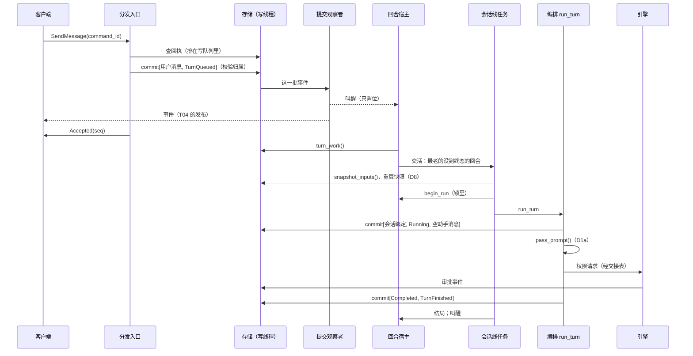

# T10a 对话闭环与接线：方案

- 任务卡：`docs/tasks/M1/T10a.md`
- 状态：**第 0a 节「不变量与义务表」第 3 轮通过（2026-11-13，`ad11791`，账上没有开着的 finding）；第 1～13 节是照表写的正文；正文交审前按 supervisor 的决定给表补了一行 D10（改动摘要与「搞定」章）。第 4 轮审正文与 D10，4/F-1～F-4 已关；第 5 轮 5/F-1～F-3 已关；第 6 轮 6/F-1 已关；第 7 轮 7/F-1 已关，7/F-2（改动前就有）照实写进 2.4、待产品负责人定修不修；第 8 轮 8/F-1 已改，并加了红灯对照的推演表（7.2a）。第 9 轮通过（`findings: []`），方案定稿；7/F-2（改动前就有）产品负责人 2026-11-13 定这次修，做成步 2b（2.4a）。定稿后的小改记在 0a.13 末尾，不重开审方案**。**第 0a 节是规范，正文是它的展开，两者有出入以第 0a 节为准。** 正文不另加表外的状态与等待点；写的时候发现要加的，列在第 10 节交 supervisor，没有自己加进去。
- 依据：需求第 12 章、附录 B（2026-11-12 的回合定义、0 档排队、D5）；技术设计第 4 节、6.4、9.0、10.4；T04 方案 2.4–2.11、第 11 节交接；T05 已合入的回合编排（`crates/iwork-core/src/turn/`）；T06 方案 2.6、5.2a、5.5、6.5、第 19 节；T07 方案 6.10.6–6.10.8；T09 方案第 3 节；T10e 方案第 0a 节、1.4、第 12 节；T10f 第一部分 A8、A9。
- 核过的代码（main `1097558`）：`iwork-core/src/turn/{runner,permission,binding,scheduler}.rs`、`iwork-core/src/approval/engine/{mod,external,sync}.rs`、`iwork-daemon/src/{daemon,boot,handler,work,stop,publish,source,supervisor}.rs`、`handler/lifecycle.rs`、`tasks/outbox.rs`、`iwork-ipc/src/server/{handler,connection}.rs`、`iwork-ports/src/{store,agent,read_model,notify}.rs`、`iwork-store/src/{writer.rs,projector/{mod,owner,turns}.rs}`、`iwork-domain/src/{turn,conversation,event}.rs`、`iwork-app/src/{admission,lifecycle,subscription}.rs`。和依据文档对不上的地方列在 0a.10。

## 0a 不变量与义务表

### 0a.1 这张表管什么，先定下的九件事

T10a 把已经各自合入的部件接成一条链路。部件自己的规矩（编排怎么提交、引擎怎么折叠、存储怎么组提交）都有了，缺的是**中间那一层**：谁受理命令、谁派发排着的回合、谁在删除和退出时把事情做完。T10e 前三轮的教训是这一层最容易出同一类问题：某件事挂在一个会消失的执行者身上。所以这张表照 T10e 第 0a 节的做法写，机制也是同一个，不另发明。

1. **受理函数只做「校验 + 一笔提交」，落盘才算受理。** ipc 在客户端断开时会在任何一个等待点中止受理函数（`connection.rs` 的 `lanes.abort_all()`），所以提交之后还要做的事一律不放在它的返回路径上。不走这条规矩的请求只有两种：`ReportPresence`（连接级，不是命令的效果）、`ShutdownDaemon`（第 E1 行）。
2. **回合宿主**：后台里一个常驻任务，管全部会话线；每个对话一条会话线，一个会话线任务拥有那条 `SessionLine`。宿主做什么只看两样：已提交的状态；自己的关闭状态（开着、完全退出、封口）。内存里另外只留两样：进程句柄（在 `SessionLine` 里）、每趟编排的结局。
3. **回合状态可以有两类写者，撞车由写线程裁决。** 编排在 `run_turn` 里写；没有编排在跑的回合（排着的、已中断的、编排出错留下的）由受理函数或宿主直接提交。存储现在不校验回合状态（`projector/mod.rs`：只有审批和卡片查状态前提），两类写者同时出手会把状态写乱。给 `TurnStateChanged` 加提交时校验（第 A4 行），和 T07 给审批、卡片加的是同一个机制（T02 方案 2.6）。
4. **一个对话里只看最老的那个没到终态的回合。** 它排着就派发，它中断了就等用户或等续接，它后面的都不动。0 档排队（需求附录 B）就是这一条。
5. **删除对话是宿主对账里的一支**，不另起任务、不调卡片宿主，照 T10e 0a.7 的四步走。
6. **事务之外的两件事走 T04 的 outbox**：删运行时的会话记录、发系统通知。条目和触发它的事件同一笔提交，进程没了由投递任务的对账接着做。
7. **宿主、会话线任务 panic 一律致命**，整进程退出交崩溃恢复，不在进程内补事实。和 T10e 对卡片宿主的取舍相同（产品负责人 2026-11-13 定，0a.11 P3）。
8. **退出的裁决和 T10e 第 13 行是同一个**，一次盖住回合和卡片两边（第 E1 行）。
9. **用户要「取消」「继续」是已提交的事实，不是内存里的信号**（第 1 轮 1/F-2、F-4、F-5 之后改的）。第 1 版把这两样放在内存里，三条 finding 从三个入口指到同一个缺口。现在加一种事件「回合意图」（取消、继续两个值），受理函数照样只是一笔提交；要不要给编排发取消、要不要续接，宿主从库里推出来（第 A5、D6、D7 行）。

### 0a.2 谁会「没了」，没了以后谁接手

| 执行者 | 什么时候会没 | 没了以后 |
| --- | --- | --- |
| 受理函数（ipc 的请求任务） | 客户端断开，在任何一个等待点被中止；停机第 1 步关门后等不完的 | 任何义务都不靠它活着。落了盘，照下表；没落盘，等于没发过 |
| 回合宿主的循环、每条会话线的任务 | panic、意外返回 | 致命（T04 2.10 登记 `turn-host`）：整进程退出、被重新拉起 → 第 R1 行。不在进程内重启，不补事实 |
| 一趟编排（`run_turn`） | 正常返回；返回错误（写不进存储、表外转换、停止记账超时）；被封口丢掉 | 返回值就是结局，交给宿主：错误收场的由第 D5 行补账；被封口丢掉的不记账，下次启动第 R1 行收 |
| 引擎追平任务（`engine-sync`） | panic、意外返回 | 可重启（T04 2.10）：它没有自己的状态，`sync()` 只看已提交的事件，可以随时丢弃（T07 6.10.8）。重起后第一件事是追平一次 |
| outbox 投递任务（T04 已有） | panic、意外返回 | 可重启，每次启动先对账停在「已派发」的条目（T04 2.11） |
| T04 的停机流程 | 卡住 | 15 秒硬上限强退 → 第 R1 行 |
| 后台进程 | 崩溃、被杀、致命退出、升级重启 | 下次启动的崩溃恢复（R 组） |
| 运行时进程（桥接、CLI） | 自己退出、被杀 | 编排收成 `Failed`（在取消的算 `Cancelled`），会话线丢掉这条会话，下一回合续接（T05 已有） |
| 客户端连接 | 断开、重连 | 连接级的状态（在看哪、上传到一半的分片）随连接清掉（第 S5 行）；已受理的命令不受影响；重连后续传或取快照（T03 已有） |
| 存储 | ① 失效 ② 回 `Busy` 或报错 ③ 线程活着却不返回 | ① `store-health` 致命 → R 组（已有）。② 受理函数回可重试的错误；宿主退避后重读重算。③ 没有现成的检测者，这是 T10e 的 K6，不在本卡解决：宿主的每次读、每笔提交套 `HOST_IO_LIMIT`（30 秒），到时记错误日志、当去向不明、下一轮重来；用户的出口是带确认的「完全退出」，这条路不读库（第 E1、E2 行） |

只在内存里、进程没了就丢的：进程句柄与会话线上记的旧树没清空；每趟编排的结局；这一趟的取消信号发没发过；同一个 `command_id` 正在受理的登记（A2）；连接报的在看哪；用户点通知记下的目标；宿主的关闭状态。丢了各是什么后果，写在用到它的那一行。用户点的「取消」「继续」不在这里面：它们是已提交的事件。

### 0a.3 义务表

「依据」一栏不特别注明的，都是**已经提交到库里的事实**。「归属还在」指对话有记录且是 `Active`、助手有记录，**按回合算**：看的是正在处理的那个回合自己的助手，不是对话里随便哪个回合的（项目对话里各回合的助手可以不同；定稿后补）；判断放在 `iwork-domain`，和审批的提交时校验 `owner_alive` 用同一组归属事实（`OwnerFacts`）。

**A 组：受理**

| # | 规则或义务 | 依据 | 谁负责 | 负责的人没了 | 时限 |
| --- | --- | --- | --- | --- | --- |
| A1 | 一条命令**受理的那一刻就是它那笔提交落盘的那一刻**；回执里的 seq 是这笔提交的 | 这笔提交 | 受理函数：取数、调 `iwork-app` 里的纯函数校验、一笔提交（会牵动审批或卡片的经 `engine.commit_with`，T07 6.10.8）、回执。**受理了就一定有这一笔**：这次什么都不用改的（比如取消一个已经结束的回合），也提交空的一笔把 `command_id` 记下，回执照样查得到 | 提交在途时被中止：那笔照样可能落盘，落了就是受理了，后面的事照下表由别人做；客户端没收到回执，带同一个 `command_id` 重发得到同一份回执（A2） | 一笔提交。`Busy` → 回 `UNAVAILABLE`、可重试，不在受理函数里重试 |
| A2 | 同一个 `command_id` **只生效一次**：顺序重发、两份同时到，拿到的都是同一份回执，不会一份成功一份报校验错误 | `commands` 表里记过的 `command_id` | 分发入口，两步（1/F-3）。① **同一个 `command_id` 一次只进一份**：进程里一张在途表，后到的那份等前一份离开（回完，或被中止）。② 轮到自己时**先查回执，这次查排在存储的写队列里**（0a.7），所以它看得到在它之前入队的每一笔，包括前一份被中止后还在路上的那一笔。查到 → 回 `replayed`，不进受理函数；没查到 → 校验、提交（存储自己再去重一次，已有）。校验失败才回错误，这时已经确定库里没有、路上也没有同一个 `command_id` 的结果 | 前一份被中止：它的登记随之放掉，后一份照第 ② 步查。在途表只在内存里，进程没了所有受理函数一起没了，不需要恢复 | 等前一份最多 10 秒，到时回 `UNAVAILABLE`、可重试。查回执是写队列的一个来回 |
| A3 | `SendMessage`：**用户消息和 `TurnQueued` 在同一笔提交里**；对话在删或已删、助手没了时这一笔进不去 | 提交那一刻对话与助手的记录 | 受理函数拼这一笔。存储的写线程校验「归属存续」：`TurnQueued` 加进要查归属的事件里（0a.7），不通过整笔拒绝，受理函数回 `CONVERSATION_DELETING` 或 `NOT_FOUND` | 同 A1 | 一笔提交 |
| A4 | 回合状态**不被两个写者写乱**；意图只落在它说的那种回合上 | 回合在库里现在的状态 | 存储的写线程，三条前提，判断函数都放 `iwork-domain`，真存储与假存储共用。① `TurnStateChanged`：库里现在的状态等于事件的 `from`，并且（`from` → `to`）是转换表里有的边。② 取消意图：回合是 `Running` 或 `WaitingApproval`。③ 继续意图：回合是 `Interrupted`。不通过整笔拒绝（`Projection`）。被拒的一方重读再定：受理函数照 A5 的表重算这一笔，最多 3 次，还不行回可重试的错误；编排按出错收场（T05 已有） | 写线程没了 = 存储失效 → 致命 | 提交那一刻 |
| A5 | 用户要取消、要继续，**落成事实**；一条命令管到哪些回合，在它那笔提交里定死（1/F-2、F-4） | 受理函数读到的回合状态；最后以写线程的裁决为准（A4） | 受理函数：照下面「回合命令各提交什么」的表拼出**一笔**提交。`CancelAll` 也是一笔：这个对话里每个没到终态的回合各出一份，合在一起，要么都落要么都不落；这一笔落盘时不在里面的回合（之后才受理的消息）不归它管。落盘之后发不发取消信号、续不续接，都不在受理函数里做。`CancelAll` 的截止点照实说：目标是受理函数**读到的**那些回合；读完之后、这一笔落盘之前别人新受理的回合不在这一笔里，不被取消 | 同 A1。落了盘：宿主照 D6、D7 接着做，客户端在不在都一样；进程没了，重启后事实还在，R 组接着 | 一笔提交；被 A4 拒了重算，最多 3 次 |
| A6 | 对话在删时**只收收尾命令**；宿主关了以后不再收会起新活的命令 | 对话的状态；宿主的关闭状态（内存） | 受理函数调 `admission::admit`（已有的 `DELETING_ALLOWED`）。宿主已是「完全退出」或「封口」时，`SendMessage`、`ResumeTurn` 提前回 `UNAVAILABLE`：这一处读内存只会多拒，不会多放 | 无关 | — |
| A7 | 不是命令效果的两种请求 | 内存 | `ReportPresence`：记在这条连接名下，不提交、不去重（重放一次只是把同一个值再写一遍）。`ShutdownDaemon`：第 E1 行 | 连接断开即清（S5） | 一次进锁 |

**回合命令各提交什么**（A5；状态以受理函数读到的为准，提交时再由 A4 裁决）

| 命令 | 回合的状态 | 这一笔提交里放什么 | 落盘之后是哪一行 |
| --- | --- | --- | --- |
| `SendMessage` | — | 用户消息、`TurnQueued`（A3） | D1 |
| `CancelTurn` | `Queued`（0 档的「撤回」） | `Queued` → `Cancelled`、`TurnFinished` | 没有后续 |
| | `Running`、`WaitingApproval` | 取消意图 | D6 |
| | `Cancelling`、终态 | 空的一笔（要的结果已经有了，或正在发生） | 没有后续 |
| | `Interrupted` | 不受理：回「回合已中断，用『放弃』」 | — |
| `CancelAll` | 这个对话里每个没到终态的回合 | 上面 `Queued`、`Running`、`WaitingApproval` 三种各出一份，合成一笔；`Interrupted`、`Cancelling` 的不动 | D6 |
| `ResumeTurn` | `Interrupted` | 继续意图 | D7 |
| | 别的 | 不受理：回「回合不在已中断」 | — |
| `AbandonTurn` | `Interrupted` | `Interrupted` → `Cancelled`、`TurnFinished`，经 `engine.commit_with(Scope::VoidTurn)`（它名下的待审批与放行一起作废） | 没有后续 |

一个意图管的是**它落盘时回合所在的那一段**，不会作用到以后的一趟（1/F-2）：取消意图只对「起点 seq 比它小」的那一趟编排有效，回合后来中断、又被续接，新一趟的起点比它大，旧意图不再算数；继续意图只对「seq 比它小」的那一次中断有效，回合再次中断后要用户重新点。一趟的起点是回合最近一次从 `Queued` 或 `Interrupted` 进到 `Running` 的那笔提交，投影记着它（0a.7）。

两种意图**都不跨后台的重启**（2/F-2）：取消意图跟着它那一趟编排，进程没了那一趟也没了；继续意图只在落盘它的这一次后台运行里有效，后台退出或崩溃之后不再算数，回合留在已中断，卡片还在，用户照那时的状态再点（D7、R7）。这和 supervisor 给客户端定的口径是同一个：「取消」「继续」是按点击那一刻的状态发的。

别的命令（`MarkRead`、`CreateConversation`、`RenameConversation`、`SetConversationModel`、`DecideApproval`、`SetApprovalMode`、`RevokeRule`、设置类）都只是 A1 那一笔，落盘之后没有要接着做的事；`DecideApproval` 批准后要不要续接，由宿主从引擎的折叠里读（D7），受理函数不管。

**D 组：派发、取消、续接、补账**

| # | 规则或义务 | 依据 | 谁负责 | 负责的人没了 | 时限 |
| --- | --- | --- | --- | --- | --- |
| D1 | **派发**排到的回合 | 归属还在；这个对话最老的没到终态的回合是 `Queued`。内存三样：宿主开着；这条会话线空着；**这条线的趟数和宿主读库之前记下的一样**（D3） | 宿主对账：把回合交给这个对话的会话线任务，**交活那一下就把这条线记成占着**（D3）。任务：读一次库拼好回合计划（D8）→ 过**派发边界** `begin_run`（宿主的锁里：宿主开着、这个对话没被叫停；过了就把这一趟记成「已过边界」）→ `run_turn`。**过了边界的那一趟从这一刻起接得住取消**（1/F-5）：取消信号到得比交接表早也不丢，到了以后这一趟不再交出 prompt（D1a） | 宿主或任务 panic → 致命 → R1、R4 | 唤醒：有关的事件一落盘就叫醒宿主（0a.6）；保底每 30 秒对一次账。拼计划的读 30 秒。`run_turn` 不设时限（回合本身，随时可以取消） |
| D1a | 取消到了以后，这一趟**不再交出 prompt**（2/F-1） | 内存：这一趟的取消标记。取消信号在交接表的锁里置位；交接表还没建时先记在 `TurnSlot` 上，建表时带上。**取消带着趟的记号（这条线上的第几趟），交接表与记着的早到取消都只认同一趟的**：给上一趟的取消到晚了，不会落到同一个回合的下一趟上（定稿后补，2.4） | 编排（`iwork-core`，改动见 0a.7）。每次把 prompt 交给运行时之前（第一次发、沿用的进程已退出重开后再发，共两处）过同一个**裁决点**：在交接表的锁里看取消标记，已置位 → 不交出，照下面收尾；没置位 → 发。裁决只看取消标记这一样，锁里的这一次读就定了先后，不另记「已交出」（定稿后删：上一稿写的这个标记没有任何地方读它，步 2 的实现没加，reviewer 核过）。所以只有两种先后：取消先到，这一趟没有 prompt；裁决先过，prompt 已经在路上，取消照在跑的回合处理（D6）。开头、开完会话、读完摘要、提交完第一笔之后各另看一次，只为少做无用功（不起进程、不提交 `Running`）；**保证靠的是最后那个裁决点**。看到取消时怎么收尾，照这一趟自己已经提交到哪：① 新回合，第一笔还没提交 → 提交 `Queued` → `Cancelled` 与 `TurnFinished`；② 第一笔已经提交（库里是 `Running`，prompt 没发）→ 提交 `Cancelling`、`Cancelled`、`TurnFinished`，空的助手消息照取消的回合收尾；③ 续接的回合，第一笔还没提交 → 不提交，原样返回 `Interrupted`（它的继续意图什么时候失效见 D7、R7） | 编排出错 → D5。进程没了 → R 组 | 裁决在锁里，没有等待点 |
| D2 | **prompt 不重发** | 回合是 `Queued` 就一定没发过 prompt | 编排（T05 已有）：开会话 → 一笔提交 [会话绑定、进 `Running`、空的助手消息] → 才发 prompt。宿主只对 `Queued` 的回合用 `TurnEntry::New` | 第一笔提交之前进程没了：回合还是 `Queued`，R4 重新派发，安全。第一笔提交之后、prompt 之前没了：回合已是 `Running`，R1 记成已中断 | — |
| D3 | 一个对话**同一时刻至多一趟、至多一棵运行时进程树**；**一趟从宿主交活那一刻算起**，到任务报回结局为止，准备、换线、编排、清理都在里面（4/F-1、F-2） | 内存：会话线表（一把锁，一个对话一项）。每一项记着：这条线占着没有、占着它的那一趟是什么活、过没过派发边界；还有一个只增的**趟数**，每一趟结束加一 | 宿主：一个对话只建一条会话线，续接用同一条（T06 2.6 第 4 条）。**交活和记占着是锁里的同一下**，占着的线不再交第二份活，所以同一份续接不会被两次唤醒排进去两次；任务手里任何时候只有一份活，没有排队。**交活的依据不能比这条线上一趟的结束更旧**：宿主每轮对账读库之前先在锁里记下每条线的趟数，读完要交活时趟数变了（这期间有一趟结束了，库里的状态可能已经不是读到的那样），这一轮不给这条线交活，立刻再对一轮。`run_turn` 拿 `&mut SessionLine`。换会话快照时先把旧线收干净再建新线（D8a）。旧树没清空时 `SessionLine` 自己不开新会话（T06 4.2a） | 致命 → 句柄随进程丢，旧树由桥接读到 stdin 结束后自己清（T04 已知限制 L6） | `retire()` 由适配器清树的时限管（T05 的进程监管；T06 5.4a 落实后是它定的次序） |
| D3a | 会话线**接着这个对话最后那条运行时会话说**，不看要派发的那个回合自己有没有编号（1/F-6） | 这个对话全部 `TurnSessionBound` 事件里 seq 最大的那一条的会话编号（已终态的回合也算；续接失败又退回旧编号时补记的那一条是最后一条，取到的就是旧编号） | 会话线任务：每次新建 `SessionLine`（重启后第一次用、D8 换线）都用这一个查询的结果当续接编号；一条都没有才新开。换线时这个查询排在 D8a 之后：旧线没补完的绑定回退先落盘，查到的才是对的。运行时的记录用不了时由编排用摘要新开（T06 5.2a，已有） | 致命 → 重启后照同一个查询重建 | 一次读，30 秒 |
| D4 | 每一趟**都留下结局** | —（它产出内存里的事实） | 会话线任务：一趟的返回值就是结局，三种：`NotStarted(原因)`（准备没做成、过不了派发边界，什么都没提交）、`Ended(状态)`、`Broke(错误)`（后两种是 `run_turn` 的返回值）。返回后在宿主的锁里一下做完：结局写进这条线、线标成空着、趟数加一；然后叫醒宿主 | 任务 panic → 致命 → R1 | — |
| D5 | **补账**：编排以错误收场，库里的回合还占着进程，把它收掉 | 回合在库里是 `Running`、`WaitingApproval` 或 `Cancelling`；内存：本进程里它的那趟编排已经以 `Broke` 结束 | 宿主对账，经 `engine.commit_with(Scope::VoidTurn)` 一笔提交欠的事件：`Cancelling` → `Cancelled`；另两种 → `Failed`（D6 的依据成立、也就是这一趟被要求过取消的 → 先 `Cancelling` 再 `Cancelled`），带 `TurnFinished`，还在流式中的助手消息一并收尾。算欠什么是纯函数，规则与崩溃恢复同一张表（T04 2.5），只是触发不同 | 致命 → R1：回合记成已中断，可继续 | 成功、`Busy`、被 A4 拒、别的错误都是同一个做法：重读库里的状态、重算、再记。`Busy` 100 毫秒起翻倍、封顶 5 秒、不设次数上限。读或提交 30 秒没返回：记错误日志，下一轮重来 |
| D5a | 编排以错误收场而库里**还是 `Queued`**（第一笔没写进去）：再派 | 回合 `Queued`；内存：上一趟 `Broke` | 宿主对账：退避后照 D1 再派。prompt 没发过（D2）。续接的同理：库里还是 `Interrupted`、D7 的依据还在，退避后再续 | 同 D1 | 退避 1 秒起翻倍、封顶 60 秒：每次都要起一次 CLI，不能转得太快 |
| D6 | 要取消的那一趟编排**一定收得到取消** | 三样之一：① 回合占着进程，并且有一条取消意图，seq 比这一趟的起点大（A5）；② 对话在删（X2）；③ 宿主已是「完全退出」（E2，内存）。内存：这个回合在本进程里有一趟过了派发边界、还没结束，这一趟还没发过取消 | 宿主对账：在锁里给这一趟发取消信号（`TurnCanceller`），线上记「发过了」。**这一下必须在宿主的锁里同步调用，不许挪到锁外，不许改成异步发送**（定稿后补，2.4「早到的取消认趟」末条说为什么；完全退出发的取消同样）。信号什么时候到都算数：交接表还没建好（任务刚过 `begin_run`）先记着；这一趟还没交出 prompt，由 D1a 的裁决点拦下、照那里收尾；已经交出了，就是编排现有的路（T05、T06）：提交 `Cancelling`（带待审批的作废）→ 停止受理权限请求 → 请运行时停下 → 进程结束后提交 `Cancelled`。回合正好结束了，信号落空，什么都不做 | 编排出错 → D5（照同一个依据记成 `Cancelled`）。进程没了 → R1：已是 `Cancelling` 的记 `Cancelled`，还没来得及的记成已中断；那条取消意图比以后任何一趟的起点都小，不会再生效 | 对账一轮；编排的 `STOP_LIMIT` 5 秒；适配器清树的时限 |
| D6a | 取消**排着的**回合、**放弃**已中断的回合，和派发、续接**不打架** | 回合 `Queued` / `Interrupted` | 受理函数那一笔（A5 的表）。和编排的第一笔撞车由 A4 裁决（G1） | 同 A1 | 一笔提交 |
| D7 | **续接**已中断的回合 | 回合是这个对话最老的没到终态的回合，状态 `Interrupted`。再加两种之一：① 引擎折叠里的 `turns_to_resume()`（中断时批准已落盘、还没交付，T07 的 R1），**并且那条批准是这次后台运行里落盘的**（它的 seq 比宿主这次启动时读到的 head 大；产品负责人 2026-11-13 定，0a.10 第 17 条）；② 有一条继续意图，seq 比这次中断的 seq 大，**并且比宿主这次启动时读到的 head 大**（A5；宿主起来时读一次 head 记在内存里，每次启动重新读） | 宿主对账：交给会话线任务，`TurnEntry::Resume`。用 ① 之前先让引擎追到宿主这一轮读到的 head（`engine.catch_up()`，5 秒）；追不上这一轮就不用 ①，等 `engine-sync` 追平后的叫醒（没追平的折叠会把已经用掉的放行当成还在）。续接说明用 `resume_note`；这一轮的请求用和新回合**同一个**「用户消息 → 输入块」的函数转好填进去，转不出来填 `Unavailable(原因)`（T06 5.2a） | ①、② 都不跨重启：后台没了，上一次运行里的批准不再让回合自己续接（R6），上一次运行里的继续意图也不再算数（R7）；回合还是已中断，卡片还在，用户点「继续」之后那条批准留下的一次性放行照样用得上，不用再批一遍。所以续接的那一趟在提交第一笔之前被取消、原样返回（D1a ③），正常退出再打开也不会自己跑起来（2/F-2） | 同 D1 |
| D8 | 审批用的会话快照和交给运行时的**是同一份**，并且**每个回合开始前都重算**：清单删了一条、受保护的路径被改成了链接，下一个回合就按新的来（1/F-1） | 已提交的安全清单与设置；重算那一刻磁盘上的路径 | 会话线任务，新回合、续接都算，每次 `run_turn` 之前：在一个读事务里读已提交的清单与设置，调 `rule_paths_for`（现解析路径）+ `snapshot_for` 重算一份（构造 `EnvPaths` 的函数只有一个，T10e 1.4 的 A3）。和这条线绑着的那份比（记审计用的 `lists_seq` 不比，别的逐项比）：一样 → 沿用这条线；不一样 → 先照 D8a 把旧线收干净，再照 D3a 建新线和新的判定方，同一份新快照给 `SessionSpec` 和 `SessionKeys`（T06 2.6 第 8 条）。**不拿引擎折叠里的序号当「不用重读」的依据**：它可能还没追平，磁盘上的变化它也看不到 | 致命 → 重启后会话线都是新建的，照样重算 | 一次读加几次路径解析，30 秒。读不出来：这个回合不开始，退避后再来 |
| D8a | 丢掉一条会话线之前，**它身上还没落盘、还没清掉的东西先了结**（2/F-3） | 内存：`SessionLine` 上只有它自己知道的两样——用摘要新开的会话没被收下、要补记回旧编号的那一笔还没补上（T06 5.2a，`unconfirmed`）；旧进程树还没确认清空（`unclean`） | 会话线任务，丢线只有三处（D8 换快照、X3 删除对话、E3 封口），前两处照同一个次序：① 让这条线把绑定回退补完（`SessionLine` 公开一个入口，就是 `run_turn` 开头已有的那一步，0a.7）；② `retire()` 确认进程树清空；③ 两样都成了才丢掉这条线、才去查最后一条绑定建新线。①、② 有一样没成（存储忙、树清不掉）：**旧线留着不换**，这个回合不开始，退避后再来——这时库里最后一条绑定还是那条没被收下的新编号，不能拿它建新线。E3 封口不提交任何东西（①、② 正做到一半时封口：这一趟的 future 被丢掉，补记那一笔要是还没发起，带闸的存储不让它发起，E4），这两样随进程一起丢，是 T06 原有的崩溃窗口 | 致命 → 同 E3：没补上的回退丢了，重启后 D3a 取到的是那条新编号（T06 5.2a 原有的窗口，不是换线带来的） | ① 一笔提交，`Busy` 退避 100 毫秒起翻倍、封顶 5 秒，不设次数上限；② 适配器清树的时限 |
| D10 | 回合正常结束时**带上改动摘要与「搞定」章**；读不出来**不挡回合收尾**，只是不盖章（需求 FR22、技术设计 9.7 第 2 条；supervisor 2026-11-13 定归本卡，正文交审前补的一行） | 不是库里的事实，是磁盘上工作副本的状态：回合开始前拍一份、收尾时再拍一份。每一份记的是「相对开始时那条基线有改动的文件」各自**此刻的版本**：种类与执行位（普通文件、可执行文件、链接、子模块引用）加内容的散列（链接是目标文字，子模块是检出的提交）；路径上没有东西记「不在」；读不了、太大不读全的记「不知道」。**这个版本由版本控制的端口给出，后台自己不按工作区的路径读文件**（6/F-1）：git 实现里读工作区一侧的那段代码已经走 `iwork-rootfs` 的逐级检查（任何一级目录是链接都不跟过去，ADR-0010），并且已经认类型、执行位、链接、子模块，探针复用它，不另写一套。上级目录被换成链接的路径，照版本控制自己的口径算「不在」，不读链接那一头。**不拿给人看的补丁文字比**（4/F-4），**也不只比字节**（5/F-3）。两份里指纹不一样的文件就是这一趟期间变了的；有一头是「不知道」的也算变了。内存：开始那一份记在这一趟自己的探针里，随 `TurnPlan` 交给编排；另有一个全后台共用的**在途读数上限**（见时限栏） | 会话线任务：过 `begin_run` 之前拍开始那一份（和 D8 的重算在同一段；项目不受版本控制、或这一份拍不出来 → 这一趟没有探针）。编排：回合以 `Completed` 收尾、提交之前问探针一次，限时；有结果就和 `Completed`、`TurnFinished` 放进**同一笔**，`celebrate` = 这一趟期间有文件变了。别的结局（取消、失败、中断）不问。读版本控制在阻塞线程里跑，它出错、panic 都只算「没有摘要」 | 探针出错、panic、到时：回合照常以 `Completed` 收尾，`change_summary` 为空、不盖章，记一条 `warn` 日志点名回合。编排在等探针时被封口丢掉：这笔 `Completed` 没提交，R1 把回合记成已中断（和封口撞上任何一笔收尾提交是同一种）。会话线任务 panic → 致命。进程没了：开始那一份丢了；续接的那一趟重新拍，所以续接的回合只算续接之后的变化 | 开始那一份 5 秒，收尾那一份 2 秒。到时放手：等的人走了，那次读自己跑完，结果丢掉。**放手不等于没人管**（4/F-3）：拍改动的读全后台同时最多 2 个在跑；每个读占一个额度，额度由那次读自己拿着，**到它真的结束才还**，不是等的人放手时还。额度满了，新来的不排队、不等，这一趟直接没有摘要。所以文件系统卡住时至多 2 个读挂着，之后的回合照常跑、都不带摘要，直到后台重启。停机不等这些读：封口时等它的那一趟被丢掉，挂着的读随进程退出结束，卡在内核里的由 T04 的 15 秒硬上限强退 |
| D9 | 引擎**追得上**已提交的事件：等着的 hook 得到答复，孤儿审批被清掉 | 已提交的事件 | 提交观察者里只叫醒（不读写存储、不碰引擎的锁）；`engine-sync` 任务调 `engine.sync()`，完了叫醒宿主（D7 ① 要读它的结果）。照 T07 6.10.8 的接线，一字不改 | 任务可重启；出错、到时都不自己重试，下一笔提交再叫醒；没清完的孤儿留到下一次 `commit_with` 或重启（T07 已定） | `ENGINE_SYNC_LIMIT` 5 秒 |

**X 组：删除对话**（T10e 0a.7 的四步；技术设计 9.0）

| # | 规则或义务 | 依据 | 谁负责 | 负责的人没了 | 时限 |
| --- | --- | --- | --- | --- | --- |
| X1 | **先落删除意图** | — | `DeleteConversation` 的受理函数：`engine.commit_with(Scope::ConversationDeleting)`，一笔提交把对话置成 `Deleting`，引擎附带作废待审批与待执行的卡片。重发幂等（`DELETING_ALLOWED`）。从这一笔起 A3 的校验挡住新回合，引擎挡住新的权限请求 | 同 A1 | 一笔提交 |
| X2 | 对话在删，**回合都收掉** | 对话 `Deleting`；名下每个没到终态的回合 | 宿主对账：不再派发、不再续接；在跑的发取消信号（D6）；排着的、已中断的由宿主提交 `Cancelled`（D6a 的同一个纯函数）；编排出错留下的走 D5 | 致命 → R5 | 对账一轮 |
| X3 | 回合都到终态之后，**会话线关掉** | 对话 `Deleting`，名下回合都到终态；内存：这条线空着 | 宿主对账：给这条线交一份「收线」的活（和回合一样是一趟：占着这条线、在封口的裁决下，D3、E3）。任务照 D8a 的次序把线收干净（补完绑定回退、`retire()` 确认进程树清空），报回结局；成了，宿主摘掉这一项。有一样没成：线留着、记错误日志，下一轮再交；收干净之前不往下走 | 致命 → 进程没了，线也没了 | 适配器清树的时限；之后每轮对账再试 |
| X4 | **最后才删记录**，并把要删的会话编号交出去 | 对话 `Deleting`；名下回合都到终态；卡片都到终态（结果未知不算）；内存：X3 做完了 | 宿主对账：从这条对话各回合的全部 `TurnSessionBound` 事件里取齐会话编号（含 `replaced` 里的旧编号），一笔提交 [`ConversationDeleted`] 加一条 outbox 条目（去向「删会话记录」，载荷是这些编号）；这一笔的 `command_id` 由对话编号算出，重复提交只会得到 `replayed`。卡片还没完时这一笔被 T10e 的 `check_cascade` 拒掉，接着等，不做别的 | 致命 → R5：`Deleting` 是已提交的，重启后宿主从头对这笔账 | 对账一轮；被拒后等下一次唤醒（卡片事件落盘会叫醒，0a.6） |
| X5 | 回合没到终态，**它的记录不被级联删掉** | 被级联的对话名下回合的状态 | 存储的写线程：`check_cascade` 加回合这一半（T10e 第 14 行管卡片那一半，同一个函数）。宿主或 T10b 的删除流程来早了，结果是被拒，不是一趟还在跑的编排脚下没了记录 | 写线程没了 = 存储失效 | 提交那一刻 |
| X6 | **删运行时的会话记录**，删不掉留下审计 | outbox 里那一条（和 `ConversationDeleted` 同一笔落盘） | outbox 投递任务，新去向一行：调 `AgentPort::forget_sessions(编号)`。`Deleted`、`NotFound` 不记；`Refused`、`Failed` 一笔提交写一条审计（会话编号、原因，0a.7），投递算成功，不重投。结果不确定（超时、投递时进程没了）→ 重投：按编号删是幂等的 | 投递任务可重启、启动先对账；进程没了下次启动接着投（T04 2.11） | 单次 30 秒；最多 3 次，用完标失败并记错误日志，残留按需求第 9 章的已知限制 |

删除命令在 X1 落盘时就回执成功。X6 失败不改变这个结果（任务卡验收 7）。

**E 组：退出与停机**

| # | 规则或义务 | 依据 | 谁负责 | 负责的人没了 | 时限 |
| --- | --- | --- | --- | --- | --- |
| E1 | 退出前**问不问**；问完到关闭之间**不再起新的** | 问不问：库里占着进程的回合数、排着的回合数（P2 a：退出会把它们取消，所以也要问）与在途卡片数，合起来是 N（读不出来算「不知道」，不算 0）。关不关：内存里已经过了派发边界、还没空下来的会话线数，加上卡片宿主那边已经越界的项数，合起来是 L | `ShutdownDaemon` 的受理函数。带了确认：不读库。没带确认：读 N，`QUIT_COUNT_LIMIT` 2 秒。然后 `try_quit`：**先后拿回合宿主、卡片宿主两把锁，中间没有等待点**，数出 L；没确认且（N 不为零、N 不知道、L 不为零）→ 回「要确认」带数目，两个宿主都不关；否则两个宿主一起置成「完全退出」并触发停机。这就是 T10e 第 13 行，范围扩到两边 | 受理函数在读 N 时被中止：等于没发，宿主没关。`try_quit` 里没有等待点 | 没确认：读最多 2 秒加一次进锁。已确认：一次进锁 |
| E2 | 完全退出：**在跑的都走取消，排着没开始的一起取消**（P2 a，产品负责人 2026-11-13 定） | 宿主已是「完全退出」（内存）；停机第 2 步 `cancel_all`。排着的那一半：库里 `Queued` 的回合 | 宿主，三件事。① 照会话线表给每一趟过了派发边界的编排发取消信号（D6 ③），**不读库**，存储卡住也发得出；信号发出之后，还没交出 prompt 的那一趟不会再交出（D1a，1/F-5、2/F-1），不管它这时停在建交接表之前、开会话里、读摘要里还是第一笔提交里。② `begin_run` 从关的那一刻起一律被拒。③ 读一次库，把每个对话里还 `Queued` 的回合提交成 `Cancelled`（带 `TurnFinished`），一个对话一笔；已经交给会话线、过了边界的那一个由 ① 管，不在这里提交；用户消息和回合都留在对话里，重开后看得到。然后等各条线空下来 | 停机流程卡住 → 15 秒强退 → R1（`Cancelling` 的记 `Cancelled`，别的记已中断）。③ 的读或提交没做成（存储卡住、一直忙、5 秒到了）：那些回合留在 `Queued`，下次启动会被派发（R4）。① 里被取消的那一趟 5 秒内没收完尾（卡在开会话里、提交记不下）：封口把它丢掉，第一笔没提交的留在 `Queued`、同样下次启动被派发，提交过的由 R1 记成已中断。这两种是 P2 a 守不住的一角，记成已知限制 KA1（0a.11） | 停机第 2 步的 5 秒。到时返回还剩几条，不当成停完 |
| E3 | 封口（信号、升级、故障，以及完全退出剩下的）：**不再开会话，进程树清掉，不写回合状态** | 停机第 3 步 `abort_all` | 宿主置「封口」，`begin_run` 一律被拒。每个会话线任务：**先丢掉手上这一整趟的 future**——不只是 `run_turn`，准备里的读、换线里的补账与清树、删除对话的清理都在这一个 future 里（D3），封口一到它在下一个等待点就不再被推进，交接表随之撤掉、编排停下；再 `retire()` 清树并核对，结果填 `AbortReport`。清树不等准备里那次没回来的读（4/F-2）。次序不能反：先关会话的话编排会把它当成运行时意外退出，记 `Failed`、作废待审批（T04 第 11 节硬约束一） | 同 E2 | 3 秒。到时照实报没清空的条数（L6） |
| E4 | 封口之后**没有新入队的提交**，全后台都算（5/F-1） | 封口闸的状态（内存，一把小锁里的一个布尔值） | **闸放在存储端口上，不放在各个调用点上。** 后台组装时把存储包一层带闸的，对外只给出这一个；它的 `commit` 在闸的锁里做两件事：看封没封口，没封就**在同一个临界区里调真存储的 `commit`**（那一下同步入队，`store.rs:338–342` → `writer.rs:166–170`），然后出锁、在锁外等回执；封了就不入队，回 `Busy`（明确没写）。`abort_all` 置封口用的是同一把锁。所以每一笔提交和封口只有两种先后：先入队，封口后到，这一笔照常落盘；封口先到，这一笔入不了队。哪些路径会提交、各在哪一下入队，列在下面「提交路径」的表里，**每一条的入队点都是这同一个 `commit`**。宿主对账里发取消信号、交活之前另在自己的锁里看一眼封没封口（那两样不是提交） | — | 临界区里只有一次不等待的入队 |

**提交路径：谁发起，在哪一下入队**（E4；supervisor 要求逐条列全。「入队」都指真存储的 `commit` 被调用的那一下）

| # | 路径 | 入队之前有没有等待 | 入队在哪 | 封口后 |
| --- | --- | --- | --- | --- |
| 1 | 受理函数直接提交（`SendMessage`、撤回、意图、设置类） | 没有：拼好就调 | 受理函数调 `commit` | 入不了，回 `UNAVAILABLE`、可重试（关门后晚到的本来就是这个答复） |
| 2 | 受理函数经引擎（`DecideApproval`、`SetApprovalMode`、`AbandonTurn` 与 `DeleteConversation` 的 `commit_with`） | **有**：引擎先追平、拿对话的令牌（上一位去向不明时这里还有一笔屏障的空提交）、再追平、算计划（`external.rs:132–168`） | 引擎里调 `commit` 的那一下（`sync.rs:104`）；之后清孤儿可能再有几笔 | 屏障、正文、清孤儿每一笔各自过闸，入不了 |
| 3 | 编排在 `run_turn` 里的每一笔 | 没有 | 编排调 `commit` | 入不了；这一趟本来也已经被丢掉（E3） |
| 4 | 权限请求的路径：适配器的任务里，引擎记审批的建立、求值、审查 | 有（引擎的追平与令牌） | 同第 2 条 | 入不了；引擎照现有的「记不下就拒绝」答拒绝（T07 的 `MSG_STORAGE_FAILED`），失败即关闭 |
| 5 | 补记绑定回退（`SessionLine::settle`） | 有：先等清树 | `settle` 里调 `commit` | 入不了 |
| 6 | 宿主直接提交（删除时取消排着的回合、退出时取消排着的回合、删除的最后一笔） | 没有 | 宿主调 `commit` | 入不了 |
| 7 | 宿主经引擎（D5 补账、删除时放弃已中断的回合） | **有**，同第 2 条 | 同第 2 条 | 入不了。**被放手的那一种也一样**（0a.8 表下）：等的人到时走了，小任务还拿着这个 `commit_with`，它之后走到入队那一下照样过闸 |
| 8 | `engine-sync` 的清孤儿、`notify` 的决定、outbox 投递里写的审计 | 清孤儿有，另两种没有 | 各自调 `commit` | 入不了；这三个任务随后由停机第 4 步停掉 |
| 9 | 启动时的崩溃恢复与引擎的恢复计划 | — | `bind` 之前 | 不相干：那时还没有封口 |

封口前已经入队的那一笔不撤，可能在封口后落盘，它记的是封口前就成立的事实；**封口后还留着的只有「等已入队那一笔的回执」这一种等待**。读不过闸。
| E5 | 关门后**晚到的命令起不了新活** | 停机第 1 步关门；宿主的关闭状态 | T04 的 `Gate`（已有）加 A6：进了门、提交也落了盘的 `SendMessage`，宿主已关就不派发；它之后的去处分三种，写在 G6 | — | 关门等 1 秒 |

**R 组：崩溃恢复与启动**

| # | 规则或义务 | 依据 | 谁负责 | 负责的人没了 | 时限 |
| --- | --- | --- | --- | --- | --- |
| R1 | 进程没了，**占着进程的回合都有交代** | 启动时库里 `Running`、`WaitingApproval`、`Cancelling` 的回合，流式中的消息 | T04 启动表第 8 步（已有）：前两种 → 已中断（可继续），`Cancelling` → `Cancelled`，消息按检查点收尾；待审批保留 | 恢复中途又崩：事务没提交，下次从头来 | 接受连接之前 |
| R2 | 引擎**在接受连接之前**折叠到位，恢复计划落盘 | 全部已提交的事件 | 启动表第 9 步的参与方：`ApprovalEngine::start`，把它返回的恢复计划一笔提交。读到不认识的事件种类原样传上去，按退出码 12 处理，不包成别的错误（T04 S8、PD6） | 启动失败，进程按退出码表退出 | 启动期间，不设时限 |
| R3 | 宿主起来时**库里没有占着进程的回合** | 库 | 宿主在第 9 步、R1 与 R2 之后构造，先查一次；有就是启动顺序排错了，启动失败并点名 | — | — |
| R4 | 重启前排着的回合**照常派发，接着原来的会话说** | 回合 `Queued`（D2：一定没发过 prompt）；这个对话最后一条会话绑定（D3a） | 宿主对账（D1），在第 11 步任务都起来之后。会话线是新建的，续接编号照 D3a 取这个对话最后一条绑定的，不看这个回合自己有没有（它没跑过，一定没有）。用户完全退出后正常不会有排着的回合（E2）；崩溃、升级、信号之后有 | 同 D1 | 同 D1 |
| R5 | 删到一半的对话**接着删完** | 对话 `Deleting` | 宿主对账（X2–X4）；outbox 条目由投递任务对账（X6） | — | — |
| R6 | 上一次运行里批准了、还没续接后台就没了的回合，**重启后不自己续接**；那条批准不丢（产品负责人 2026-11-13 定：和「继续」不跨重启一致；原来这一行写的是「自动续接」） | 引擎折叠（R2）里这个回合名下一次性放行的批准 seq，都不大于宿主这次启动时读到的 head | 宿主对账（D7 ①）：只认批准的 seq 比启动时的 head 大的。回合留在已中断，「继续 / 放弃」卡片还在；用户点了「继续」，续接后同一次调用命中那条一次性放行（T07 6.2，放行跨重启还在）。重启之后用户才批准的（seq 比启动时的 head 大），照常自动续接 | — | 启动时一次读（和 R7 用的是同一个 head） |
| R8 | 后台起来以后**库里一定有内置助手 iWork**，项目对话的回合才有助手可交（需求第 3 章、FR04、AC21；定稿后补，组 B 的 developer 核出全仓没有生产代码登记它） | 库里有没有 `builtin` 为真的助手 | 启动表第 9 步的参与方（2.8 第 1a 步）：没有就以系统身份提交一笔 `AssistantCreated`，助手编号是固定的、这一笔的 `command_id` 由它算出；已经有了（包括用户改过的）什么都不做，不覆盖 | 启动中途死掉：这一笔没落盘，下次启动再查、再提交；落了盘，下次查到就不动。重复启动、重复提交都只会得到 `replayed` 或主键冲突，建不出两个。单实例锁保证同一时刻只有一个后台在做这件事 | `bind` 之前；一次读加至多一笔提交 |
| R7 | 重启之前用户点过、还没生效的「继续」**不自己生效**（2/F-2） | 继续意图的 seq 不大于宿主这次启动时读到的 head | 宿主：启动时读一次 head 记下；D7 ② 只认比它大的继续意图。回合留在已中断，「继续 / 放弃」卡片还在 | — | 启动时一次读 |

**Q 组：查询** 与 **S 组：订阅**

| # | 规则或义务 | 依据 | 谁负责 | 负责的人没了 | 时限 |
| --- | --- | --- | --- | --- | --- |
| Q1 | 查询结果**对得上事件流里的一个位置** | 一个读事务看到的 head | 查询的受理函数：视图类查询在**一个读事务**里取完，`seq` 填这个事务看到的 head（T03 的契约）；翻页的几种取法（T09 G10、G11）都在这一个事务里算 | 被中止：只读，没有要收尾的东西 | 交接里的查询由 ipc 的 10 秒管（T03 已有），到时 ipc 关连接，客户端重连 |
| Q2 | 查询**不产生副作用**，中止、重发、乱序到达都没事 | — | 查询的受理函数不提交、不改内存。例外只有 `GetOpenTarget`（读连接级的内存，S5） | — | — |
| S1 | 订阅的快照**是一个时刻的**：各部分同一个 head | 一个读事务 | `SnapshotProvider`（T04 留的接缝）：全部活动范围的快照查询在一个读事务里跑，和 Q1 走同一组查询函数，不另写一套 | 取不出来：ipc 关这条连接，客户端重连续传（T03 已有） | ipc 的 10 秒 |
| S2 | **快照加上它之后的事件，等于直接看最新状态**：界面要画的每一种行、侧栏上的每个值，查询都重建得出来（T09 第 3 节的规则） | 投影与事件 | T10a 填 T09 交过来的字段与查询（G2–G5、G10、G11、`Turn.project_content`）；事件的路由只有 `routes_for` 一处（已有）。守它的是对拍：同一份场景上真后台与假后台逐项相等（任务卡验收 5） | — | — |
| S3 | 流式增量**丢了也不缺字** | 检查点与 `MessageCompleted` 里的正文 | 已有（T04 2.6 的 `LiveDeltas`、编排每 500 毫秒的检查点）。T10a 只接线，并处理 T09 的 G6（侧栏用不着增量，怎么不给它发由正文定） | 断线期间的增量不补，重连后的快照带着到检查点为止的正文 | — |
| S4 | 每条已提交的事件**按 seq 发布一次** | 提交顺序 | 已有（T04 的 `PublishObserver`）。同一个观察者里 T10a 加三行叫醒（引擎、回合宿主、通知），都只置位，不读写存储 | 发布断了由 `publish-check` 致命退出（已有） | — |
| S5 | 连接级的状态**随连接清掉** | 连接还在不在 | `connection_closed`：清这条连接报的在看哪、没传完的分片、它点通知记下的目标 | ipc 保证任何原因断开都调（T03 已有） | — |

**N 组：系统通知**（任务卡范围 4）

| # | 规则或义务 | 依据 | 谁负责 | 负责的人没了 | 时限 |
| --- | --- | --- | --- | --- | --- |
| N1 | 待处理新增一项，**发不发只定一次**，重连、重启后不重复 | 库里的待处理项；这一项有没有定过。「定过」记在 `commands` 表里：这笔提交的 `command_id` 由待处理项的编号算出，同一项永远是同一个 | `notify` 任务（可重启）：被观察者叫醒 → 读待处理项 → 对每一项调纯函数（窗口在前台且正看着它的对话或「待你处理」页 → 不发）→ 一笔提交：要发就带一条 outbox 条目（去向「系统通知」），不发就是空的一笔。重复提交得到 `replayed`，什么都不写 | 任务没了重起后重读待处理项，定过的照样是 `replayed`。在看哪是内存，进程重启后没有连接报过，按「没人在看」算 | 一次读加每项一笔提交 |
| N2 | 通知**真的发出去**，至多一次 | outbox 里那一条 | outbox 投递任务，新去向一行：先看这一项还在不在待处理（已处理、已作废的不发），再调 `Notifier`。结果不确定 → 标失败不重投（通知丢了不影响业务，重复了打扰用户）。拿不到权限只记日志 | T04 2.11 | 单次 5 秒，1 次 |

### 0a.4 几个先后窗口，写成保证

- **G1（撤回、放弃与派发、续接之间）**。受理函数提交「排着的回合 → `Cancelled`」，和编排提交同一个回合「→ `Running`」，可能同时出手。A4 让写线程只放过一个，所以只有两种结果：① 取消先落盘：编排的第一笔被拒，prompt 没发（D2），这一趟以错误收场，库里已是终态，D5 没有欠的；② 派发先落盘：取消那一笔被拒，受理函数重读，回合在跑，照 A5 的表改提交一条取消意图。不保证的：情形 ① 里运行时进程可能已经起来又被关掉，这个对话下一回合要续接，慢一点，不丢东西。「放弃」和「继续」之间同理。
- **G2（删除与派发之间）**。对话的 `Deleting` 落盘后：新的 `TurnQueued` 进不来（A3，写线程上裁决）；已经排着的回合，宿主对到账之后不再派发；对到账之前正好过了派发边界的那一个会起来，随即被 X2 取消。对话在它到终态之前删不完（X4、X5）。不保证「删除落盘的那一瞬之后一个回合都不起」。
- **G3（退出确认与派发之间）**。`try_quit` 和 `begin_run` 抢同一把锁：回合先过了边界，`try_quit` 数到 L ≥ 1，没带确认就回去问；`try_quit` 先关了宿主，这个回合再也过不了边界，由 E2 ③ 取消。不经确认就退出，不会打断任何一个已经过了派发边界的回合。读不出 N 时不当成 0。带了确认的退出：过了边界的那一趟**一定收得到取消**，哪怕它这时还停在 `begin_run` 和编排建交接表之间（1/F-5）。保证的范围照 D1a 的裁决点写（2/F-1，上一版写的「确认退出之后不会有新的 prompt 发出去」说宽了）：
  1. `cancel_all` 给某一趟发了取消之后，这一趟**不会再通过交出 prompt 的裁决**。取消和裁决在同一把锁里，只有两种先后。
  2. 取消发出之前已经通过裁决的那一个 prompt 可能正在交给运行时：它算在跑的回合，照 D6 取消，5 秒内收不完由封口结束进程、R1 记成已中断。这一种和「退出时回合正在跑」是同一回事。
  3. 不保证的：取消发出之后不再起运行时进程。那一趟要是正卡在开会话里，进程可能起来；它拿不到 prompt，随后被 `retire()` 或封口关掉。
  4. 被取消的那一趟 5 秒内没收完尾的去处见 E2 末栏（KA1）。
- **G7（意图与编排的趟次之间）**。一条取消意图、一条继续意图只对它落盘时的那一段有效（A5 表下的说明）。同一个 `command_id` 重发得到原回执、不再落一条（A2）；回合中断后被续接，旧的取消意图比新一趟的起点小；回合再次中断，旧的继续意图比这次中断小。两种意图都不跨后台的重启（R7）：正常退出、崩溃之后再打开，没有回合凭上一次运行里点的「继续」自己跑起来。所以旧请求不会打断后来的一趟，也不会让再次中断的回合、重启前没来得及续接的回合自己跑起来。不保证的：一条**从没落过盘**的命令（客户端发了、后台没受理就没了），客户端以后带着同一个 `command_id` 再发，按那时的状态当新命令受理。
- **G4（中断与批准之间）**。等待上限到了回合中断、用户正好批准：谁先落盘由引擎的折叠裁决（T07 6.10.6 第 8 条的表，已有）。宿主不自己判断，只照 `turns_to_resume()` 续接；续接排在上一趟 `run_turn` 返回之后（同一条会话线，`&mut`）。
- **G5（清单变化与回合之间）**。在跑的回合用旧快照跑到结束，审批和运行时始终是同一份；下一个回合开始前一定重读已提交的清单、重新解析路径（D8），不管引擎追没追平、有没有清单事件。所以删掉一条清单条目、或者两轮之间把受保护的路径改成链接，下一个回合就按新的判。不保证清单改了立刻对在跑的回合生效（技术设计 7.2c：对新启动的会话生效；回合跑到一半才改的链接是 T10e 的 K2）。
- **G8（唤醒与一趟之间）**。宿主会被好几个来源叫醒（提交观察者、`engine-sync`、任务报回结局），一轮对账里读库和交活也不是同一下。保证的是：① 一条线占着的时候不会再收到第二份活，不管被叫醒几次；② 交出去的每一份活，依据的那次读都不早于这条线上一趟的结束（趟数没变才交，D3）。所以「用户点一次继续」只会变成一趟续接：第一趟再次中断后，旧的继续意图已经比新的中断小，下一轮按新读到的状态判，不会凭上一轮的旧读再交一份（4/F-1）。回合状态的提交时校验挡不住这一种（两次中断的状态值一样），靠的是这两条。
- **G6（受理与停机之间）**。关门前进了门的 `SendMessage`，提交落了盘就是受理了：宿主没关就照常派发；宿主是「完全退出」，E2 ③ 把它取消；E2 ③ 读完库之后才落盘的、或者封口（信号、升级、故障）之后落盘的，留在 `Queued` 到下次启动。不会出现「受理了却永远没人管」，也不会出现「宿主关了以后又起一个进程」。

### 0a.5 不变量

1. 受理的依据只有一个：那笔提交落没落盘。受理函数的返回路径上没有义务。受理了的命令在 `commands` 表里都有一条，同一个 `command_id` 的受理一份一份来（A2）。
2. 发 prompt、开会话只在 `run_turn` 里；`run_turn` 只由会话线任务在过了派发边界之后调用；一个对话一条会话线；过了边界的一趟从那一刻起接得住取消，取消到了以后不再交出 prompt（D1a 的裁决点，全仓交出 prompt 的两处都过它）。
3. 回合状态的每一次变化都过 A4 的校验。写的人只有四种：编排（自己那一趟里）、受理函数（A5 的表）、宿主（D5、X2、E2 ③）、启动时的崩溃恢复。
4. 「派不派、续不续、停不停、删不删」的依据只有已提交的事实和宿主的关闭状态；用户的「取消」「继续」也是已提交的事实。内存回答三个问题：这个对话的进程是不是在我手里；这一趟编排是怎么结束的；这一趟的取消信号发没发过。三样丢了都等于进程没了（致命）。读引擎的折叠、读会话快照这类内存里的东西当依据之前，先让它追上库（D7、D8）。
5. 回合没到终态，它和它的对话的行都还在库里（X5）；所以进程没了以后 R 组一定找得到它。
6. 提交观察者里只叫醒，不读写存储、不拿任何锁之外的东西；一个观察者，几行叫醒，清单是登记表（0a.6）。
7. 事务之外的副作用（删会话记录、发通知）只经 outbox，条目和触发它的事实同一笔落盘。
8. 封口之后全后台没有新入队的提交：闸在存储端口的入队点上，和置封口同一把锁（E4）；宿主不发取消、不派发；`abort_all` 不写回合状态。
9. 会话线从哪条运行时会话接着说、审批用哪份快照，都按整个对话已提交的事实算，不按某一个回合自己的字段、也不按上一次留在内存里的值（D3a、D8）。
10. 丢掉一条会话线之前，它身上还没落盘的绑定回退先补完、进程树先清空；做不到就留着这条线（D8a）。
11. 用户的「取消」「继续」不跨后台的重启：取消意图跟着它那一趟，继续意图只在落盘它的这一次运行里有效（R7）。
12. 一条会话线的一趟从交活算起：交活即占用，整趟在封口的裁决下（一个可以被整个丢掉的 future，加上带闸的存储），交活的依据不比上一趟的结束更旧（D3、E3、E4、G8）。
13. 到时放手的等待，被放手的工作都有在途上限：上一次没真正回来之前不发下一次，或者有固定的额度；额度由干活的那一方拿到它结束（D10；宿主与会话线自己的读和提交见 0a.8 表下的说明）。
14. 给一趟发取消，是在宿主的锁里同步调用的：看这一项占着的是哪一趟、调取消，同一次持锁里做完，不挪到锁外、不改成异步发送。交接表那一层只留一条早到的取消，不乱序靠的是这一条加上「结束与交下一趟同一把锁」「每条线一份活」（D3、D4、D6，2.4）。

### 0a.6 叫醒宿主的来源

提交观察者里一行：这批事件里有下面几种之一就叫醒宿主，只置位。清单是一张登记表 `TURN_HOST_WAKE_KINDS`，加一种 = 加一行：`TurnQueued`、`TurnStateChanged`、回合意图（A5）、`ConversationDeleting`、`UserActionStateChanged`（删除在等卡片）。另外三个不经观察者的来源：会话线任务写下一趟的结局（D4）；`engine-sync` 追平完一次（D7 ①）；`try_quit`、`cancel_all`、封口。安全清单的增删不用叫醒宿主：D8 每个回合开始前自己重读。清单漏了一种或唤醒丢了，后果是晚到保底的 30 秒，不是没人管。

### 0a.7 这张表新增的状态与接口（正文不另加）

| 新增 | 在哪 | 为什么要 |
| --- | --- | --- |
| 提交时校验：`TurnStateChanged` 的状态前提；两种回合意图各一条前提 | `iwork-domain`（判断函数）、`iwork-store` 投影器、`iwork-ports` 测试用的假存储与参照投影 | A4。动的是 T02 已合入的代码，往已有的「状态前提」里加行 |
| 新事件种类（加法，登记契约）：回合意图 `{turn_id, 取消 / 继续}`，turn 流 | `iwork-domain`、`events.proto`、`iwork-app` 的转换与路由；引擎的折叠认得它、什么都不做 | A5、D6、D7（1/F-2、F-4）。第 1 版写过「不新增意图事件」，这一版撤回：没有它，取消和继续就没有能去重、能在进程没了以后接着做的依据 |
| 投影多记三样：一趟的起点 seq、最近一条取消意图的 seq、最近一条继续意图的 seq（中断的 seq 已有） | `iwork-store` 的 `turns` 表与投影器、读模型 | A5 表下的趟次规则、D6、D7、G7 |
| 提交时校验：`TurnQueued` 查归属 | 同上，往已有的「归属存续」里加一种事件 | A3、G2 |
| 提交时校验：`check_cascade` 的回合那一半 | 同上。本卡建这个函数、只收回合（对话编号与回合状态的列表）；T10e 步 3a 往同一个函数里加卡片的参数与那一半的判断 | X5 |
| 读接口：按 `command_id` 取回执，**排在写队列里执行**（写线程按入队先后做，现成的 `writer.sql` 那条路） | `StoragePort`，只读 | A2（1/F-3）。排在写队列里，它才看得到前一份被中止后还在路上的那一笔；走读连接看不到 |
| 分发入口的在途表：同一个 `command_id` 一次只进一份 | `iwork-daemon` 的分发入口，内存 | A2（1/F-3） |
| 读模型查询：每个对话没到终态的回合连同归属事实与上面三个 seq；一个对话全部 `TurnSessionBound` 里的会话编号；一个对话最后一条 `TurnSessionBound` 的会话编号 | `iwork-ports::read_model` 与 SQLite 实现 | D1、D5–D7、X2–X4；D3a（1/F-6） |
| 回合编排在交出 prompt 之前认取消，四处改动：① `TurnSlot` 记住早到的取消，`open` 时带上；取消与开表都带趟的记号 `RunTag`，只认同一趟的（定稿后补）；② 交接表上加取消标记，两处 `session.prompt()` 之前过同一个裁决点（锁里看这个标记）；③ 开头、开完会话、读完摘要、提交完第一笔之后各看一次；④ 看到取消时照 D1a 的三种情形收尾 | `iwork-core/src/turn/{permission,runner}.rs`（T05、T06 已合入的代码）。比上一版说的「两处小改」多：多了裁决点和三种收尾 | D1、D1a、D6、E2、G3（1/F-5、2/F-1）。现在 `TurnSlot::cancel` 在没有交接表时什么都不做（`permission.rs:538`），`run_turn` 要到发完 prompt、进了更新循环才第一次读取消（`runner.rs:397–420`） |
| `SessionLine` 公开「把没补完的绑定回退补上」这一步 | `iwork-core`，把 `run_turn` 开头已有的那一步（`settle_unconfirmed`）另开一个公开入口，逻辑不动 | D8a（2/F-3） |
| 宿主启动时读到的 head（内存，每次启动重新读） | `iwork-daemon` 的回合宿主 | D7 ②、R7（2/F-2）；D7 ①、R6（产品负责人 2026-11-13） |
| 一次性放行记下批准它的那条事件的 seq；`turns_to_resume()` 连回合带「名下放行里最大的批准 seq」一起回 | `iwork-core/src/approval/engine/{mod,fold}.rs`（T07 已合入的代码：`GrantOnce` 加一个字段，折叠应用 `ApprovalDecided` 时填，在「等交付」与「放行」之间挪动时带着走；`turns_to_resume` 的返回值从回合列表变成（回合，seq）的列表） | D7 ①、R6。折叠里的内存状态，由已提交的事件算出，重启后重算出来是同一个值 |
| 打开仓库之前的布局检查与受限的打开选项 | `iwork-vcs-git/src/workspace.rs` 的 `open()`（T08 已合入的代码，改） | 2.4a（步 2b；7/F-2、T09 的 L-7d-6）。没有新状态 |
| `ApprovalModeChanged` 加「这一笔里由切档放行的审批数」 | `iwork-domain`、`events.proto` 与契约、转换；`engine.switch_mode` 构造事件时填 | 切档提示的数量由后台给准数（产品负责人 2026-11-13，⑦ 选 a）。事件上多一个数 |
| 两个固定的编号（内置助手 iWork、M1 唯一的运行时 Claude Code）与内置助手的默认配置（一个纯函数，T10b 的「重置」也用它） | `iwork-domain`（常量与函数）；`iwork-daemon/src/assembly.rs`（启动时登记） | R8（定稿后补）。库里多一行助手、一行运行时（运行时没探测到时状态是「找不到」），都是已提交的事实 |
| 改动探针：`TurnPlan` 多一个可空的 `changes`（一个端口 `ChangeProbe`，只有「给出这一趟的改动摘要」一个方法）；编排在 `Completed` 的收尾里限时问它一次 | 端口在 `iwork-ports/src/vcs.rs`；`iwork-core/src/turn/runner.rs` 的 `finish`；实现在 `iwork-daemon`，用 T08 的 `VcsProvider::{baseline, status, diff}` 列出有改动的文件，每个文件的版本问 `VcsProvider` 的新方法 | D10。编排不知道 git：它只拿到一个摘要或者没有 |
| 版本控制端口加一个方法：给一组路径，回各自在工作区里此刻的版本（种类与执行位、内容散列，或「不在」「不知道」） | `iwork-ports/src/vcs.rs`；实现在 `iwork-vcs-git/src/workspace.rs`，复用已有的读工作区一侧的那段（经 `iwork-rootfs`，不运行外部程序）。动的是 T08 已合入的 crate。**那段现成的代码有一处改动前就有的缺口**（7/F-2：子模块目录里的 `.git` 是链接时会跟过去读，见 2.4），产品负责人 2026-11-13 定这次修，做成步 2b（2.4a）；所以这一行不是「只加不改」 | D10（6/F-1、5/F-3、4/F-4）。后台自己不读工作区的文件 |
| 拍改动的在途读数上限：全后台一个计数，上限 2；额度随那次读走，读真的结束才还 | `iwork-daemon/src/host/changes.rs`，内存 | D10（4/F-3） |
| 会话线表的每一项多记：占着它的那一趟（什么活、过没过派发边界、取消发没发过）、只增的趟数。交活从「往任务的队列里放」改成「锁里写进这一项再叫醒任务」，没有队列 | `iwork-daemon/src/host/` | D3、D4、G8（4/F-1） |
| 带封口闸的存储端口与封口闸：包一层，`commit` 在闸的锁里看封没封口并**在同一个临界区里调真存储的 `commit`**，封了回 `Busy`；读与别的方法原样转过去。闸是一把小锁加一个布尔值，`abort_all` 用它置封口 | `iwork-daemon/src/`（组装处包一次）。**全后台拿到的都是带闸的这一个**：受理函数、引擎的 `ports.store`、宿主、会话线任务的 `TurnPorts.store`、三个任务、outbox 投递。裸的只留给组装处自己、关存储和启动时的恢复 | E4（4/F-2、5/F-1）。上一版只包了会话线任务的那一个，挡不住经引擎的提交 |
| 「收线」这种活（删除对话时把会话线收干净） | `iwork-daemon/src/host/line.rs` | X3、D3 |
| 宿主的对账读、宿主的提交、每条会话线准备里的读：各自同一时刻至多一个在途；上一次到时了还没真回来，就不发下一次，只记日志 | `iwork-daemon/src/host/`，内存里几个「在途」标记 | 不变量 13（4/F-3 的同类） |
| 回合宿主：会话线表、关闭状态、派发边界 `begin_run`、`try_quit` | `iwork-daemon`，登记成致命任务 `turn-host` | D、X、E 组 |
| `engine-sync`、`notify` 两个可重启任务 | `iwork-daemon/src/tasks/` | D9、N1 |
| outbox 两个去向：删会话记录、系统通知 | T04 的去向登记表各加一行 | X6、N2 |
| 新事件种类（加法，登记契约）：删会话记录没成的审计 | `iwork-domain`、`events.proto`，audit 流 | X6、任务卡验收 7。现在的 audit 流只有审批求值两种事件，没有能放这条的地方 |
| `SessionLine::retire` 公开 | `iwork-core`，改可见性 | D8、X3、E3（0a.10 第 1 条） |

不新增的：回合的状态与转换表（一行不加）；按对话记的停止集合；内存里的「继续」请求；宿主之外别的常驻对账任务。

### 0a.8 每个等待点按六种故障过一遍

六种：调用方消失、panic、一直不返回、存储忙或报错、结果迟到或乱序、断线重连。

| 等待点 | 调用方消失 | panic | 一直不返回 | 存储忙或报错 | 迟到、乱序 | 断线重连 |
| --- | --- | --- | --- | --- | --- | --- |
| 受理函数等那笔提交 | A1：落了就是受理了 | 后果限在这一条请求任务里（它是 ipc 单独起的任务）；提交没发起就等于没发，发起了照 A1 | 这条请求不回（K6）；用户的出口是完全退出 | 回可重试的错误 | A2：`command_id` 去重 | 带同一个 `command_id` 重发，A2 |
| 分发入口等同一个 `command_id` 的前一份（A2 ①） | 自己被中止：登记放掉，不挡后面的 | 前一份 panic：登记随任务结束放掉 | 前一份卡在存储上：等 10 秒，回可重试的错误 | — | 两份同时到：后到的等完再查，查得到前一份的回执 | 重连后重发的那份照样排在后面 |
| 分发入口查回执（A2 ②，排在写队列里） | 只读，没事 | 同上 | 这条请求不回（K6） | 回可重试的错误 | 前一份被中止、提交还在路上：这次查排在它后面，看得到 | — |
| 受理函数取数（读） | 只读，没事 | 同上 | 同上 | 回可重试的错误 | 读和提交之间别人先落了盘：A3、A4 在写线程上裁决，被拒了重算 | — |
| 宿主对账的读、每笔提交 | 宿主自己就是调用方，不会消失 | 致命 | 30 秒到时，记日志，下一轮重来 | 退避后重读重算（D5 的做法） | 上一趟编排丢下的一笔迟到：A4 拒掉对不上的那一方 | — |
| 会话线任务每个回合前重算快照、取最后一条绑定（D8、D3a） | 封口：这一趟的 future 整个被丢掉，不等这次读回来；清树照做（E3） | 致命 | 30 秒，这一趟以「没开始」结束，线空出来，退避后再交。上一次读还没真回来时不发新的读（不变量 13） | 同左 | 重算和 `run_turn` 之间清单又变了：这个回合用刚算的那份跑完，下一个回合再重算（G5） | — |
| 拍改动的两次读（D10）：会话线任务在回合前拍开始那一份；编排在 `Completed` 收尾前问探针 | 等的那一趟被封口丢掉：这笔收尾没提交，R1 记成已中断；读自己不受影响，额度到它结束才还 | 读在阻塞线程里跑，它 panic 只算没有摘要，不致命，额度照还 | 5 秒、2 秒到时放手，回合照常开始、照常收尾，不盖章。挂着的读至多 2 个，满了以后的回合直接不带摘要，不再起新的读 | 这两次读不碰存储；版本控制报错、文件读不了只算没有摘要或「不知道」 | 到时之后才回来的结果丢掉；探针是这一趟自己的，不会落到别的回合上 | — |
| 会话线任务换线前补绑定回退、清树（D8a），删除对话的收线同样 | 封口：这一趟的 future 被丢掉。补记那一笔还没发起的，带闸的存储不让它发起；已经入队的不撤（E4）。清树由封口那一支重做一次 | 致命 | 清树由适配器的时限管 | 补记回 `Busy`：旧线留着不换，退避后再来，这个回合不开始 | 等清树的时候封口、清树回来以后才要补记：过不了闸，不提交 | — |
| 编排从开头到交出 prompt 之间的每个等待点：建交接表之前、开会话、读摘要、提交第一笔、进程已退出后的重开 | 封口：丢掉它（E3） | 致命 | 开会话由适配器的时限管；这期间用户取消、退出都收得到（下一格） | 编排按出错收场 → D5、D5a | 这期间到的取消：等待一结束就看到，最迟在交出 prompt 的裁决点拦下，不交出（D1a、G3） | 运行时起不来：回合按失败收尾（T05 已有） |
| 会话线任务等 `run_turn` | 封口时宿主主动丢掉它（E3） | 致命 | 回合本身不设时限；用户取消（D6），编排里各步有自己的时限（T05、T06） | 编排按出错收场 → D5 | 迟到的权限答复由交接表回绝（T06 已有）；旧的取消、继续意图按趟次不算数（G7） | 运行时进程没了：编排收成失败，下一回合续接 |
| 会话线任务等 `retire()` | 同上 | 致命 | 适配器清树有时限；清不掉记下，下次开会话前再清 | — | — | — |
| `engine-sync` 等 `sync()` | 任务重启即丢弃，`sync()` 可以随时丢（T07） | 任务重启 | 5 秒到时丢掉这一次 | 记日志，下一笔提交再叫醒 | 多次叫醒合成一次 | — |
| 删除的最后一笔（X4） | 同宿主 | 致命 | 30 秒 | 被 `check_cascade` 拒：接着等；`Busy`：退避 | 这一笔的 `command_id` 由对话编号算出（和 N1 同一个办法）：上一次已经落了盘、宿主没等到回执又提交一次，得到 `replayed`，outbox 条目不会多出一条 | — |
| outbox 投递（X6、N2） | T04：future 被丢后不留后台工作 | T04：按结果不确定处理 | 单次时限 | T04 的退避 | X6 重投幂等；N2 不重投 | — |
| `try_quit` 之前读 N | 等于没发 | — | 2 秒，当「不知道」 | 当「不知道」 | — | — |
| `cancel_all`、`abort_all` | T04 停机流程；15 秒硬上限 | — | 5 秒、3 秒，到时照实报剩下的 | 不读库 | — | — |
| 快照与查询的读 | 只读 | — | ipc 的 10 秒 | ipc 关连接，客户端重连 | 结果带 seq，客户端按 seq 丢旧的（T09 已有） | 重连后续传或重取快照 |
| 启动时引擎折叠、恢复计划的提交 | — | 启动失败 | 启动期间不设时限，卡住时进程到不了 `Ready`，客户端按连不上显示诊断（T04 2.7） | 启动失败，按退出码表 | — | — |

**到时放手之后，被放手的那次工作归谁管**（不变量 13；4/F-3 是拍改动的读，这里把同类的都列出来）。上表里「到时当去向不明、下一轮重来」的等待有四种，放手的都只是等的人，那次读或提交自己还在存储的队列里或阻塞线程上。每一种都有在途上限，不会一轮一轮越攒越多：

| 等待 | 在途上限 | 满了怎么办 |
| --- | --- | --- |
| 宿主的对账读 | 1 | 上一次还没真回来：这一轮不发新的读，只记日志，等下一次唤醒或保底的 30 秒再看 |
| 宿主的提交（补账、删除的最后一笔、退出时取消排着的回合） | 1 | 同上。已经在途的那一笔可能落盘，它回来之前不发第二笔；回来以后照常重读重算 |
| 每条会话线准备里的读（快照的输入、最后一条绑定） | 每条线 1 | 这一趟以「没开始」结束，下一趟开始前上一次读还没回来就接着算「没开始」 |
| 拍改动的读 | 全后台 2 | 这一趟不带摘要，不排队（D10） |

做法是同一个：被等的工作交给一个不随等的人一起被丢掉的小任务拿着，额度（或「在途」标记）跟着它，它真的结束才放。封口不等它们。**被放手的提交不一定已经入队**（5/F-1；上一版在这里写「放手之前已经入队」，只对直接提交成立）：宿主经引擎的那一种（「提交路径」表第 7 条）被放手时可能还停在引擎的追平或拿令牌上，之后才走到入队。它走到入队那一下过的是同一道闸，封口后入不了，引擎拿到 `Busy` 就此结束。所以不用区分「放手时入没入队」：闸在入队点上，谁拿着这份工作都一样。

### 0a.9 这张表要有的验证（正文展开成带名字的用例，这里只点名）

| 对应 | 验证 |
| --- | --- |
| A1、A2 | 受理函数在提交前、提交在途、提交返回后三个位置被中止，各一格：库里要么没有这条命令的任何事件，要么事件齐全且后续照表发生（`SendMessage` 的回合被派发）；重发同一个 `command_id` 得到同一份回执，事件数不变。重发时状态已经变了（比如对话已经在删）：仍然是 `replayed`，不是校验错误。**两份同时到**（1/F-3）：两个连接同时发同一个 `SendMessage`，屏障让两份都停在分发入口；放开后第一份提交成功，随即对话进入 `Deleting`，第二份才往下走：两份拿到同一份回执，第二份没有进受理函数。另一格：第一份在提交入队后被中止，第二份紧跟着到：查回执的那一下排在那笔提交后面，回 `replayed`。对照：把查回执换成走读连接，这一格必须红。**这一格的命令要选「自己生效之后再校验就不过」的那种**：用 `AbandonTurn`。屏障有两个，**两种实现各有各的放开条件**（8/F-1；上一版写「等第二份查完回执再放开写线程」，正确实现的查回执排在被压住的那一笔后面，这样写会互相等；坏实现那边也没保证第二份的业务读排在第一笔落盘之后）：屏障一压住写线程，停在第一份那笔提交之前；屏障二设在受理函数的开头（查回执之后、读业务状态之前）。次序：第一份入队后被中止 → 第二份发出 → 等到「写队列里出现了查回执这一项」**或者**「第二份停在了屏障二上」，两样见到一样就放开屏障一 → 等第一份那笔确实落盘（head 前进）→ 放开屏障二 → 看第二份的答复。正确实现走的是前一样：查回执入了队就放写线程，它排在那一笔后面、查到回执、回 `replayed`，根本到不了屏障二。坏实现走的是后一样：读连接查空、停在屏障二；第一笔落盘之后才放它去读业务状态，回合已经不在已中断，回 `TURN_NOT_RESUMABLE`，红。逐步的推演在 7.2a 的表里（K2）；这张验证清单里每一处红灯对照在那张表里都有一行 |
| A3、G2 | `SendMessage` 的提交与 `ConversationDeleting`、`ConversationDeleted` 按各种先后落盘：对话在删之后没有新回合；库里没有属于已删对话的回合或消息 |
| A4、G1 | 交错性质测试（要有牙：去掉校验时会红）：对同一个回合，撤回与派发、放弃与续接、两次续接、D5 的补账与编排迟到的一笔，任意先后；日志里每条 `TurnStateChanged` 的 `from` 等于它前一条的 `to`，终态之后没有变化，prompt 至多发一次。真存储与假存储用同一个判断函数（对拍） |
| A5、G7（1/F-2） | 同一个 `command_id` 跨两次中断重发：用 C 继续 → 回合跑起来 → 再次因等待上限中断 → 重发 C：回 `replayed`，回合不动，库里只有一条继续意图。取消同理：取消意图落盘后杀进程 → 重启后回合是已中断 → 用户继续 → 迟到的原取消命令重发：回 `replayed`，新的一趟照跑。不经重发的那一半：把旧意图留在库里，回合中断后续接，新一趟不被取消；回合再次中断，不会自己续接。意图落盘后受理函数被中止、客户端不再来：取消照样发生、续接照样发生。继续意图落盘后、续接开始之前杀进程：重启后回合不自己续接，还是已中断，卡片还在（R7） |
| A5（1/F-4） | `CancelAll` 三种布置（只有在跑的、只有排着的、两种都有）× 受理函数在提交前、提交在途、提交返回后被中止，再加提交回 `Busy`：要么一个都没取消（那笔没落），要么在跑的到 `Cancelled`、排着的都是 `Cancelled` 且没被派发；不出现只停了一半。那笔落盘之后才受理的新消息照常派发 |
| D1–D4 | 同一个对话连发三条消息：回合一个接一个跑，任何时刻至多一趟编排；第二条在第一条的 `TurnFinished` 之后才开始。宿主的唤醒全部压住时，保底的 30 秒把它派出去 |
| D5、D5a | 让编排在「已进 `Running`、提交 `Completed` 时存储报错」处以错误收场：宿主把回合记成 `Failed`，流式消息收尾，待审批作废；存储一直 `Busy` 时登记留着、恢复后一笔补齐；取消途中出错的记成 `Cancelled`。第一笔就写不进去的：回合还是 `Queued`，退避后再派，假运行时收到的 prompt 恰好一次 |
| D7、R6 | 继续意图与 `turns_to_resume()` 两个来源各一格；同一个回合两个来源同时有，只续接一次。续接的请求转不出来 → 回合失败、原因点名，不发残缺的请求。把 `engine-sync` 压住、折叠停在「放行还没用掉」的旧位置，回合用掉放行后再次中断：宿主先追平再读，不会凭旧折叠再续接一次 |
| D8、G5（1/F-1） | 回合在跑时加一条安全清单：这个回合的审批与交给运行时的约束仍是旧的一份且相等；下一个回合两边都是新的，旧进程树已清空才起新的。**压住 `engine-sync` 的一格**：删掉一条可写目录的清单条目，让宿主先于 `engine-sync` 被叫醒（`sync()` 一直不跑）→ 下一个回合的约束里没有那个目录，审批也按没有它判。**只改链接的一格**：两轮之间把一个受保护的文件换成指进可写目录的链接，不发任何命令 → 下一个回合的快照里有它真实位置的别名，写它被底线拦住。对照：清单与磁盘都没变时，连跑两个回合用的是同一条会话线，没有重起进程 |
| D8a（2/F-3） | 扩展 T06 已有的 `rebind_commit_failure_is_retried_at_next_entry`（摘要新开的会话 N 没收下首条 prompt，补记旧编号 O 的那一笔回 `Busy`；这时线上是 O、库里最后一条绑定是 N）：下一个回合开始前改清单。存储还忙着时：旧线没被丢掉，没有建新线，这个回合没开始，没有任何会话带着 N 被打开。存储恢复后：补记 O 的那一笔先落盘，旧线清树，新线带着 O 续接，新快照生效。对照：去掉「先补完再换线」，新线会带着 N 打开，用例红。删除对话走同一个次序的一格 |
| D3、G8（4/F-1） | 把会话线任务压在准备里（拍开始那份改动的读不返回，或快照的读不返回），连着叫醒宿主两次（一次仿提交观察者，一次仿 `engine-sync`）：这条线上只有一份活——宿主的交活次数是 1、准备里的读只发了一次（新回合的这一格不能拿「只收到一次 prompt」当判据：多出来的那份活会在第一笔提交上被 A4 拒掉，prompt 本来就只有一次，7.2a 的 K5）。续接的一格照 finding 的次序走完：继续意图落盘 → 交活、压在准备里 → 再叫醒 → 放开 → 这一趟再次因等待上限中断 → 之后没有新的继续意图：没有第二趟，回合停在已中断。趟数的一格：宿主读完库、还没交活时让上一趟结束并且回合再次中断（屏障停在读库之后）→ 这一轮不交活，下一轮按新读到的状态判，不续接。对照：去掉「交活即占用」或去掉趟数的比较，对应的格会红 |
| E3（4/F-2）：封口盖住整趟 | 屏障把会话线任务依次停在准备的各个等待点上——快照的读、换线里补记之前、换线里等清树、取最后一条绑定、拍开始那份改动——各一格 → 封口 → 放开：这一趟没有再被推进（没有新的读、没有新入队的提交）；`AbortReport` 在 3 秒内回来，清树做了。准备里的读永不返回的一格：封口后 3 秒内照样清完树、报告回来，不等那次读。删除对话的收线撞上封口一格。**这五格验的是「整趟被丢掉」，不验存储闸**（5/F-2）：有偏的 `select` 先看封口，这一趟根本走不到下一次提交，去掉存储闸它们也是绿的 |
| E4（5/F-1、5/F-2）：闸在入队点上 | ① **闸与入队的边界，两种先后**（确定性的交错，不用异步等待点代替）：假的真存储在 `commit` 的同步部分里停在一个同步屏障上。线程甲调带闸存储的 `commit`、停在屏障上（人在临界区里）；线程乙这时置封口。入队先赢的一格：乙在甲放开之前**回不来**（它在等那把锁）；放开后这一笔入了队，乙随后返回，之后再提交回 `Busy`。封口先赢的一格：乙先置封口，甲再调 `commit`：回 `Busy`，入队次数为 0。对照必须红：换成裸存储（封口先赢那一格入了队）；把「看封没封口」挪到锁外（入队先赢那一格里乙提前返回，甲在封口之后入了队）。② **「提交路径」表每条有等待的路径各一格，用真引擎**：把引擎压在追平上（存储的读不返回）、压在拿令牌上（令牌被占着），各一格 → 宿主的补账（D5）与删除时放弃已中断的回合（X2）走到这里 → 等的人 30 秒到时放手 → 封口 → 放开：没有新入队的提交，库里没有 `Failed`、`Cancelled` 与审批作废。屏障的空提交、清孤儿各一格同理。受理函数经引擎的 `DecideApproval` 一格：封口后回可重试的错误。权限请求路径一格：封口后引擎答拒绝，没有新的审批事件。③ 补记绑定回退：等清树的时候封口、清树回来以后才走到 `commit`（单独起一个不经 `select` 的 `settle` 调用来制造这个先后）：回 `Busy`，没有新的 `TurnSessionBound` |
| D10 | 假版本控制上：回合期间多了一个文件 → `TurnFinished` 带摘要（文件数、路径对得上）且 `celebrate` 为真，和 `Completed` 在同一笔里；回合开始前就有的改动、期间没再动 → 没有摘要里的那个文件，`celebrate` 为假；回合被取消、失败 → 不问探针。**内容指纹的几格**（4/F-4，用真的 git 实现，`#[cfg(unix)]`）：回合开始前已经改过的二进制文件，回合里再改成另一份内容 → 算变了、盖章；同一个文件回合里没动 → 不算；需要外部过滤、版本控制比不了内容的文件，回合里改了 → 算变了；回合开始前改过、回合里改回和基线一样 → 算变了；文件读不了 → 记「不知道」、算变了。**执行位与类型的几格**（5/F-3）：回合开始前正文已经改过的 `run.sh`，回合里只加执行位 → 算变了、盖章；回合开始前只有执行位改动的文件，回合里把执行位改回和基线一样 → 算变了；文件换成指向别处的链接、链接换了目标 → 算变了；这些文件回合里没动 → 不算。**上级目录被换成链接的一格**（6/F-1）：回合开始前 `dir/file` 已经改过、被记下；回合里把 `dir` 换成指向仓库外的链接，外面有一个同名的 `file`。收尾时这个路径的版本是「不在」，算变了。**这一格直接打在 `worktree_versions` 的入口上，外面放的是一个普通文件，里面是一段别处不会出现的标记**（7/F-1）：断言这个路径的版本严格等于「不在」（不是带散列的版本，更不是那段标记的散列）。红灯对照：把逐级检查换成只看最后一级的 `lstat`，这一格必须红——它穿过上级目录的链接、把外面的普通文件认成仓库里的普通文件，走到读文件那一支；实测下来读的那个函数（`iwork-rootfs::read_file`）自己又逐级查一遍、报错，版本记成「不知道」而不是「不在」，严格等于「不在」的断言红（7.2a 的 K14）。上一版只放了命名管道，证伪不了这个坏实现：管道在 `lstat` 下是「别的东西」，现成的代码对它直接回「不在」、根本不去打开，坏实现也全绿。命名管道的那一格留着当补充（读了会卡住，用例带时限），不单独担这个验证。正向对照：最后一级本身是链接、换了目标 → 版本里是新的目标文字，算变了，同样不读目标指向的文件。**在途有上限的一格**（4/F-3）：让拍改动的读一直不返回，连着跑 6 个回合（两个对话）：6 个回合都照常到 `Completed`、都不带摘要；挂着的读始终不超过 2 个；第 3 个回合起没有起新的读。把挂着的读放开一个之后，下一个回合又带得出摘要。**不挡收尾的四格**：收尾那次读报错、panic、一直不返回（假时钟走 2 秒）、开始那次读一直不返回（5 秒）→ 回合都照常到 `Completed`，`change_summary` 为空，日志里点名；一直不返回的那一格断言回合结束的时刻不晚于时限。封口撞上编排正在等探针：没有新的回合事件，重启后回合是已中断。真 git 仓库上一格（`#[cfg(unix)]`）：Agent 提交过一次、又留了未提交的改动，两样都算进摘要 |
| D3a、R4（1/F-6） | A 回合第一次开会话时 B 已经排着；A 跑完、会话编号落在 A 上；派发 B 之前杀进程 → 重启后 B 开会话带的是 A 的那个编号，假运行时看得到 A 的对话。另两格：A 续接失败换过会话线（最后一条绑定是新编号）→ B 带新编号；A 换线没成、补记了旧编号 → B 带旧编号 |
| D9 | `engine_sync_wiring_real_observer`（T07 6.10.13，本卡的合入门槛）：真存储加真观察者，删除命令的提交在限定时间内返回，孤儿随后被作废，写线程没被阻塞；把 `sync()` 直接写进观察者时用例会红（对照） |
| X1–X6 | 对话里有在跑的回合、排着的回合、已中断的回合各一个时删除：三个都到终态，会话线 `retire()` 之后才有 `ConversationDeleted`，`forget_sessions` 收到的编号恰好是这条对话的（含被换下的旧编号）、在删记录之后调用；假适配器回 `Failed`：删除命令早已成功，审计里有一条，没有重投。每一步之后杀进程各一格：重启后删得完，`forget_sessions` 至少被调一次。卡片结果未知时最后一笔一直被拒，用户点「我已核对」后才过 |
| X5 | 回合 `Queued`、`Running`、`Interrupted` 时 `ConversationDeleted` 与 `AssistantDeleted` 各被拒；都到终态后通过（对照） |
| E1、G3 | T10e 0a.8 第一行的那组交错，对象换成回合：读得 N = 0 → 另一条已受理的 `SendMessage` 落盘 → 会话线任务走到 `begin_run` → `try_quit`，两种先后各一格。存储的读永不返回：没带确认 2 秒内回「数目未知」，带确认立刻受理、没有发出任何读。回合和卡片各有一个在跑时，确认框的两个数都对 |
| D1a、G3（2/F-1） | 屏障把编排依次停在五个等待点上：建交接表之前、开会话里、读摘要里、第一笔提交里、进程已退出后的重开里，各一格 → 带确认退出 → 放开：假运行时一次 prompt 都没收到；回合的终态照 D1a 的三种收尾（第一笔没提交的是 `Cancelled`、没有 `Running` 出现过；提交过的经 `Cancelling` 到 `Cancelled`）。再一格钉住裁决点的两种先后：取消紧挨着裁决之前到 → 没有 prompt；紧挨着之后到 → prompt 发出去一次，回合照在跑的取消收成 `Cancelled`。开会话卡住超过 5 秒的一格：`cancel_all` 到时返回还剩一条，封口后没有 prompt、回合留在 `Queued`（KA1，照实断言）。对照：只留开头那一次检查、去掉裁决点，停在开会话里的那一格会红 |
| D7、R7（2/F-2） | 入口换成 `Resume` 的同一组屏障：中断 → 继续意图落盘 → 续接过了 `begin_run`、第一笔还没提交 → 带确认退出 → 放开：没有 prompt，回合还是 `Interrupted`。**正常退出后重启**：回合不自己续接，「继续」卡片还在，用户再点一次才跑。对照：D7 ② 去掉「比启动时的 head 大」，重启后它会自己跑起来，用例红。另一格：同一次运行里用户点继续、宿主照常续接（意图比启动时的 head 大） |
| E2、G3（1/F-5） | 屏障把会话线任务停在 `begin_run` 之后、编排建交接表之前 → 带确认退出（`try_quit`、`cancel_all`）→ 放开：假运行时没有收到开会话与 prompt，回合是 `Cancelled`，这条线在 5 秒内空下来。同一个停靠点换成删除对话、换成用户的 `CancelTurn`（回合还是 `Queued`，走 A5 的撤回）各一格：都没有 prompt 发出去，回合是 `Cancelled`（撤回那一格运行时可能被起来又关掉，G1）。对照：去掉「取消早于交接表也记着」的改动，第一格会红（prompt 发出去了） |
| E2 ③（P2 a） | 一个回合在跑、后面排着两条 → 带确认退出：三个回合都是 `Cancelled`，两条用户消息还在对话里；重启后没有回合自己跑起来。存储的提交一直 `Busy` 时：在跑的照样被取消，排着的留在 `Queued`，`cancel_all` 到时返回，重启后它们被派发（KA1，照实断言）。只有排着的回合（前面一个已中断）时不带确认退出：回「要确认」 |
| E2、E3、E4 | 完全退出：在跑的回合 5 秒内到 `Cancelled`；到时没走完的重启后是 `Cancelled`。信号停机：没有新的回合事件落盘，待审批保留，重启后回合是已中断；进程组已空，`AbortReport` 如实。封口撞上宿主正在等读、等提交各一格：之后没有新发起的提交、取消、派发 |
| R1–R5 | 启用 T04 留下的端到端演练（T04 Q1）；回合运行中 `kill -9`、派发途中 `kill -9`（已有的 `turn_dispatch_crash`，接上真宿主再跑）、删到一半 `kill -9`、未知事件种类以 12 退出且库不变（真引擎装配下再跑一遍） |
| Q1、S1、S2 | 快照各部分的 seq 相同；从任意一个时刻的快照加上之后的事件，和那之后直接取的快照逐项相等（性质测试）；六种取页方式上真后台与假后台对拍（T09 第 3 节要点 ⑤） |
| N1、N2 | 任务卡验收 1 里的五格（没有桌面客户端连着、前台正看着、看着别的对话、重连与重启后不重复、已决定的不发），用假 `Notifier` |

### 0a.10 和已合入的接口、别的方案对不上的地方（交 supervisor）

前十条 supervisor 2026-11-13 已定，定法写在每条末尾。第 11～14 条是第 1 轮改表带出来的，supervisor 同日已定（产品负责人授权当晚代裁定非重大事项）。第 15 条是改动前就有的问题，产品负责人 2026-11-13 定另开小任务修（归 T06）。第 16、17 条是第 2 轮改表带出来的，产品负责人同日已定（需求附录 B，`bbe12c3`），定法写在各条里。

1. **`SessionLine::retire` 是私有的**（`runner.rs:506`）。任务卡范围 6 与 T06 5.5 都要调用方「会话线先 `retire()`」，`abort_all` 也要在丢掉编排之后清树。要公开它。改的是 T05 / T06 已合入的 `iwork-core`，改动只有可见性和一段文档。**已定：公开，归 T10a 做。**
2. **`AgentPort::forget_sessions` 还没有**（T06 的 S6b 没做）。X6 的接口照 T06 5.5 写。S6b 要是改了签名，回来改 X6。**已定：T10a 先用假适配器过验收 7，真实现等 S6b。**
3. **`ProjectContentReported` 事件与 `Turn.project_content` 还没有**（T06 的 S6-6）。任务卡让本卡做投影、查询与订阅接线，事件进了 main 才能做。**已定：排在 T10a 最后一组。**
4. **存储没有按 `command_id` 查回执的读接口**。T10e 1.4 的 A1 写的是「分发入口先查」，现在只有提交时的去重。**已定：T10a 加。** 第 1 轮之后它的形状变了：要排在写队列里执行，不是普通的读（0a.7、1/F-3），请知悉。
5. **没有能放「删会话记录没成」的审计事件**。任务卡验收 7 要「审计里有一条」。新事件种类按 PD6 会让旧版本打不开这个库，和 T10e、T06 的新事件一起算。**已定：T10a 加一种 audit 流的事件，只增。**
6. **`ShutdownDaemon` 的受理要改**：`RunningWork::running()` 是同步数内存（`handler/lifecycle.rs`），T10e 第 13 行已经定了卡片那一半改走 `try_quit`、查库。`decide_shutdown` 的输入要认得「数目不知道」。**已定：T10a 先做，`try_quit` 的形状盖两个宿主，T10e 步 3c 接上卡片那一半；T04 方案 2.8 的同步句由正文给出，supervisor 提交。**
7. **启动参与方的错误类型**：`StartupParticipant::start` 只能返回 `StorageError`（`boot.rs:455`），引擎的 `EngineError` 另有折不下去、重算冲突两种。未知事件种类能原样传（`EngineError::Storage`），另两种要有去处。**已定：返回类型放宽，T10a 做。**
8. **三处提交时校验动的是 T02 已合入的代码**（投影器、参照投影、假存储、事件生成器）。T07 当时是同一种改法（E1）。**已定：都归 T10a 做，照常审。** 第 1 轮之后多了两条意图的前提（A4 ②③），在同一处加。
9. **任务卡写的是「风险中，不走方案审查，写一页接线说明」**。**已改**（`fd511c8`：风险高，走方案审查）。
10. **T10f 第二部分给 T10a 提的「会话线表、启动边界」接口**都是待定（T10f A9 第 1 条），本表没有照它排。B、C 重写时要对着这张表的 D1、D3、D8。**已定：同意。**
11. **要动 T05 已合入的回合编排两处**（1/F-5）：`TurnSlot` 记住早到的取消；`run_turn` 开会话之前先看取消。都在 `iwork-core/src/turn/`，改动小，可它是 T06 审过的裁决路径旁边的代码。**已定：归 T10a 做；审代码时 supervisor 请 T06 的 reviewer 看这两处。** 第 2 轮之后这一处变大了（2/F-1、2/F-3）：除了记住早到的取消，还要在交出 prompt 之前加一个裁决点、几个等待点之后各看一次取消、三种收尾，另给 `SessionLine` 开一个公开的补账入口。清单在 0a.7。归属照旧，请知悉范围。
12. **新加一种事件「回合意图」**（1/F-2、F-4），连同 `turns` 投影多记的三个 seq。和第 5 条一样是新事件种类（PD6）；引擎的折叠要认得它（穷举匹配里加一个什么都不做的分支，动 T07 的 `fold.rs` 一行）。**已定：同意，只增。**
13. **T04 方案第 11 节给 T10 的交接里有一句要改口**：「`ResumeTurn` 受理时回合上有会话 ID 就续接原会话」「重新派发 `Queued` 的回合……没有会话 ID，照常新开会话」。照 D3a，续接编号取这个对话最后一条绑定，不看回合自己的字段；只有整个对话一条绑定都没有才新开（1/F-6）。**已定：同步句由正文给出，supervisor 提交。**
14. **给 T09 的一句**：客户端重连后带着原 `command_id` 重发没收到回执的命令是对的（A2 保证只生效一次）；从没落过盘的 `CancelTurn`、`ResumeTurn` 重发时后台会按那时的状态受理（G7 末句）。**已定：客户端重连后丢掉没回执的 `CancelTurn`、`ResumeTurn`，不重发**——它们是按点击那一刻的状态发的意图，重连后让用户照新状态再点。记成给 T09 的交接；界面怎么提示交设计窗口。后台这一侧不变（G7 末句照旧成立，别的客户端或工具重发时就是那个结果）。
15. **改动前就有的窗口，不是这张表引入的，表里没有处理**：编排的第一笔提交（会话绑定、进 `Running`）落盘之后、prompt 发出去之前进程没了。重启后回合记成已中断、带着会话编号，可那条运行时会话里没有这一轮的请求。用户点「继续」，发过去的只有续接说明。运行时的会话记录不存在时，T06 5.2a 会用摘要新开并带上请求原文；记录在但里面是空的，这一轮的请求就丢了，Agent 不知道要做什么。根子在 T05 / T06 的派发顺序（先落「开始执行」再发 prompt，为的是不重发）。**已定（产品负责人 2026-11-13，需求附录 B `bbe12c3`）：修，另开小任务，归 T06，不进 T10a 的步骤。** 方向有两个，都不在 T10a 的表里，由那张小任务的方案选：续接时总是带上这一轮的请求原文；或者记下「prompt 已被运行时收下」这件事，没收下的续接按新回合的输入发。
16. **G3 的保证改窄了，剩下的三种行为**（2/F-1）。**已定**：第三种并进 KA1、记为已知限制（产品负责人 2026-11-13）；前两种是照实写明的行为，不另列限制。当时报的原话：上一版写「确认退出之后不会有新的 prompt 发出去」，机制撑不起。现在保证的是：取消发给某一趟之后，这一趟不再通过交出 prompt 的裁决。剩下三种行为：① 取消发出之前已经过了裁决的那一个 prompt 可能正在交出，它照在跑的回合取消，5 秒收不完记成已中断；② 那一趟正卡在开会话里时，运行时进程可能起来，拿不到 prompt，随后被关掉；③ 被取消的那一趟 5 秒内没收完尾、第一笔又没提交的，留在排队，下次打开被派发（并进 KA1）。
17. **已定（产品负责人 2026-11-13，需求附录 B `bbe12c3`）：不自动续接。** 回合中断着、用户批准了一条审批、还没续接就完全退出，下次打开不自己续接，和「继续」不跨重启（R7）一致。落在本卡步 4 的宿主对账里，另动 T07 两处小的（0a.7）：宿主只认「批准的 seq 比这次启动时的 head 大」的续接依据（D7 ①、R6）。**一处后果请知悉**：这条规矩不分「完全退出」和「崩溃、升级、信号」，凡是后台重启过，上一次运行里的批准都不再让回合自己续接。要只管完全退出，得在退出时另提交一条「这次是用户退出」的事实来分辨，退出的那条路现在不读库、不提交（E1、E2 ①），不值得为它开口子；崩溃后多点一次「继续」，放行还在。当时报的原话：回合中断着、用户批准了一条审批、还没续接就完全退出，下次打开时引擎的折叠里它还在 `turns_to_resume()`，宿主会自动续接（R6，T07 的 R1：批准已落盘、没交付的要续接）。这和用户点的「继续」不一样：它的依据是一条已经落盘的批准，那条批准不作废就一直有效。用户点的「继续」这一版定成不跨重启（R7）。要是希望完全退出后这一种也不自己跑，要动 T07 的规定，请定要不要问产品负责人。

### 0a.11 要产品负责人定的

**三条都已定（产品负责人 2026-11-13，需求附录 B，`41f6463`）：P1 选 a，P2 选 a，P3 选 a。** 当时的选项留在下面。定了之后有两处要他知情：

- **KA1（已知限制；产品负责人 2026-11-13 已定：记为已知限制，连同 0a.10 第 16 条的第三种，需求附录 B `bbe12c3`）**：完全退出时排着的回合由宿主各提交一笔取消（E2 ③），这一步离不开存储。存储当时卡住或一直忙、5 秒内记不下的，回合留在排队状态，下次打开会被派发。第 2 轮之后并进来一种：刚被派发、还没发出 prompt 的那一趟被取消，可它正卡在开会话里或提交记不下，5 秒内没收完尾，封口后同样留在排队状态。在跑的回合不受影响（取消信号不读库）。不为它加新机制。
- **照 P2 a 读出来的一条（supervisor 2026-11-13 认可，告知产品负责人）**：退出既然会取消排着的消息，「要不要先问」就把排着的回合也算进去（E1）。只有排着的消息、没有在跑的回合时（前面一个回合已中断），点「完全退出」也会先问一次。确认框的说法归 T09 与设计窗口。

**P1 排在一个已中断回合后面的消息怎么办**

- 场景：回合中断了（崩溃恢复，或等审批太久），卡片上是「继续 / 放弃」。用户没点，又发了一条新消息。
- a（推荐）：新消息排着，等用户对前面那个回合点了「继续」或「放弃」才轮到它。不替用户放弃任何东西；一个对话的会话线始终按先后走。界面要在排着的消息上说明在等什么（文案归设计窗口）。
- b：发新消息就等于放弃前面那个已中断的回合。少点一下，可它名下留着的一次性放行、没交付的批准一起作废，用户未必知道。
- c：有已中断的回合时不让发新消息。
- 表里的 D1、D7 按 a 写。选 b 要加一行「发新消息时放弃」，选 c 是 A3 的校验多一条。

**P2 完全退出时，排着还没开始的回合怎么办**

- 场景：一个回合在跑，后面排着两条消息，用户点「完全退出」并确认。在跑的那个走取消。
- a（推荐）：排着的一起取消。「完全退出」的确认问的就是要不要停下手上的事，下次打开时不会有回合自己跑起来。存储当时卡住、取消记不下的，下次启动仍会派发，这一点照实写进已知限制。
- b：排着的留着，下次打开自动接着跑。和崩溃后的做法一致（T04：重启后照常派发），可用户明确退出过，第二天一开就有 Agent 在动手，容易吓一跳。
- 崩溃、升级、信号引起的重启不在这一问里：那几种没有用户的意图，排着的照常派发（T04 已定）。

**P3 回合宿主、会话线任务 panic 一律整个后台退出**

- 和 T10e 对卡片宿主的决定是同一个取舍（需求附录 B，2026-11-12）：一个对话的编排出了缺陷，所有对话在跑的回合都变成已中断、可继续。
- a（推荐）：照这样定。进程内只收这一条线要靠内存里的东西补事实，T10e 第 3 轮被否过。
- b：只停这一个对话的会话线，别的对话不受影响。要另加一套「这条线没了以后它的回合怎么记」的规则。

另有两处照现有文档这样读，不对请指出：`CancelAll` 取消这个对话里在跑的和排着的回合，不动已中断的；`CancelTurn` 对已经结束的回合回成功（要的结果已经有了）。

### 0a.12 表过审之后正文要写的

模块与文件划分、启动表第 9 步里各参与方的先后、每条命令与查询的受理（含 T09 的 G2–G11 逐项、`ListAnchors`、行级游标）、`RuntimeLaunch.env` 的两个变量、诊断里的会话替换记录、系统通知的 `iwork-host` 实现、录像对拍、回合失败原因要不要结构化的评估、性能（提交观察者多几行叫醒、提交时校验、每条命令多一次写队列里的查回执、每个回合前重算快照、启动时引擎折叠的耗时）、出事场景与回退、实施步骤与合入分组、ADR。

### 0a.13 审查后的改动汇总

#### 第 1 轮（`2026-11-13-m1-t10a-plan`，1/F-1～F-6；5 条 blocking、1 条 important）

**根因判断**。六条归成四类。

| 类 | finding | 第 1 版哪条规则造成的 | 怎么改的 | 同类还查了哪里 |
| --- | --- | --- | --- | --- |
| 用户的意图只放在内存里 | 1/F-2 取消、继续不记回执，重放作用到后一趟；1/F-4 `CancelAll` 一半提交一半信号，没人接手；1/F-5 取消信号早于交接表会丢 | 0a.1 第 1 条给「没有事实可提交的请求」开了例外，第 A5 行把取消和继续做成内存信号。这正是 T10e 前三轮反复出现的那一类，我在这里又犯了一次：三条 finding 是它的三个入口，所以不逐条堵，换机制 | 加一种事件「回合意图」，取消和继续都落盘（A5 与它下面的表）；宿主从库里推出要不要发取消、要不要续接（D6、D7）；一条命令管到哪些回合在那一笔里定死，`CancelAll` 是一笔；意图按趟次生效（G7）。1/F-5 另有一半是接口：取消可以早于交接表，编排开会话之前先看（D1、D6、0a.7、0a.10 第 11 条） | 剩下只读内存的请求逐个过了一遍：`ReportPresence` 不是命令的效果，重放无害（A7）；`ShutdownDaemon` 有自己的裁决（E1）；删除对话、完全退出给编排发的取消，依据是已提交的 `Deleting` 与宿主的关闭状态，走同一条 D6，早到的信号同样接得住。D5 补账里「这一趟有没有被要求取消」原来记在内存的结局里，改成照 D6 的依据从库里算 |
| 拿内存里可能没追上库的值当依据 | 1/F-1 只比引擎折叠的序号，跳过了重读清单 | 第 D8 行想省掉每个回合的一次读，拿 `snapshot_inputs_seq` 当「没变」的证据；它没追平时是旧的，磁盘上的变化它根本看不到。T10e 1.4 的 A3 写的是「每次起 CLI 前重读重算」，我没照做 | D8 改成每个回合开始前都重读已提交的清单、重新解析路径、重算快照，和线上绑着的那份逐项比，不一样就换线；不读引擎的序号（G5；两格验证） | 宿主别的读内存的地方：D7 ① 读 `turns_to_resume()` 是同一类（折叠没追平时会把用掉的放行当成还在），改成先 `catch_up()` 再读，补了一格验证；A6 读宿主的关闭状态只会多拒；E1 的 L 就是真值（和 `begin_run` 同一把锁） |
| 去重的读和提交不在同一个先后里 | 1/F-3 两份同 ID 都查空，后一份报校验错误 | 第 A2 行把「先查回执」当成普通的读：两份可以同时查，前一份还在路上的提交它也看不到 | 同一个 `command_id` 一次只进一份；查回执排在写队列里，看得到之前入队的每一笔（A2；两格验证带对照） | 所有命令都从这一个分发入口进，T10e 的四条卡片命令、清单增删一并受益，不用各自处理。查询不涉及。宿主自己的提交（删除的最后一笔、通知的决定）用算出来的 `command_id`，重复提交只会得到 `replayed`，没有校验在前，不受这一类影响 |
| 拿单个回合的字段当整条会话线的事实 | 1/F-6 按排队回合自己的会话编号建线，丢前文 | 第 R4 行照 T04 交接的原话写「回合上记过编号就续接，没有就新开」，没想到排着的回合从没跑过 | 新行 D3a：续接编号取这个对话最后一条 `TurnSessionBound` 的；R4 跟着改（三格验证）；T04 那句交接改口（0a.10 第 13 条） | X4 取要删的会话编号本来就是按整个对话的全部绑定取的。D8 换线时原来写「带着旧会话编号」，是旧线内存里的值，一并改成照 D3a 查 |

**附注**：D2 的「发 prompt 之前进程没了」改成「第一笔提交之前」，并补了第一笔之后、prompt 之前的那种（回合已是 `Running`，记成已中断）。

**这一版加了什么**：事件「回合意图」与两条前提；`turns` 投影的三个 seq；分发入口的在途表；排在写队列里的查回执；最后一条绑定的查询；`iwork-core` 回合编排的两处小改。**删了什么**：内存里的取消信号入口（受理函数不再直接发）、内存里的「继续」请求、结局里的「有没有被要求取消」、拿引擎序号判断快照过不过期。

**同一次提交里落的决定**：P1–P3（产品负责人，0a.11）；0a.10 前十条（supervisor）。P2 a 带来 E2 第 ③ 件事、E1 把排着的回合算进要不要问、已知限制 KA1。

#### 第 2 轮（2/F-1～F-3，都是 blocking；1/F-1～F-6 已关）

**根因判断**。三条都出在第 1 轮新加的东西上：我加了一个机制，没把它在每条路上的头和尾走完。各是一类。

| 类 | finding | 上一版哪句话造成的 | 怎么改的 | 同类还查了哪里 |
| --- | --- | --- | --- | --- |
| 保证写得比机制宽 | 2/F-1 开会话前只查一次取消，G3 却说确认退出后不再有新 prompt | 上一版为 1/F-5 加了「取消早于交接表也记着、编排开头看一次」，然后在 G3 里直接写成了绝对的保证。开头到交出 prompt 之间还有四个等待点，我没逐个过。这和 T10e 安全清单 2/F-1 是同一类错 | 新行 D1a：交出 prompt 之前一个裁决点，和取消在同一把锁里，全仓两处交出 prompt 都过它；等待点之后各另看一次只为少做无用功；三种收尾写明。G3 照裁决点能撑住的范围重写，剩下的三种行为列出来交 supervisor 确认（0a.10 第 16 条）。五个等待点各一格验证，再加一格钉住裁决点的两种先后 | 表里别的「不会」「一定」逐句对着机制过了一遍：G1 的「prompt 没发」靠 A4 拒掉第一笔，成立；G2 的三条已经写了不保证的那一半；G6「不会受理了却没人管」成立；D2「`Queued` 一定没发过 prompt」是 T05 的提交次序，裁决点排在第一笔之后，不破它；G7 末句已写明不保证的 |
| 新加的持久事实没定什么时候失效 | 2/F-2 续接的一趟被取消后原样返回，继续意图还有效，重启后自己跑 | 上一版把「继续」落成事件，只定了它对哪一次中断有效，没定它活到什么时候。上一轮我还把「杀进程后意图还在、重启后自动续接」当成好处写进了验证，方向就错了 | 继续意图只在落盘它的这一次后台运行里有效：宿主启动时读一次 head，D7 ② 只认比它大的（新行 R7）。不加「撤回」这种新值，也不在退出时多提交东西，所以存储卡住时照样成立。验证改成重启后不自己续接 | 第 1 轮加的别的持久事实各自的失效点：取消意图跟着那一趟的起点，进程没了那一趟也没了，成立；通知的决定是永久的，本来就要永久；outbox 条目由 T04 的对账管；`Deleting` 一直有效到删完，是要的。引擎那边的自动续接（R6）依据是一条没作废的批准，跨重启是 T07 的规定，没动，报给了 supervisor（0a.10 第 17 条） |
| 丢掉内存里的对象前没清点它身上没落盘的东西 | 2/F-3 换快照时丢旧会话线，丢了没补记的绑定回退 | 上一版为 1/F-6 把「续接编号」的真值从会话线的内存挪到了库里最后一条绑定，却没看会话线身上还有什么是只有它知道的 | 新行 D8a：丢线之前先补完绑定回退、清空进程树，两样都成才丢、才查最后一条绑定；补不上就留着旧线、这个回合不开始。`SessionLine` 公开补账的入口（逻辑是 T06 已有的）。扩展 T06 那条 `Busy` 用例 | `SessionLine` 的字段逐个过了一遍（`runner.rs:226`）：只有它知道的是 `unconfirmed`、`unclean` 两样，都进了 D8a；`resume`、`bound` 能从库和快照重算；交接表随 `run_turn` 返回已撤。丢线的三处都对了一遍：换快照、删除对话照 D8a；封口不提交，丢了的回退是 T06 原有的崩溃窗口。宿主别的内存对象：线上的「取消发没发过」丢了只会再发一次（编排收到重复取消无害）；每趟的结局在写进线之前丢 = 任务 panic = 致命 |

**附注**：`CancelAll` 的截止点照实写进了 A5（目标是读到的那些回合；读完之后、落盘之前新受理的不在里面）。

**这一版加了什么**：D1a、D8a、R7 三行；交出 prompt 之前的裁决点与几处取消检查、三种收尾；`SessionLine` 的公开补账入口；宿主启动时的 head。**改窄了什么**：G3；KA1 多并进一种；`iwork-core` 的改动比上一版说的多（0a.10 第 11 条）。

#### 第 3 轮：通过（`findings: []`），2/F-1～F-3 已关

reviewer 给实现的两条提醒写进了 7.2（D1a「重开再发」那一格、D8a 扩展 T06 用例那一格）。

#### 正文交审前补的一行（不是 finding）

写正文时发现「搞定」章与改动摘要没人做，而且做它要在编排收尾时多等一次读，是表外的等待点；我没有自己加进正文，报给了 supervisor。supervisor 2026-11-13 定：M1 要做（FR22），归本卡，先给表补一行。补的是 **D10**，连同 0a.7 一行（改动探针）、0a.8 一行（两次读按六种故障过了一遍）、0a.9 一行（验证）。别的行没动。这一行和正文一起交第 4 轮审。

#### 第 4 轮（4/F-1～F-4；3 条 blocking、1 条 important；审的是正文和 D10 一行）

**根因判断**。F-1、F-2 是同一类，supervisor 的判断成立；F-3、F-4 各是一类，都出在 D10 上。

| 类 | finding | 上一版哪句话造成的 | 怎么改的 | 同类还查了哪里 |
| --- | --- | --- | --- | --- |
| 一趟的占用和封口从「过派发边界」才算起，前面那一段没人管 | 4/F-1 准备中的线不算占着，同一份续接被两次唤醒排进去两次；4/F-2 封口只包住 `run_turn`，准备里的读、补账、清树都在外面 | 义务表把「一趟」定在 `begin_run` 之后（D1、D3、E3 都是这么写的），正文照着写，于是交活到过边界之间的准备、换线、清理既不占线、也不在封口的裁决下。派发边界本来是为退出的裁决定的，我拿它兼当了一趟的起点 | 换机制，不给准备的三步各补一条：**一趟从交活算起**（D3）。交活和记占着是锁里同一下，没有队列；整趟是一个 future，和封口赛跑，封口一到整个丢掉（E3）；这一趟里发起的每笔提交都过带闸的存储（E4 ②）；删除对话的清理也做成一趟（X3）。另加趟数：交活的依据不比上一趟的结束更旧（G8） | 「对账读库」和「照读到的做事」之间隔着等待的地方都过了一遍：交活靠趟数；补账、取消排着的回合、删除的最后一笔这几种提交，读到的状态过期了由提交时校验拒掉、重读（状态值不同，没有两次一样的情况）；发取消信号对已经结束的一趟落空，无害。封口的覆盖：宿主自己的每次发起本来就过闸；会话线上的现在整趟都在；outbox 投递、`engine-sync`、`notify` 三个任务由 T04 停机第 4 步停掉，它们发起的提交不归封口闸管，T04 已有的次序里它们停在关存储之前 |
| 到时放手只管了等的人，没管被放手的工作 | 4/F-3 拍改动的读到时后还活着，一轮一轮越攒越多 | D10 的时限栏写「到时放手，那次读自己跑完」，以为不等它就和它没关系了；S10 还写了「不影响别的对话」，没有东西撑着 | 拍改动的读全后台至多 2 个在途，额度跟着那次读、它真结束才还，满了直接不带摘要、不排队（D10）；S10 照这个上限重写 | 表里别的「到时当去向不明」的等待是同一类：宿主的对账读、宿主的提交、会话线准备里的读，原来每过一个时限就再发一次。都加了在途上限（各 1），列在 0a.8 表下；新不变量 13。**T10e 的卡片宿主有同样的写法**（`HOST_IO_LIMIT` 到时后下一轮再读、再提交），那份方案已定稿，我没动，报给 supervisor |
| 拿给人看的文字当内容的身份 | 4/F-4 比补丁文字的摘要，二进制文件再改一次看不出来 | 2.4 写「把每个文件的补丁文本算成摘要」。我没去看 git 实现对二进制、对要外部过滤的文件出什么补丁（上一轮回报里只说了没核未跟踪文件，这一处连想都没想到）。T10e 第 1 轮的 1/F-5（拿哈希当身份）是同一类错 | 比文件此刻的内容指纹（字节的 SHA-256），列文件用 `status()`，中途提交过的再加两条基线之间的差异；读不了、太大的记「不知道」并算变了（D10、2.4）。真仓库上五格验证 | 方案里别处拿什么当「相同」的依据：D8 比快照是逐项比结构化的值，不经文字；A2 去重比的是 `command_id` 本身；X4、N1 算出来的 `command_id` 是从编号算的；会话编号是原样比。没有第二处拿展示文字比的 |

**这一版加了什么状态与等待点**（都已进 0a.7、0a.8）：

- 状态：会话线表每一项的「占着它的那一趟」（什么活、过没过边界、取消发没发过）与只增的趟数；「收线」这种活；带封口闸的存储端口；拍改动的在途读数（上限 2）；宿主的对账读、宿主的提交、每条线准备里的读各一个「在途」标记；改动探针里每个文件的内容指纹。
- 等待点：没有新增。删除对话的清理从「宿主对账里直接做」挪进了会话线的一趟（原有的补账与清树两个等待，现在在封口的裁决下）。
- 删掉的：给会话线任务交活的队列；`RunInFlight`（并进 `JobInFlight`）；拿补丁文字比。

**改了的表行**：D1、D3、D4、D8a、D10、X3、E3、E4；新保证 G8；新不变量 12、13；0a.7 六行；0a.8 四行加表下一段；0a.9 三行。别的行没动。

#### 第 5 轮（5/F-1～F-3；2 条 blocking、1 条 important；4/F-1～F-4 已关）

**根因判断**。5/F-1、5/F-2 是同一处，supervisor 的判断成立；5/F-3 是另一类。

| 类 | finding | 上一版哪句话造成的 | 怎么改的 | 同类还查了哪里 |
| --- | --- | --- | --- | --- |
| 保证建在一个没核全的前提上，验证也没对准那个边界 | 5/F-1 「提交即入队」只对直接提交成立，经引擎的提交先有几个等待，闸只包了会话线的存储，挡不住；5/F-2 五格测的是整趟被丢掉，去掉闸也绿 | 上一版的封口闸靠「提交在调用那一下入队」。这句话我只在 `SqliteStore::commit` 上核过，就把它当成了所有提交路径的事实；宿主的补账、删除时的放弃走的是 `engine.commit_with`，它是 `async fn`，入队之前先追平、拿令牌。回报里我写了「这个论证没核，靠测试跑出来」，可列的那组测试根本到不了入队那一下 | **先把提交路径列全，再定闸放哪**：E4 下面新加「提交路径」表，九条，每条写入队之前有没有等待、入队在哪一下。结论是所有路径的入队点都是存储的 `commit` 这一个调用，所以**闸挪到存储端口上**：后台只给出一个带闸的存储，它在闸的锁里看封口并在同一个临界区里调真存储的 `commit`，等回执在锁外。引擎、受理函数、宿主、会话线、三个任务用的都是它，不用逐条路径加检查。0a.8 表下「放手之前已经入队」那句撤掉。验证分开：五格只验整趟被丢掉；闸另加两个线程加同步屏障的两种先后（坏实现必红），真引擎压在追平、令牌上的格 | 「调用即入队」本身也没核全，这次一并核了：真存储成立；`iwork-core` 测试用的 `StepStore::commit` 是 `async fn`，不成立。所以把它写成 `StoragePort::commit` 的契约、加一条契约用例，和闸一起用的假存储步 1 核对。别的「靠某个实现的行为」的地方：A2 的查回执靠「写队列按入队先后执行」，是 T02 单写者的设计（技术设计 5.2），不是观察；D1a 的裁决点靠的是自己加的锁，不靠别人的实现 |
| 换一种表示时没核对它丢了原来那种带着的什么 | 5/F-3 指纹只有字节摘要，丢了类型与执行位 | 上一轮为 4/F-4 把补丁文字换成内容散列。补丁文字里本来带着 `old mode` / `new mode`，我只盯着它对二进制不够，没看它比纯字节多带了什么 | 指纹带上种类、执行位、链接的目标（D10、2.4）；链接不跟过去读。两格验证加链接的一格 | 对着 `patch.rs` 的 `file_diff` 把版本控制认作改动的东西过了一遍：新增、删除（`Absent` 的两头）、类型与 mode（现在有了）、内容（有）、子模块指针（记 `Unknown`，算变了）。照实写了哪些会多盖、哪一种会少盖（2.4 末条） |

**这一版新加的状态**：封口闸（一把小锁加一个布尔值，从宿主的关闭状态里分出来给存储端口用）；带闸的存储从「会话线专用」变成全后台唯一对外给出的存储；指纹多了种类、执行位、链接目标三样。**等待点**：没有新增。**新的接口约定**：`StoragePort::commit` 调用返回时已经入队。

**改了的表行**：E4 重写，下面新加「提交路径」表；D10 的依据栏；不变量 8；0a.7 一行；0a.8 表下一段；0a.9 两行（E3 与 E4 拆开）加 D10 一行里的几格。正文：2.1 一行、2.4 的指纹、2.5 一条、2.8 第 0 步、第 6 节一行、7.2 两行。

#### 第 6 轮（6/F-1，blocking；5/F-1～F-3 已关）

reviewer 另核过两件事：T04 停机序列里封口之后没有必须落盘的提交，全后台的闸成立；`iwork-ports/tests/fakes.rs:284–290` 的假存储先同步入队再返回，满足契约，步 1 不用改。

**根因判断**。supervisor 说的类成立：**后台按 Agent 能控制的路径读文件，没走仓库里已有的 `iwork-rootfs`**。再往上一层：改动探针这一块从第 4 轮起连着出了四条（4/F-3 是读的上限，另三条 4/F-4、5/F-3、6/F-1 都是「一个文件现在是什么、和刚才一样不一样」），每一轮我都在后台自己那套判断上再补一样——先补内容散列，再补类型和执行位，这次轮到读的时候不跟随链接。照 architect.md 第 18 条，同一类第三次从新的入口出现，不再补，换机制。

| finding | 上一版哪句话造成的 | 怎么改的 | 同类还查了哪里 |
| --- | --- | --- | --- |
| 6/F-1 `lstat` 只认最后一级链接，上级目录被换成链接时读到仓库外 | 2.4 写「类型用 `lstat` 看、不跟随链接……所以不会顺着链接读到仓库外面」。这是我自己推的，没去找仓库里有没有现成的规矩；ADR-0010 和 `iwork-rootfs` 开头的说明写的就是这个场景 | **后台不再按工作区的路径读任何文件。** 版本控制端口加一个方法 `worktree_versions`，git 实现复用 `workspace.rs` 里已有的 `side()`：经 `iwork-rootfs` 逐级检查，上级目录是链接的路径算不在；认类型、执行位、链接、子模块；不运行外部程序。探针只比它给的版本。这样 4/F-4、5/F-3 补的两样也不用后台自己维护了：版本的口径就是 `diff` 判「两版相同」的口径。上级目录是链接时记「不在」而不是 reviewer 建议的「不知道」：这是那段现成代码的口径（和 `status`、`diff` 一致），两种记法都不读链接那一头、都会把开始时有内容的路径算成变了；记「不在」的好处是开始时就已经是这样的路径不会每个回合都被算成变了 | **方案里后台按工作区路径读文件的地方逐个过了一遍**：① 改动探针：本条，改掉了。② D8 重算会话快照时解析规则路径：走的是 T07 的 `PathResolver`，它做的是把路径解析到真实位置（本来就要跟着链接走，为的是把真实位置也保护起来），不读文件内容，结果只进规则，不转发给任何人；不属于这一类。③ 「用户消息 → 输入块」：读的是库里的消息和制品区的附件，不是工作区的路径；附件归 T10d。④ 仓库里的说明、技能送进会话（`ProjectContentReported` 的来源）：在 T06 的桥接里读，本卡只做投影和查询，不读文件。⑤ 版本控制的 `baseline`、`status`、`diff`：都在 `iwork-vcs-git` 里，已经走 `iwork-rootfs`。⑥ 项目标记 `.iwork/project.toml`：`iwork-host` 经 `iwork-rootfs` 读（T08）。⑦ 删运行时的会话记录：在 T06 的桥接里，按编号定位，不是工作区的路径。除了第 ① 处，本卡没有新增后台自己读工作区文件的地方；正文里加了一句当规矩（2.4）：本卡的后台代码要看工作区里的文件，一律经版本控制端口或 `iwork-rootfs` |

**这一版新加的**：端口方法 `VcsProvider::worktree_versions` 与类型 `PathVersion`、`PathKind`（动 T08 已合入的两个 crate；当时写的「只加不改」第 7 轮改口了，见下一小节的 7/F-2）。**删掉的**：后台里的 `Fingerprint` 和它自己读文件的那一段。**状态与等待点**：都没有新增（两次读还是那两次，现在走端口）。

**改了的表行**：D10 的依据栏；0a.7 两行；0a.9 的 D10 一行里加一格。正文：2.1 两行、2.4 探针的实现、7.2 一行、第 11 节步 2、第 12 节给 T08 的一条。

#### 第 7 轮（7/F-1 important、本次引入；7/F-2 blocking、改动前就有；6/F-1 已关）

reviewer 认可了上级目录是链接时记「不在」。

| finding | 属于哪一类、哪句话造成的 | 怎么改的 | 同类还查了哪里 |
| --- | --- | --- | --- |
| 7/F-1 命名管道的夹具证伪不了要挡的坏实现 | **对照没有真去走一遍坏实现在这个夹具下会落到哪条路上。** 和 5/F-2 是同一类，第二次出现。上一轮我选命名管道是为了「读了会被发现」，没想到坏实现在管道上根本不去读：`lstat` 认它是「别的东西」，现成的代码直接回「不在」 | 那一格直接打在 `worktree_versions` 的入口上，外面换成带唯一标记的普通文件，断言严格等于「不在」；红灯对照写明是「逐级检查换成只看最后一级的 `lstat`」，实现报告里附变异的结果。命名管道留作补充 | **把 0a.9 里每一处写了「对照会红」的都重走了一遍坏实现**：A2「查回执走读连接」那一格也不成立——没写用哪条命令，换成重新校验照样通过的命令时，坏实现会走到提交、被存储自己的去重接住，回的还是原回执，对照是绿的。已改成用 `AbandonTurn` 并写明屏障的位置。别的几处走下来成立：D1a（只留开头一次检查，停在开会话里那一格 prompt 会发出去）、R7（去掉启动时 head 的条件，重启后自己续接）、G8 的两处（去掉占用或趟数，多出一份活）、D8a（不先补完就换线，新线带着没被收下的编号打开）、E4 的两种坏实现（上一轮按线程与同步屏障设计的）、A4（去掉校验，交错里出现 `from` 对不上的状态变化） |
| 7/F-2 子模块目录里的 `.git` 是链接时，现成的代码照样交给 gix 打开，gix 跟过去读 | 改动前就有，在 T08 的 `workspace.rs:473–480`。**我这边的错是把复用的代码的保证整段照抄**：上一轮读了 `side()` 的各个分支，就写「不跟随任何一级链接」，没顺着子模块那一支往下看到交给 gix 的那一步 | 2.4 照实写了这处例外、最小修法、它和已登记的并发时间窗不是一回事；不再说「只加不改」。**修不修待产品负责人确认**，supervisor 推荐这次顺手修、放进步 2；确认前那一项不开工。我另加了一条保守做法：这一处修好之前改动探针不启用——本卡之前后台没有任何地方调 `status`、`diff`，探针会让这处缺口变成每个回合都碰一次 | `side()` 往下调的别的几处也顺着看了：读普通文件、读链接目标都只经 `iwork-rootfs`；内容转换只用内置的（外部过滤程序在打开仓库时已经去掉，`remove_external_filters`）；交给 gix 打开的只有子模块这一处。本方案里别处复用别人代码并转述它保证的地方：T06 的 `settle_unconfirmed`（D8a 只说「逻辑不动、另开入口」，没有替它多许诺）、T07 的 `commit_with`（上一轮已经顺着读到入队那一下）、T04 的 outbox（引用的是它方案里写明的约定） |

**这一版新加的状态与等待点**：没有。**新的待定项**：7/F-2 修不修（第 10 节第 0 条）。

#### 第 8 轮（8/F-1 important；7/F-1 已关，7/F-2 留给产品负责人）

**根因判断**。8/F-1 是「对照会不会红」第三次出问题（5/F-2 五格到不了入队点；7/F-1 命名管道上坏实现不去读；这次 A2 的屏障次序让正确实现互相等、坏实现也不一定红）。三次是同一个毛病：写一句「去掉某某就红」，没有拿坏实现和正确实现在这个布置下各走一遍。上一轮我说「把每一处对照都重走了一遍」，走的只是坏实现大致会怎样，没有把屏障一个一个的放开条件写出来，A2 那一格就是这样漏的。照 supervisor 的意思换做法，不再一格一格等审出来。

| 做了什么 | 在哪 |
| --- | --- |
| **加一张红灯对照的推演表**：凡是写了红灯对照的用例都有一行，写坏实现改掉什么、在这个布置下每一步走到哪、哪条断言红、正确实现凭什么绿、每个屏障的放开条件。15 行，交之前逐行走过。以后加一个红灯对照 = 加一行；实施时照表做变异，实现报告逐行附结果 | 7.2a |
| 8/F-1 照 reviewer 的最小修法改：两个屏障，正确实现那一支见「查回执入了队」就放写线程，坏实现那一支见「第二份停在受理函数开头」再放、并等第一笔确实落盘后才放它去读业务状态 | 0a.9 的 A1/A2 一行；7.2a 的 K2 |
| 逐行走的时候又改了两处判据。**K5**：新回合被交了两份活时，多出来的那份会在第一笔提交上被提交时校验拒掉，prompt 本来就只有一次，「只收到一次 prompt」证伪不了坏实现；改成数交活次数和准备里读的次数。**K3**：提交时校验的对照原来只靠随机交错撞上，加了固定的一格 | 0a.9 的 D3/G8、A4 两行；7.2 |
| 「修好前不启用探针」写明关在哪：组装处的开关，没开时不调 `capture`，一个版本控制的调用都不发；加用例数调用次数 | 2.4；7.2 |
| 措辞：7/F-2 那一处是 reviewer 核对源码的结论，不是实测 | 2.4 |

**新加的状态与等待点**：没有。组装处多一个开关（改动探针启不启用），7/F-2 的修复合入时打开。

#### 第 9 轮：通过（`findings: []`），方案定稿

8/F-1、6/F-1 已关；7/F-2 当时留在等产品负责人的那一队（2026-11-13 已定这次修，步 2b，见本节末尾的表）。

#### 定稿后的小改（2026-11-13，supervisor 定，不重开审方案）

组 A 开工后步 1 的 developer 提了三处，supervisor 同意；另把第 9 轮 reviewer 给实现的建议写进 7.2a。

| 改了什么 | 为什么 | 在哪 |
| --- | --- | --- |
| 迁移 0002 不给 `approvals`、`user_actions` 加 `created_seq` 列，只建两个索引 `approvals(conversation_id, requested_seq)`、`user_actions(conversation_id, proposed_seq)`；步 7 的行级游标读这两列 | 0001 里已经有 `requested_seq`、`proposed_seq`，值就是各自流的第一条事件的 seq。原稿没去看这两张表现有的列，把同一个事实又抄了一份（我只看了 `turns` 与 `tool_calls` 的建表语句） | 2.2 迁移的表 |
| 事件编号定下：`TurnIntentRecorded` = 88，`RuntimeSessionForgetFailed` = 173；和 T06 的 `ProjectContentReported` 撞号时后合入的一方让 | 步 1 要写进 proto 与契约，不能留「合入时再对」 | 2.3 |
| `check_cascade` 本卡只收回合（对话编号与回合状态的列表），不预留卡片的参数位；卡片的参数由 T10e 步 3a 加 | 留一个本卡用不到的空参数，调用处都要传一个空切片，T10e 加的时候还得再改一遍签名 | 2.1、0a.7、第 12 节给 T10e 的一条。T10e 方案第 12 节交接 T02 的那条没有写死参数，不用改 |
| 7.2a 表下加「实施这张表时的四条」：K1、K2 的测试通知发在哪一下，不靠 `sleep`，K5 断言前确认宿主跑过第二轮 | 第 9 轮 reviewer 给实现的建议；上一轮我自己也报过这两行的可观测点方案里没规定 | 7.2a |
| **产品负责人 2026-11-13 的一批决定落进方案**（需求附录 B `bbe12c3`；supervisor 交办） | ① **7/F-2 这次修**：做成独立的步 2b，连同 T09 交过来的 include、alternates 两条路。打开仓库之前查布局、打开时关 include、alternates 不空记不支持、打开后核工作区；全仓 `gix::open` 只有一处，检查加在那一个函数里。守不住的记成已知限制 KA2。修好后打开改动探针的开关。② **0a.10 第 17 条：不自动续接**。宿主只认这次运行里落盘的批准；动 T07 两处小的。原来的 R6（「自动续接」）改口。不分完全退出与崩溃，凡是重启过都不自动续接，这个后果写明了。③ **切档提示的数量由后台给**：`ApprovalModeChanged` 加「由切档放行的条数」，剩余取待处理表。④ **KA1（含第 16 条第三种）记为已知限制**。**新加的状态**：`GrantOnce` 上一个 seq（折叠里的内存，由事件算出）；`ApprovalModeChanged` 上一个数；没有新的等待点。步 2b 每次打开仓库多几十次 `lstat` 加走一遍 `refs/` | ①：2.4 两处、新加 2.4a、0a.7 一行、7.2a 的 K18–K20、第 11 节步 2 与新步 2b、合入分组、第 10 节第 0 条、第 12 节给 T08 的一条。②：D7、R6 两行、0a.7 一行、0a.10 第 17 条、2.5 对账表一行、7.2 一行、7.2a 的 K17、第 9 节四行同步句、第 11 节步 4、第 12 节给 T07 与 T09 的。③：0a.7 一行、2.3 一行、2.6 一行、第 9 节一行、第 11 节步 3、第 12 节给 T09 的。④：0a.10 第 16 条、0a.11 的 KA1、第 11 节的阻塞项。同一笔附录 B 里另两条顺带标成已定：0a.10 第 15 条（另开小任务修，归 T06）、第 10 节第 5 条内置助手的四样默认值。排版上挪了一处：2.4 里讲 `capture`、`summary`、`paths` 的三条小条目挪回声明它们的代码块下面（原来被 7/F-2 那段和 2.4a 隔开了），文字没动 |
| **内置助手 iWork 由本卡在启动时登记**（实施回流，supervisor 2026-11-13 交办） | 组 B 的 developer 核出：全仓没有生产代码登记内置助手（只有测试夹具造），项目对话的回合没有助手可交，组 B 合入后发消息会回 `NOT_FOUND`。归本卡而不是 T10b：T10b 还没有方案，卡上只写了「存在且不可删除」；不放本卡，「打开项目能对话」（任务卡的目标、AC21）在 T10b 合入前不成立。**我这边的缺口**：正文从头到尾默认「项目对话有一个助手」，`plan_send_message` 写了「取对话的助手」，没去查这个助手是谁建的。做法：义务表加 R8；启动表第 9 步加第 1a 步；助手与运行时用固定的编号，创建那一笔的 `command_id` 算出来；运行时没探测到时照样登记，运行时那一行是「找不到」的占位。默认配置里文档没写的四样列成问题（第 10 节第 5 条）。**新加的状态**：库里一行内置助手、一行运行时（已提交的事实）；两个固定编号的常量；没有新的等待点（启动时多一次读、至多一笔提交，在 `bind` 之前） | 0a.3 加 R8；0a.7 一行；2.8 第 1 步改口、加第 1a 步；7（第 11 节步 4 的验收里）五条用例；第 10 节第 5 条；第 11 节步 4；第 12 节给 T10b 的一条 |
| **G5 的对话编号要加在领域事件上，单拆步 1b 先合**（实施回流，supervisor 2026-11-13 交办） | 步 7 的 developer 开工前核出：`routes_for` 吃的是领域事件，原稿 2.3 只写了给 proto 加字段，领域里那十二种事件没有 `conversation_id`，路由拿不到对话。**根因**：我读过 `owning_conversation` 和它上面的注释（那里写着「T10 给这些事件加字段后在这里返回它」），却只把 proto 列进了协议加法，没顺着问一句「这个函数的入参是哪一层的类型」；2.1 的文件清单、步 7 的文件范围因此都漏了领域层和 `iwork-core`。**更窄的办法查过，不换**：放信封或流键上、另查「回合 → 对话」的表，是 T03 方案 Q3 当年列过又放弃的两条路，产品负责人定的是事件带会话编号；后一条还会让历史补发和实时推送不再是同一个纯函数。**归属**：不放步 7，单拆成步 1b 紧跟组 A 先合——组 B 正在写的受理与宿主也构造这些事件，早合少返工。没有新状态、新等待点；多的是十二个事件上的一个可空字段 | 1.4 一条；2.1 的 `event.rs` 一行；2.3 的 G5 一行；2.7 的 G5 加一段；7.2 加一行；第 11 节加步 1b、改步 7、合入分组加一条 |
| 归属事实从对话挪到每个回合上；`snapshot_inputs` 的形状照步 1 的实现同步（实施回流，supervisor 2026-11-13 交办） | ① 原稿把 `OwnerFacts` 放在 `ConversationWork` 上，等于假定一个对话只有一个助手；项目对话里各回合的助手可以不同（M2 多成员就是这样，M1 的数据模型已经是按回合记助手），步 1 改成每个 `OpenTurn` 带自己的，reviewer 判成立。宿主按正在处理的回合读它自己的，写进步 4 的验收并加一条用例。② `snapshot_inputs` 原稿只写了一句「清单、项目与助手的设置」；实现返回的是整份已提交输入（对话、成员档位、全部项目、全部助手、三张清单、`lists_seq`），路径解析留给调用方。全部项目与助手是会话快照算临时敏感目录要的。没有新状态、新等待点 | 0a.3 表头下「归属还在」的定义；2.2 的接口代码块（`ConversationWork`、`OpenTurn`、`snapshot_inputs`）；2.5 对账表上面的说明；第 11 节步 4 的验收 |
| 把「发取消在宿主的锁里同步调用」写成步 4 的明确义务（实施回流，supervisor 2026-11-13 交办） | 步 2 的 reviewer 核出：`TurnSlot` 表不在时只留最近一条早到的取消、`open` 每次取走，单看这一层遇到乱序会丢取消。这个次序只靠宿主的调用规矩到不了，而方案原来只在 D6 里写了半句「在锁里」，没写明它是别的东西成立的前提，步 4 的 developer 把调用挪出锁或改成异步也看不出哪里不对。没有新状态、新等待点 | D6 的谁负责一栏；新不变量 14；2.4「早到的取消认趟」加末条（三条前提、手段、怎么核）；第 11 节步 4 的验收 |
| 删掉「已交出 prompt」的标记；K14 里坏实现走到哪改成实测的结果（实施回流，supervisor 2026-11-13 交办） | ① 步 2 的实现没加这个标记，reviewer 核过：裁决只看取消标记，锁里那一次读已经定了先后，这个标记没有读它的地方。是我多写的一样状态。② 上一稿推的是坏实现「读出外面的文件、回带散列的版本」；实测是读文件的那个函数自己又逐级查一遍、报错，版本记成 `Unknown`，外面的文件没被读到。严格断言 `Absent` 仍然红，结论不变，走到哪一步我推错了：只走到了 `lstat`，没接着走进它调的读函数 | D1a 的谁负责一栏；0a.7 一行；2.4 `pass_prompt` 的注释；0a.9 的 D10 一行；7.2a 的 K14 |
| **早到的取消认趟**：取消与开表都带趟的记号 `RunTag`（这条线上的第几趟），交接表与记着的早到取消只认同一趟的 | 步 2 的 developer 报的缺口，supervisor 交办：一趟的交接表已撤、宿主还没记下结束的那一小段里发的取消，会被同一个回合的下一趟续接拿走，白起一趟（状态不会错）。两种修法里选了带趟次的，不选「交活时清掉」：不靠时序上的论证，和趟数（G8）同一个依据。**根因**：第 1 轮加「早到的取消也记着」时，只想了它要送到的那一趟，没想它送不到时会留给谁；意图事件当时定了「只管落盘时的那一趟」，内存里的这条信号没有照同样的规矩带上趟。**新加的状态**：`RunTag` 一个数，记在 `JobInFlight`、`TurnPlan`、交接表、早到的取消上；没有新的等待点 | D1a 的依据栏；0a.7 一行；2.4 的签名与「早到的取消认趟」一段；2.5 的 `JobInFlight` 与 `cancel_all`；7.2 加一行；7.2a 加 K16；第 11 节步 2（`iwork-core` 的签名与比较）、步 4（宿主传记号） |

**改了的地方**：0a.7 一行（不再说只加不改）；0a.9 的 D10 一行里那一格、A1/A2 一行里那一格；2.4（例外、修法、探针的启用条件）；7.2 两行；第 10 节第 0 条；第 11 节步 2、步 4 与阻塞项；第 12 节给 T08 的一条。

## 1 现状与约束

### 1.1 已有的（main `1097558` 之后，逐个读过）

| 东西 | 在哪 | T10a 怎么用 |
| --- | --- | --- |
| 回合编排：`SessionLine::run_turn`、`TurnPlan`、`TurnEntry`、`TurnPorts`、`TurnCanceller`、交接表 `TurnSlot` | `crates/iwork-core/src/turn/` | 宿主的会话线任务调它。要改四处并公开两个入口（2.4） |
| 审批引擎：`ApprovalEngine::start`、`decider_for`、`decide`、`switch_mode`、`commit_with(Scope)`、`sync`、`catch_up`、`turns_to_resume`、`snapshot_inputs_seq` | `crates/iwork-core/src/approval/engine/` | 原样装配。`fold.rs` 加一个认得「回合意图」的空分支 |
| 会话快照：`rule_paths_for`、`snapshot_for`、`tools_to_disable`、`tool_set_for` | `crates/iwork-core/src/approval/session.rs` | 每个回合开始前重算（D8） |
| 崩溃恢复：`recovery::plan`、`Unsettled` | `iwork-core/src/recovery.rs`、`iwork-daemon/src/recovery.rs` | 不改；D5 的补账复用它的规则 |
| 存储：`commit`（空事件的提交也收，`writer.rs:633`）、`commands` 表、提交观察者、失效信号、outbox | `crates/iwork-store/` | 加三处提交时校验、一个排在写队列里的读、迁移 0002（2.2） |
| 提交时校验的框架：`owner.rs` 的 `precondition`、`require_owner`，判断在 `iwork-domain` | `crates/iwork-store/src/projector/owner.rs` | 往里加行，不另写一套 |
| 请求入口：`DaemonHandler`（关门、span）、`NotWired`、`Gate` | `crates/iwork-daemon/src/handler.rs` | 内层换成真的分发 |
| 停机：`RunningWork`、`stop.rs` 的八步、`StopSwitch` | `crates/iwork-daemon/src/{work,stop}.rs` | 宿主实现 `RunningWork`；`ShutdownDaemon` 的受理改走 `try_quit` |
| 启动表、`StartupParticipant`、任务登记表与监督器 | `crates/iwork-daemon/src/{boot,daemon,supervisor}.rs` | 第 9 步接参与方；登记三个任务 |
| 发布：`PublishObserver`、`LiveDeltas`、`StoreSource`、`SnapshotProvider`（未接入的占位） | `crates/iwork-daemon/src/{publish,source}.rs` | 观察者里加三行叫醒；实现 `SnapshotProvider` |
| outbox 投递循环与去向登记表 | `crates/iwork-daemon/src/tasks/outbox.rs` | 登记两个去向 |
| 订阅范围表、`routes_for`、命令名表、`admit`、`decide_shutdown` | `crates/iwork-app/src/{subscription,admission,lifecycle}.rs` | 加行、加参数 |
| 领域 ↔ proto 的转换，T09 留的「T10 填真值」五处 | `crates/iwork-app/src/convert/model.rs:711、793、855、1021、1183` | 填真值 |
| ACP 适配器 `AcpRuntime::new(RuntimeLaunch)`、探测结果 `RuntimeProbe.cli_path` | `crates/iwork-agent-acp/`、`iwork-ports/src/discovery.rs` | 组装运行时；`RuntimeLaunch.env` 给两个变量 |
| `Notifier` 端口 | `crates/iwork-ports/src/notify.rs` | `iwork-host` 实现；`SystemNotification.open` 加条目 id |
| 版本控制：`VcsProvider::{detect, baseline, status, diff}` 与 git 实现 | `crates/iwork-ports/src/vcs.rs`、`crates/iwork-vcs-git` | 改动探针用 `baseline` 与 `diff(WorkspaceSince)`（D10）。编排收尾里现在写死 `celebrate: false`、`change_summary: None`（`runner.rs:1292`） |
| 假运行时、假后台（T09 的参照实现） | `crates/iwork-fake-agent`、`crates/iwork-fake-daemon` | 端到端用假运行时；对拍用假后台 |
| 错误码 `CONVERSATION_DELETING`(60)、`TURN_NOT_RESUMABLE`(61)、`TURN_NOT_CANCELLABLE`(62) 等 | `proto/iwork/v1/common.proto` | 够用，不加新错误码 |

样板：受理照 `handler/lifecycle.rs` + `iwork_app::lifecycle`（判断是 `iwork-app` 里的纯函数，`iwork-daemon/src/handler/` 里的外壳只取数、调用、提交）；常驻对账照 T10e 2.3 的卡片宿主；提交时校验照 T07 的 E1。

### 1.2 还没有的，等谁

| 缺的 | 等谁 | T10a 里受影响的 |
| --- | --- | --- |
| 桥接的取消与结束 CLI、清树（S6-4、S6-5）、本机验证（S7）、探测与版本策略（S8） | T06 | 真实 CLI 冒烟与「放开真实会话」的门（第 8 节）。假运行时下的全部步骤不等 |
| `AgentPort::forget_sessions`（S6b） | T06 | 步 6 先用假适配器；S6b 合入后换真的 |
| `ProjectContentReported`、`Turn.project_content`（S6-6） | T06 | 步 9，排在最后一组 |
| `ReportPresence`、`GetOpenTarget`、`ListAnchors`、`GetConversation` 的五种新取法、`has_newer`（G9–G11 的 proto） | T09 组 2b（还没合入 main；main 的 `queries.proto` 里 `GetConversation` 只有 `before_message_id`） | 步 7、步 8 |
| `check_cascade` 的卡片那一半、卡片宿主 | T10e（排在本卡之后） | 本卡建函数与回合那一半；本卡合入到 T10e 合入之间卡片点不动（T10e 1.4 的空窗提醒） |

### 1.3 约束

- 第 0a 节的表与不变量。
- AGENTS.md：状态变化一律经事件，命令只返回受理结果与 seq；依赖只向下（`iwork-core` 不知道 SQLite 与 tokio，`iwork-app` 不依赖 `iwork-ipc`、`iwork-store`）；网页层只渲染；状态机与审批求值是纯函数、要有属性测试；重测试套 `lockf`。
- 放开真实会话的四条（T06 方案第 19 节）由 supervisor 把门，本卡的代码合入不等它，真实 CLI 冒烟等它。
- M1 不支持 Windows：用到真进程的测试限定 `#[cfg(unix)]`。
- 协议只增：新字段、新事件都登记契约（`update-contract -- --additive`），加金样本。

### 1.4 两问

**再加一种要动几处？**

- 再加一条命令：分发表一行（`handler/mod.rs` 的 `match`，编译器逼着加）、`iwork-app` 里一个纯函数、外壳一个函数。落盘之后要接着做事的，义务表加一行、宿主对账加一支。
- 再加一种查询：读模型一个方法、转换、分发表一行、`query_lane` 登记一行（已有）。
- 宿主再多管一件事：义务表一行、对账里一支、唤醒登记表里看要不要加一种事件。
- 再加一个 outbox 去向：去向登记表一行。
- 再加一种要查提交前提的事件：`iwork-domain` 的判断函数一支，投影器与假存储各调一处（同一个函数）。

**改这里牵动谁？**

- 三处提交时校验：T02 的投影器、`iwork-ports` 的参照投影与假存储、`iwork-app/tests/support/arb.rs` 的事件生成器（生成的回合事件序列要合前提）、T05 / T06 的回合编排测试（假存储开始拒绝对不上的状态变化）。
- 「回合意图」事件：`iwork-domain`、`events.proto` 与契约、`iwork-app` 的转换与路由、T07 的 `fold.rs`、T09 的假后台与客户端（认得一种新事件，不画它）。
- `iwork-core` 回合编排的改动：T05 / T06 的 `turn_runner.rs`、`turn_barriers.rs`（行为只多不少：没有取消时次序不变）；基准 `turn_stream`（热路径是更新循环，改的是 prompt 之前，要量一次证明没变）。
- `ShutdownDaemon` 的受理：T04 的 `handler.rs` 测试、`lifecycle::decide_shutdown` 的签名、T09 的确认框（多一个数、多一种「数目未知」）、T10e 步 3c。
- 订阅路由（G5、G6）：T09 的客户端与假后台（`iwork-fake-daemon/src/routes.rs` 已按 G5 落地后的形状写）。G5 给十二种领域事件加 `conversation_id`，牵动每一处构造这些事件的代码（约 200 处：`iwork-core` 的编排、引擎与崩溃恢复，`iwork-store` 的测试与基准，`iwork-bench`，`iwork-proto` 的构造辅助，本卡组 B 正在写的受理与宿主），所以单拆一步先合（步 1b）。
- 迁移 0002：T04 Q4 的发版纪律（带迁移的版本运行后不能退回旧版）。

## 2 模块与接口

### 2.1 crate 与文件

| crate | 文件 | 放什么 |
| --- | --- | --- |
| `iwork-domain` | `turn.rs` | `check_turn_committed(现在的状态, &TurnStateChanged)`；`TurnIntentKind { Cancel, Resume }` 与 `check_intent_committed(现在的状态, 种类)` |
| | `conversation.rs` | `check_cascade(对话编号, &[回合状态])`：**本卡只收回合**（supervisor 2026-11-13 定）。卡片的参数由 T10e 步 3a 加，本卡不预留空的参数位。T10e 方案第 12 节交接 T02 的那一条只说「判断函数在 domain」，没有写死参数；T10e 实施时照这里的签名往上加 |
| | `event.rs` | 十二种回合、审批、卡片事件各加 `conversation_id: Option<ConversationId>`（G5，2.3、2.7；步 1b）；`TurnIntentRecorded { turn_id, intent }`（turn 流）；`RuntimeSessionForgetFailed { conversation_id, runtime_session_id, outcome }`（audit 流，`outcome` 是 `Refused{why}` / `Failed{message}`）；`requires_owner` 里加 `TurnQueued` |
| `iwork-ports` | `store.rs` | `StoragePort::command_receipt(CommandId) -> Option<CommitReceipt>`，文档注明「排在写队列里」 |
| | `read_model.rs` | 2.2 列的查询 |
| | `notify.rs` | `SystemNotification.open` 改成 `Option<OpenTarget { pending_item_id, conversation_id }>` |
| | `vcs.rs` | 端口 `ChangeProbe`；`VcsProvider::worktree_versions` 与 `PathVersion`（D10，签名见 2.4） |
| `iwork-vcs-git` | `workspace.rs`、`lib.rs` | `worktree_versions` 的实现：复用已有的 `side()`（2.4）。子模块 `.git` 链接那处改动前就有的缺口（7/F-2）定了要修的话，也改在这里 |
| | `tests/fakes.rs`、`tests/reference_projection/` | 假存储、参照投影跟上三处校验与新列 |
| `iwork-store` | `migrations/0002_turn_runs.sql`、`projector/{turns,owner,conversations,assistants}.rs`、`read_model.rs`、`store.rs` | 2.2 |
| `iwork-core` | `turn/{permission,runner}.rs` | 2.4 |
| | `turn/settle.rs`（新） | 纯函数 `owed_turn_events`（D5、X2、E2 ③ 共用） |
| | `notify.rs`（新） | 纯函数 `should_notify(待处理项, 在看哪)` |
| | `approval/engine/fold.rs` | 认得 `TurnIntentRecorded`，什么都不做 |
| `iwork-app` | `turn_command.rs`（新） | 纯函数：`plan_send_message`、`plan_cancel_turn`、`plan_cancel_all`、`plan_resume_turn`、`plan_abandon_turn`、`plan_delete_conversation`，输入是读到的状态，输出是要提交的事件或一个点名的拒绝 |
| | `message_blocks.rs`（新） | 「用户消息 → 输入块」，新回合与续接共用的那一个函数（T06 5.2a） |
| | `lifecycle.rs` | `decide_shutdown` 的输入认得「数目不知道」 |
| | `subscription.rs`、`convert/` | G5、G6 的路由；五处「T10 填真值」；新事件的转换 |
| `iwork-host` | `notifier.rs`（新） | `Notifier` 的实现（macOS 申请权限，拿不到只记日志；Linux 只记日志）、把桌面客户端叫到前台 |
| `iwork-daemon` | `host/mod.rs`、`host/line.rs`、`host/plan.rs`、`host/quit.rs`（新） | 回合宿主（2.5） |
| | `host/changes.rs`（新） | `ChangeProbe` 的实现：拍开始那一份、收尾时比（D10） |
| | `gate.rs`（新） | 封口闸与带闸的存储端口（E4，2.8 第 0 步） |
| | `handler/dispatch.rs`（新） | 在途表、查回执、分发表（2.6） |
| | `handler/{conversation,turn,approval,settings,query}.rs`（新） | 每条命令、每个查询的外壳 |
| | `handler/lifecycle.rs` | `ShutdownDaemon` 改走 `try_quit` |
| | `snapshot.rs`（新） | `SnapshotProvider` 的实现 |
| | `tasks/{engine_sync,notify}.rs`（新） | 两个可重启任务 |
| | `routes.rs`（新） | outbox 的两个去向 |
| | `assembly.rs`（新）、`daemon.rs`、`boot.rs`、`publish.rs` | 组装、第 9 步的参与方、观察者里的叫醒 |
| | `tests/{wiring,turn_host,delete,quit,dispatch,queries}.rs`（新） | 第 7 节 |

`scripts/deps-policy.toml`：`iwork-daemon` 新依赖 `iwork-core` 的回合与引擎、`iwork-agent-acp`、`iwork-vcs-git`、`iwork-host`（都在「只有 daemon 知道所有实现」之内）；别的 crate 不加依赖。

### 2.2 存储的改动（都在已有的机制里加）

**迁移 `0002_turn_runs.sql`**（只加列与索引，回填用 SQL 从 `events` 表算，在迁移的同一个事务里；不触发投影重建，启动表不多一步）：

| 表 | 加什么 | 回填 |
| --- | --- | --- |
| `turns` | `created_seq`、`ended_seq`（0 = 没结束）、`run_started_seq`、`cancel_intent_seq`、`resume_intent_seq`（后三个可空） | `created_seq` = 这个回合 turn 流里最小的 seq；`ended_seq` = 它的 `turn_finished` 事件的 seq；后三个留空（迁移时没有在跑的编排，旧库里没有意图） |
| `tool_calls` | `conversation_id` | 从 `turns` 取 |
| `approvals`、`user_actions` | **不加列**（supervisor 2026-11-13 定，步 1 的 developer 提出）：0001 里已经有 `approvals.requested_seq`、`user_actions.proposed_seq`（`0001_initial.sql:176、191`），值就是各自流的第一条事件的 seq，也就是协议里的 `created_seq`。原稿写的「加 `created_seq` 一列」是把同一个事实又抄了一份，撤掉 | 不用回填 |
| 索引 | `turns(conversation_id, created_seq)`、`turns(conversation_id, ended_seq)`、`tool_calls(conversation_id, started_seq)`、`approvals(conversation_id, requested_seq)`、`user_actions(conversation_id, proposed_seq)`（步 7 的行级游标读这两列，转成协议时填进 `created_seq`）、`messages(conversation_id, appended_seq)` | 行级游标的五路各走一个索引（T09 第 3 节要点 ④） |

`turns.project_content` 一列随步 9（等 S6-6）用下一号迁移加，不放进 0002。

**投影器**（`projector/turns.rs`）：

- `TurnQueued`：记 `created_seq`。
- `TurnStateChanged`：先过 `check_turn_committed`（A4 ①）。`from` 是 `Queued` 或 `Interrupted`、`to` 是 `Running` 时把 `run_started_seq` 记成这条事件的 seq。进入 `Interrupted` 时照旧记 `interrupted_seq`，并把 `resume_intent_seq` 清空（上一次中断的意图不带到这一次）。
- `TurnFinished`：记 `ended_seq`。
- `TurnIntentRecorded`：先过 `check_intent_committed`（A4 ②③），再把对应的那个 seq 记成这条事件的 seq。

**三处提交时校验**（判断函数在 `iwork-domain`，投影器与假存储各调一处）：

| 前提 | 判断 | 不通过 |
| --- | --- | --- |
| A4 ① `TurnStateChanged` | 库里现在的状态 == `e.from`，并且转换表里有某个触发让 `from` 到 `to` | `Projection`，点名回合与两边的状态 |
| A4 ②③ `TurnIntentRecorded` | 取消：`Running` / `WaitingApproval`；继续：`Interrupted` | 同上 |
| A3 `TurnQueued` | 对话有记录且 `Active`、助手有记录（`OwnerFacts` 里现成的两样） | 同上，点名缺的那样 |
| X5 `ConversationDeleted`、`AssistantDeleted` | 被级联的每个对话名下没有非终态的回合（`check_cascade`） | 同上，点名对话与回合 |

**排在写队列里的查回执**：`command_receipt` 走 `writer.sql`（`writer.rs:175`，写线程按入队先后执行的通用操作），里面一条 `SELECT first_seq, last_seq FROM commands WHERE command_id = ?`。和提交时去重读的是同一张表、同一条语句（`writer.rs:575`），把那条语句提成一个函数两处共用。

**读模型加的查询**（`ReadModelPort`，一个方法一个读事务）：

```rust
/// 宿主对账用：每个有活干的对话。一个读事务。
pub struct TurnWork {
    pub head: Seq,
    pub conversations: Vec<ConversationWork>,
}
pub struct ConversationWork {
    pub conversation: Conversation,            // 含状态（Active / Deleting）
    /// 没到终态的回合，按 created_seq 升序。第一个就是「最老的没到终态的回合」
    pub open_turns: Vec<OpenTurn>,
    /// 名下还有没到终态的卡片（删除在等它）
    pub cards_open: bool,
}
pub struct OpenTurn {
    pub turn: Turn,
    /// **这个回合自己的**归属事实（对话在不在、它的助手在不在）。放在回合上、不放在对话上：
    /// 项目对话里各回合的助手可以不同，一个对话没有「唯一的那个助手」（定稿后改，步 1 实施时发现）
    pub owner: OwnerFacts,
    pub run_started_seq: Option<Seq>,
    pub interrupted_seq: Option<Seq>,
    pub cancel_intent_seq: Option<Seq>,
    pub resume_intent_seq: Option<Seq>,
}
fn turn_work(&self) -> impl Future<Output = Result<TurnWork, StorageError>> + Send;

/// D3a：这个对话最后一条会话绑定的编号。
fn last_session_binding(&self, c: ConversationId) -> impl Future<Output = Result<Option<String>, StorageError>> + Send;
/// X4：这个对话全部绑定里出现过的编号（含 replaced 里的旧编号），去重。
fn session_ids_of(&self, c: ConversationId) -> impl Future<Output = Result<Vec<String>, StorageError>> + Send;
/// E1：占着进程的回合数、排着的回合数。卡片那一个数由 T10e 加。
fn quit_counts(&self) -> impl Future<Output = Result<QuitCounts, StorageError>> + Send;
/// D8：算会话快照要的**整份**已提交输入，一个读事务：这个对话、它的成员档位、全部项目、全部助手、
/// 三张安全清单、`lists_seq`（读清单时 rule 流的最新序号）。**只取已提交的数据，不解析路径**：
/// 路径解析（`rule_paths_for`）留给调用方在读事务之外做，读模型不碰文件系统。
/// 为什么要全部项目与全部助手：会话快照里的临时敏感目录是「别的项目的根」与「别的助手的私聊目录」，
/// 只给这个对话自己的项目和助手算不出来（定稿后同步，步 1 实施时定的形状）。
fn snapshot_inputs(&self, c: ConversationId) -> impl Future<Output = Result<SnapshotInputs, StorageError>> + Send;
```

后两条绑定查询读的是 `events` 表里这个对话各回合的 `turn_session_bound` 事件（按 `events_by_stream` 索引），不读投影：投影上只有每个回合最后一个值。查询与取页用的方法见 2.6。

### 2.3 协议的加法

| 加什么 | 在哪 | 说明 |
| --- | --- | --- |
| 事件 `TurnIntentRecorded { turn_id, intent }`，`intent` 是枚举 `TURN_INTENT_CANCEL` / `TURN_INTENT_RESUME` | `events.proto`，编号 **88**（supervisor 2026-11-13 定） | 后合入的一方让号：T06 的 `ProjectContentReported` 要是先用了 88，本卡往后取；本卡先合入，T06 往后取 |
| 事件 `RuntimeSessionForgetFailed { conversation_id, runtime_session_id, oneof outcome { refused, failed } }` | `events.proto`，编号 **173**（supervisor 2026-11-13 定；同样后合入的一方让号），audit 流 | `refused.why`、`failed.message` 是适配层给的文字（T06 5.5：来自 iWork 自己的桥接，不是运行时的原文） |
| 事件 `ApprovalModeChanged` 加 `optional uint32 released_approvals`：这一笔提交里由这次切档放行的审批条数（领域里 `released_approvals: Option<u32>`，加字段之前的旧事件是 `None`） | `events.proto`、`iwork-domain/src/event.rs`、转换、契约 | **切档提示里的两个数由后台给，客户端不从时间线上数**（产品负责人 2026-11-13 定，⑦ 选 a）。「放行了几条」取这个字段：`engine.switch_mode` 算计划时就知道这一笔带了几条由切档放行的 `ApprovalDecided`，构造 `ApprovalModeChanged` 时填上（被拒重算时跟着重算）。放在事件上而不放在命令的回执里：别的窗口、重连后补发的客户端也拿得到，回执的形状不为一条命令开口子。「还剩几条」就是待处理表的条数，客户端已有（`derive::pending_count`，和侧栏计数同一个函数），不加东西。切到更严的档位、或者没有可放行的：填 0 |
| `ShutdownDaemon` 被要求确认时的 `details` 多一个键 `queued_turns`，另一个键 `counts_unknown`（`"true"` 时别的数不可信） | `iwork-app/src/details.rs` | 不动 proto |
| T09 的 G5（T03 方案 Q3，产品负责人已定选 a）：十二种事件带上所属对话的编号——`TurnStateChanged`、`TurnFinished`、`TurnModelReported`、`TurnSessionBound`、`TurnIntentRecorded`、`ToolCallStarted`、`ToolCallFinished`、`ApprovalDelivered`、`ApprovalReviewUpdated`、`ApprovalDecided`、`ApprovalVoided`、`UserActionStateChanged` | **三层都要加**（定稿后补：原稿只写了 proto，漏了领域层，见 2.7）：`iwork-domain` 的事件结构体各加 `conversation_id: Option<ConversationId>`；`events.proto` 各消息加 `optional string conversation_id`，登记契约；`iwork-app` 的转换两头对上。领域里用 `Option`：加字段之前落盘的事件要照样解得出来，解出来是 `None` | T09 第 3 节；T03 方案 Q3；假后台已按这个形状写。实施在步 1b（第 11 节） |

本卡不加命令、不加查询、不加错误码。`CancelTurn` 对已中断的回合回 `TURN_NOT_CANCELLABLE`，`ResumeTurn` 对不在已中断的回合回 `TURN_NOT_RESUMABLE`，被 A4 拒了三次回 `CONFLICT`（可重试）。

### 2.4 `iwork-core` 回合编排的改动（0a.7、0a.10 第 1、11 条）

```rust
// permission.rs
impl TurnSlot {
    /// 请求取消某一趟。取消带着趟的记号，只对这一趟有效（定稿后补，见下面「早到的取消认趟」）。
    /// - 交接表在、表上的（回合，趟）和传进来的一样：置取消标记并叫醒编排；不一样：什么都不做。
    /// - 交接表不在：记下「（回合，趟）一开就取消」，只留最近的一条。
    pub fn cancel(&self, turn_id: TurnId, run: RunTag);
    /// 开一个回合的表。记着的早到取消和（turn_id, run）一样 → 带上（取消标记一开始就是置位的）；
    /// 不一样 → 丢掉那条（它是给别的一趟的）。
    pub fn open(&self, turn_id: TurnId, run: RunTag) -> …;
    /// 交出 prompt 之前的裁决点（D1a）：锁里看取消标记。没置位 → 返回 true；置位 → 返回 false。
    /// 只读这一个标记，不写别的：先后由锁里的这一次读定。
    pub(crate) fn pass_prompt(&self) -> bool;
    /// 取消标记置位了没有（等待点之后各看一次用）。
    pub(crate) fn cancel_requested(&self) -> bool;
}
/// 一趟的记号：这条会话线上的第几趟。由调用方给，编排只拿它比相等；只在本进程里有意义。
#[derive(Debug, Clone, Copy, PartialEq, Eq)]
pub struct RunTag(pub u64);
impl TurnCanceller {
    pub fn cancel(&self, turn_id: TurnId, run: RunTag);
}
// runner.rs：`TurnPlan` 加 `pub run: RunTag`，`run_turn` 用它开表

// runner.rs
impl<A: AgentPort, D: PermissionDecider> SessionLine<A, D> {
    /// 丢掉当前会话：确认整棵进程树清空才放掉（原有逻辑，公开）。
    pub async fn retire(&mut self) -> Result<(), AgentError>;
    /// 把没补完的绑定回退补上（`run_turn` 开头已有的那一步，另开一个入口，逻辑不动）。D8a 用。
    pub async fn settle<…>(&mut self, ports: TurnPorts<'_, …>) -> Result<(), TurnRunError>;
    /// 这条线还有没有没了结的东西（绑定回退没补、旧树没清）。D8a 判断能不能丢。
    pub fn is_settled(&self) -> bool;
}
```

`run_turn_inner` 里看取消的位置与收尾（D1a）：

| 位置 | 这时这一趟提交到哪了 | 看到取消 |
| --- | --- | --- |
| 建完交接表，开会话之前 | 什么都没提交 | 新回合：提交 `Queued` → `Cancelled`、`TurnFinished`，返回。续接：不提交，返回 `Interrupted` |
| `ensure_session` 返回之后 | 同上（会话已经开了，留着给下一回合用） | 同上 |
| `with_summary` 返回之后 | 同上 | 同上 |
| `started()` 提交之后 | `Running`、会话绑定、空的助手消息 | 走下一行 |
| **`pass_prompt()`，两处 `session.prompt()` 之前**（第一次发；沿用的进程已退出、重开并提交绑定之后再发） | `Running` | 提交 `Running` → `Cancelling`、`Cancelling` → `Cancelled`、`TurnFinished`，助手消息照 `message_status` 收成 `Interrupted`（现有的 `finish` 路径，结局是取消），返回 `Cancelled` |
| 之后 | prompt 已交出 | 现有的更新循环与 `on_cancel`，不变 |

前三行与第五行的收尾共用 `finish` 里取消的那一支，只是不用等更新流。没有取消时，这几处各多一次锁里的读，次序与提交内容不变。

**早到的取消认趟**（定稿后补；步 2 的 developer 报的缺口，supervisor 2026-11-13 交办）。

- **缺口**：宿主给一趟发取消，依据是「这一趟还没结束」（会话线表里它还占着）。一趟的 `run_turn` 返回时交接表已经撤了，可任务还没来得及在宿主的锁里记下结束；这一小段里宿主发的取消落不到交接表上，按「早到的取消」记了下来。上一稿早到的取消只按回合编号记，同一个回合下一次续接开表时会把它拿走：这一趟在交出 prompt 之前被取消、原样回 `Interrupted`。状态不会错（继续意图还在，宿主下一轮再续），白起一趟。
- **两种修法里选带趟次的那一种**（developer 的 b）。另一种是会话线任务取到活、过 `begin_run` 之前把记着的早到取消清掉（a）。a 也守得住，可它靠的是一段时序上的论证（宿主只给过了边界的一趟发取消、结束在锁里记，所以过期的取消一定在清理之前到）；b 把「这条取消是给哪一趟的」写在取消自己身上，不靠谁先谁后，和趟数（G8）是同一个依据。
- **趟的记号从哪来**：就是会话线表里那一项的趟数。宿主交活时把「这一趟是第几趟」（`runs + 1`）记进 `JobInFlight`，会话线任务填进 `TurnPlan.run`；宿主发取消时带同一个数。
- **`TurnSlot` 怎么比**：照上面三个方法的注释。交接表上、记着的早到取消上都带（回合，趟）；只有两样都相等才认。给上一趟的取消，不管是落在已经撤掉的表之后、还是碰上了下一趟已经开好的表，都不起作用。`close()` 不用再清早到的取消：留着的那一条下次开表时对不上就丢。
- 完全退出、删除对话发的取消走同一个入口，同样带趟的记号。
- **`TurnSlot` 这一层自己不防乱序，靠的是宿主的调用规矩，这一条是步 4 的义务**（步 2 的 reviewer 核出，supervisor 2026-11-13 交办）。`TurnSlot` 在表不在时只留最近的一条早到取消，`open` 每次把记着的那条取走（对得上就用、对不上就丢）。单看这一层，取消要是乱序到达就会丢：给第 3 趟的先到、给第 2 趟的后到，后到的把先到的盖掉，第 3 趟开表时对不上、丢掉，第 3 趟就收不到它的取消。这个次序在宿主的规矩下到不了，前提有三条，缺一条就到得了：
  1. **发取消在宿主的锁里同步调用**：宿主看这一项的 `job`、读它的 `run`、调 `canceller.cancel(turn, run)`，三样在同一次持锁里做完，中间不放锁、不等待。不许把调用挪到锁外，不许改成往通道里发一条消息再由别处去调。
  2. **记一趟的结束和交下一趟是同一把锁**（D3、D4）。
  3. **每条线同一时刻只有一份活，没有队列**（D3）。
  
  三条合起来：宿主能发出「给第 N 趟的取消」的时候，表里占着的就是第 N 趟；第 N+1 趟要等第 N 趟在锁里记了结束才交得出去。所以取消落到交接表这一层的先后和趟的先后一致：给第 N 趟的取消都在第 N 趟记结束之前调完，给第 N+1 趟的取消都在那之后才调得出来，不会出现「给后一趟的先到、给前一趟的后到」。
  - **手段**：`TurnCanceller` 只放在锁保护的那一项（`LineEntry`）里，不克隆出去、不交给任何任务拿着；能碰到它的代码一定拿着锁。
  - **怎么核**：步 4 的代码审查照这三条逐条看；另加一条机械的检查——`host/` 里除了 `LineEntry` 的字段定义与锁里的那两处调用（对账的 D6、`cancel_all`），不出现 `TurnCanceller` 这个名字（一条 `grep`，输出附在步 4 的实现报告里）。它查不出「调用还在原处、可那一段已经不在锁里了」，这一种靠审查看。

**改动摘要与「搞定」章**（D10）：

```rust
// iwork-ports/src/vcs.rs
/// 一趟编排自己的改动探针：开始时的样子已经拍在里面，收尾时问它这一趟期间变了什么。
/// 给不出来（版本控制报错、项目不受版本控制）返回 None。
pub trait ChangeProbe: Send + Sync {
    fn summary(&self) -> Pin<Box<dyn Future<Output = Option<ChangeSummary>> + Send + '_>>;
}

// iwork-core/src/turn/runner.rs
pub struct TurnPlan {
    …
    /// 这一趟的改动探针；没有就不出改动摘要（D10）
    pub changes: Option<Arc<dyn ChangeProbe>>,
}
/// 收尾时等探针最多这么久；到时不带摘要照常收尾。
pub const CHANGE_SUMMARY_LIMIT: Duration = Duration::from_secs(2);
```

- `finish` 里只有结局是 `Completed` 时问：`within(timer, CHANGE_SUMMARY_LIMIT, probe.summary())`（`runner.rs` 现成的 `within`，用的是端口里的 `Timer`，测试里是假时钟）。有结果 → `TurnFinished { change_summary: Some(s), celebrate: s.files_changed > 0 }`；没有 → 现在的 `None` / `false`。`finished_event` 里写死的两个值换成这一处的结果，别的结局不变。
- 这一问排在「结束前先处理已经收到的取消」之后、`Completed` 那一笔提交之前；等的这 2 秒里新到的取消不再处理，和现在取消撞上最后一笔提交是同一种结果（回合已经做完了）。
- 实现（`iwork-daemon/src/host/changes.rs`）。**比的是每个路径在工作区里的版本，版本由版本控制的端口给出；后台自己不按工作区的路径读任何文件**（6/F-1）。这一块连着四轮出问题（4/F-3 之外的三条：4/F-4 拿补丁文字比、5/F-3 只比字节、6/F-1 自己 `lstat` 读穿了上级目录的链接），根子是我在后台重写了一遍「看工作区里一个文件现在是什么」，而 git 实现里已经有一段审过的：`workspace.rs:289` 的 `side()`，经 `iwork-rootfs::inspect` 逐级检查（上级目录是链接 → 这个路径算不在，不读链接那一头）、认普通文件与执行位、链接读目标文字、认子模块、不运行外部过滤程序（ADR-0010）。`diff` 判「两版相同」用的就是它产出的东西。所以不再自己算，加一个端口方法把它交出来：

  ```rust
  // iwork-ports/src/vcs.rs
  /// 一个路径在工作区里此刻的版本。两个版本相等就当这个路径没变，口径和 `diff` 判两版相同一致
  /// （要外部过滤程序的文件除外：不运行过滤程序，比的是文件原样的字节）。
  #[derive(Debug, Clone, PartialEq, Eq)]
  pub enum PathVersion {
      /// 工作区里没有它（含：上级目录是链接，不跟过去）
      Absent,
      /// 种类与执行位、内容的散列。内容：普通文件是文件字节，链接是目标文字，子模块引用是检出的提交
      Present { kind: PathKind, digest: [u8; 32] },
      /// 给不出可比的版本（超过上限不读全、读失败）
      Unknown,
  }
  pub enum PathKind { File, ExecutableFile, Symlink, Submodule }

  pub trait VcsProvider {
      …
      /// 这些路径（相对仓库根）在工作区里此刻的版本，按传入的次序。不运行任何外部程序，不跟随任何一级链接。
      fn worktree_versions(&self, repo: &RepoRoot, paths: &[PathBuf])
          -> impl Future<Output = Result<Vec<PathVersion>, VcsError>> + Send;
  }

  // iwork-daemon/src/host/changes.rs
  struct Captured { baseline: BaselineRef, files: BTreeMap<PathBuf, PathVersion> }
  ```

  - `capture`：取 `baseline()` 得 B，取 `status()` 得此刻相对 B 有改动的路径（含未跟踪的），调 `worktree_versions` 取它们的版本。
  - `summary`：要看的路径 = 开始那一份里的 ∪ 此刻 `status()` 里的 ∪（基线挪过，也就是 Agent 中途提交过时）`diff(Between{B, 现在的基线})` 里的。调 `worktree_versions` 取它们此刻的版本，和开始那一份比；开始那一份里没有的路径，开始时和基线一样，现在出现在后两个集合里就是变了。版本不同、或有一头是 `Unknown` → 算变了。
  - `paths` 是变了的那些，`files_changed` 是个数；`insertions`、`deletions` 是给人看的数，取 `diff(WorkspaceSince(B))` 里这些文件的行数，取不到记 0，不影响盖不盖章。

  git 实现（`iwork-vcs-git/src/workspace.rs`）对每个路径调已有的 `side(rel, None)`，把结果映成 `PathVersion`：

  | `side()` 给出的 | `PathVersion` |
  | --- | --- |
  | `Absent`（路径不在；上级目录是链接；设备、管道这类） | `Absent` |
  | `Present(Side { mode, data })` | `Present { kind: 照 mode, digest: SHA-256(data) }` |
  | `NeedsExternalFilter { mode, .. }`（要外部过滤程序才能得到 git 里的内容） | 不运行过滤程序；经 `iwork-rootfs::read_file` 取文件原样的字节算散列，`Present { kind: 照 mode, digest }`。前后两次用的是同一种算法，可比 |
  | 出错 | `Unknown` |

  读普通文件之前先看长度（`inspect` 通过之后对同一路径取不跟随链接的元数据，`workspace.rs` 判 racy 时已有的写法），超过 16 MiB 不读，记 `Unknown`。这样版本里有版本控制认作改动的每一样（5/F-3：`patch.rs:68–90` 把类型与 mode 的变化当成差异），读文件只有 `iwork-rootfs` 这一条路（6/F-1）。`iwork-rootfs` 自己登记过的已知限制照旧适用：检查和打开是两步，专门抢这个时间窗的并发进程挡不住（需求 v1.70、ADR-0010）。

  **`side()` 的保证有一处例外，改动前就有，照实写**（7/F-2，reviewer 源码核对）：路径在暂存区里是子模块引用、工作区里是个真目录时，`side()` 走 `checked_out_submodule_head`（`workspace.rs:463–480`）。它对 `<子模块>/.git` 做了 `inspect`，可 `inspect` 回「最后一级是链接」时照样往下走（那里写的是 `Ok(_) => {}`），接着把子模块目录交给 gix 打开；gix 会跟着这个 `.git` 链接去读它指向的文件。所以把 `sub/.git` 做成指向仓库外某个文件的链接，后台就读了那个文件（内容不是合法的 git 目录，最后报错，可读已经发生了）。这不是并发抢时间窗的那一种，不在已登记的已知限制里。上一轮我写「不跟随任何一级链接」，是读了 `side()` 的各个分支就照抄了它的保证，没有顺着子模块那一支往下看到交给 gix 的那一步。
  - **产品负责人 2026-11-13 定：这次修**（需求附录 B，`bbe12c3`）。范围比 reviewer 给的最小修法大：连同 T09 方案 15.10 第 5 条交过来的另外两条路一起，做成独立的一步 **步 2b**，写在下面 2.4a。
  - **探针和这处缺口的关系**：这处缺口现在只在有人调 `status`、`diff` 时才会碰到，而后台的源码到本卡之前没有任何地方调这两个（项目身份只用 `detect`，核过 `iwork-daemon/src`、`iwork-app/src`、`iwork-core/src`）。改动探针每个回合自动调两次 `status` 和 `worktree_versions`，会把它变成每个回合都碰一次。所以**这一处修好之前，改动探针不启用**。**关在拍开始那一份之前，不拍、不读**（第 8 轮 reviewer 的要求）：组装处有一个开关，没开时会话线任务第 ③ 步根本不调 `capture`，也就不调 `status`、`worktree_versions`、`baseline` 里的任何一个；不是照常读完再把结果丢掉。`TurnPlan.changes` 为空，回合照常结束、不盖章。守它的用例 `probe_disabled_makes_no_vcs_calls`：假版本控制数被调用的次数，开关没开时跑完一个回合次数为 0。开关在步 2b 合入之后打开：步 2b 自己那一笔里开，或者紧跟着的下一笔开，开的那一笔带上 2.4a 的验收用例已经通过的结果；D10 的别的部分（端口、编排收尾里的限时一问、在途上限）照做、照测，用的是假版本控制。

**2.4a 交给 gix 之前先查仓库的布局（步 2b；7/F-2 与 T09 的 L-7d-6）**

- **目的**：后台用 gix 打开一个仓库时，不顺着仓库里的东西读到仓库外面去。出事场景有两种来路：Agent 在工作区里摆一个 `sub/.git`（它在工作区里，不是 `.git/` 内部，底线不拦）；用户加进来一个从别处拿来的文件夹，里面的 `.git` 是做过手脚的（T09 方案 SD10）。最坏是后台在沙箱外读了凭据目录或数据目录里的文件，读本身就违反底线。
- **范围**：只管 `iwork-vcs-git` 里打开仓库的地方。全仓 `gix::open` 只有一处（`workspace.rs:637` 的 `open()`，`baseline`、`status`、`diff`、读子模块的 `HEAD` 都经它，核过），所以检查加在这一个函数里，加一种调用不用再想一遍。**`detect` 不在这一步**：T09 方案 7d 定稿里它已经定成不用 gix、只看布局（15.2），由 T10c 换实现并管住；main 上的代码眼下还是 `gix::discover`，那是 T10c 要换掉的，步 2b 不碰 `detect.rs`。
- **T09 方案 15.2 核出的三条往外读的路**（那边带着 gix 的源码位置），加上 7/F-2 的一条，逐条怎么处理：

  | 路 | gix 会做什么 | 步 2b 怎么办 |
  | --- | --- | --- |
  | `.git` 本身是链接（项目根的，或子模块目录里的 `sub/.git`） | 跟过去，把链接指向的东西当 git 目录或 gitfile 读 | 打开之前用 `iwork-rootfs::inspect` 看：是链接 → 拒绝，不交给 gix |
  | `.git` 是一个文件（`gitdir: <路径>`，链接的工作树与吸收进上层的子模块都是这种） | 去读那个路径 | 用 `iwork-rootfs::read_file` 读这个小文件，解析出路径、取真实路径。**子模块的**：必须落在上层仓库 git 目录的 `modules/` 之下，否则拒绝（Agent 能在工作区里写这个文件，把它指到任意目录）。**项目根的**：这是链接的工作树，路径在别处是正常的，接着查它指的那个 git 目录与共享目录 |
  | git 目录里面的元数据是链接（`HEAD`、`config`、`index`、`packed-refs`、`objects`、`refs`、`commondir` 等） | 照读，跟到链接那一头 | git 目录、共享目录各自的**直属条目**逐个 `lstat`，有一个是链接就拒绝；`objects/info/`、`objects/pack/` 下的条目与 `objects/` 的直属条目同样查；`refs/` 整棵树走一遍，有链接就拒绝 |
  | `config` 里的 `include.path`、`includeIf` | 默认跟过去读别的文件（gix 0.90 `open/permissions.rs:44`，`includes: true`） | 打开时用 `gix::open::Options` 把配置的 include 关掉（`permissions` 里 `config.includes = false`）；别的权限项照现在的默认不动 |
  | `objects/info/alternates`（借用别处的对象库） | 打开时无条件建对象库，读这个文件并一层层追下去；没有「不建对象库」的选项（`open/repository.rs:556–568`） | 这个文件存在且不空 → **拒绝，记为不支持**（已知限制 KA2）。不去分辨它指的是仓库里还是仓库外：正常的借用指的都是别的仓库 |
  | `core.worktree` 把工作区指到别处；或者 `.git` 这个目录本身是裸仓库 | 工作区按配置算，或没有工作区 | 打开之后核一次：gix 认的工作区的真实路径必须等于登记的仓库根；不等、或者没有工作区 → 拒绝。这一条读的只是仓库自己的 `config`，不往外读，是为了后面按登记的根读工作区文件时两边说的是同一个地方 |

- **include 与 alternates 不是链接，「拒绝是链接的元数据」字面上盖不到它们，所以上表里各有单独的一行**（supervisor 2026-11-13 转 T09 architect 的提醒）：`config` 是个普通文件，里面写着去读别的文件；`alternates` 也是个普通文件，里面写着别处的目录。前一条靠打开选项关掉，后一条靠不空就拒绝。alternates 这一条我定得比「指到仓库外才拒绝」更严（不空就拒绝）：要判断「指的是不是仓库外」就得去解析它的每一行、解析相对路径、再查那一头有没有链接，那正是 gix 一层层追下去时出过事的地方；正常用到它的仓库指的都是别的仓库，判了也是拒绝。
- **拒绝是什么样**：`open()` 返回一个点名原因的 `VcsError`（原因是固定的几种文字，不带链接指向的路径）。`status`、`diff`、`baseline` 报错；子模块那一支在 `side()` 里照出错路径走，改动探针这边映成 `Unknown`；上层仓库别的路径不受影响。回合照常跑，只是没有改动摘要。
- **守不住的，照实写**（已知限制 **KA2**，请 supervisor 转产品负责人登记）：
  1. 借用别处对象库的仓库（`git clone --reference`、`--shared` 建出来的）看不了改动、不盖章。
  2. 经 include 引进来的设置在 iWork 的读操作里不生效，差异可能和 `git diff` 不完全一样。gix 的这个开关只有一位，管所有来源的配置（见下面「关 include 的写法」）：仓库自己 `config` 里的 include 不跟，**用户全局配置（`~/.gitconfig`）里的 `include`、`includeIf` 也一起不跟**。用户把换行转换（`core.autocrlf`）、全局忽略文件（`core.excludesFile`）这类设置写在被 include 的文件里时，iWork 看到的改动会多出换行差异或本来被忽略的未跟踪文件；只影响改动摘要与盖章的数，不影响 Agent 干活和用户自己用 git。想只关仓库那一份、留着全局那一份，得自己先解析仓库的 `config` 再决定，等于在 gix 外面再写一遍配置解析，这次不做。
  3. 对象库深处的单个松散对象文件是链接（`objects/ab/cdef…`）：数量可以很大，不逐个查。gix 读到它时会把链接那一头当成压缩过的对象去解，解不出来报错，可读已经发生了。Agent 直接往 `.git/` 里面写文件有系统底线拦着，这一种只在用户加进来的文件夹本来就被做过手脚时出现。
  4. 检查和打开是两步（`iwork-rootfs` 已登记的时间窗，需求 v1.70）。
- **和 T09 那边几条已知限制的关系**：
  - **L-7d-6**（「`detect` 不读不等于之后不读」）说的就是这一步要补的口子。步 2b 合入后那一条可以改成指到这里，剩下没管住的是上面 KA2 的第 3、4 点。
  - **L-7d-5**（`.git` 是链接、`HEAD` / `objects` / `refs` 是链接、`core.worktree` 指到别处的仓库，`detect` 之后加不进来或根不一样）：步 2b 对同样的布局同样拒绝，两处口径一致。加进来之后才被改成这种布局的，`status`、`diff` 报「不支持」，不会读出去。`core.worktree` 指到别处的那一种，T09 那边按 `.git` 所在目录登记了根，到这里被上表最后一行拒绝：项目加得进来、能对话，版本控制这一半不可用。
  - **L-7d-7**（`.git` 本身是裸仓库，被当成工作区登记）：T09 写的是「`status`、`diff` 由 gix 打开时发现没有工作区而报错，逐字的报错没核到」。步 2b 把它钉成上表最后一行的明确拒绝，T09 的 `bare_dot_git_layout_fails_closed` 断言的原因以这里的为准。
- **验收用例**（`iwork-vcs-git/tests/`，`#[cfg(unix)]`；外面一律放**带唯一标记的普通文件**，断言拒绝的原因并断言结果里没有那段标记，不用命名管道当主证；红灯对照进 7.2a）：
  - `submodule_dot_git_symlink_is_refused`：`sub/.git` 是指向仓库外的链接，两格。外面是带标记的普通文件一格；外面是摆成合法 git 目录样子的夹具、`HEAD` 指到一个带标记的提交一格。断言**拒绝的原因是「`.git` 是链接」**，并且读出来的版本不是那个带标记的提交；上层的 `status` 别的条目照常。只断言「版本是 `Unknown`」不够：不查链接的坏实现读完报错，映出来同样是 `Unknown`（7.2a 的 K18）。
  - `submodule_gitfile_outside_modules_is_refused`：`sub/.git` 是文件，写着 `gitdir:` 指到仓库外一个摆成 git 目录样子的夹具（里面的 `config` 带标记）→ 拒绝。对照：指到上层 `.git/modules/sub` 的正常子模块照常读出检出的提交。
  - `root_dot_git_symlink_is_refused`、`git_dir_entry_symlink_is_refused`（`HEAD`、`config`、`index`、`packed-refs`、`objects`、`refs` 各一格）、`ref_symlink_deep_in_tree_is_refused`。
  - `config_include_is_not_followed`：`config` 里 `include.path` 指到仓库外带标记的文件，文件里设一个看得出效果的配置 → 打开成功，那个配置没生效。
  - `alternates_is_unsupported`：`objects/info/alternates` 指到另一个仓库 → 拒绝，原因是「不支持」。
  - `worktree_elsewhere_or_bare_is_refused`：`core.worktree` 指到别处一格、`.git` 是裸仓库一格。
  - `linked_worktree_still_works`：正常的 `git worktree add` 出来的工作树照常 `status`、`diff`（别把好的也拦了）。
  - 已有的 `iwork-vcs-git` 测试全过。
- **关 include 的写法（读 gix 0.90 源码核过，没编译过）**：现在的 `gix::open(path)` 就是 `open_opts(path, Options::default())`，权限是 `Permissions::default()`（`lib.rs:397–404`、`open/repository.rs:58–60`、`open/permissions.rs:226–230`）。步 2b 改成取同一份默认权限、只把 `config.includes` 置成 `false`，再经 `Options::default().permissions(..)` 交给 `gix::open_opts`：别的权限项一个不动，和今天的差别只有这一位。这一位对所有来源的配置都生效（`config/cache/init.rs:271、281–287`），用户全局配置里的 include 也不跟，已写在 KA2。
- **没核的，步 2b 开工先核**：`refs/` 整棵树走一遍在引用很多的仓库上要多久（步 2b 量一次，写进实现报告；太慢的话回来改成只查到固定的层数并把剩下的记进 KA2）。

**2.4（续）改动探针余下的几条**

- **立一条规矩**（6/F-1 的同类）：本卡的后台代码要看工作区里的文件，一律经版本控制端口或 `iwork-rootfs`，不直接用 `std::fs` 按仓库里的相对路径读。工作区的路径是 Agent 能摆布的，任何一级都可能被换成指向凭据目录或数据目录的链接。逐个过了一遍本卡别处有没有这样的读，结论在 0a.13 第 6 轮的表里：只有探针这一处，已经改掉。审代码时照这一条查 `iwork-daemon/src/host/` 与 `handler/` 里有没有 `std::fs` 的读。
- **读有上限**（4/F-3）：`capture` 与 `summary` 各是一组版本控制的读（`status`、`worktree_versions`，必要时加 `diff`），跑在阻塞线程上。发起之前先向全后台的计数拿额度（上限 2，不等待）；拿不到 → `capture` 回「没有探针」、`summary` 回 `None`。拿到的额度交给一个不随等待方被丢掉的小任务，由它把读跑完再还；等待方只等它的结果，到时就走。线程 panic 映射成 `None`，额度照还。
- 照实说的几处粗糙：这一趟期间用户自己手改的文件也会算进来（M1 成员直接写用户的工作副本，分不开）；行数是这些文件此刻相对基线的差异，回合开始前就改过的那部分也在里面；`Unknown` 一律算变了，所以回合开始前就有改动的、超过 16 MiB 的大文件，每个回合都会被算成变了。盖不盖章看的是「有没有路径的版本变了」，也就是版本控制会不会认为它变了；这几处都只会让章多盖。**会少盖的情形我只知道一种**：改动落在 `status()` 不列的地方（被忽略的文件），这和版本控制自己不认它是改动一致。

### 2.5 回合宿主（`iwork-daemon/src/host/`）

```rust
pub struct TurnHost<P: HostPorts> { ports: P, shared: Arc<Shared> }

struct Shared {
    lines: Mutex<Lines>,          // 会话线表与关闭状态，一把锁；锁里没有等待点
    wake: Notify,                 // 叫醒对账
    boot_head: Seq,               // 启动时读到的 head（R7）
}
struct Lines {
    closing: Closing,             // Open | Quit | Sealed
    by_conversation: BTreeMap<ConversationId, LineEntry>,
}
struct LineEntry {
    job: Option<JobInFlight>,     // 占着这条线的那一趟：从交活起，到任务报回结局止（D3）。Some = 占着
    runs: u64,                    // 趟数，只增；每一趟结束加一（D3、G8）
    last: Option<JobEnd>,         // 上一趟的结局：NotStarted(原因) | Ended(状态) | Broke(错误)（D4）
    canceller: TurnCanceller,
    wake: Arc<Notify>,            // 叫醒这条线的任务去取活；没有队列
    backoff: Backoff,
}
struct JobInFlight {
    kind: JobKind,                // Run { turn, entry: New | Resume } | Close（删除对话时收线）
    run: RunTag,                  // 这条线上的第几趟：交活时取 runs + 1；任务填进 TurnPlan.run，宿主发取消时带它
    crossed: bool,                // 过了派发边界没有（begin_run 置位；try_quit 数的 L、取消信号只管它为真的）
    cancel_sent: bool,
}

impl<P: HostPorts> TurnHost<P> {
    /// 启动表第 9 步：读 head 记成 boot_head；库里有占着进程的回合就失败并点名（R3）。
    pub async fn start(ports: P) -> Result<Self, HostStartError>;
    /// 常驻任务（致命）。两条线互不等待：收会话线任务的结局（panic → 立刻返回错误）；对账。
    pub async fn run(&self) -> HostError;
    pub fn wake(&self);
    /// E1：两把锁（回合宿主、卡片宿主）里一口气做完。卡片那一半由 T10e 步 3c 接上，接上之前只有回合这一半。
    pub fn try_quit(&self, confirmed: bool, n: Counts, trigger: impl FnOnce()) -> QuitDecision;
    /// 受理路径读内存的唯一一处（A6）：宿主关了没有。
    pub fn is_closed(&self) -> bool;
}
impl<P: HostPorts> RunningWork for TurnHost<P> { /* E2、E3 */ }
```

**对账的一轮**（对应 0a.3 的行号；每次发起提交、发取消、交活之前在锁里看一眼封没封口，E4）：

1. `Sealed` → 返回。**在锁里记下每条线此刻的趟数**（G8）。
2. 读 `turn_work()`，套 `HOST_IO_LIMIT`（30 秒）。读不出来 → 记日志，退避后再来。上一次的读还没真回来 → 不发新的（0a.8 表下的说明）。
3. `engine.catch_up()`，套 5 秒；成了才取 `turns_to_resume()`，没成这一轮当它是空的（D7 ①）。
4. 对每个对话，取 `open_turns` 的第一个（最老的没到终态的回合），照下表做一件事；别的回合不动。表里「交给会话线任务」都是锁里的同一下：这条线空着（`job` 是 `None`）、趟数和第 1 步记下的一样 → 写 `job`、叫醒任务；趟数变了 → 这一轮不交，标记「立刻再对一轮」。「这条线」一栏的「空着」就是 `job` 为 `None`；「在跑」是 `job.crossed` 为真。表里的「归属在」「助手没了」都按**正在处理的那个回合**判：读 `open_turns[i].owner`，不拿第一个回合的套整个对话。眼下每个对话只处理 `open_turns` 的第一个，读的就是它自己的；X2 把在删的对话里的回合逐个收掉时、以后 T10b 处理助手没了的回合时，每个回合各读各的。

   | 对话 | 那个回合 | 这条线 | 做什么 | 行 |
   | --- | --- | --- | --- | --- |
   | `Active`、归属在 | `Queued` | 空着，宿主开着 | 交给会话线任务，`TurnEntry::New` | D1 |
   | 同上 | `Queued` | 空着，上一趟 `Broke` | 退避到时再交 | D5a |
   | 同上 | `Interrupted`，并且：在 `turns_to_resume()` 里、它带回来的批准 seq 大于 `boot_head`；或者继续意图的 seq 大于中断的 seq 且大于 `boot_head` | 空着，宿主开着 | 交给会话线任务，`TurnEntry::Resume` | D7、R6、R7 |
   | 同上 | `Interrupted`，两样都没有 | — | 不做（等用户） | P1 a |
   | 任意 | 占着进程，这一趟在本进程里 | 在跑，没发过取消 | 取消意图的 seq 大于这一趟的起点，或对话在删，或宿主是 `Quit` → 发取消信号，记「发过了」 | D6 |
   | 任意 | 占着进程，本进程里它的那一趟已经 `Broke` | 空着 | 算 `owed_turn_events`，经 `commit_with(VoidTurn)` 提交 | D5 |
   | 任意 | 占着进程，本进程里从没有过它的编排 | — | 不可能（R3 在启动时查过）：返回 `HostError` 点名，致命 | R3 |
   | `Deleting` | `Queued` 或 `Interrupted`，没有过了派发边界的一趟 | 空着，或占着但没过边界 | 提交 `Cancelled`（`Interrupted` 的经 `commit_with(VoidTurn)`）。正在准备的那一趟到 `begin_run` 被拒（对话在删），以「没开始」结束 | X2 |
   | `Active`、助手没了 | `Queued` 或 `Interrupted` | — | 同上一行（M1 碰不到，T10b 删助手时才有；规则先放着，T10b 照它验收） | A3 的另一头 |

5. `Deleting` 且没有没到终态的回合的对话：这条线空着就交一份「收线」的活（X3），它报回成功后摘掉这一项；线已经摘掉、`cards_open` 为假 → 取 `session_ids_of`，提交 [`ConversationDeleted`] 加 outbox 条目，`command_id` 由对话编号算出（X4）。被 `check_cascade` 拒 → 等下一次唤醒。
6. 这一轮有提交成功 → 立刻再来一轮；有欠着的或读写失败 → 按退避定下一轮；另有保底的 30 秒。

**会话线任务**（一个对话一个，宿主第一次要用这条线时起；拥有 `SessionLine`）：

**一趟从取到活算起，整趟是一个 future，和封口赛跑**（D3、E3；4/F-1、F-2）。封口那一支排在前面（有偏的 `select`），封口一到这一趟的 future 不再被推进、整个丢掉，不管它停在哪个等待点：

```
loop {
    等被叫醒；从自己那一项里取 job（宿主交活时已经写好，这条线已经算占着）
    select（有偏，封口在前）{
        封口通知 → 丢掉下面那个 future；line.retire()；报清没清空；结束任务
        结局 = 这一趟(job) → 宿主的锁里一下做完：job = None，last = 结局，runs += 1；叫醒宿主
    }
}

这一趟(job)，job 是「跑回合」：
    ① 读 snapshot_inputs + 解析路径 → 重算快照（D8）。读不出来 → NotStarted
    ② 和线上绑的那份比。不一样 → D8a：line.settle() → line.retire() → last_session_binding() → 新 SessionLine、新判定方
       有一样没成 → 旧线留着，NotStarted
    ③ 拼 TurnPlan：助手配置、模型、系统提示、cwd、会话快照 → SessionSpec；用户消息 → 输入块（续接时填进 ResumeRequest，转不出来填 Unavailable）
       项目受版本控制 → 拍改动探针的开始那一份（D10），限时 5 秒；拿不到额度、拍不出来、到时 → 这一趟不带探针，照常往下
    ④ begin_run（宿主的锁里）：宿主开着、这个对话没在删 → job.crossed = true；否则 NotStarted
    ⑤ line.run_turn(...) → Ended(状态) 或 Broke(错误)

这一趟(job)，job 是「收线」：
    line.settle() → line.retire()。都成了 → Ended；有一样没成 → NotStarted（线留着，宿主下一轮再交）
```

- 这一趟里用的存储端口是**带封口闸的那一个**（E4）——全后台都是它，不是会话线专有的：`TurnPorts.store`、`line.settle()`、判定方背后的引擎用的都是同一个。封口那一下和这一趟正在另一个线程上被推进撞在一起时，它要是正要入队一笔提交，要么已经在闸的临界区里（这一笔先入队，封口等它出来），要么还没进去（封口先到，它入不了队）；之后它不再被推进。「整趟被丢掉」管的是不再往下走，「闸」管的是撞在一起的那一下，两样各有各的验证（0a.9 的两行）。
- ①～③ 的失败都不提交任何东西：回合在库里还是 `Queued` / `Interrupted`，对账下一轮照 D5a 再来。②、③ 里读库的各套 30 秒，各自至多一个在途（0a.8 表下的说明）。拍改动探针不算失败：拍不出来只是这一趟没有摘要。
- 一趟以 `NotStarted` 结束也让趟数加一、也叫醒宿主：宿主照新读到的状态重新判要不要再交。

**`cancel_all`**（E2）：锁里对每个过了边界的 `job`（`crossed` 为真）调 `canceller.cancel(turn, job.run)`、记「发过了」（对账里 D6 发取消也是这一个调用，都带这一趟的记号）；然后做一轮只管「把还 `Queued`、没有过了边界的一趟的回合提交成 `Cancelled`」的对账（一次读，一个对话一笔；正在准备的那一趟到 `begin_run` 被拒）；然后等所有 `job` 变成 `None`，到 5 秒返回剩下的条数。

**`abort_all`**（E3）：锁里置 `Sealed`，通知每条会话线；每条线丢掉手上的一整趟、清树、报告，不等准备里没回来的读；到 3 秒把没报告的算成没清空，返回 `AbortReport`。

**`try_quit`** 数的 L 是 `crossed` 为真的 `job` 数：正在准备、还没过边界的不算（它们过不了边界了，`begin_run` 和 `try_quit` 同一把锁）。

### 2.6 受理

**分发入口**（`handler/dispatch.rs`，A1、A2）：

```rust
pub struct Dispatcher<P> { ports: P, in_flight: InFlight, host: Arc<TurnHost<…>>, engine: Arc<Engine>, … }

async fn command(&self, ctx: &ConnectionContext, cmd: pb::Command) -> pb::Response {
    let id = 解析 command_id（不是合法的 ULID → INVALID_ARGUMENT）;
    let _slot = match within(10s, self.in_flight.enter(id)).await {   // A2 ①：同一个 id 一次只进一份
        None => return UNAVAILABLE（可重试）,
        Some(slot) => slot,                                           // 丢弃时出表，受理函数被中止也一样
    };
    if let Some(r) = self.ports.store.command_receipt(id).await? {    // A2 ②：排在写队列里
        return accepted(r, replayed = true);
    }
    match cmd.kind { … 每条命令一个外壳函数 … }
}
```

`in_flight` 是 `Mutex<HashMap<CommandId, Arc<Notify>>>`；`enter` 发现有人在就等它的通知再重查。`ReportPresence`、`ShutdownDaemon` 不经这里（前者在分发之前按命令种类分出去，后者在外层 `DaemonHandler` 里，已有）。

**每条命令**（外壳都是：取数 → 纯函数 → 一笔提交 → 回执；被 A4 / A3 拒了重读重算，最多 3 次）：

| 命令 | 取什么 | 纯函数（`iwork-app`） | 怎么提交 | 拒绝时回什么 |
| --- | --- | --- | --- | --- |
| `SendMessage` | 对话、它的助手与运行时、项目 | `plan_send_message` → 用户消息的 `MessageAppended`、`TurnQueued`（回合里记下助手版本、运行时、模型） | `store.commit` | 对话在删 `CONVERSATION_DELETING`；没有 `NOT_FOUND`；宿主已关 `UNAVAILABLE` |
| `CancelTurn` | 回合 | `plan_cancel_turn`（0a.3「回合命令各提交什么」） | `Queued`、意图、空的一笔：`store.commit` | 已中断 `TURN_NOT_CANCELLABLE` |
| `CancelAll` | 对话没到终态的回合 | `plan_cancel_all` | `store.commit`，一笔 | — |
| `ResumeTurn` | 回合 | `plan_resume_turn` | `store.commit` | 不在已中断 `TURN_NOT_RESUMABLE`；宿主已关 `UNAVAILABLE` |
| `AbandonTurn` | 回合 | `plan_abandon_turn` | `engine.commit_with(Scope::VoidTurn{ reason: TurnAbandonedAfterInterrupt })` | 不在已中断 `TURN_NOT_RESUMABLE` |
| `DeleteConversation` | 对话 | `plan_delete_conversation`（`Conversation::request_delete`，已有） | `engine.commit_with(Scope::ConversationDeleting)`；已在删 → 空的一笔 | 私聊不能删 `PRECONDITION_FAILED` |
| `CreateConversation`、`RenameConversation`（事件归 T10b）、`MarkRead`、`SetConversationModel` | 对话 / 项目 | 各一个 | `store.commit` | `admit` 的结果 |
| `DecideApproval` | — | — | `engine.decide(…)`（引擎自己提交）；它返回的 `resume_turn` 不用，续接由宿主读折叠 | `DecideError` 照 T07 2.4 的对照映射；`Conflict` → `CONFLICT` 可重试 |
| `SetApprovalMode`、`RevokeRule` | — | — | `engine.switch_mode`；它提交的 `ApprovalModeChanged` 带上「这一笔里由切档放行了几条审批」（2.3，产品负责人 2026-11-13 定 ⑦ 选 a）。`RevokeRule` 一笔 `RuleRevoked`（内置条目 `RULE_NOT_REVOCABLE`） | 同上 |
| `SetPlayfulUi`、`SetProjectsRoot`、`UpdateProjectSettings` | 设置 | 各一个 | `store.commit` | — |
| 别的卡的命令（T10b–T10h） | — | — | 回 `UNAVAILABLE`「未接入」，那张卡来换 | — |

引擎自己提交的两条（`DecideApproval`、`SetApprovalMode`）用引擎生成的事件，但 `command_id` 仍是客户端给的那个：`decide` 与 `switch_mode` 现在的签名里没有 `command_id`（`decisions.rs:509、601`），步 3 给它们各加这个参数、传到那一笔提交里，A2 的去重才管得到它们。这是动 T07 已合入代码的一处小改，列在第 10 节。

**查询**（`handler/query.rs`，Q1、Q2；`ViewQuery` 都在一个读事务里取，`seq` 填那个事务的 head）：

| 查询 | 读模型 | 本卡要补的 |
| --- | --- | --- |
| `GetConversation` | `conversation_page(取法)` | 六种取法互斥的校验；按消息数的三种与按行数的两种（照 T09 2.9 的语义，五路各按排序字段取 `limit + 1` 行再归并，不扫整个对话）；`has_more`、`has_newer`；`tool_calls`、`approvals`（含终态的 `decider`、`void_reason`、`decided_at`）、`user_actions`、`attachments`、`usage_total`；各类 `created_seq`、`Turn.ended_seq`、`Turn.usage`；数回合结束行时排除中断的与没结束的 |
| `ListConversations` | `conversations(过滤, 游标, limit)` | `last_turn_state`（G4）；`title_contains`、`before`、`limit`、`has_more`（G8 的参数本卡照做，「全部对话」页归 T10b 验收） |
| `ListAnchors` | `anchors(对话, around, before, after)` | 用户消息、待处理项、失败回合三路按 `created_seq` 归并取前后各 N 条；`excerpt` 截到 200 个字素簇；两个计数算整个对话的 |
| `ListPendingItems`、`ListProjects`、`ListAssistants`、`GetSettings`、`GetQuota`、`GetRuntimeStatus`、`ListRules` | 已有的方法 | 接上；`ListAssistants.activities`（G7）归 T10b |
| `GetOpenTarget` | 内存（这条连接的） | `SideQuery` |
| `ReadArtifact`、`ListModels`、`ListLocalConfig`、`ListSecurityLists` | — | 回 `UNAVAILABLE`「未接入」，归 T10d、T10g、T10f、T10e |

诊断里的会话替换记录（任务卡范围 2 末句）不加查询：它就是 `GetConversation` 结果里回合的事件。读模型加 `session_replacements(对话)`，从 `turn_session_bound` 事件里取带 `replaced` 的，连同同一回合后面那条记回旧编号的；经 `GetRuntimeStatus` 的诊断部分带出的形状归步 8，和 T09 的诊断页对一下字段再定，定不了的列进第 10 节。

### 2.7 订阅与快照

- **`SnapshotProvider`**（S1）：`snapshot(scopes)` 开一个读事务，对每个范围跑 `snapshot_queries(scope)`（`iwork-app` 已有的登记表），调的就是 2.6 的查询函数，传进同一个事务句柄；返回这个事务的 head。
- **G5**：`routes_for` 里回合、工具调用、审批决定、卡片状态事件现在返回 `None` 的那几支（`subscription.rs` 的 `owning_conversation`）改成返回事件上新带的 `conversation_id`。设置范围的 `streams` 加 `all(K::Rule)`。

  **对话编号加在领域事件上，不走别的路**（定稿后补；步 7 的 developer 开工前核出原稿的缺口，supervisor 2026-11-13 交办）。`routes_for` 吃的是领域事件，原稿 2.3 只写了给 proto 加字段，领域里这十二种事件没有这个字段，只改 proto 与转换，`routes_for` 拿不到对话编号。我写 2.3 时读过 `owning_conversation` 那段和它上面的注释，却没把「领域结构体要加字段」列进文件清单。
  - **有没有更窄的办法：没有值得换的。** 这件事 T03 方案的 Q3 已经由产品负责人定过（选 a：事件带会话编号，Protobuf、domain 结构体、转换同步加），当时放弃的备选正是现在能想到的两条更窄的路：
    - **放在事件的信封或流键上**（T03 Q3 的备选 b：`events` 表加路由列）。领域的信封只有 seq、时间、actor，流键是 `(种类, 流编号)`，回合事件的流编号是回合编号。要带对话编号得给提交请求或 `events` 表加一样东西，每个提交点照样要填，改的地方不比加字段少，还多动存储的表结构与写入热路径。
    - **`routes_for` 之外另查一张「回合 → 对话」的表**（发布那一侧在内存里攒，或者问投影）。实时那条路在存储的写线程上，不能读库，只能靠内存里的表；后台重启后表是空的，要预载。历史补发（`source.rs` 的 `replay`）现在和实时用的是**同一个纯函数**，这是 T03 的契约（两条路算出的路由必须一致，有对拍）；换成查表就成了两条路，表里缺一项的后果是这条事件悄悄不进会话范围，客户端的对话视图漏一笔、没有任何报错。对话删掉以后投影里也查不到了。
    
    加字段的代价是机械的：十二个结构体，约 200 处构造（编排与引擎、崩溃恢复、存储的测试与基准、bench、proto 的构造辅助），编译器逐处指出来。换来的是路由仍然只看事件自己。
  - **每个构造点从哪拿对话编号**（都在手边，不用另查）：编排的那几种取自己这一趟的回合（`turn.conversation_id`）；引擎的三种审批事件取折叠里这条审批所在的对话（`Folded::approval_conversation`）；卡片状态事件取卡片上的；崩溃恢复取 `Unsettled` 里回合与卡片上的；本卡受理函数与宿主提交的取读到的回合上的；回合意图同上。
  - **`None` 的口径**（T03 Q3 已定，`subscription.rs` 那段注释里也写着）：`None` 只表示「加字段之前落盘的旧事件」，`routes_for` 对它只回主键、`warn` 一次、不回填。**新构造的一律是 `Some`**。旧事件不进会话范围不算退步：加字段之前这十二种事件本来就只走主流，会话范围靠快照对齐。
  - **怎么守住「新构造的一律 `Some`」**：类型挡不住（是 `Option`），靠两条测试。`turn_scoped_events_route_to_conversation`：十二种事件各造一条带对话编号的，`routes_for` 都回两个键。`no_new_event_without_conversation`：端到端的场景（7.3 录像对拍用的那一组）跑完，提交观察者见到的这十二种事件没有一条是 `None`（`warn` 的次数为 0）。
- **G6**：流式增量换一个只给瞬时事件用的键 `live:<conversation_id>`。`MessageRoutes` 记的路由从「`MessageAppended` 的路由」改成这一个键；`Scope::Conversation` 的 `streams` 多订它。侧栏订的是整类 `conversation` 键，盖不到 `live` 这一类，所以不再收到所有对话的增量。键名放 `iwork-app/src/subscription.rs` 一处，假后台与客户端跟着改（给 T09 的交接）。
- **`Turn.project_content`**（步 9）：投影只在 `ProjectContentReported` 上换值；`GetConversation` 带出；事件的路由和别的回合事件一样。

### 2.8 启动与组装

**启动表第 9 步里的先后**（`assembly.rs`；R2、R3；都在装好提交观察者之后、`bind` 之前）：

0. **把存储包成带封口闸的那一个**（E4），后面每一步、每个任务、ipc 的受理拿到的都是它：

   ```rust
   // iwork-daemon/src/gate.rs
   pub struct SealGate(Mutex<bool>);                 // true = 已封口
   pub struct GatedStore<S> { inner: Arc<S>, gate: Arc<SealGate> }
   impl<S: StoragePort> StoragePort for GatedStore<S> {
       // 不能写成 async fn：入队必须发生在调用的这一下、在锁里，不能拖到返回的 future 第一次被推进时
       fn commit(&self, req: CommitRequest) -> impl Future<Output = Result<CommitReceipt, StorageError>> + Send {
           let sealed = self.gate.0.lock();
           if *sealed { return Either::Left(ready(Err(StorageError::Busy))); }
           let receipt = self.inner.commit(req);     // 真存储在这一下同步入队（store.rs:338–342）
           drop(sealed);
           Either::Right(receipt)                    // 等回执在锁外
       }
       // 读、检查点、outbox 的标记等原样转给 inner
   }
   impl SealGate { pub fn seal(&self) { *self.0.lock() = true; } }
   ```

   `abort_all` 先在宿主的锁里置 `Sealed`，再调 `gate.seal()`（固定的先后；宿主的锁里不等闸以外的东西）。**闸成立的前提是「`commit` 调用返回时这一笔已经入队，返回的 future 只等回执」**，这一条要写成 `StoragePort::commit` 的契约并且有测试守着，不能只当成对 `SqliteStore` 的观察：
   - 真存储满足（`store.rs:338–342` 不是 `async fn`，调用时就 `writer.request`）。守它的用例 `commit_lands_without_polling_its_future`：调 `commit` 之后**不推进**返回的 future、直接丢掉，这一笔照样落盘。
   - 假存储不都满足，核过一个：`iwork-core/tests/support/step_store.rs:231` 的 `StepStore::commit` 是 `async fn`，第一次被推进时才入队。它只在 `iwork-core` 自己的测试里用，不和闸一起用，不改。`iwork-daemon` 的测试里和闸一起用的假存储（`iwork-ports/tests/fakes.rs` 的那个）步 1 核一遍，不合就改成调用时入队，并跑同一条契约用例。
   - 启动时的崩溃恢复与引擎的恢复计划那时没有封口，也统一用带闸的，少一种例外。
1. 探测运行时（`RuntimeDiscovery`），提交 `RuntimeUpdated`（库里没有这一行、或有变化时）。运行时的编号是固定的 `RuntimeId::CLAUDE_CODE`。探测不到 `claude`：照样提交这一行，状态 `Missing`、路径为空（「找不到运行时」的占位；T06 的 S8 合入之前探测走端口，拿不到结果时也是这个占位，supervisor 2026-11-13 定）；照常启动，回合在派发时以「运行时缺失」失败（编排已有）。
1a. **登记内置助手 iWork**（R8；定稿后补，supervisor 2026-11-13 交办，归本卡）。读一次库：有没有 `builtin` 为真的助手。有 → 不动。没有 → 提交一笔 [`AssistantCreated`]：

   ```rust
   // iwork-domain
   impl AssistantId { pub const BUILTIN_IWORK: Self = …; }     // 固定的编号，全仓只有这一个助手用它
   impl RuntimeId   { pub const CLAUDE_CODE: Self = …; }       // M1 唯一的运行时也用固定的编号
   /// 内置助手 iWork 的默认配置。启动时登记、T10b 的 `ResetAssistant` 都只从这里取（AC21「可重置」）。
   pub fn builtin_iwork_config() -> AssistantConfig;
   ```

   - **提交的形状**：`Assistant { id: BUILTIN_IWORK, builtin: true, current: 第 1 版 { config: builtin_iwork_config() } }`；actor 是 `system:bootstrap`；`command_id = CommandId::derived("builtin-assistant", BUILTIN_IWORK)`。
   - **幂等与崩溃**（supervisor 问的第 ④ 点）：判断「有没有」看 `builtin` 这个标记，不看编号——库里要是已经有一个内置助手（哪怕编号不是这个常量），就不再建。创建用固定的编号加算出来的 `command_id`：这一笔落过盘再提交是 `replayed`；万一 `command_id` 不同而编号相同，`assistants` 表的主键挡住（投影报错，启动失败并点名，不会悄悄多出一个）。启动在读和提交之间死掉：没落盘，下次启动照做一遍。用户改过内置助手（提示词、工具开关）：行还在，不动，不会被默认配置盖回去。
   - **运行时没探测到时照样登记，不等探测**（第 ③ 点）。`AssistantConfig.runtime_id` 不可空，M1 只有 Claude Code 一种运行时，它的编号是固定的常量；第 1 步不管探测到没有都会把这一行运行时提交出来（没探测到时状态是 `RuntimeState::Missing`，`cli_path` 为空——这就是 supervisor 定的「找不到运行时」占位）。所以内置助手的运行时字段填的是这个常量，不留空、不等探测。运行时找不到时用户照样看得到 iWork、发得出消息，回合在派发时以「运行时缺失」失败（编排已有的路：开不了会话，`Queued` → `Failed`，原因点名），界面上是一个失败的回合加运行时页的「找不到」，不是「没有助手」。探测到以后只是那一行运行时的状态变了，助手不用动。
   - **谁用它**：`plan_send_message` 给项目对话排新回合时，助手取 `builtin` 为真的那一个（需求 FR04：主管自动加入每个项目、不可由别的角色替代）；模型按技术设计 9.6 第 1 条取：对话的临时改选 → 项目默认（`ProjectSettings.default_model`）→ 助手配置里的默认。
   - **默认配置里各项从哪来**：

     | 字段 | 值 | 依据 |
     | --- | --- | --- |
     | 名字 | `iWork` | 需求第 3 章：用户可见名称为 iWork；界面不出现「主管」 |
     | 运行时 | `RuntimeId::CLAUDE_CODE` | 技术设计 9.1a：M1 只有 Claude Code |
     | 审批档位 | 不在助手配置里；跟项目默认（手动） | AGENTS.md「权限四概念」；助手单独设置是另一条命令 |
     | 头像（`initial`、`color`） | **文档没写**。界面上内置 iWork 显示的是 iWork 标志（`ui-m1.md` 第 213 行），这两个字段只是落库的占位 | 待定，第 10 节第 5 条 |
     | 提示词 | **文档没写** | 待定，同上 |
     | 默认模型与思考强度 | 产品负责人 2026-11-13 定：别名 `opus`、思考强度 high（项目默认为空时用它；FR04 取项目默认，9.6 第 6 条不许不传模型） | `opus` / high |
     | 工具开关 | **文档没写**默认哪几组开着 | 待定，同上 |
2. 组装 `AcpRuntime::new(RuntimeLaunch { env, … })`。`env` 里两个变量，都是绝对路径：`IWORK_DATA_DIR`（数据目录）、`IWORK_CLAUDE_CLI`（这次探测结果的 `cli_path`）。探测没有路径就不组装这个运行时。
3. `ApprovalEngine::start(ports, mcp_read_only = 空集, keys_for)`。`keys_for` 要同步地给出 `SessionKeys`：先读一遍待审批所在回合的对话与助手、算好各自的会话快照放进一张表，闭包只查表；算不出来的给 `None`（引擎对它们只许拒绝与作废，T07 6.10.5）。
4. 提交引擎返回的恢复计划（一笔，`system:approval`）。
5. `TurnHost::start`（读 `boot_head`、查 R3）。

参与方的返回类型从 `StorageError` 放宽成 `BootError`（0a.10 第 7 条）：`EngineError::Storage(Codec(UnknownKind))` 原样走 `read_error`（归 12）；`Fold`、`Conflict`、宿主的 R3 归 20，点名。

**提交观察者**（`publish.rs`，S4、不变量 6）：在现有的发布之后加三行，都只是置位：

```rust
if batch.events.iter().any(|e| in_engine_streams(&e.event)) { self.engine_wake.notify_one(); }
if batch.events.iter().any(|e| TURN_HOST_WAKE_KINDS.contains(&kind_of(&e.event))) { self.host_wake.notify_one(); }
if batch.events.iter().any(|e| NOTIFY_WAKE_KINDS.contains(&kind_of(&e.event))) { self.notify_wake.notify_one(); }
```

**任务登记表**加三行：`turn-host`（致命）、`engine-sync`（可重启，T07 6.10.8 的那个循环，完了 `host.wake()`）、`notify`（可重启）。outbox 去向登记表加两行（2.9、2.10）。

### 2.9 删除对话

照 0a.3 的 X1–X6，不再重复。两处实现上的事：

- X4 那一笔的 `command_id`：`CommandId::derived("delete", conversation_id)`，一个把名字空间和编号混成 128 位的纯函数（放 `iwork-domain::id`，N1 也用它，名字空间不同）。
- X6 的去向：`OutboxRoute { prefix: "forget-sessions:", on_uncertain: Redeliver, timeout: 30s, max_attempts: 3 }`。`dispatch` 调 `agent.forget_sessions(ids)`，对每个 `Refused` / `Failed` 的结果提交一条 `RuntimeSessionForgetFailed`（一笔，`command_id` 由 outbox 条目的编号算出，重投不会多写），然后返回成功。载荷是对话编号与会话编号的列表，用 protobuf 编码（和别的 outbox 载荷同一种写法）。

### 2.10 系统通知

- N1：`notify` 任务被叫醒（`NOTIFY_WAKE_KINDS`：`ApprovalRequested`、`ApprovalReviewUpdated`、`UserActionProposed`、`TurnStateChanged`、`AgentsMdDraftProposed`）→ `pending_items()` → 对每一项 `should_notify(项, 各桌面连接报的在看哪)` → 提交一笔，`command_id = CommandId::derived("notify", 项的编号)`，要发的带 outbox 条目。任务在内存里记着这次运行里定过的项，省掉重复的提交；这只是省事，去重靠 `command_id`。
- N2：`OutboxRoute { prefix: "notify:", on_uncertain: Fail, timeout: 5s, max_attempts: 1 }`。`dispatch` 先查这一项还在不在待处理，再调 `Notifier::notify`。标题与正文只用卡片上已有的摘要，不出现「主管」。
- `iwork-host` 的 `Notifier`：macOS 用系统的用户通知接口，第一次用时申请权限，拿不到记一行 `info` 日志、之后不再申请；Linux 只记日志。用户点通知时系统回调给后台进程：记下 `OpenTarget`、把桌面客户端叫到前台。回调拿不到「点了哪一项」就不记（T09 2.8 的 N2）。没有 Developer ID 签名时这条路走不到，代码照写（任务卡范围 4）。
- 在看哪：`ReportPresence` 写进 `HashMap<connection_id, Presence>`，`connection_closed` 时删（S5）。只收桌面客户端的连接。

### 2.11 回合失败原因要不要结构化（任务卡范围 3 让评估）

现在 `TurnStateChanged.reason` 是一段文字（编排把 `AgentError` 转成字符串）。`AgentError::IsolationBroken { kind, plugin }` 里的插件名只能经这段文字到界面。

评估：**M1 不改成结构**。理由：改的话要动领域事件、proto、转换、客户端与 T09 的假后台四处，而 M1 里要按原因分支处理的只有「隔离失效」一种，它已经有另一条带类型的路：适配器写隔离停用状态、运行时变成 `Incompatible`，原因经 `RuntimeProbe.verification` 到诊断页（T06 3.1b）。回合上的那段文字只是给人看的。M2 接第二家厂商、要按失败原因给不同的处理入口时再改，那时一起定错误码。本卡只保证这段文字原样到客户端，不截断、不改写。

这是评估结论，不是产品决定；supervisor 不同意就列成一步另排。

## 3 数据流



取消一个在跑的回合：`CancelTurn` → 提交取消意图 → 观察者叫醒宿主 → 宿主读到「意图的 seq 大于这一趟的起点」→ 给编排发取消 → 编排照现有的路提交 `Cancelling`、停运行时、提交 `Cancelled`。删除对话：X1 的一笔 → 宿主照 X2–X4 → outbox 投递 X6。

## 4 每条规则的「目的 + 手段」

规则就是 0a.3 的行，目的写在每行的第二栏，手段在第四栏，这里不抄一遍。正文另外带出来的几条：

| # | 目的 | 手段 | 由什么保证（用例名见第 7 节） |
| --- | --- | --- | --- |
| B1 | 后台起的 `claude` 就是探测并验证过的那一个，不是 `PATH` 上碰巧先找到的 | `RuntimeLaunch.env` 的 `IWORK_CLAUDE_CLI` 取探测结果的绝对路径；探测没有路径不组装运行时 | `launch_uses_probed_cli_not_path` |
| B2 | 旧库升级后翻页、锚点立刻可用，不要用户等一次重建 | 迁移 0002 在同一个事务里用 SQL 从 `events` 回填新列 | `migration_0002_backfills_from_events` |
| B3 | 侧栏不为别的对话的流式输出花力气 | 增量只发到 `live:<对话>` 这个键，侧栏的范围不订它 | `sidebar_scope_gets_no_deltas` |
| B4 | 引擎自己提交的命令也只生效一次 | `decide`、`switch_mode` 带上客户端的 `command_id` | `decide_replay_returns_same_receipt` |
| B5 | 通知不泄露卡片之外的东西，也不出现内部叫法 | 标题与正文只取待处理项已有的摘要 | `notification_text_comes_from_pending_summary` |
| B7 | 回合做完了就是做完了，不因为看不了改动而卡住或改口 | 改动摘要只在 `Completed` 的收尾里限时问一次；问不到照常提交 `Completed`，不盖章（D10） | `change_probe_never_blocks_completion`（四格） |
| B6 | 别的卡的命令在它们接上之前有明确的答复，不是悬着 | 分发表里没接的命令、查询一律回 `UNAVAILABLE`「未接入」 | `unwired_commands_answer_unavailable` |

## 5 出事场景

每种写三件事：会出什么事；怎么止血和回退；由什么保证。0a.4 的 G1–G7 与 0a.8 的走查是这一节的底，下面是上线后用户会碰到的样子。

**S1 回合宿主或某条会话线出了缺陷（panic、对账遇到不可能的状态）**

- 会出什么事：整个后台退出、被重新拉起；所有对话在跑的回合变成已中断、可继续；待审批保留（P3）。
- 止血和回退：不用人工，崩溃恢复自己做。反复崩：监督器 60 秒 5 次之后托管实例停止被拉起（T04 2.10），用户看到诊断页；装回上一个版本（迁移 0002 之后不能退回 0002 之前的版本，T04 Q4）。
- 由什么保证：`host_panic_is_fatal_then_turns_interrupted`、T04 的 `kill9_loop`。

**S2 存储忙、报错、卡住**

- 会出什么事：受理回可重试的错误；宿主的补账、删除的最后一笔、通知的决定都停着等；存储线程卡住不返回时界面不更新（K6）。
- 止血和回退：忙与报错自己恢复。卡住：带确认的「完全退出」再打开——这条路不读库（E1、E2 ①）。排着的回合这时取消不了，下次打开会被派发（KA1）。
- 由什么保证：`settle_converges_after_busy`、`quit_works_while_store_is_stuck`、`queued_survive_quit_when_store_is_stuck`。

**S3 三处提交时校验里有一处判错了，把正常的状态变化拒了**

- 会出什么事：回合卡住——编排的提交被拒，按出错收场，宿主补账也被拒，一直退避重试；日志里每次都点名回合与两边的状态。
- 止血和回退：用户对这个回合点取消或删除对话；仍被拒的话完全退出，重启后崩溃恢复写的状态变化同样过校验，卡住的回合还在。真到这一步只能发修复版；判断函数是纯函数，修复不带迁移。上线前靠属性测试把它挡住：对着转换表生成全部合法与不合法的（现在, from, to）组合。
- 由什么保证：`check_turn_committed_matches_transition_table`（穷举）、`a4_interleavings`（要有牙）。

**S4 「回合意图」被旧版本读到**

- 会出什么事：装回不认识这种事件的旧版本，启动表第 5a 步读到它，以退出码 12 拒绝启动，库不变（T04 S8、PD6）。
- 止血和回退：装回新版本。和 T06、T10e 的新事件一起算一次「加了事件种类之后不能退回」。
- 由什么保证：T04 的 `unknown_event_kind_refuses_and_keeps_data`，在带真引擎的装配下再跑一遍（任务卡验收 4）。

**S5 删除对话卡在「删除中」**

- 会出什么事：对话一直显示删除中。可能的原因：一张卡片结果未知，在等用户点「我已核对」（设计如此）；会话线的进程树清不掉；存储忙。
- 止血和回退：前一种用户点卡片。后两种宿主每轮对账再试，日志点名卡在哪一步；完全退出再打开，进程没了，重启后宿主从 `Deleting` 接着删。`Deleting` 期间这个对话收不了新消息，别的对话不受影响。
- 由什么保证：`delete_waits_for_unknown_card`、`delete_resumes_after_kill9`（每一步之后各杀一次）。

**S6 运行时的会话记录删不掉**

- 会出什么事：对话在 iWork 里已经没了，Claude Code 那边留着一条会话记录。
- 止血和回退：审计里有一条（会话编号、原因）；需求第 9 章已知限制；用户可以自己在 CLI 的目录里删。删除命令不受影响。
- 由什么保证：任务卡验收 7 的 `forget_failure_is_audited_and_delete_succeeds`。

**S7 用户完全退出时有一个回合刚被派发**

- 会出什么事：0a.10 第 16 条的三种：已经交出的 prompt 被当成在跑的回合取消；运行时进程可能起来又被关掉；5 秒内没收完尾的留在排队或记成已中断。
- 止血和回退：下次打开，被取消的显示已取消、可重发；留在排队的会被派发（KA1）；已中断的显示「继续 / 放弃」。
- 由什么保证：0a.9 的 D1a / G3 一行、E2 ③ 一行。

**S8 引擎追平任务一直失败**

- 会出什么事：等审批的 hook 收不到用户的决定（决定已落盘，折叠没追上）；孤儿审批没人清。
- 止血和回退：任务可重启，下一笔提交再叫醒；决定路径自己会先追平（T07），所以用户再点一次或回合取消都能推动；重启后 `start` 重新折叠。hook 不会无限等：等待上限到了回合中断。
- 由什么保证：T07 的 `t_decisions_correct_without_sync`；本卡的 `engine_sync_wiring_real_observer`、`engine_sync_task_restarts_and_catches_up`。

**S9 通知发重了、发漏了**

- 会出什么事：重了打扰用户；漏了用户没被叫回来（macOS 上 M1 的提醒实际靠 Dock 角标，T09）。
- 止血和回退：同一项的 `command_id` 是算出来的，不可能提交两次；漏的那一种（决定落盘后、投递前进程没了，outbox 按结果不确定标失败）不补，待处理项还在列表里。设置里关掉系统通知是系统自己的开关。
- 由什么保证：任务卡验收 1 的五格。

**S10 改动摘要读不出来，或者读得很慢**

- 会出什么事：回合照常结束，结束行上没有改动摘要、不盖章；大仓库里每个回合开始前最多多等 5 秒、结束时最多多等 2 秒。读卡住不返回时（仓库在卡住的文件系统上），那次读占着一个阻塞线程和一个额度直到它自己回来；**这样的读全后台至多 2 个**，额度满了以后所有对话的回合都不再拍改动、都不带摘要，回合本身照跑。阻塞线程池是后台共用的（版本控制的别的读、运行时采样、关存储也用它），被占掉的至多这 2 个线程，不会越攒越多（4/F-3；上一版写的「不影响别的对话」没有这个上限撑着，已改）。
- 止血和回退：不用处理。持续很慢时日志里每个回合一条 `warn`，额度满了另有一条点名在途的两次读。挂着的读回来以后额度自己还上，摘要恢复；一直不回来就到后台重启为止。真成了负担，让探针直接返回空（一个函数），不动别的；把时限调小不解决问题，也不会让它更糟（上限不随时限变）。
- 由什么保证：`change_probe_never_blocks_completion`、`change_probe_capture_timeout_starts_turn_anyway`、`hung_change_reads_stay_bounded`。

**紧急路径走一遍**：刚发出去的版本有问题时，用户能做的是取消回合、删除对话、完全退出、装回旧版本。逐个看有没有被本方案的规则挡住：

- 取消：一笔提交（意图或 `Cancelled`），不依赖宿主之外的东西；宿主坏了是 S1，进程退出，回合不在跑。存储卡住时取消提交不了，出口是完全退出。
- 删除对话：X1 一笔；之后卡住是 S5，不挡别的对话。
- 完全退出：带确认时不读库、不提交，`try_quit` 里没有等待点；之后 15 秒硬上限。A2 的在途表不管 `ShutdownDaemon`（它不经分发入口）。
- 装回旧版本：迁移 0002 与新事件种类之后退不回更早的版本（S4、T04 Q4），只能发修复版。这一条是代价，写在第 9 节。

## 6 性能（需求第 14 章）

| 动到的热路径 | 改了什么 | 怎么量 |
| --- | --- | --- |
| 存储写入 | 每笔提交入队前多拿一次封口闸的锁（没有争用的互斥锁，临界区里只有一次不等待的入队）；提交观察者多三次「这批里有没有某类事件」的扫描与置位；`TurnStateChanged`、`TurnIntentRecorded`、`TurnQueued` 提交时各多读一行 | `cargo bench -p iwork-store --bench write_commit` 前后对比（同一时段交替多轮，报相对值）。回合状态变化不在每条增量的路径上，预计看不出差别 |
| 回合编排的流式路径 | prompt 之前多几次锁里的读；更新循环不动 | `cargo bench -p iwork-bench --bench turn_stream` 前后对比，证明没变 |
| 每条命令 | 多一次写队列里的查回执（一个来回，和组提交同一个节拍） | `ipc` 基准里加一组「命令往返」，前后对比；写入阈值按需求第 14 章的单命令延迟 P95 看 |
| 每个回合开始前 | 一次读加若干次路径解析（规则里要解析的路径几十条） | 记进 `turn` span 的耗时字段；阈值之外，但回合开始本来要起进程或发 prompt，这点耗时排不上号，照实记 |
| 回合开始与结束 | 各读一次版本控制的状态并给有改动的文件算内容指纹（D10），放在阻塞线程里，限时 5 秒、2 秒，全后台至多 2 个在途 | 记进 `turn` span 的两个耗时字段；在本仓库和一个改了几百个文件的大仓库上各量一次。它不在流式输出、唤醒延迟这几条阈值的路径上：开始那次在发 prompt 之前，结束那次在运行时已经做完之后 |
| 冷启动 | 引擎启动时从头折一遍事件（T04 第 11 节要求量） | `cargo bench -p iwork-daemon --bench lifecycle` 的 `daemon_cold_start` 三组（空库、1 万、10 万事件），带真引擎再量；超了 1 秒和 T07 一起改成从投影取待审批，回 architect |
| 后台空闲 CPU | 宿主保底每 30 秒对一次账（一次读） | T11 的空闲 10 分钟一项；和 T10e 的保底对账合起来算 |
| 行级游标与锚点查询 | 五路各走一个索引 | 一个回合 5000 次工具调用的对话上，六种取法各量一次，不随对话总长增长（T09 第 3 节要点 ④） |

开发机负载高时只报相对值并写明负载；正式数在 mac120 量（T11）。

## 7 测试

### 7.1 任务卡验收 ↔ 测试

| 验收 | 测试（`iwork-daemon/tests/`，真存储 + 真引擎 + 假运行时 + 经 ipc 发命令的客户端，除非注明） |
| --- | --- |
| 1 审批端到端（手动档） | `wiring.rs`：`approval_cards_for_outside_write_push_delete`、`network_needs_no_approval`、`full_access_only_push_asks`、`denied_action_stays_denied_until_next_message`（AC05）、`pending_survives_client_restart`；通知五格 `notify_*`（假 `Notifier`） |
| 2 关窗后回合继续 | `turn_completes_after_client_disconnect`：发消息、断开、等假运行时跑完、重连取快照，结果完整 |
| 3 接线 | `engine_sync_wiring_real_observer`（合入门槛）与它的对照 |
| 4 未知事件种类 | `process::unknown_event_kind_refuses_and_keeps_data`、`unknown_event_kind_with_unsettled_objects_writes_nothing`，带真引擎的装配 |
| 5 录像对拍 | 7.3 |
| 6 续接失败 | `resume_with_lost_session_uses_summary`：假运行时对续接回「会话记录不存在」，回合照常完成，事件里有带 `replaced` 的绑定；`summary_source` 在真存储上取到的是这条会话线的消息，这一轮的请求在界外 |
| 7 删除对话 | 0a.9 的 X1–X6 一行；`forget_failure_is_audited_and_delete_succeeds` |
| 冒烟 | 第 8 节 |

### 7.2 义务表的验证（0a.9 逐行展开，用例名）

| 0a.9 的行 | 用例 | 在哪 |
| --- | --- | --- |
| A1、A2 | `handler_abort_three_points`、`replay_returns_same_receipt_after_state_change`、`concurrent_same_id_one_receipt`、`aborted_first_enqueued_commit_is_seen`（用 `AbandonTurn`，两个屏障，放开条件见 7.2a 的 K2；`concurrent_same_id_one_receipt` 见 K1） | `dispatch.rs` |
| A3、G2 | `send_vs_delete_orders`（性质测试：两笔提交任意先后，库里没有属于已删或在删对话的新回合） | `delete.rs` |
| A4、G1 | `check_turn_committed_matches_transition_table`（`iwork-domain`，穷举）；`a4_interleavings`（`iwork-core/tests`，假存储，随机交错：撤回与派发、放弃与续接、两次续接、补账与编排迟到的一笔；断言每条状态变化的 `from` 等于前一条的 `to`、终态之后不变、prompt 至多一次）外加固定的一格 `a4_fixed_withdraw_vs_dispatch`（去掉校验时这一格必红，不靠随机撞上，7.2a 的 K3）；真存储与假存储的对拍 `precondition_parity` | 三处 |
| A5、G7 | `resume_replay_across_two_interruptions`、`cancel_replay_does_not_hit_later_run`、`stale_intents_ignored_without_replay`、`intent_survives_handler_abort` | `turn_host.rs` |
| A5（`CancelAll`） | `cancel_all_grid`（三种布置 × 四种打断） | `turn_host.rs` |
| D1–D4 | `three_messages_run_in_order`、`backstop_dispatches_when_wakes_are_suppressed`、`owner_is_judged_per_turn`（同一个项目对话里两个回合助手不同，各按自己的归属判；助手的删除在夹具里直接提交事件造出来） | `turn_host.rs` |
| D5、D5a | `settle_after_broke_run`（四格）、`settle_converges_after_busy`、`queued_after_broke_is_redispatched_once` | `turn_host.rs` |
| D7、R6 | `resume_from_intent`、`resume_from_grant`、`both_sources_resume_once`、`resume_request_unavailable_fails_turn`、`stale_fold_does_not_resume_twice`；`grant_from_previous_run_does_not_auto_resume`（回合中断着 → 用户批准 → 续接之前完全退出 → 重启：假运行时没有收到 prompt，回合仍是已中断，卡片在；用户点「继续」→ 续接，同一次调用命中那条放行、没有再出审批卡片。崩溃重启一格同样。红灯对照进 7.2a）、`grant_decided_after_restart_auto_resumes`（中断在重启之前、批准在重启之后 → 自动续接） | `turn_host.rs`、`quit.rs` |
| D8、G5 | `list_change_applies_next_turn`、`list_removed_while_sync_is_held`、`link_only_change_is_seen_next_turn`、`unchanged_snapshot_reuses_line` | `turn_host.rs` |
| D3a、R4 | `rebuilt_line_resumes_last_binding`（三格） | `turn_host.rs`、`turn_dispatch_crash.rs` |
| D10 | `completed_turn_carries_change_summary`、`preexisting_changes_are_not_counted`、`cancelled_and_failed_turns_skip_probe`、`change_probe_never_blocks_completion`（收尾读报错、panic、不返回，开始读不返回，四格）、`change_probe_capture_timeout_starts_turn_anyway`、`seal_during_probe_wait_writes_nothing`；真仓库上（`#[cfg(unix)]`）：`summary_counts_commits_and_worktree`、`dirty_binary_modified_again_is_counted`、`untouched_dirty_file_is_not_counted`、`filter_unsupported_file_change_is_counted`、`reverted_to_baseline_is_counted`、`unreadable_file_counts_as_changed`、`exec_bit_only_change_on_dirty_file_is_counted`、`exec_bit_restored_to_baseline_is_counted`、`file_to_symlink_and_retarget_are_counted`、`parent_symlink_to_external_regular_file_is_absent`（打在 `worktree_versions` 的入口上，外面是带唯一标记的普通文件，断言严格等于 `Absent`；红灯对照：逐级检查换成只看最后一级的 `lstat` 时必须红，实现报告里附这次变异的结果）、`parent_dir_swapped_for_symlink_is_absent_and_not_read`（补充：外面放命名管道，用例带时限）；`probe_disabled_makes_no_vcs_calls`（开关没开时假版本控制被调用 0 次）；7/F-2 定了要修之后加 `submodule_dot_git_symlink_is_refused`（子模块目录里的 `.git` 指向仓库外带标记的普通文件：不读它，回出错路径）；`iwork-vcs-git` 自己的单元测试 `worktree_versions_match_diff_equality`（同一组夹具上：两次版本相等 ⇔ `file_diff` 回 `None`，要外部过滤的文件单列）；`hung_change_reads_stay_bounded`（6 个回合、两个对话，在途不超过 2，放开一个后恢复） | 前三条与四格里编排那一半在 `iwork-core/tests/turn_runner.rs`（假探针、假时钟）；别的在 `turn_host.rs` 与 `iwork-daemon/tests/changes.rs` |
| D3、G8 | `two_wakes_one_job`、`one_resume_click_one_run`（finding 的次序）、`stale_read_does_not_hand_over`（屏障停在读库之后），各带对照 | `turn_host.rs` |
| E3（整趟被丢掉） | `seal_at_each_prepare_wait`（表驱动五格）、`seal_does_not_wait_for_stuck_prepare_read`、`seal_during_close_job`。只验封口盖住整趟，不当存储闸的验证 | `quit.rs` |
| E4（闸在入队点上） | `commit_lands_without_polling_its_future`（存储的契约：真存储与 daemon 测试用的假存储各跑一遍，`iwork-store`、`iwork-ports`）；`gate_vs_enqueue_enqueue_first`、`gate_vs_enqueue_seal_first`（两个线程、同步屏障；对照：裸存储、锁外检查两种坏实现各在指定的一格红）；真引擎：`sealed_commit_with_parked_on_catch_up`、`sealed_commit_with_parked_on_token`、`sealed_barrier_commit`、`sealed_orphan_sweep`、`sealed_decide_returns_retryable`、`sealed_permission_path_denies`；`sealed_settle_after_retire_wait` | 前两条在 `iwork-daemon/src/gate.rs` 的单元测试（真线程）；别的在 `quit.rs` |
| 不变量 13 | `abandoned_host_read_is_not_reissued`、`abandoned_host_commit_is_not_reissued`、`abandoned_line_read_is_not_reissued`（各让一次读或提交永不返回，假时钟走过几个时限：入队的次数停在 1；放开后恢复） | `turn_host.rs` |
| D8a | 见下面第 ② 条 | `iwork-core/tests/turn_barriers.rs`、`turn_host.rs` |
| D1a、G3 | 见下面第 ① 条 | `iwork-core/tests/turn_barriers.rs`、`quit.rs` |
| D1a（早到的取消认趟） | `late_cancel_for_previous_run_does_not_hit_next_run`：回合第 1 趟结束、交接表已撤 → 这时才到一条给（回合，第 1 趟）的取消 → 同一个回合第 2 趟续接：照常交出 prompt（红灯对照见 7.2a 的 K16）。正向两格：给（回合，第 2 趟）的取消在第 2 趟开表之前到 → 第 2 趟不交出 prompt；第 2 趟的表已经开着时来一条给第 1 趟的取消 → 不起作用。宿主一侧 `host_cancel_carries_run_tag`：把会话线任务停在「`run_turn` 已返回、还没在锁里记结束」上，让宿主这时发取消（删除对话），再让同一个回合续接一趟：没有白起的一趟（假运行时收到的 prompt 次数与续接次数相等） | 前三格在 `iwork-core/tests/turn_barriers.rs`（步 2）；最后一格在 `turn_host.rs`（步 4） |
| D7、R7 | `resume_cancelled_before_start_does_not_rerun_after_restart`（对照：去掉 `boot_head` 的条件会红）、`resume_in_same_run_works` | `quit.rs` |
| D9 | `engine_sync_wiring_real_observer`、`engine_sync_task_restarts_and_catches_up` | `wiring.rs` |
| X1–X6、X5 | `delete_with_running_queued_interrupted`、`delete_resumes_after_kill9`（每步之后一格）、`delete_waits_for_unknown_card`（等 T10e 合入后启用，之前用直接提交的卡片事件造状态）、`cascade_rejected_while_turn_open`（三种状态 × 两种事件） | `delete.rs`、`iwork-store` |
| E1、G3 | `quit_vs_begin_run_two_orders`、`quit_with_stuck_store_reads`、`quit_counts_include_queued` | `quit.rs` |
| E2 ③ | `quit_cancels_queued_turns`、`queued_survive_quit_when_store_is_stuck`（KA1，照实断言） | `quit.rs` |
| E2、E3、E4 | `quit_cancels_running_within_limit`、`signal_stop_writes_no_turn_events`、`seal_during_host_read_wait`、`seal_during_host_commit_wait` | `quit.rs` |
| R1–R5 | T04 留的端到端演练启用；`turn_dispatch_crash` 接真宿主；`delete_resumes_after_kill9` | `process/` |
| S2、S4（G5 的事件字段） | `turn_scoped_events_route_to_conversation`（十二种事件各一条，`routes_for` 回主键加对话键）、`legacy_event_without_conversation_routes_primary_only`（步 1b，`iwork-app/tests/subscription.rs`）；`no_new_event_without_conversation`（端到端场景跑完，这十二种事件没有一条不带对话编号；步 7，`queries.rs`） | `iwork-app`、`iwork-daemon/tests` |
| Q1、S1、S2 | `snapshot_parts_share_one_seq`、`snapshot_plus_events_equals_later_snapshot`（性质测试）、六种取法的对拍（7.3） | `queries.rs` |
| N1、N2 | `notify_*` 五格 | `wiring.rs` |

**reviewer 第 3 轮给实现的两条提醒，照做：**

① **D1a 的五个等待点各一格**（`pre_prompt_cancel_at_each_wait`，表驱动）加裁决点两种先后一格（`cancel_just_before_and_after_pass_prompt`）。里面「沿用的进程已退出、重开后再发」那一格：**断言新开的那个进程没有收到重发的 prompt**；并且把两件事分开数——对已经退出的旧会话的那一次 `prompt` 调用（它返回 `ProcessExited`，运行时没有收到请求）不算「收到了 prompt」，假运行时按会话实例分别记「被调用了几次」「真正收下了几条」，用例断言的是后一个数：旧实例 0、新实例 0。

② **D8a 扩展 `turn_barriers.rs:1595` 的 `rebind_commit_failure_is_retried_at_next_entry`**（新用例 `pending_rebind_blocks_line_swap`）：下一回合开始前改清单；**持续阻住补记旧编号的那一笔**（假存储一直回 `Busy`，不是只回一次），在这期间断言旧线还在、没有建新线、没有任何会话带着新编号 N 被打开、这个回合没开始；然后放开存储，断言补记先落盘、之后才有带旧编号 O 的新线。这条用例不要求多出一次 `terminate` 调用：旧线上要是没有活着的会话，`retire()` 本来就不调它，断言只看次序与最后带的编号。

### 7.2a 红灯对照的推演表

「对照会不会红」已经错了三次（5/F-2、7/F-1、8/F-1），每次都是写了一句「去掉某某就红」，没有拿坏实现在这个布置下一步一步走过。换个做法：**凡是写了红灯对照的用例，都在这张表里有一行**，写明坏实现改掉了什么、在这个布置下每一步走到哪、哪一条断言红、正确实现凭什么绿；用到屏障的写明每个屏障的放开条件。交方案之前逐行走一遍；实施时照这张表做变异，实现报告里逐行附结果。以后加一个红灯对照 = 加一行，走不通的不许写「会红」。

| # | 用例 | 坏实现（改掉什么） | 坏实现在这个布置下走到哪 | 哪条断言红 | 正确实现凭什么绿、屏障怎么放 |
| --- | --- | --- | --- | --- | --- |
| K1 | `concurrent_same_id_one_receipt`（A2） | 去掉在途表 | 屏障设在受理函数开头（查回执之后）。两份都查空、都停在屏障上 → 放第一份，它提交成功 → 测试提交对话的 `Deleting` → 放第二份：读到对话在删，回 `CONVERSATION_DELETING` | 「两份拿到同一份回执」 | 第二份卡在在途表上，到不了屏障。放开条件：等到「第二份停在屏障上」**或**「在途表上有一个等的」，再放第一份；第一份回完以后第二份查到回执，回 `replayed` |
| K2 | `aborted_first_enqueued_commit_is_seen`（A2，8/F-1） | 查回执走读连接 | 屏障一压着写线程，第一份的 `AbandonTurn` 那一笔在队列里；第一份被中止。第二份：读连接查空 → 停在屏障二（受理函数开头）→ 测试见它到了屏障二，放屏障一 → 第一笔落盘（等 head 前进）→ 放屏障二 → 读业务状态：回合已是 `Cancelled` → `plan_abandon_turn` 拒绝 | 「第二份回 `replayed`」：实际回 `TURN_NOT_RESUMABLE` | 查回执排进写队列、在那一笔后面。测试见「写队列里有了查回执这一项」就放屏障一，不等它查完；写线程先落那一笔、再做查询，查到回执，回 `replayed`，不进受理函数 |
| K3 | `a4_interleavings` 里固定的一格 `a4_fixed_withdraw_vs_dispatch`（A4） | 假存储不调 `check_turn_committed` | 受理函数入队 `Queued` → `Cancelled`，编排入队 `Queued` → `Running`，两笔都落盘 | 「每条状态变化的 `from` 等于前一条的 `to`」：第二条的 `from` 是 `Queued`，前一条的 `to` 不是 | 第二笔被拒；被拒的一方照 G1 走。随机交错之外固定留这一格，红不红不靠运气 |
| K4 | `pending_rebind_blocks_line_swap`（D8a） | 换线前不补绑定回退 | 库里最后一条绑定是 N，旧线上记着 O、待补；补记一直回 `Busy`。清单变了 → 丢旧线 → 查最后一条绑定得 N → 新线带着 N 开会话（开会话在第一笔提交之前，不受 `Busy` 影响） | 「没有任何会话带着 N 被打开」（假运行时记每次开会话带的编号） | 补记没成 → 旧线留着、这一趟以「没开始」结束，没有开会话。放开存储后先落补记，再换线，带的是 O |
| K5 | `two_wakes_one_job`（D3） | 交活不记占着（或用队列） | 任务压在准备的读上；两次叫醒 → 同一个回合被交了两次 | 「交活次数为 1」「准备里的读只发了一次」（宿主与假读模型各一个计数）。**不能拿「只收到一次 prompt」当红灯**：新回合的第二份活在第一笔提交上被 A4 拒掉，prompt 本来就只有一次 | 第二次叫醒时这条线占着，不交 |
| K6 | `one_resume_click_one_run`（D3、G8，4/F-1 的次序） | 同 K5 | 继续意图落盘 → 交活两次 → 第一趟跑起来、再次因等待上限中断 → 第二份活照跑：回合是 `Interrupted`，第一笔 `Interrupted` → `Running` 过得了 A4（两次中断的状态值一样）→ 发出 prompt | 「假运行时只收到一次 prompt」「回合停在已中断」 | 只有一份活；第一趟结束后宿主重读，旧意图比新的中断小，不续接 |
| K7 | `stale_read_does_not_hand_over`（G8） | 交活时不比趟数（占用照记） | 第一趟还在准备（库里是 `Interrupted`、线占着）时宿主读库，屏障把宿主停在读完之后 → 第一趟跑完、再次中断、线空出来 → 放宿主：线空着、手里的读说「已中断且有继续意图」→ 交活 → 同 K6 发出第二次 prompt | 同 K6 | 趟数和读库之前记下的不一样，这一轮不交；下一轮读到新的中断，不续接 |
| K8 | `pre_prompt_cancel_at_each_wait` 的「开会话里」一格（D1a） | 只留开头那一次检查，没有交出 prompt 前的裁决点与等待点之后的检查 | 屏障停在开会话里 → 确认退出，取消进了交接表 → 放开：开完会话 → 提交第一笔 → 发 prompt，之后才在更新循环里读到取消 | 「假运行时一次 prompt 都没收到」 | 开完会话后的那次检查或裁决点看到取消，照 D1a ① 收尾，不交出 |
| K9 | `pre_prompt_cancel_at_each_wait` 的「建交接表之前」一格（E2、G3，1/F-5） | `TurnSlot::cancel` 在没有交接表时什么都不做 | 屏障停在 `begin_run` 之后、建交接表之前 → 确认退出，取消落空 → 放开：建表、各处检查都看不到取消 → 开会话、发 prompt | 「假运行时没有收到开会话与 prompt」 | 早到的取消记在 `TurnSlot` 上，建表时带上，开头那次检查就看到 |
| K10 | `resume_cancelled_before_start_does_not_rerun_after_restart`（R7） | D7 ② 不要求继续意图比启动时的 head 大 | 续接在提交第一笔之前被退出取消，回合还是 `Interrupted`，意图的 seq 仍比中断的大 → 重启 → 宿主对账：条件成立 → 续接、发 prompt | 「重启后假运行时没有收到 prompt」「回合仍是已中断」 | 意图不大于这次启动时的 head，不算数 |
| K11 | `stale_fold_does_not_resume_twice`（D7 ①） | 读 `turns_to_resume()` 之前不追平 | `engine-sync` 被压住，折叠停在「放行还没用掉、回合已中断」。回合用掉放行后因另一条审批再次中断 → 宿主对账：库里是 `Interrupted`，旧折叠里它还在待续接的名单上 → 续接、发 prompt | 「第二次中断之后没有新的 prompt」 | 先 `catch_up()`：折叠看到放行已交付，名单里没有它 |
| K12 | `gate_vs_enqueue_seal_first`（E4） | 裸存储（没有闸） | 线程乙先置封口 → 线程甲调 `commit` → 入了队 | 「入队次数为 0」「回 `Busy`」 | 闸里看到已封口，不调真存储 |
| K13 | `gate_vs_enqueue_enqueue_first`（E4） | 「看封没封口」在锁外，入队不在同一个临界区 | 甲看了一眼（没封）→ 进真存储的 `commit`，停在它同步部分里的屏障上 → 乙置封口，**立刻返回**（没有锁可等）→ 放屏障，甲入队 | 「乙在甲放开之前回不来」（用例先断言乙在 200 毫秒内没有返回）；以及「封口返回之后没有新入队」 | 甲在临界区里，乙等锁；放开后甲先入队、乙才返回 |
| K14 | `parent_symlink_to_external_regular_file_is_absent`（D10，7/F-1） | 逐级 `inspect` 换成只看最后一级的 `lstat` | `dir` 是指向仓库外的链接，外面有带标记的普通文件。`lstat(dir/file)` 穿过链接，说它是普通文件 → 走读普通文件那一支 → `iwork-rootfs::read_file` 自己又逐级查了一遍，在 `dir` 这一级报「经过了链接」→ 出错 → 版本记成 `Unknown`（**实施时实测的结果**；上一稿推的是「读出来、回带散列的版本」，没算到读的那个函数自己还有一道检查，外面的文件没有被读到） | 「版本严格等于 `Absent`」：得到的是 `Unknown`，红。所以这一格的断言必须是严格等于 `Absent`，写成「不是带散列的版本」就证伪不了 | `inspect` 在 `dir` 这一级就回「经过了链接」，`side()` 回「不在」，不读 |
| K17 | `grant_from_previous_run_does_not_auto_resume`（R6） | D7 ① 不比批准的 seq 与启动时的 head | 回合中断着 → 批准落盘 → 续接之前退出 → 重启：折叠重算，回合在待续接的名单上 → 宿主对账：条件成立 → 续接、发 prompt | 「重启后假运行时没有收到 prompt」「回合仍是已中断」 | 批准的 seq 不大于这次启动时的 head，不算数；用户点「继续」后才续接 |
| K18 | `submodule_dot_git_symlink_is_refused`（2.4a） | 交给 gix 之前不看 `.git` 是不是链接（现在 main 上的写法：`inspect` 回什么都往下走） | `sub/.git` 是指向仓库外带标记文件的链接 → 交给 gix 打开 → gix 跟过去读那个文件 → 内容不是合法的 git 目录，报错 | 「拒绝的原因是『`.git` 是链接』」：坏实现报的是 gix 读了以后的错误，原因对不上。**只断言「版本是 `Unknown`」证伪不了**：坏实现读完报错，映出来同样是 `Unknown`；所以断言的是原因，另加一个读得出来的夹具——外面放一个摆成合法 git 目录样子的夹具、`HEAD` 指到一个带标记的提交，坏实现会把那个提交当成子模块检出的提交读出来 | 打开之前 `inspect` 回「最后一级是链接」，直接拒绝，不交给 gix |
| K19 | `submodule_gitfile_outside_modules_is_refused`（2.4a） | 不查 gitfile 指到哪 | `sub/.git` 是文件，`gitdir:` 指到仓库外摆成 git 目录样子的夹具 → gix 照着去读，读出夹具里 `HEAD` 指的那个带标记的提交 | 「版本不是那个带标记的提交」「拒绝的原因是『指到 `modules/` 之外』」 | 解析出的真实路径不在上层 git 目录的 `modules/` 之下，拒绝 |
| K20 | `config_include_is_not_followed`、`alternates_is_unsupported`（2.4a） | 用默认选项打开（现在 main 上的写法） | include：被引进来的那个配置生效了。alternates：gix 建对象库时读了它指的目录，打开成功 | 「那个配置没生效」；「打开被拒绝，原因是不支持」 | include 被打开选项关掉；alternates 不空，打开之前就拒绝 |
| K16 | `late_cancel_for_previous_run_does_not_hit_next_run`（D1a，定稿后补） | 早到的取消只按回合编号记，不带趟 | 第 1 趟结束、表已撤 → 给第 1 趟的取消到了，没有表，记成「这个回合一开就取消」→ 第 2 趟（续接）开表，回合编号对得上，带上取消 → 开头那次检查看到取消 → 不开会话、不交出 prompt，原样返回 `Interrupted` | 「第 2 趟交出了 prompt」（假运行时在第 2 趟上收到 1 条） | 记着的那条是（回合，第 1 趟），第 2 趟开表时趟对不上，丢掉；取消标记没置位，照常交出。没有屏障：三步是顺着做的 |
| K15 | `engine_sync_wiring_real_observer`（D9；T07 6.10.13 已有的对照） | 把 `sync()` 直接写进提交观察者 | 观察者在写线程上调 `sync()`，它要读库、可能要提交，排在写队列里等写线程，写线程却停在回调里 | 「删除命令的提交在限定时间内返回」 | 观察者只置位，`sync()` 在独立的任务里跑 |

不在这张表里的「对照」是正向的那一种（比如「清单与磁盘都没变时沿用同一条线」「都到终态后级联通过」「最后一级是链接、换了目标算变了」），它们验的是别把好的也拦了，没有坏实现要证伪。

**实施这张表时的四条**（第 9 轮 reviewer 给实现的建议，照做）：

- **K1 的可观测点**：被测代码在「确认同一个 `command_id` 已经有人占着、自己准备开始等」的那一下发一个测试通知。测试等的是这个通知，不是猜它大概已经在等了。
- **K2 的可观测点**：存储的写线程一侧在「查回执这一项成功入队之后」发一个测试通知。**不能拿「`command_receipt` 这个调用已经返回了 future」代替**：返回 future 和入了队在实现里可以不是同一下，测试要的是后者。
- **不靠 `sleep` 排先后**：这张表里所有的先后都用屏障和通知定。K13 里「乙在 200 毫秒内没有返回」是唯一一处带时间的断言，它断言的是「没发生」，只能这样写；别的地方不用时间。
- **K5 断言之前先确认宿主确实跑过第二轮对账**（等宿主的对账轮数到 2 的通知），再断言交活次数是 1。不然「次数是 1」可能只是第二轮还没跑。

测试通知只在测试构建里有（和仓库里已有的 `dev::pause_at` 同一种做法），发布构建里是空的。

### 7.3 录像对拍与演练

- **录像对拍**（任务卡范围 5、验收 5；T09 方案第 11 节步 11）：用真后台加假运行时把 T09 的场景重录一遍，和假后台的录像比终态；六种取页方式、锚点查询在同一份场景上逐项相等（场景里要有一个中断的回合落在页的边界上）。差异逐条写说明或修掉。这一步要 T09 组 2b 之后的场景集。
- **演练**（`iwork-daemon/tests/process/`，真进程）：回合运行中 `kill -9`；派发途中 `kill -9`；删除每一步之后 `kill -9`；完全退出时一个回合在跑、两个排着；未知事件种类。T04 Q1 留下的 `#[ignore]` 用例在本卡启用，通过后请 supervisor 在 T04 的完成记录里把验收 3 的端到端部分标过。

重测试（全量、`a4_interleavings` 调大用例数、真进程演练）套 `lockf /tmp/iwork-heavy-test.lock`。

## 8 需实测

本卡自己没有新的厂商行为假设：对 Claude Code 的一切假设都在 T06 的方案与 `t0-findings.md` 里。要实际跑的只有一件：

- **真实 Claude Code 冒烟**（任务卡验收的括号）：打开一个项目、发一条会写文件的消息、看到审批卡片、批准、回合完成；关窗再开，结果还在；`PATH` 上放一个假的 `claude`，确认起的是探测到的那个（B1）。**这一步碰得到真实会话，要等 T06 第 19 节的四条都满足、supervisor 放行**；在那之前本卡的各组照常合入，冒烟留到最后，报告附运行记录。

## 9 偏离或补充技术设计的地方，和给别的方案的同步句

| 文档 | 位置 | 同步成什么 |
| --- | --- | --- |
| 技术设计 | 第 4 节「退出」 | 「有成员在运行时先确认」补成：有回合在运行、有消息排着、有亲手执行卡片在途时先确认；确认后在跑的走取消，排着的一起取消（P2 a） |
| 技术设计 | 5.2 写入模型 | 加一句：回合状态变化、回合意图、排队新回合在提交时校验前提（和审批、卡片同一个机制） |
| 技术设计 | 6.4 | 加一句：会话线的续接编号取这个对话最后一条会话绑定；用户点的「取消」「继续」是落盘的回合意图，不跨后台重启 |
| 技术设计 | 9.0 第 4 步 | 「请适配层删除」补成：经 outbox 投递，删不掉写一条审计事件 |
| 技术设计 | 9.7 第 2 条 | 加一句：「本回合产生了改动」按回合开始前与收尾时各看一次工作副本相对同一条基线的差异来判；看不了（版本控制报错、到时、项目不受版本控制）时回合照常结束、不盖章。续接的回合只算续接之后的变化 |
| T04 方案 | 2.8 `ShutdownDaemon` 的受理 | 整段换成：「带了确认：不读库，直接 `try_quit`。没带确认：读占着进程的回合数、排着的回合数、在途卡片数，限时 2 秒，读不出来记成不知道；再 `try_quit`。`try_quit` 在回合宿主、卡片宿主两把锁里一口气做完：数出已经过了派发边界的会话线数与已经越界的卡片数；没确认且有任何一个数不为零或不知道 → 回 `PRECONDITION_FAILED`，`details` 带各个数与 `counts_unknown`；否则两个宿主一起置成完全退出并触发停机。`lifecycle::shutdown` 变成异步函数；`decide_shutdown` 的输入加上『不知道』。依据 T10a 0a.3 的 E1、T10e 0a.3 第 13 行。」 |
| T04 方案 | 2.8 停机表第 2 步 | 「全部回合走取消流程」补成：在跑的走取消流程，排着的提交成已取消（T10a E2） |
| T04 方案 | 2.10 任务登记表 | 加三行：`turn-host` 致命；`engine-sync`、`notify` 可重启 |
| T04 方案 | 第 11 节给 T10 的交接，第二条 | 整条换成：「启动后重新派发 `Queued` 的回合：按 P1 它们没发过 prompt，可以直接派发。会话线是新建的，续接编号取**这个对话最后一条会话绑定**的（含已经结束的回合留下的），不看要派发的回合自己有没有编号；整个对话一条绑定都没有才新开。`ResumeTurn` 的续接同样用这个编号。依据 T10a 0a.3 的 D3a、R4。」 |
| T04 方案 | 2.4 启动表第 9 步、`StartupParticipant` | 参与方的返回类型放宽成启动错误；第 9 步里的先后照 T10a 2.8 |
| T07 方案 | 2.4 对外接口 | `decide`、`switch_mode` 加 `command_id` 参数（第 10 节第 1 条定了之后） |
| T07 方案 | 6.10.6 第 8 条与 6.10.8 的接口表里 `turns_to_resume()` 一行、T06 契约 R1 的「要求续接」 | 改成：「`turns_to_resume()` 回的是（回合，这个回合名下一次性放行里最大的批准 seq）。它只说哪些回合**可以**凭放行续接；要不要自动续接由调用方定：T10a 的回合宿主只对『批准落盘在这次后台运行里』的自动续接，后台重启之前批准的不自动续接，等用户点『继续』，放行照样用得上（产品负责人 2026-11-13，需求附录 B）。」R1 里「同样盖住崩溃」那一句跟着改：崩溃后放行仍然留着，不再自动续接 |
| T07 方案 | 6.5 档位与切换 | 加一句：`ApprovalModeChanged` 带「这一笔里由切档放行的审批条数」，切档提示用它，客户端不从时间线上数（产品负责人 2026-11-13） |
| T04 方案 | 2.5「审批引擎与 AI 审查」一段后面、第 11 节给 T10 的交接 | 加一句：重启后宿主不凭上一次运行里的批准自动续接回合（T10a 的 R6） |
| 技术设计 | 第 4 节「崩溃恢复」 | 「待审批项保留」后面加：重启之前已经批准、还没续接的，放行保留，回合等用户点「继续」，不自己续接 |
| T09 方案 | 15.10 的 L-7d-6 | 步 2b 合入后改成指到 T10a 方案 2.4a；没管住的剩 KA2 的第 3、4 点 |

## 10 写正文时带出来、要 supervisor 定的

0a.10 的第 15、16 条第三种、第 17 条与 KA1 产品负责人 2026-11-13 都已定（需求附录 B `bbe12c3`），定法写在 0a.10、0a.11 各条里，这里不重复。下面四条 **supervisor 2026-11-13 已定**：第 1 条加参数、归本卡（动 T07 两处，照常审）；第 2 条 M1 要做、归本卡，义务表补了 D10，正文在 2.4、2.5；第 3 条步 8 开工时和 T09 的 developer 对字段；第 4 条步 7、步 8 排在 T09 组 2b 合入 main 之后，前六步先做。另认可：2.11 的结论（M1 不结构化）；迁移 0002 在同一个事务里回填、带迁移的版本不能退回旧版并在发版说明里标注。当时报的原话留在下面：

0. **已定（产品负责人 2026-11-13）：7/F-2 这次修**，连同 T09 交过来的另两条往外读的路，做成步 2b（2.4a、第 11 节）；修好后打开改动探针的开关。当时写的：改动前就有的缺口，说明与修法在 2.4。supervisor 会推荐这次顺手修、放进步 2。确认前步 2 不开工这一项；这一处修好之前改动探针不启用（这半句是我加的保守做法，理由在 2.4：探针会让这处缺口从「有人看改动时才碰到」变成「每个回合都碰」）。
1. **`engine.decide`、`engine.switch_mode` 没有 `command_id` 参数**（`decisions.rs:509、601`），引擎自己生成提交用的编号。不改的话 `DecideApproval`、`SetApprovalMode` 的重发过不了 A2 的去重（查不到回执，再进一次引擎；引擎自己能挡住第二次批准，回的是 `APPROVAL_NOT_PENDING`，不是原回执）。建议本卡给这两个函数加参数，动 T07 已合入的代码各一行签名加一处传参。
2. **「搞定」章与改动摘要没人做**。技术设计 9.7 第 2 条要编排核心在回合结束时看这一轮有没有改动；`runner.rs:1292` 现在写死 `celebrate: false`、`change_summary: None`，注释是「随版本控制接入」。任务卡范围 1 写了把 T08 接进后台，没点这件事。做的话要在编排收尾时读一次版本控制的状态，**这是义务表之外的一个等待点**（回合结束前多等一次读，读卡住、读失败时回合怎么收），照规矩要先给表加一行再写。建议：不放进本卡的前几组；要 M1 做，就在最后一组之前由我补一行义务（等待点的六种故障过一遍）、小审一次再实施；或者挪给 T10g / T09 的那张卡。请定。
3. **诊断里的会话替换记录经哪个查询带出**（2.6 末段）。读模型的方法本卡做；带出的形状要和 T09 的诊断页对字段。T09 那边还没有这一块的视图定义，建议步 8 开工时由 developer 和 T09 的 developer 对一次，定不了再回来。
4. **T09 组 2b 的 proto 还没进 main**（G9–G11）。步 7、步 8 依赖它；2b 合入前本卡的前六步不受影响。请把先后排上。

5. **内置助手 iWork 的默认配置，文档里没写的四样**（定稿后补，2.8 第 1a 步）。需求、技术设计、`ui-m1.md` 我都查了：名字（iWork）、不可删除、可改可重置、运行时与模型「取项目默认」、界面显示 iWork 标志，这些有；下面四样没有，是产品上的取值，要定。四样都集中在 `builtin_iwork_config()` 一个函数里，定成别的值只改这一处；已经建出来的库用「重置」（T10b）拿到新值。
   - **提示词**。a（推荐）：空，不追加角色提示词，Agent 照项目的 AGENTS.md 与运行时自己的默认行事；M1 只有 iWork 一个成员，没有要它「当主管」的协作内容，写一段空泛的角色说明没有用处。b：写一段简短的身份说明（要产品负责人给原文）。
   - **默认模型与思考强度**（项目没设默认时用它；技术设计 9.6 第 6 条不许不传模型）。**已定（产品负责人 2026-11-13）：别名 `opus`、思考强度 high**；用户可以在项目设置或对话里改。（原推荐 a 是 `sonnet` 不设思考强度。）
   - **工具开关**。a（推荐）：四个分组都开。iWork 是项目里唯一干活的成员，关掉任何一组它就少一种基本能力；边界由底线、沙箱与审批守，不靠这个开关（技术设计 9.1a）。b：指定关掉哪几组。
   - **头像字段的占位值**（`initial`、`color`）。界面上内置 iWork 画的是 iWork 标志，这两个值平时看不到。a（推荐）：`initial` 取 `i`，`color` 取设计系统里 iWork 标志的主色；颜色的具体取值请设计窗口给。b：留给设计窗口整个定。
   
   **四样都已定（产品负责人 2026-11-13，需求附录 B `bbe12c3`）**：提示词为空；默认模型 `opus`、思考强度 high；四组工具开关都开；头像 `initial` 取 `i`，颜色由设计窗口给。第 1a 步照这些值实现；颜色在设计窗口给出之前先用一个中性的占位色，给了以后改 `builtin_iwork_config()` 这一处。

## 11 实施计划

一步一个合入单元里的一笔或几笔提交；「∥」表示可以和前一步并行（改的文件不重叠）。每步的 developer 开工前读第 0a 节对应的行。

| 步 | 目标 | 文件或模块 | 依赖 | 验收 |
| --- | --- | --- | --- | --- |
| 1 | 存储与领域的底：三处提交时校验；「回合意图」与「删会话记录没成」两种事件（domain、proto、转换、契约、金样本、`fold.rs` 的空分支）；迁移 0002 与投影的新列；排在写队列里的查回执；2.2 的读模型查询；假存储、参照投影、事件生成器跟上；`StoragePort::commit`「调用返回时已经入队」写进契约，`commit_lands_without_polling_its_future` 在真存储与 daemon 测试用的假存储上各跑一遍 | `iwork-domain`、`proto/`、`iwork-app/src/convert`、`iwork-store`、`iwork-ports`、`iwork-core/src/approval/engine/fold.rs` | 无 | `check_turn_committed_matches_transition_table`、`precondition_parity`、`cascade_rejected_while_turn_open`、`migration_0002_backfills_from_events`；契约只增；全仓测试过（T05 / T06 的编排测试在新校验下仍然过）；`write_commit` 基准前后对比 |
| 2 ∥ | `iwork-core` 回合编排：早到的取消（带趟的记号 `RunTag`：`TurnSlot::{cancel, open}`、`TurnCanceller::cancel`、`TurnPlan.run`，2.4「早到的取消认趟」）、裁决点、几处检查与三种收尾；公开 `retire`、`settle`、`is_settled`；纯函数 `owed_turn_events`；`ChangeProbe` 端口、`TurnPlan.changes`、`finish` 里限时问探针（D10）；`VcsProvider::worktree_versions` 与它的 git 实现（D10，2.4）。子模块 `.git` 链接那处缺口（7/F-2）不在这一步，在步 2b | `iwork-core/src/turn/`、`iwork-ports/src/vcs.rs`、`iwork-vcs-git/src/{workspace,lib}.rs` | 无（和步 1 改的文件不重叠；`a4_interleavings` 要步 1 的假存储，排在步 1 之后跑） | 7.2 第 ① 条的六格、第 ② 条；`a4_interleavings`；D10 一行里编排那一半；已有的 `turn_runner`、`turn_barriers` 全过（构造 `TurnPlan` 的地方补 `changes: None`）；`turn_stream` 基准前后对比。审代码时请 T06 的 reviewer 看这一步 |
| 2b | **交给 gix 之前先查仓库的布局**（2.4a；7/F-2 与 T09 的 L-7d-6，产品负责人 2026-11-13 定这次修）：`open()` 里加布局检查（`.git` 是链接、子模块的 gitfile 指到 `modules/` 之外、git 目录与共享目录的直属条目是链接、`objects/info/` 与 `objects/pack/` 下的条目、`refs/` 整棵树）；打开时关掉配置的 include；`alternates` 不空记为不支持；打开后核工作区等于登记的根。`detect` 不在这一步（归 T10c） | `iwork-vcs-git/src/workspace.rs`（`open()` 与子模块那一支）、`iwork-vcs-git/tests/` | 2（组 A 已合入，这一步在它上面做）。**单独一个合入单元**，不等组 B；和组 B 改的文件不重叠 | 2.4a 的验收用例全过，红灯对照照 7.2a 的 K18–K20 做变异并附结果；已有的 `iwork-vcs-git` 测试全过；`refs/` 走一遍的耗时量一次。合入这一笔、或者紧跟着的下一笔，把改动探针的开关打开，并跑 `probe_disabled_makes_no_vcs_calls` 的反面（开关开着时一个回合里有版本控制的调用）。请 T08 的 reviewer 审 |
| 3 | 封口闸与带闸的存储（`gate.rs`，2.8 第 0 步），组装处从这一步起只给出带闸的那一个；`engine.switch_mode` 构造 `ApprovalModeChanged` 时填「由切档放行的条数」（2.3；`switch_mode_reports_released_count`：手动切到自动、有三条能放行两条时事件上是 2，待处理表剩 1；被拒重算后数跟着变；切到更严的档位是 0）；分发入口与命令受理：在途表、查回执、分发表；`iwork-app` 的纯函数；`SendMessage`、`CancelTurn`、`CancelAll`、`ResumeTurn`、`AbandonTurn`、`DeleteConversation`、`MarkRead`、`CreateConversation`、`SetConversationModel`、设置类、`DecideApproval`、`SetApprovalMode`、`RevokeRule`；给 `engine.decide`、`engine.switch_mode` 加 `command_id` 参数（第 10 节第 1 条，已定）；没接的回「未接入」 | `iwork-app/src/{turn_command,message_blocks}.rs`、`iwork-daemon/src/handler/` | 1 | 7.2 的 A1、A2、A3 各行；`unwired_commands_answer_unavailable`；`decide_replay_returns_same_receipt`。这时没有宿主，回合停在 `Queued`，用例直接断言库里的事件 |
| 4 | 回合宿主与组装：宿主、会话线任务、对账、`begin_run`；**上一次运行里的批准不让回合自己续接**（D7 ①、R6，产品负责人 2026-11-13 定）——给 `GrantOnce` 加批准的 seq、`engine.turns_to_resume()` 改成连 seq 一起回（动 T07 两处，0a.7），宿主拿它和 `boot_head` 比，只认大的；用例 `grant_from_previous_run_does_not_auto_resume`、`grant_decided_after_restart_auto_resumes`；启动时登记内置助手 iWork 与运行时的占位行（2.8 第 1、1a 步；固定编号与 `builtin_iwork_config()` 放 `iwork-domain`；默认配置里那四样的值已定，见第 10 节第 5 条）；交活时给这一趟定记号、填进 `TurnPlan.run`、发取消时带上（`host_cancel_carries_run_tag`）；改动探针的实现（接 T08 的 `VcsProvider`；**7/F-2 修好之前探针不启用**，`TurnPlan.changes` 一律为空，见 2.4）；启动表第 9 步的参与方；`engine-sync` 任务与观察者里的叫醒；`RuntimeLaunch.env`；`turn`、`approval` 两个 span | `iwork-daemon/src/{host,assembly,tasks/engine_sync}.rs`、`daemon.rs`、`boot.rs`、`publish.rs` | 1、2、3 | **`engine_sync_wiring_real_observer`（合入门槛）**；7.2 的 A5、D 组各行（含 D10 里宿主那一半与真仓库一格）、R1–R4、R6、R7；`launch_uses_probed_cli_not_path`；任务卡验收 2、4、6；冷启动基准带真引擎量一次；回合开始与结束两次读的耗时各量一次。**内置助手**（R8）：`builtin_assistant_registered_once`（空库启动两次，库里只有一个内置助手、只有一条 `AssistantCreated`）、`builtin_registration_survives_kill_before_commit`（启动在读之后、提交之前被杀，再启动后有且只有一个）、`user_edited_builtin_is_not_overwritten`（改过提示词后重启，还是改过的）、`builtin_registered_while_runtime_missing`（探测不到运行时：助手照样在，运行时那一行状态是 `Missing`；发消息后回合以「运行时缺失」失败，不是 `NOT_FOUND`）、`project_turn_goes_to_builtin_assistant`。**归属按回合判**：宿主处理哪个回合就读哪个回合的 `owner`（`open_turns[i].owner`），代码里没有「取第一个回合的归属当成整个对话的」这种写法；用例 `owner_is_judged_per_turn`（一个项目对话里排着两个回合、助手不同，前一个的助手在、后一个的助手已经没了：前一个照常派发，轮到后一个时不派发、收成已取消；反过来的一格同理）。**取消的调用规矩（不变量 14，2.4「早到的取消认趟」末条）审查时逐条核**：`canceller.cancel` 只在宿主的锁里同步调用，没有挪到锁外、没有改成异步发送；记结束与交下一趟同一把锁；每条线没有队列。附一条检查的输出：`grep -rn TurnCanceller crates/iwork-daemon/src/host/` 只命中 `LineEntry` 的字段定义与锁里的两处调用 |
| 5 | 退出与停机：`try_quit`、`ShutdownDaemon` 的受理、`cancel_all`、`abort_all`、封口闸 | `iwork-daemon/src/host/quit.rs`、`handler/lifecycle.rs`、`iwork-app/src/lifecycle.rs` | 4 | 7.2 的 E 组各行；T04 的停机测试全过；演练「完全退出时一个在跑两个排着」 |
| 6 | 删除对话：对账里的 X2–X4；outbox 去向「删会话记录」；审计事件的提交 | `iwork-daemon/src/{host,routes}.rs` | 4（`forget_sessions` 用假适配器；T06 的 S6b 合入后换真的，换的时候只动组装的一行） | 7.2 的 X 组、R5；任务卡验收 7 |
| 1b | **G5 的事件字段，单拆一步先合**（定稿后补，2.7）：十二种领域事件加 `conversation_id: Option<ConversationId>`；proto 加字段、登记契约、金样本；转换；全部构造点填 `Some`；`routes_for` 的 `owning_conversation` 改成读这个字段，`None` 只回主键并 `warn` 一次 | `iwork-domain/src/event.rs`；`proto/iwork/v1/events.proto` 与契约；`iwork-app/src/{convert/event,subscription}.rs` 与它们的测试、`tests/support/arb.rs`；**`iwork-core`**（`turn/runner.rs`、`approval/engine/`、`recovery.rs` 与各自的测试）；`iwork-store` 的测试与基准；`iwork-bench`；`iwork-proto/tests/support/builders.rs`；`iwork-fake-daemon`（构造处）；`iwork-daemon/src/recovery.rs` 与测试 | 1（要在它合入之后：`TurnIntentRecorded` 是步 1 加的）。**和组 B 的先后**：这一步先推、先合；组 B 正在写的受理与宿主也构造这些事件，rebase 到它上面，新写的构造点直接带 `Some`。和步 2 都动 `iwork-core/src/turn/runner.rs`：步 2 已合入就在它上面做，没合入就排在步 2 之后，不并行 | 全仓编译与全量测试过；`turn_scoped_events_route_to_conversation`（十二种）；`legacy_event_without_conversation_routes_primary_only`（旧金样本照样解码、只回主键、`warn` 一次）；T03 已有的「历史与实时路由一致」对拍仍然过；契约只增。`write_commit` 基准前后对比（事件多一个字段） |
| 7 ∥ | 查询、快照与订阅：`SnapshotProvider`；`GetConversation` 六种取法、`ListConversations`、`ListAnchors`、`ListPendingItems` 等；五处「填真值」；G3 的转换与对拍；G6 的路由、设置范围加 rule 流（G5 的事件字段与 `routes_for` 在步 1b，不在这一步；这一步不用动 `iwork-domain`、`iwork-core`）；`no_new_event_without_conversation` | `iwork-daemon/src/{handler/query,snapshot}.rs`、`iwork-store/src/read_model.rs`、`iwork-app/src/{convert,subscription}.rs` | 1、1b；**排在 T09 组 2b 合入 main 之后**（第 10 节第 4 条，已定）。和步 4–6 改的文件不重叠，2b 合入得早就可以并行 | 7.2 的 Q1、S1、S2；`approval_proto_roundtrip_all_states`；`sidebar_scope_gets_no_deltas`；行级游标与锚点查询的耗时 |
| 8 | 系统通知与在看哪：`should_notify`、`notify` 任务、outbox 去向、`iwork-host` 的 `Notifier`、`ReportPresence`、`GetOpenTarget`；诊断里的会话替换记录 | `iwork-core/src/notify.rs`、`iwork-daemon/src/{tasks/notify,routes}.rs`、`iwork-host/src/notifier.rs`、`handler/` | 4、7；T09 组 2b 的 proto | 任务卡验收 1 的通知五格；`notification_text_comes_from_pending_summary` |
| 9 | `ProjectContentReported` 的投影、查询与订阅 | `iwork-store`、`iwork-app` | T06 的 S6-6 | `GetConversation` 带得出 `Turn.project_content`；投影收到 `TurnSessionBound` 不清它 |
| 10 | 端到端收口：任务卡验收 1 的审批用例、录像对拍、T04 的演练启用、真实 CLI 冒烟 | `iwork-daemon/tests/`、T09 的场景 | 全部；冒烟另等 T06 第 19 节的四条与 supervisor 放行 | 任务卡验收 1、5 与冒烟；实现报告逐条给命令与结果 |

**合入分组**（每组单独合入、单独审；每组用新的 developer 与 reviewer）：

- **组 A**：步 1、步 2。两步不重叠，可以交给两个 developer 并行；一起合入，后面的组都建在它上面。
- **步 2b 自成一个合入单元**（产品负责人 2026-11-13 定这次修）：只动 `iwork-vcs-git`，和别的组不重叠，随时可以做、可以合；改动探针的开关等它。
- **步 1b 自成一个合入单元**（定稿后补）：紧跟组 A，先于组 B 合入。它是一笔机械的大改（约 200 处构造），越早合入、后面各组要返工的构造点越少；组 B rebase 一次。由核出这个缺口的步 7 developer 做。
- **组 B**：步 3、步 4、步 5。同一个 developer 先后做（都动 `handler/` 与 `host/`）。**这一组合入就是「打开项目能对话」**，T10b、T10c、T10g 从这里可以开工。
- **组 C**：步 6。
- **组 D**：步 7、步 8。可以和组 B、C 并行开工（步 7 只依赖步 1），但要等 T09 组 2b 的 proto；步 8 排在步 4 之后。
- **组 E**：步 9、步 10。

阻塞项（不拆成任务）：0a.10 第 15 条（产品负责人）；KA1、第 16 条第三种、第 17 条、7/F-2 都已定（2026-11-13），不再是阻塞项；改动探针的启用等步 2b 合入；T06 的 S6b、S6-6 与放开真实会话的四条；T09 组 2b 合入 main（挡组 D）。第 10 节的四条已定，不再是阻塞项。

## 12 交接给别的卡

- **T10e**：`check_cascade` 已经有了，签名只收回合（对话编号与回合状态的列表）；步 3a 给它加卡片的参数与卡片那一半的判断，投影器与假存储的两处调用跟着多传一样；`try_quit` 已经是盖两个宿主的形状，步 3c 接上卡片宿主的锁与 L；提交观察者里加叫醒卡片宿主的一行；分发入口的在途表与查回执对卡片命令、清单命令自动生效（1.4 的 A1）；1.4 的 A2–A7 逐条对着本卡合入的代码核。
- **T10b**：内置助手 iWork 已经由本卡在启动时登记（R8，2.8 第 1a 步），T10b 不用再建；`ResetAssistant` 的默认配置从 `iwork_domain` 的 `builtin_iwork_config()` 取，不另写一份；「iWork 不可删除」的拒绝在 `DeleteAssistant` 的受理里做，认的是 `builtin` 标记。删除助手照 0a.7（T10e）与本卡的 X 组：先落意图、等回合与卡片都到终态、再提交 `AssistantDeleted`（`check_cascade` 会拦早到的）；助手没了的回合由宿主收成已取消（2.5 对账表最后一行）；私聊的会话线按「助手 × 项目」各一条，会话线表的键要从对话扩成这一对，D3a 的「最后一条绑定」也按这一对取；G1 的 `ConversationRenamed`、G7、G8 的页面。
- **T10c**：测试里的项目现在用夹具登记，添加项目的受理接进分发表。
- **T10d、T10f、T10g**：各自的命令与查询现在回「未接入」，接进分发表；`message_blocks.rs` 是附件转输入块的唯一入口（T10d）。
- **T09 与设计窗口**：
  - 客户端重连后丢掉没回执的 `CancelTurn`、`ResumeTurn`，不重发；界面怎么提示交设计窗口（0a.10 第 14 条）。
  - 认得新事件「回合意图」，不画它。
  - **切档提示里的两个数**（产品负责人 2026-11-13，⑦ 选 a）：「放行了几条」取 `ApprovalModeChanged.released_approvals`，「还剩几条」取待处理表的条数（`derive::pending_count`）；不从时间线上数。这个字段是空的（加字段之前的旧事件）时不显示放行数。假后台的切档跟着填这个字段。
  - **重启之后回合不凭上一次运行里的批准自己续接**（R6）：用户批准后没来得及续接就退出或崩溃的，重开后回合还是已中断、卡片还在；点「继续」后不会再问一遍那条审批。卡片上要不要说明「已批准，点继续执行」，文案交设计窗口。
  - 版本控制这一半不可用的项目（步 2b 拒绝打开的几种布局、借用别处对象库的仓库）：回合照常，结束行没有改动摘要；要不要在项目上提示原因，交设计窗口。
  - 回合结束行的 `celebrate` 与 `change_summary` 从本卡起是真值（D10）；没有摘要时结束行照常显示、不盖章。
  - 流式增量的路由键换成 `live:<对话>`，会话范围多订一个键（G6）；G5 落地后假后台的 `routes.rs` 去掉「只走主流」的那一段。
  - 「完全退出」的确认框多一个数（排着的消息）和「数目未知」的说法；只有排着的消息时也会问。
  - 排在已中断回合后面的消息要说明在等什么（P1 a）；完全退出后被取消的消息可以重发（P2 a）。这两处的文案与样式交设计窗口。
- **T06**：S6b 合入时把组装里的假 `forget_sessions` 换成真的；S6-6 合入后本卡做步 9；审步 2 的代码。
- **T04**：第 9 节的同步句；完成记录里验收 3 的端到端部分。
- **T07**：`fold.rs` 多一个空分支（步 1）；`decide`、`switch_mode` 的 `command_id`（第 10 节第 1 条）；`ApprovalModeChanged` 带切档放行的条数（步 3）；`GrantOnce` 记批准的 seq、`turns_to_resume()` 连 seq 一起回（步 4）。后两处连同方案的同步句见第 9 节。
- **T08**：`VcsProvider` 多一个方法 `worktree_versions`，git 实现复用 `workspace.rs` 的 `side()`（步 2）；别的实现（以后的 Perforce 等）要给出同样口径的版本。审步 2 里这一处时请 T08 的 reviewer 看。**7/F-2 已定这次修（产品负责人 2026-11-13），做成本卡的步 2b**：动的是 T08 的 `open()` 与子模块那一支，连同 T09 交过来的 include、alternates 两条路，规则与用例在 2.4a；请 T08 的 reviewer 审这一步。T08 自己的 `status`、`diff` 行为跟着变：2.4a 表里那几种布局从「照读」变成「拒绝、报不支持」。下面是定之前写的。**改动前就有的缺口 7/F-2**（`workspace.rs:473–480`：子模块目录里的 `.git` 是链接时照样交给 gix 打开，gix 跟过去读了链接指向的文件）：待产品负责人确认要不要这次顺手修、放进 T10a 步 2。修法是交给 gix 之前拒绝最后一级是链接的 `.git`，补指向仓库外无害文件的用例。它也影响 T08 自己的 `status` 与 `diff`，不只是本卡新加的方法；不放进本卡修的话请另开任务，本卡的改动探针等它。
- **T11**：故障矩阵加「派发途中」「删除途中」「完全退出途中」三格 `kill -9`；空闲 CPU 把宿主的保底对账算进去。

## 13 ADR（由 developer 随实现写入 `docs/adr/`，编号合入时定）

### ADR-T10a-a 回合的派发、取消、续接、删除都由一个回合宿主从已提交的状态推出来

- **背景**：回合编排、审批引擎、存储各自都对，缺中间一层决定「谁来做下一步」。ipc 会在任何等待点中止受理函数；用户的操作可能在进程没了之后才轮到。T10e 的卡片一侧为同一类问题审了五轮。
- **决定**：受理函数只做校验加一笔提交。一个致命的常驻任务（回合宿主）每轮读已提交的状态，决定派发、发取消、续接、补账、删除；它只在内存里留进程句柄和每趟编排的结局。用户的「取消」「继续」落成事件。宿主或会话线 panic 时整个后台退出，交崩溃恢复。
- **放弃的做法**：① 受理函数直接调编排（提交后的事挂在一个会被中止的任务上）。② 每条命令一个后台任务（要给每个任务定监督与恢复）。③ 取消、继续用内存信号（重放去不了重，进程没了就丢；第 1 轮的 1/F-2、F-4、F-5）。④ 宿主 panic 后只重启这一条线（要靠内存里的东西补事实）。
- **影响**：多一种事件与几列投影；每条命令多一次排在写队列里的查回执；一个对话的缺陷会连带打断所有在跑的回合（P3，M1 单人使用）；`ShutdownDaemon` 的受理变成异步。

### ADR-T10a-b 回合状态的写者不止一个，由存储在提交时裁决

- **背景**：在跑的回合由编排写状态；排着的、已中断的、编排出错留下的回合没有编排，要由受理函数和宿主写。两类写者可能同时出手（撤回与派发、放弃与续接）。
- **决定**：`TurnStateChanged` 落盘的前提是库里现在的状态等于事件的 `from` 并且这条边在转换表里；被拒的一方重读再定。回合意图、排队新回合、级联删除各有一条同样机制的前提。判断函数在领域层，真存储与假存储共用。
- **放弃的做法**：① 所有回合状态都经一个任务串行提交（在跑的回合里编排要等这个任务，T06 定的「提交顺序裁决审批的交付」就不成立了）。② 用进程内的锁排队（进程没了不留痕迹，重启后的写者不受约束；受理函数拿着锁被中止的窗口要另外处理）。
- **影响**：动 T02 已合入的投影器；每次回合状态变化多读一行；撤回撞上派发时运行时进程可能白起一次；判断函数判错的后果是回合卡住（第 5 节 S3），靠穷举测试挡。
