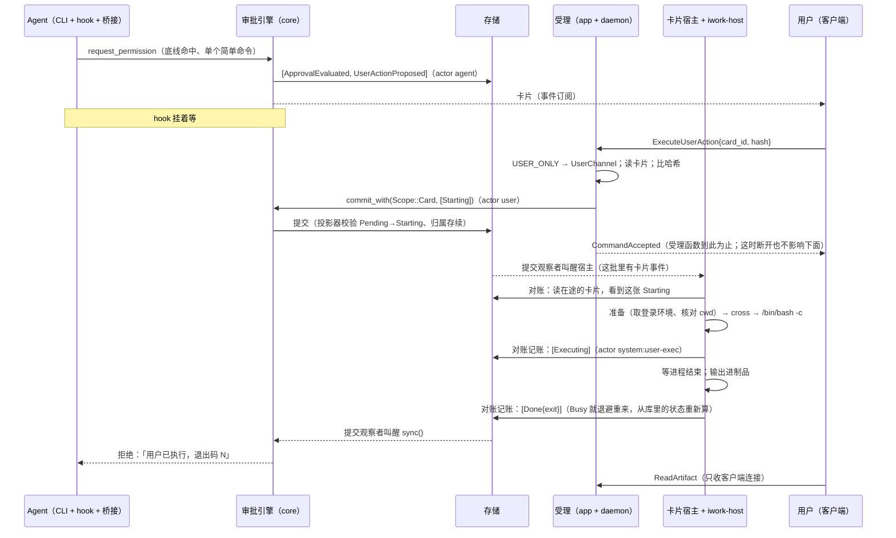

# T10e 实施方案：亲手执行与安全清单

- 状态：**第 4 轮进行中**（2026-11-12）。第 3 轮没过（3/F-1～F-5），产品负责人定了开第 4 轮并缩范围（需求附录 B，`0f16ef3`）。这一笔只加了第 0a 节「卡片宿主义务表」，先请审查看表全不全；**2.3–2.5、第 4～7 节、第 11 节的正文还是第 3 版，等表确认后照表重写，冲突处以第 0a 节为准**。安全清单部分（2.6 等）不受影响。每轮改了什么见第 14 节
- 任务卡：`docs/tasks/M1/T10e.md`（范围 2a、2c；验收 1、2）
- 依据：需求 7.2（安全能力的分层、能力与界面分离）、FR11、第 9 章（系统底线、已知限制）、AC36、AC41；M1 技术设计 7.0、7.2a、7.2c、7.3；`AGENTS.md`「安全不变量」亲手执行一条；T01 方案 4.3（卡片表、对话表、附录 B）；T07 方案 4.3、4.4、5.4、6.7、6.9、6.10.6 第 8–10 条、6.10.8；T04 方案 2.5、2.8、第 11 节交接；T06 方案第 8 节、3.4a、4.5、5.3；T03 方案 2.4、S2
- 前置：T10a 合入（它又等 T04 组 3、T06 S6–S9）。本方案用到 T10a 的东西都列在 1.4，标「T10a 交付」

## 0 一页总览

1. **大部分地基已经在 main 上**。协议（四个卡片命令、两个清单命令、一个查询、四种事件、三个错误码）、卡片状态机与提交时校验、`ExecutionBackend` 端口、亲手执行判定与哈希、清单校验纯函数、会话快照、崩溃恢复把执行到一半的卡片转「结果未知」，都已合入。T10e 要写的是三块：`iwork-host` 的执行后端、六条命令的受理、把它们接进 T10a 的链路；再加引擎和续接说明三处改动（2.5）。
2. **不加协议字段、不加事件种类、不加数据库迁移**。所以这张卡合入后发现问题，装回上一版就能退（T07 PD6、T04 Q4 的条件都满足）。
3. **「只有用户本人能点」做成一个类型**。`iwork-app::channel::UserChannel` 只有校验过连接的函数造得出来；启动卡片、忽略、停止、确认结束、清单增删的计划函数都要这个值当参数，忘了查通道就编译不过。哪些命令只收用户本人，登记在一张表 `USER_ONLY` 里（2.2）。
4. **执行的内容只来自落盘的卡片**。`ExecuteUserAction` 只带卡片编号和哈希；卡片宿主拿的是库里那张卡片的命令或补丁，请求里没有可执行的内容。卡片的转换表没有回到「待执行」的边，一张卡片最多执行一次（T01 4.3）。
5. **Agent 这一侧只听得到一句固定的话**。hook 和续接说明共用一个出口 `agent_card_status`（2.5 ⓪）：一个封闭的枚举，里面唯一会变的是退出码，没有任何自由文字。现有代码里 `Failed` 那一句带着错误原文，随本卡改掉。输出进制品区，只有客户端连接读得到；制品区对 Agent 是底线禁读。
6. **安全清单的校验照 T07 的纯函数，T10e 补两件**：范围内每一种会话形状各校验一遍（全局条目要对每个项目都成立）；路径条目把「写下的位置」和「解析后的真实位置」两种都校验（经链接指进凭据目录的可写目录要拒）。生效靠 T10a 每次起 CLI 进程前重读清单、重算快照，T10e 用端到端用例证明改动到得了审批和沙箱设置两头。
7. **卡片由已提交的状态驱动，一个常驻的「卡片宿主」负责到底**（2.3，第 3 版换的机制）。受理函数只做校验加一笔提交；库里有 `Starting` 的卡片，宿主就起它，不看是哪个请求提交的、那个请求还在不在。起只有一个边界，停止范围是数据，记账是「把库里的状态追到事实」，提交失败多少次都从库里重新算。补丁的读、改、写是一个临界区：等锁、写临时文件、复查都在边界之前、可以丢掉，边界之后只剩落位那一次系统调用（2.4）。
8. **要产品负责人定的 7 件、知情并登记已知限制的 5 件**，在第 10 节。都不挡开工的是 Q2、Q3、Q4、Q6、Q7；Q1、Q5 定之前，步 4 和步 1 的表各有一行先按推荐做、留好改口。

## 0a 第 4 轮：卡片宿主义务表（先行提交，正文照它重写）

### 0a.1 这一轮定下来的四件事（产品负责人 2026-11-12，需求附录 B）

1. **补丁卡片挪出 T10e，另开 T10h**（M1 内做，AC36 不改）。T10e 只做命令卡片。T10h 完成之前，Edit 命中底线只拒绝、提示改用一条命令，和整文件 Write 现在的处理一样（T07 Q6）。下面的表里没有补丁；3/F-5 随之消失。
2. **卡片任务、宿主循环 panic 一律 Fatal**：按 T04 2.10 登记，整进程退出，交给崩溃恢复。第 3 版「对账替它补事实」那一段删掉（3/F-2、3/F-3）。
3. **删掉 `stop_conversation` 这个给别人调的接口**：停止义务由宿主对账时从已提交的对话、助手状态推出来（3/F-1）。
4. **退出确认的卡片数查库**，不数内存登记（3/F-4）。

审查看过第一版表之后（4/F-1～F-4）又定了四处，下面的表已经是改过的：

5. **退出的裁决和启动边界在同一把锁里**（4/F-1）：查库的张数只用来决定问不问；「关不关宿主」和 `cross` 在登记表的同一把锁里判，见第 13 行与 G2。
6. **卡片还没到终态，它的记录不许被级联删掉**（4/F-3）：给会级联删对话的两种事件加提交时校验，见第 14 行；删除助手、删除对话要先落「删除意图」，见 0a.7 对 T10a、T10b 的要求。
7. **登记项的回收是一条明写的义务**（4/F-4）：见第 5 行。
8. **存储「活着但不返回」没有现成的检测者，照实写**（4/F-2）：宿主给自己的每次读、每笔提交套时限并记日志，不替存储判死活；缺口记成已知限制 K6，交 T04，见 0a.2 末行。
9. **退出这条路不能被存储卡住**（4/F-5，上一条和第 13 行叠出来的）：K6 给用户留的出口是「完全退出再打开」，可第 13 行原来是先查库再关宿主，查询不返回就到不了不读库的 `cancel_all`，硬上限也还没开始计时。改成：已确认的退出不读库；没确认的那次读有 2 秒时限，读不出来当「不知道」、回去问，不当 0。

### 0a.2 谁会「没了」，没了以后谁接手

前三轮的问题都是同一类：某件事挂在一个会消失的执行者身上。先把执行者列全，每个只有一种「没了以后」：

| 执行者 | 什么时候会没 | 没了以后 |
| --- | --- | --- |
| 受理函数（ipc 的请求任务） | 客户端断开，ipc 在任何一个等待点中止它 | **任何义务都不靠它活着**。它只做校验加一笔提交：落了盘，下表照常；没落盘，等于没发过这条命令 |
| 卡片宿主的循环、每张卡片的任务（后台里的常驻任务） | panic、意外返回 | Fatal：整进程退出、被重新拉起 → 最后一行。不在进程内重启，不补事实 |
| T04 的停机流程（发「完全退出」「封口」两个信号的那个任务） | 卡住 | T04 的 15 秒硬上限强退 → 最后一行 |
| 后台进程 | 崩溃、被杀、Fatal 退出、升级重启 | 下次启动的崩溃恢复（表里第 12 行）：在途卡片一律转结果未知，由用户核对。已有，演练 D1–D5 |
| 存储（宿主对账要读、要提交） | ① 失效：写连接坏了、写线程退出。② 回 `Busy` 或报错。③ **线程活着，却卡在 I/O 里不返回** | ① T04 的 `store-health` 任务收到失效信号，Fatal → 第 12 行（已有）。② 第 9 行：留着登记项，退避后再来。③ **现有机制里没有人发现它**：`store-health` 只等失效信号，卡住不算失效（`iwork-daemon/src/tasks/store_health.rs`）。宿主能做的是不被它拖死、并把它报出来：每次读、每笔提交套 `HOST_IO_LIMIT`（30 秒），到时当作「这一次去向不明」处理（留着登记项，下一轮重读重算），记一条错误日志（卡片编号、哪一步、等了多久），之后每 30 秒再试、再记。宿主**不**据此退出进程：存储卡住时回合、审批的提交同样停着，要不要整体退出是存储健康检查的事，不由卡片这一侧来判。这段时间卡片停在库里原来的状态；用户「完全退出」再打开（第 6 行不读库，退得掉；到点由 T04 的 15 秒硬上限强退），由第 12 行转结果未知。记成已知限制 **K6**，连同「存储健康检查查不出卡住」这个缺口交 supervisor 转 T04 |

只在内存里、进程没了就丢的东西有四样：进程句柄、宿主知道的事实（`Truth`）、「越过过启动边界」的卡片集合、停机流程发来的两个信号。它们不会在进程活着的时候单独丢（丢 = panic = Fatal）；进程没了一起丢，由第 12 行按「结果未知」收，不重跑。

### 0a.3 义务表

「依据」一栏不特别注明的，都是**已经提交到库里的事实**。归属还在不在，用提交时校验「归属存续」的同一个函数 `owner_alive`（回合有记录、对话有记录且不在删、助手有记录）。

| # | 义务 | 依据 | 谁做 | 做的人没了 | 时限 |
| --- | --- | --- | --- | --- | --- |
| 1 | **起**一张受理了的卡片 | 卡片 `Starting`；`owner_alive` 为真。另两样内存里的：宿主没关（谁来关、什么时候关见第 6、7、13 行）；本进程没为它越过过启动边界 | 宿主对账：建登记项、起卡片任务。任务：准备（取登录环境、核对工作目录）→ `cross`（启动边界，全仓唯一）→ spawn | 宿主或任务 panic → Fatal → 第 12 行。受理函数没了：无关 | 唤醒：有关的事件一落盘就叫醒宿主；保底每 30 秒对一次账。准备最多 10 秒。spawn 是一次系统调用，不设时限（卡住见第 6、7 行） |
| 2 | 归属没了，**还没起的不再起** | 卡片 `Starting`；`owner_alive` 为假（对话在删，或助手、回合的记录没了） | 宿主对账：还没建项的不建任务、直接记事实 `NotStarted{"启动前已取消"}`；已经在准备的记「不许越界」并叫醒，任务到 `cross` 被拒，同样得到 `NotStarted`。由第 9 行记成 `Failed` | 同第 1 行 | 对账一轮（唤醒即到，保底 30 秒）。先后窗口见保证 G1 |
| 3 | 用户点了停止就**停** | 卡片 `Stopping`；内存里有它的活句柄 | 宿主对账：`handle.stop()`（整个进程组先请求结束，3 秒后强杀） | Fatal → 第 12 行；那个进程不再有人停（做法 A 的已知限制） | 唤醒即到；`stop()` 自身 3 秒加强杀 |
| 4 | 归属没了，**正在跑的要停** | 卡片在途（`Starting` / `Executing` / `Stopping`）；`owner_alive` 为假；内存里有它的活句柄 | 宿主对账：`handle.stop()`，并让第 9 行补记一笔 `Stopping`（进程先结束了就直接记 `Done`） | 同第 3 行 | 同第 3 行 |
| 5 | 卡片在库里不在途了，**这一项收掉**（回收登记项） | 库里这张卡片不在途：到了终态或结果未知。登记表里有它的项 | 宿主对账，按这一项现在的样子分两种。**正常**：任务已经结束、手里没有活句柄 → 摘掉这一项（`Failed` / `Done` / `Unknown` 记下之后都走到这里）。**不正常**（任务还在准备、已经越界，或手里还有活句柄；正常流程到不了，第 14 行的前提守着卡片的行不会凭空消失，出现了就是缺陷）：记错误日志点名；这一项记「不许越界」并叫醒任务；有活句柄就 `handle.stop()`；等任务结束、句柄没了再摘 | 同第 3 行 | 对账一轮。提交回 `Busy`、库里还在途时这一行不适用，登记项留着（第 9 行） |
| 6 | 完全退出：**都停下** | 宿主已经被第 13 行关成「完全退出」（内存）；停机流程第 2 步 `cancel_all` 来收（不是受理函数发的） | 宿主：对登记表里每个活句柄 `stop()`——**直接照登记表做，不读库、不等对账**，存储卡住也停得了；没越界的任务被叫醒，在 `cross` 被拒，得到 `NotStarted{"启动前已取消"}`；然后等登记表空（要等第 9 行把账记完、第 5 行摘项） | 停机流程卡住 → 15 秒强退 → 第 12 行 | 停机第 2 步的 5 秒。到时返回还剩几张，不当成停完 |
| 7 | 封口（信号、升级、故障）：**不再有新的** | 停机流程的信号（第 3 步 `abort_all`） | 宿主：关闭，之后 `cross` 一律被拒；不起、不停、不记；等已经越界、还卡在 spawn 里的那几张 | 同第 6 行 | 1 秒。到时返回还剩几张并点名记日志，不当成清空：卡在内核里的那一次 spawn 取消不了，可能在封口之后才完成 |
| 8 | 命令的每一步都**留下事实** | —（它产出内存里的事实：`NotStarted{原因}`、`Running`、`Exited{exit, output}`、`Lost{error}`） | 卡片任务。任务函数的返回值就是结局（`NotStarted` / `Exited` / `Lost` 三种之一），写不出「结束了却没有结局」；`Running` 在 spawn 成功那一刻写 | 任务 panic → Fatal → 第 12 行 | 准备 10 秒；等进程结束不设时限（用户的命令，随时可以停）；存输出只试一次、5 秒，失败按「输出没存下来」收，不挡结局 |
| 9 | **记账**：库里的状态追上事实 | 卡片在库里的状态（和内存里的事实比） | 宿主对账，全仓唯一提交卡片结果事件的地方：`owed_events(库里的状态, 事实, 要不要停)` 非空就提交 | Fatal → 第 12 行：事实丢了，按结果未知收（这是实情） | 一次提交一个来回。成功、`Busy`、被拒、别的错误都是同一个做法：留着登记项、重读、重算、再记；`Busy` 100 毫秒起每次翻倍、封顶 5 秒、不设次数上限。读或提交 30 秒没返回：当去向不明，记错误日志，下一轮重读（0a.2 末行）。封口后不记 |
| 10 | **Agent 得到结果** | 卡片到了有结果的状态（`Done` / `Failed` / `Unknown` / `Dismissed` / `Voided`） | 审批引擎的折叠（已有，T10a 接的 `sync()` 那条线）。话只出自 `agent_card_status` | 引擎那个任务的监督归 T10a。hook 没等到：等待上限到了回合中断，续接说明里补上这句（2.5 ①） | `sync()` 的 5 秒 |
| 11 | 对话**删得完** | 对话 `Deleting`；名下的回合、卡片都到了终态（结果未知不算终态） | T10a 的删除流程（A5）：挂在提交观察者的唤醒上，自己看已提交的状态。T10e 不调它，它也不调宿主。它判断错了、提前提交真正的删除，会被第 14 行拒掉 | 受理函数没了：无关。删除流程的任务没了：监督归 T10a（写进 A5 的要求：Fatal，或者可重启且只看已提交的状态） | 唤醒即到 |
| 12 | **进程没了以后** | 启动时库里在途的卡片（它们的行一定还在：第 14 行守着） | T04 启动表第 8 步的崩溃恢复（已有）：一律转结果未知；不查进程、不停、不重跑。宿主在它之后才起，起来时库里必须没有在途卡片，有就启动失败并点名 | 恢复中途又崩：那笔事务没提交，下次启动从头来（T04 2.5） | 接受连接之前 |
| 13 | 退出前**问不问**；问完到关闭之间**不再起** | 两样。问不问：库里在途卡片的张数 N（一次读查询；读不出来算「不知道」，不算 0）。关不关：登记表里已经越过启动边界、还没收掉的项数 L（内存；和 `cross` 同一把锁） | `ShutdownDaemon` 的受理函数（在 T04 的外层 `DaemonHandler` 里受理，不经过 A1 的内层分发，所以前面也没有按 `command_id` 查重的那次读），按命令带没带确认分两条路。**带了确认：不读库**，直接 `card_host.try_quit(已确认, 触发停机)`——已经确认的退出不依赖存储的任何读写。**没带确认**：查库得到 N，套 `QUIT_COUNT_LIMIT`（2 秒）；到时或出错，N 记成「不知道」；再调 `try_quit(未确认, N, 触发停机)`。`try_quit` 在登记表的锁里一口气做完、中间没有等待点：数出 L；未确认且（N 不为零，或 N 不知道，或 L 不为零）→ 回「要确认」（带张数；N 不知道时写明「存储没有响应，卡片数未知」），宿主不关；否则把宿主置成「完全退出」（从这一刻起 `cross` 一律被拒），并触发停机流程 | 受理函数在查库的等待点被中止：等于没发这条命令，宿主没关。`try_quit` 里没有等待点，中止不到一半，不会出现「宿主关了、停机却没触发」。存储的读卡住：未确认的那次 2 秒后回「要确认」，用户确认后的那次不读库（0a.2 末行、4/F-5） | 未确认：读查询最多 2 秒，加一次进锁。已确认：只有一次进锁。保证见 G2 |
| 14 | 卡片没到终态，**它的记录不被级联删掉** | 被级联的对话名下卡片的状态。会级联删对话（连同回合、卡片的行）的事件只有两种：`ConversationDeleted`、`AssistantDeleted`（删它的私聊） | 存储的写线程，提交时校验：这两种事件落盘的前提是被级联的每个对话名下**没有非终态的卡片**（待执行、在途、结果未知都算）；不满足整笔拒绝。判断函数放 `iwork-domain`，真存储与测试用的假存储共用（T07 加「状态前提」「归属存续」时的同一个做法，T02 方案 2.6） | 写线程没了 = 存储失效 → Fatal → 第 12 行 | 提交那一刻 |

对账自己用到的读和提交出问题时：读失败、提交回 `Busy` 或报错，都是退避后下一轮再来（第 9 行的做法，读也一样），登记项不动；一直不返回的情况见 0a.2 末行。

四条卡片命令各自只是一笔提交，落盘之后接上表的哪一行：

| 命令 | 提交的 | 之后是哪一行 |
| --- | --- | --- |
| `ExecuteUserAction` | `Starting` | 第 1 行（归属这时没了就是第 2 行） |
| `StopUserAction` | `Stopping` | 第 3 行 |
| `DismissUserAction` | `Dismissed` | 第 10 行 |
| `ConfirmUserActionEnded` | `Ended` | 第 11 行（对话在删的话） |

删除对话、删除助手不是卡片命令。它们先落盘的「删除意图」（对话 `Deleting`；助手的删除见 0a.7）让 `owner_alive` 变假，接第 2、4 行；真正级联删行的那一笔受第 14 行约束，要等名下卡片都到终态。

### 0a.4 两个先后窗口，写成保证

- **G1（删除与起之间）**。对话的 `Deleting`（或助手的删除）落盘之后，到宿主对到这笔账之前，可能有一张卡片正好越过启动边界。保证的是三条：① 宿主对到账之后，这个对话不再有卡片越界；② 在那之前越界的，命令会起来，随即被第 4 行停掉（对账一轮之内发出 `stop()`）；③ 对话在这张卡片到终态之前删不完（第 11 行），所以不会有命令在一个已经删掉的对话名下跑。不保证的是「删除落盘的那一瞬之后一条命令都不起」。
- **G2（退出确认与起之间）**。第一版表只说「查完张数之后受理的卡片不会起」，可那时关闭宿主的是停机流程第 2 步的 `cancel_all`，它前面还隔着「关门、等在途请求回完」的一秒（`iwork-daemon/src/stop.rs`）；这一秒里另一条已受理的请求提交了 `Starting`，宿主照样准备、越界、起命令，随后被退出流程杀掉，而用户没被问过（4/F-1）。改成第 13 行：**关宿主这一下和 `cross` 在同一把锁里，并且发生在回「可以退出」之前，不等停机流程**。保证的是：
  1. 不经确认就退出，不会杀掉任何一条已经起来的命令。`try_quit` 和 `cross` 抢同一把锁，只有两种先后：命令先越界，`try_quit` 数到 L ≥ 1，没带确认就回去问；`try_quit` 先关了宿主，这条命令再也越不了界。
  2. 宿主关了之后，受理了还没越界的、之后才落盘的卡片都不会起：停机流程的 `cancel_all` 期间收成 `Failed{"启动前已取消"}`；封口之后才落盘的留在 `Starting`，下次启动转结果未知（实际没执行过）。
  3. 不保证的：这类「还没起」的卡片一定被问到。N 是关之前查的，查完又受理的那张不在里面。它不会起；用户重新打开后看到的是第 2 点的两种结果之一：`cancel_all` 期间收掉的显示「启动前已取消」，封口之后才落盘的显示「结果未知」（实际没执行过，核对一下点「我已核对」即可）。
  4. 存储读不出来时不把「不知道」当成 0：没带确认的退出一律先问（最多等 2 秒）；带了确认的退出不读库，直接关宿主、触发停机，之后 `cancel_all` 照登记表停进程（第 6 行，也不读库），再往后由 T04 的 15 秒硬上限兜底——硬上限是停机被触发之后才开始计时的（`iwork-daemon/src/daemon.rs`：先等到停机原因，再 `arm_hard_deadline`），所以「触发停机」这一步之前不能有任何可能卡住的等待。
- **信号、升级、故障引起的停机**不经过第 13 行（没有人可问）：封口之前起来的命令留着不杀，下次启动转结果未知；封口之后不再起（第 7 行）。

### 0a.5 五条不变量

1. 起只在 `cross` 一处；一张卡片在一个进程里最多越过一次（内存里的集合只增不减），跨进程靠第 12 行。
2. 提交卡片结果事件（`Failed`、`Executing`、`Stopping` 的补记、`Done`、`Unknown`）只在第 9 行一处。
3. 登记项只在库里这张卡片不在途时才摘（第 5 行）；库里还在途就一直留着（第 9 行）。
4. 「起不起、停不停、删不删」的依据只有两种：已提交的事实；宿主的关闭状态（由第 13 行或停机流程的封口置位）。内存登记回答两个问题：「这张卡片的进程是不是在我手里」「有没有命令已经越过了启动边界」（第 13 行的 L）。受理路径上读内存的有三处：`StopUserAction` 要求宿主手里有句柄、宿主已关时 `ExecuteUserAction` 提前回 `UNAVAILABLE`，这两处只会多拒不会多放；第 13 行的 `try_quit`，它和 `cross` 同一把锁。
5. 卡片没到终态（待执行、在途、结果未知），它的行、它的回合和对话的行都还在库里（第 14 行）。所以进程没了以后第 12 行一定找得到它，用户一定有一张卡片可以核对。

### 0a.7 对 T10a、T10b 删除流程的要求（4/F-3）

审查指出：`AssistantDeleted` 一落盘，投影器就把这个助手的私聊连同回合、卡片的行一起删掉（`iwork-store/src/projector/assistants.rs`、`conversations.rs` 的 `delete_cascade`）。卡片这时还在准备，行没了、手里没有句柄，第一版表的第 2、4、5 行都对不上，它照样能越界；已经在跑的，行被删了之后进程再崩，重启找不到卡片，用户连一张「结果未知」都没有。T01 4.3 早就写了「删除对话或助手碰上这些卡片要先等」，表里要把它落成两头都守的规矩：

- **存储这一头**（第 14 行，T10e 做）：卡片没到终态，会级联删它的那两种事件提交不进去。删除流程写错了、来早了，结果是被拒，不是卡片消失。
- **流程这一头**（T10a 的对话删除、T10b 的助手删除，写成对它们的要求）：
  1. **先落删除意图**：一条让 `owner_alive` 变假、又不删任何行的已提交事实。对话删除已有（对话置成 `Deleting`）。助手删除由 T10b 定怎么表示；现成的一种是先把它的私聊置成 `Deleting`（`owner_alive` 认这个状态）。意图一落盘，宿主按第 2、4 行不再起、把在跑的停掉，不用谁来调宿主。
  2. **等**：名下卡片都到终态。结果未知的要等用户点「我已核对」。
  3. **再提交真正级联的那一笔**（`ConversationDeleted` / `AssistantDeleted`）。被第 14 行拒了就继续等，不重试到成功为止以外的任何事。
  4. 这三步由流程自己挂在已提交的事件上往前走（第 11 行），不靠受理函数的返回路径。
- 项目对话里属于被删助手的卡片（M1 还碰不到，M2 多成员才有）：行不会被级联，助手的记录没了之后 `owner_alive` 为假，同样是第 2、4 行。

### 0a.8 这张表要有的验证（正文重写时展开成用例；这里只点名，给审查核对有没有漏）

| 对应 | 验证 |
| --- | --- |
| 第 13 行、G2（4/F-1） | 交错：查库得 0 → 另一条已受理的请求提交 `Starting` → 任务走到 `cross` → `try_quit`。两种先后各一格：`cross` 先，`try_quit` 回「要确认」、宿主没关、命令照跑；`try_quit` 先，`cross` 被拒、后端的 spawn 次数为 0、卡片 `Failed`。另一格：`try_quit` 放行之后把停机流程压住 2 秒（盖过「关门、等回完」那一秒），这期间提交 `Starting`：spawn 次数为 0。`try_quit` 里没有等待点（受理函数在它前后被中止各一格：要么宿主没关，要么宿主关了且停机已触发） |
| 第 13 行、G2 第 4 点（4/F-5） | **从真实的 `ShutdownDaemon` 受理入口发命令**（不直接调 `try_quit`），存储的读永不返回，有一张卡片的命令在跑：① 没带确认 → 2 秒内回 `PRECONDITION_FAILED`，说明里是「卡片数未知」，宿主没关，命令照跑；连发三次都是同样的结果、都在 2 秒内（不会卡在同一个前置查询上）。② 带确认 → 立刻受理（没有发出任何读），宿主已关、停机已触发；`cancel_all` 不读库，把命令停掉，在步骤时限内返回。③ 同 ②，再让 `cancel_all` 之后的某一步也卡住（存储关闭不返回）：从停机被触发算起 15 秒，进程由硬上限强退；重启后这张卡片是结果未知。对照：存储正常、没有在途卡片时，不带确认的退出直接受理（N = 0、L = 0） |
| 0a.2 末行、第 9 行（4/F-2） | 假存储让一次读永不返回、让一笔提交永不返回，各一格：30 秒（假时钟）后宿主的循环继续往下走，登记项还在，错误日志里有卡片编号与哪一步；之后存储恢复，卡片照常收尾，命令没有重跑。存储卡住时「完全退出」：`cancel_all` 不读库，活句柄都被停，在步骤时限内返回剩余数 |
| 第 14 行、0a.7（4/F-3） | 提交时校验：名下有待执行、启动中、执行中、停止中、结果未知的卡片时，`ConversationDeleted` 与 `AssistantDeleted` 各被拒（五种状态 × 两种事件）；都到终态后提交成功（对照）。真存储与假存储用同一个判断函数（对拍）。端到端：卡片在准备时落助手的删除意图 → 命令不起、卡片 `Failed`，之后级联那一笔才提交得进去；卡片在跑时同样 → 被停、`Done`，再级联；卡片结果未知时 → 级联一直被拒，用户点「我已核对」后才过。进程在「意图已落、级联未落」时被杀：重启后卡片还在，是结果未知 |
| 第 5 行（4/F-4） | `Failed`、`Done`、`Unknown` 三种各一格：这一笔记下之后的下一轮对账，登记项没了，`count()` 回到 0，`cancel_all` 等得到登记表空。对照：这一笔回 `Busy` 时登记项还在。不正常的那一支：测试里把一张在准备的卡片在库里直接改成终态 → 它不再越界、登记项随后摘掉、错误日志点名 |
| 别的各行 | 第 3 版已有的用例照用（受理函数被中止四格、记账六条、启停屏障表去掉补丁的格子、真观察者接线）；去掉的：补丁的全部用例（去 T10h）、「对账替 panic 的任务补事实」的用例（改成：任务或宿主 panic → 进程以 Fatal 的退出码退出，重启后卡片是结果未知） |

### 0a.6 叫醒宿主的事件

提交观察者里一行（A2）：这批事件里有下面几种之一就叫醒宿主，只置位、唤醒，不读存储。清单是一张登记表 `HOST_WAKE_KINDS`，加一种 = 加一行：卡片状态事件（`UserActionStateChanged`）、对话进入删除（`ConversationDeleting` 那一类让 `owner_alive` 变假的对话事件）、助手删除（`AssistantDeleted`）。清单漏了一种或唤醒丢了，后果是晚到保底的 30 秒，不是没人管。

## 1 现状与约束

### 1.1 已有的（main，2026-11-12）

| 东西 | 在哪 | T10e 怎么用 |
| --- | --- | --- |
| 命令 `ExecuteUserAction{card_id, proposal_hash}`、`DismissUserAction`、`StopUserAction`、`ConfirmUserActionEnded`、`AddSecurityListEntry{list, value, scope}`、`RemoveSecurityListEntry{entry_id}`；查询 `ListSecurityLists` | `proto/iwork/v1/{commands,queries}.proto` | 原样受理，不加字段 |
| 事件 `UserActionProposed`、`UserActionStateChanged`、`SecurityListEntryAdded`、`SecurityListEntryRemoved` | `events.proto` 130、131、140、141 | 原样提交 |
| 错误码 `USER_ACTION_HASH_MISMATCH`(72)、`USER_ACTION_NOT_PENDING`(73)、`USER_ACTION_WRONG_CHANNEL`(74)、`SECURITY_LIST_ENTRY_REJECTED`(110)、`RULE_NOT_REVOCABLE`(111) | `common.proto` | 2.7 的对照表 |
| 卡片状态机 `USER_ACTION_TRANSITIONS`、`check_committed`（提交时校验整张表，T07 PD2） | `crates/iwork-domain/src/user_action.rs` | 所有卡片事件都经 `card.apply(触发)` 得到；撞车由写线程裁决 |
| `ExecutionBackend`、`ExecutionHandle`、`OutputSink`、`ExecError` | `crates/iwork-ports/src/exec.rs` | `run_as_user` 拆成「准备」「起」两段（2.4；还没有真实现，只有测试里的假实现要跟着改），`iwork-host` 实现它 |
| `propose_user_action`、`proposal_hash` | `crates/iwork-core/src/approval/evaluate/proposal.rs` | 受理时重算哈希比对 |
| 引擎建卡片并等结果：`propose_card`；到终态经折叠的 `CardSettled` 把话带给挂着的 hook；`card_settled_message` | `crates/iwork-core/src/approval/engine/{decisions,fold,mod}.rs` | `card_settled_message` 的 `Failed` 一句现在是「用户执行失败：{error}」，把错误原文交给了 Agent（`mod.rs:389`），本卡改掉（2.5 ⓪）；2.5 ② 改 `propose_card` 一处 |
| `engine.commit_with(Scope::Card(对话), req)`：卡片「从待执行出发」的事件在对话令牌上排队 | `engine/external.rs` | 启动、忽略走它（T07 6.10.6 第 9 条） |
| `validate_list_entry`、拒收名单、`rules::revocable` | `crates/iwork-core/src/approval/rules/` | 清单受理调它 |
| `snapshot_for`、`rule_paths_for`、`constraints_for`；折叠记 `snapshot_inputs_seq` | `crates/iwork-core/src/approval/session.rs` | 会话启动时用（T10a 交付） |
| 约束翻成 Claude Code 沙箱设置 | T06 方案第 8 节（`settings.rs`） | 不改；端到端用例断言它的输出 |
| 崩溃恢复：`Starting` / `Executing` / `Stopping` 的卡片 → `Unknown` | `crates/iwork-core/src/recovery.rs`；T04 2.5 | 不改；启用演练 |
| `Deleting` 期间放行的收尾命令表 `DELETING_ALLOWED`、`admission::admit` | `crates/iwork-app/src/admission.rs` | 受理时调它 |
| `ShutdownDaemon` 的受理、`RunningWork`（含「执行中的卡片数」） | `crates/iwork-daemon/src/{handler/lifecycle,work}.rs` | 卡片那一半由 T10e 接 |
| 连接上下文 `ConnectionContext{client_kind, signature_checked}` | `crates/iwork-ipc/src/server/handler.rs` | 用户通道的判断只看这两样 |
| 读模型 `security_lists()`（库里三张清单的用户条目）、`artifact_is_referenced`（含卡片） | `crates/iwork-ports/src/read_model.rs` | 查询与输出读取 |

样板：受理照 `handler/lifecycle.rs` + `iwork_app::lifecycle::decide_shutdown` 的写法（判断是 `iwork-app` 里的纯函数，`iwork-daemon/src/handler/` 里的外壳只取数、调用、提交）；登记表照 `DELETING_ALLOWED`；进程组的起停照 `crates/iwork-agent-acp/src/process.rs`。

### 1.2 约束

- `AGENTS.md` 安全不变量：卡片写明精确命令或补丁加理由；不可记住；全开档也出现；不得做成 Agent 能自己批准的通道；执行后 Agent 只得知是否执行与退出码，输出只给用户；判定在编排核心，用户确认在应用服务，执行在 `iwork-host`，适配层只转发。
- 安全设计原则（需求 v1.50、v1.69）：不为堵一个缺口引入一串新机制；新增安全规则不改已有规则与求值流程；盖不住的记已知限制、交产品负责人。
- 判定结果固定五种，不新增；求值七步不动（T10e 不碰 `evaluate/`）。
- 依赖方向：`iwork-app` 不依赖 `iwork-ipc`、`iwork-host`、`iwork-store`；`iwork-host` 只依赖 `iwork-ports`、`iwork-domain`、`iwork-rootfs`（`scripts/deps-policy.toml`）。
- 崩溃后的卡片按做法 A（产品负责人 2026-11-09）：不核对进程、不停、不重跑、不自动判结束。
- M1 不支持 Windows：执行后端在非 unix 平台直接回 `SpawnFailed{"M1 不支持 Windows"}`，用到真进程的测试限定 `#[cfg(unix)]`。
- 安全清单的界面待定（需求 v1.65、v1.66）：只经命令验收。

### 1.3 两问

**再加一种要动几处？**

- 再加一条「只收用户本人」的命令：`USER_ONLY` 加一行，处理函数签名带上 `&UserChannel`。一处表、一处函数。
- 再加一张安全清单：`SecurityList` 加一个变体和它的层（domain）、`validate_list_entry` 加一个分支（core）、`constraints_for` 或 `Boundaries` 认这个层（core）。受理、查询、事件、存储都不用动。这是 T07 留下的结构，T10e 不改。
- 卡片再加一种提议内容（现在是命令、补丁两种）：`Proposal` 加变体、`proposal_hash` 加分支、`ExecutionBackend` 加一对方法（准备、落到实处）、卡片宿主的 `match` 加一支。四处，都由穷举 `match` 逼着改全。

**改这里牵动谁？**

- `USER_ONLY` 表与 `channel::verify`：`ShutdownDaemon` 现在的判断 `may_shut_down` 改成读它（行为不变）。
- 给 Agent 的结果文字（2.5 ⓪）：`engine/fold.rs` 用它判「第一次有结果」、`iwork-core/tests` 里断言旧句子的用例、T01 4.3 与 T07 5.5 写着「用户执行失败：<error>」的两处文档。
- `ExecutionBackend` 拆两段（2.4）：`iwork-ports/tests/fakes.rs` 里的假实现。
- `propose_card` 的复用（2.5）：引擎的性质测试 `engine_interleavings`、T09 客户端对「同一张卡片被再次等」没有感知（没有新事件）。
- `ResumeReason` 加变体（2.5）：T06 的 `resume_note` 快照测试、T10a 选续接说明的地方。
- 卡片宿主：T04 的 `RunningWork`（数卡片、退出时停卡片）与启动表第 9 步（宿主在崩溃恢复之后起）、提交观察者（多一行叫醒）、T10a 的对话删除流程（停卡片；删除收尾要自己挂在已提交的事件上）、T10b 的助手删除流程（同样的两件事）。
- 清单受理：T10a 的会话启动（读清单的地方）；T06 的设置翻译（只读它的输出）。

### 1.4 用到 T10a 的东西（T10a 交付；名字以 T10a 为准）

T10a 只写接线说明、不走方案审查，所以这里写的是 T10e 需要它**做到什么**。步 0 拿 T10a 实际合入的代码逐条核对，对不上的回 architect 改本方案，不在代码里将就。

| # | T10a 交付 | T10e 怎么用 | 依据 |
| --- | --- | --- | --- |
| A1 | 命令与查询的分发：`DaemonHandler` 内层的真 `RequestHandler`，按命令种类分到 `handler/*.rs`；`command_id` 幂等：分发入口先查这个 `command_id` 记没记过，记过就直接回上次的回执、不进处理函数；每个请求开 `command` span | 六条命令、一个查询各加一支。受理函数只做校验加一笔提交；起进程不在受理函数的返回路径上，重放回执也不会起进程（2.3） | T04 第 11 节交接；T01 3.2 |
| A2 | 装好的 `Arc<ApprovalEngine>`，和「提交观察者叫醒、独立任务跑 `sync()`」那条线。观察者只能装一个（T04） | `commit_with(Scope::Card)`；卡片宿主直接提交的卡片事件靠这条线送到挂着的 hook。**T10e 在同一个观察者里加一行**：这批事件里有卡片事件就 `card_host.wake()`（只置位、唤醒，不读存储）；宿主的常驻循环在启动表第 9 步、崩溃恢复落盘之后、`bind` 之前起 | T07 6.10.8；T10a 验收 3；T04 2.x `CommitObserver` |
| A3 | 会话启动：**每次起 CLI 进程前**（新回合、续接都算），在一个读事务里读 `security_lists()` 和 head，调 `rule_paths_for` + `snapshot_for`，把**同一份**快照交给 T06（翻成设置）和 `SessionKeys`；构造 `EnvPaths` 的函数只有一个 | 清单「对新启动的会话生效」就是它。T10e 不改它，用端到端用例证明（7.2）；清单校验要「每种会话形状的 `EnvPaths`」，调同一个构造函数（2.6） | T07 6.9、4.3；技术设计 7.2c |
| A4 | `RunningWork` 的回合那一半 | 卡片那一半由 T10e 加：`running()` 的卡片数、`cancel_all` 停卡片、`abort_all` 封口（2.3） | T04 2.8 |
| A5 | `DeleteConversation` 的删除流程：进 `Deleting`、经 `commit_with(ConversationDeleting)` 作废待处理项、全部到终态后提交 `ConversationDeleted`；「再查一次这个对话能不能删完」是幂等的，并且**由删除流程自己挂在提交观察者的唤醒上**（卡片事件、回合事件落盘就查），不靠别人在某条返回路径上调它 | T10e 在 **`Deleting` 落盘之后**调 `card_host.stop_conversation(这个对话)`（2.3「停」）。卡片到终态、用户点了「我已核对」之后的删除收尾，靠它自己看已提交的事件。T10a 做成了「由调用方显式调」的话，步 3 在观察者里补上这一下唤醒 | T01 4.3 对话表；技术设计 9.0 |
| A6 | `ResumeTurn` 受理里选续接说明的地方（`Approved` / `Denied` / `Interrupted`） | 加上卡片的那一句（2.5） | T06 5.3 |
| A7 | 端到端测试夹具：真存储 + 真引擎 + 假运行时 + 经 ipc 发命令的客户端 | 第 7 节的端到端用例都建在它上面 | T10a 验收 |

**空窗提醒（给 supervisor）**：T10a 合入之后、T10e 组 1 合入之前，引擎已经会出卡片，可「执行」「忽略」还没人受理：卡片点不动，回合挂到用户取消或等待上限（约两小时）。组 1 要紧跟 T10a；中间这段产品负责人碰到卡片就取消回合。

## 2 模块与接口

### 2.1 crate 与文件

| crate | 新增 / 改 | 内容 |
| --- | --- | --- |
| `iwork-app` | 新 `channel.rs` | `UserChannel`、`USER_ONLY`、`verify`（纯函数） |
| `iwork-app` | 新 `user_action.rs` | 四个命令的计划函数、执行结果 → 事件、输出截断规则（纯函数） |
| `iwork-app` | 新 `security_lists.rs` | 增、删的计划函数，查询结果的拼装（纯函数） |
| `iwork-host` | 新 `exec.rs`、`login_env.rs` | `UserExecBackend`：起进程、停、等、打补丁；取登录 shell 的环境 |
| `iwork-daemon` | 新 `handler/user_action.rs`、`handler/security_lists.rs`、`card_host.rs` | 受理的外壳：取数、调计划函数、一笔提交。卡片宿主：对账、起、停、记账（2.3） |
| `iwork-daemon` | 改 `handler/lifecycle.rs`、`work` 的实现、`boot.rs` 装配 | `may_shut_down` 读 `USER_ONLY`；`RunningWork` 接卡片 |
| `iwork-core` | 改 `approval/engine/{mod,fold,decisions,waiting}.rs`、`turn/resume_note.rs` | 2.5 的三处 |
| `iwork-ports` | 改 `read_model.rs`、`exec.rs` | 加两个查询：按编号取一张卡片、在途的卡片（后者和 `unsettled()` 里卡片那一段共用一条查询）；`ExecutionBackend` 的命令与补丁各拆成「准备」「落到实处」两段；加常量 `STOP_GRACE` |
| `iwork-rootfs` | 改 `lib.rs` | 加一个「带复查、带权限」的替换写（2.4 打补丁）；项目标记那条路继续用原来的 `replace_file` |
| `iwork-client-core` | 改 `derive/` 里卡片那一行 | 命令卡片到 `Done` 却没有输出引用时显示「输出没有保存」（2.3） |
| `iwork-store` | 改 `read_model.rs` | 上面那个查询的实现（读 `user_actions` 表已有的快照列，不加列） |
| `iwork-agent-acp` | 改 `process.rs` 一行 | `GRACE_PERIOD` 改成读 `iwork_ports::exec::STOP_GRACE`（值不变） |

`STOP_GRACE` 为什么挪：T01 4.3 写卡片停止「3 秒后结束进程树（与回合取消一致）」，「一致」现在靠两处各写一个 3。真值放端口，两边都读它。

### 2.2 用户通道（`iwork-app::channel`）

```rust
/// 证明这条请求来自用户本人操作的客户端连接。字段私有，只有 `verify` 造得出来。
pub struct UserChannel(());

/// 判断用的事实。`iwork-app` 不认识 ipc 的类型，由 daemon 从 `ConnectionContext` 抄过来。
#[derive(Debug, Clone, Copy)]
pub struct ChannelFacts {
    pub client_kind: pb::ClientKind,
    pub signature_checked: bool,
    /// daemon 传 `cfg!(feature = "dev")`
    pub dev_build: bool,
}

/// 只收用户本人的命令（proto `Command` oneof 字段名 → 被拒时的错误码）。加一条 = 加一行。
pub const USER_ONLY: &[(&str, pb::ErrorCode)] = &[
    ("execute_user_action", UserActionWrongChannel),
    ("dismiss_user_action", UserActionWrongChannel),
    ("stop_user_action", UserActionWrongChannel),
    ("confirm_user_action_ended", UserActionWrongChannel),
    ("add_security_list_entry", PermissionDenied),      // 见 Q5
    ("remove_security_list_entry", PermissionDenied),   // 见 Q5
    ("shutdown_daemon", /* 沿用 handler/lifecycle.rs 现在回的码 */),
];

pub fn verify(facts: ChannelFacts) -> Result<UserChannel, WrongChannel>;
```

`verify` 的规则只有一条：`client_kind == DESKTOP && signature_checked`；`dev_build` 时再放过 `DEV_TOOL` 与没查签名的连接（开发期的 `ipc-tool`、`tauri dev`）。发布构建里 `signature_checked` 恒为真（T03 2.4），所以实际只剩「是不是桌面客户端」。

分发入口（A1）在调处理函数之前查表：命令在 `USER_ONLY` 里就先 `verify`，不过就回表里的错误码，并往 `audit::TARGET` 写一行日志（连接编号、对端 pid、命令名；不写载荷）。被拒不产生事件：让随便一条连接都能往事件日志里塞东西，是另一个口子。

**这道检查挡的是什么，要说老实话**（技术设计 7.2a 第 3 条写的是「桥接与 hook 的连接发来即拒绝」）：照 T03、T06 的实际接法，桥接经 stdin/stdout 和后台说 ACP，hook 只连桥接，两者都不连后台的 socket；能连上后台 socket 的进程先要过 T03 的同用户、同签名校验。所以「Agent 够不着」主要靠结构，这张表是第二道：

| Agent 能碰到后台的口子 | 为什么走不到「启动卡片」 |
| --- | --- |
| ACP `session/request_permission`（hook → 桥接 → 后台） | 进的是 `PermissionDecider::decide`，只会返回放行或拒绝；判成亲手执行时返回的是拒绝，并且要等卡片到终态。这条路上没有提交 `Starting` 的代码 |
| ACP `session/update`（正文、工具活动） | 只变成消息与工具事件，内容不当命令解析（AC05「消息内容不能伪造用户批准」） |
| 后台的本机 socket | 成员命令在沙箱里，沙箱不放行本机 socket（技术设计 7.0）。沙箱外执行的命令要先过审批；连上了还要过对端校验（不是 iWork 签名的程序被拒）。同用户、能在沙箱外跑任意代码的程序先建连再 exec 成 iWork 程序，是已登记的已知限制（需求 v1.73） |
| 用户消息里写「请点执行」 | 文字不是命令 |
| 以后给 AI 开的「调用能力」（需求 v1.76） | M1 没有。到时那个入口也要过 `USER_ONLY`，表里的命令不给 AI（Q5） |

开发构建开 `--dev-trust` 时，对端校验只剩「同用户」，任何沙箱外的程序都能自称桌面客户端发任何命令（不只这六条）。这是 T03 S3 已有的结论，T10e 不加东西；日常使用用签名构建。

### 2.3 卡片的受理与执行

**计划函数（`iwork-app::user_action`，纯函数）**

```rust
pub fn plan_execute(_: &UserChannel, card: &UserActionCard, claimed: &Sha256) -> Result<DomainEvent, CardRefusal>;
pub fn plan_dismiss(_: &UserChannel, card: &UserActionCard) -> Result<DomainEvent, CardRefusal>;
pub fn plan_stop(_: &UserChannel, card: &UserActionCard) -> Result<DomainEvent, CardRefusal>;
pub fn plan_confirm_ended(_: &UserChannel, card: &UserActionCard) -> Result<DomainEvent, CardRefusal>;

pub enum CardRefusal { NotPending { state: UserActionStateKind }, HashMismatch, NotInState { want: UserActionStateKind, got: UserActionStateKind } }

/// 宿主对一张卡片知道的事实（只在内存里）。
pub enum Truth {
    /// 明确没执行：准备失败、启动前被叫停、spawn 失败、补丁落位之前失败
    NotStarted { reason: String },
    /// 进程起来了
    Running,
    /// 进程结束了，或补丁已经落位（`exit` 为 `Code(0)`）。`output` 为 `None` 表示输出没存下来
    Exited { exit: ExitStatus, output: Option<ArtifactRef> },
    /// 跟丢了：等待失败，或对账时发现库里在途、宿主却没有它的任务
    Lost { error: String },
}
/// 记账：把库里的状态追到宿主知道的事实，还差哪些事件。**只看已提交的状态与事实**，所以哪一笔提交失败过、
/// 失败了几次都不影响结果；返回空表示这张卡片的账记完了。
pub fn owed_events(committed: &UserActionCard, truth: &Truth, stop_wanted: bool) -> Vec<DomainEvent>;
```

- 四个计划函数都是「克隆卡片 → `apply(触发)` → 出 `UserActionStateChanged`」，合不合法只问 `USER_ACTION_TRANSITIONS`，不另写判断。
- `plan_execute` 多两步比对：`claimed == card.proposal_hash`，以及 `proposal_hash(&card.proposal) == card.proposal_hash`（库里的内容和哈希对不上就不执行，点名报错；这是不可能发生的状态，不兜底）。
- `owed_events` 是一张表（同样经 `apply` 出事件，转换表之外的格子返回空）：

  | 库里的状态 | 事实 | 欠的事件 |
  | --- | --- | --- |
  | `Starting` | `NotStarted{reason}` | `Failed{reason}`（触发 `SpawnFailed`：「明确知道没起来」，T01 4.3 给 `Failed` 定的含义） |
  | `Starting` | `Running` | `Executing` |
  | `Starting` | `Exited` | `[Executing, Done{exit}]`，一笔两条（转换表没有 `Starting → Done` 的边） |
  | `Executing` | `Running`，且有人要它停 | `Stopping` |
  | `Executing`、`Stopping` | `Exited` | `Done{exit}` |
  | `Starting`、`Executing`、`Stopping` | `Lost{error}` | `Unknown`（`Starting` 用 `ProcessLost` 触发，另两种用 `WaitFailed`） |
  | 终态、`Unknown` | 任意 | 空：账记完了 |
  | 别的组合 | — | 空（等事实往前走） |

**四个命令的步骤（`iwork-daemon/src/handler/user_action.rs`）**

共同的开头：① 查 `USER_ONLY` 拿到 `UserChannel`；② 读卡片（读模型新增 `user_action(id) -> Option<UserActionCard>`），没有 → `NOT_FOUND`；③ 读对话，`admission::admit(对话, 命令, Some(卡片), card_host.holds(id))`，删除中的对话只放行停止与确认（`CONVERSATION_DELETING`）。

**受理函数只做一件事：校验，加一笔提交。提交之后要做的事，一件都不放在受理函数里**（第 2 轮审查 2/F-1）。客户端在回执返回之前断开，ipc 会中止正在跑的受理函数（`iwork-ipc/src/server/connection.rs` 末尾的 `lanes.abort_all()`），可已经入队的那笔提交照样落盘。受理函数里「提交成功之后再去起进程、去停进程、去叫删除流程」的每一行，都可能永远执行不到。所以这四条命令都写成：这一笔落了盘就一定有人接着做，没落盘就什么都没发生。

| 命令 | 受理函数做的（到提交为止） | 落盘之后由谁接着做 |
| --- | --- | --- |
| `ExecuteUserAction` | `plan_execute` → 宿主已关（完全退出或封口，见下）→ `UNAVAILABLE`、不提交 → `engine.commit_with(Scope::Card(对话), {command_id, actor: "user", events: [Starting]})` → 回 `CommandAccepted{seq}`。被投影器拒（别人先启动、先作废了，或对话在删、助手已删）→ `USER_ACTION_NOT_PENDING` | **卡片宿主**看到库里有一张 `Starting` 的卡片，起它（下文）。受理函数不调任何「起」的接口 |
| `DismissUserAction` | `plan_dismiss` → `commit_with(Scope::Card)` | 引擎的折叠：挂着的 hook 收到「用户未在 iWork 中执行」（已有） |
| `StopUserAction` | `plan_stop`（要求 `Executing` 且宿主持有句柄）→ 直接提交 `Stopping`（actor `user`）。进程先自己结束了 → 提交被拒 → `PRECONDITION_FAILED`（已经结束，不用停） | 卡片宿主看到库里是 `Stopping`、自己手里有句柄，调 `stop()` |
| `ConfirmUserActionEnded` | `plan_confirm_ended`（要求 `Unknown`）→ 直接提交 `Ended`（actor `user`） | 对话的删除流程（A5）：它自己挂在提交观察者的唤醒上，卡片事件落盘就再查一次能不能删完 |

启动、忽略走 `commit_with`、别的直接提交，是 T07 6.10.6 第 9 条定的：只有「从待执行出发」的两种要和作废计划在对话令牌上排队。受理函数在 `commit_with` 里的任何一点被中止（入队之前、入队之后落盘之前、落盘之后追平期间）都是上面两种情况之一：引擎自己对「上一位的提交去向不明」已有屏障（T07 6.10.4），卡片这一侧只认落没落盘。客户端重连后用同一个 `command_id` 重发：落过盘的由 A1 直接回上次的回执；没落盘的当新请求处理。哪一种都不由重发去起进程。

**卡片宿主（`iwork-daemon/src/card_host.rs`）**

前两版在这里各被报了一轮，是同一类问题从不同的入口冒出来：

| 轮次 | 入口 | 当时让谁担着责任 |
| --- | --- | --- |
| 第 1 轮 1/F-2、1/F-6 | `Starting` 之后还没拿到句柄的卡片没人管；存输出失败没有去处 | 「拿到了句柄」这件事 |
| 第 2 轮 2/F-1 | 受理函数被 ipc 中止，登记跟着没了，`Starting` 却落了盘 | 受理函数这个 future 活着 |
| 第 2 轮 2/F-4 | `Failed` 这笔提交回 `Busy`，登记照删，库里还是 `Starting` | 「这一笔提交会成功」 |

第 2 版加的「先登记再提交」和「每步写失败去处」都只是把责任从一个会消失的东西挪到另一个会消失的东西上。这一版换机制，和审批引擎同一个做法（T07 6.10：内存只由已提交的事件推出来，常设义务只看已提交的状态，谁调、调几次都一样）：

- **哪张卡片要被执行，只由库里的状态决定**：库里有一张 `Starting` 的卡片，就得有人起它。不看是哪个请求提交的、那个请求还在不在。
- **一个常驻任务负责到底**：卡片宿主。它不随任何请求结束；后台进程活着它就在。
- **起、停、记，各只有一处**：启动边界 `cross`；停止范围是登记表里的数据；记账是「把库里的状态追到事实」（上面的 `owed_events`），提交失败多少次都从库里的状态重新算。

```rust
pub struct CardHost<B: ExecutionBackend, S, A> { /* Mutex<Registry>；唤醒通知；后端、存储、制品 */ }

struct Registry {
    closed: Option<Close>,
    /// 这些对话的卡片不许再越过启动边界。只增不减（对话编号不会重用）
    stopped: BTreeSet<ConversationId>,
    /// 本进程里越过过启动边界的卡片。只增不减：一张卡片在一个进程里最多越过一次
    crossed: BTreeSet<UserActionId>,
    entries: BTreeMap<UserActionId, Entry>,
}
pub enum Close { StopAll(Actor) /* 完全退出 */, Sealed /* 信号、升级、故障 */ }
struct Entry {
    conversation: ConversationId,
    phase: Phase,
    truth: Option<Truth>,          // 宿主知道的事实；任务写，对账读
    stop_wanted: Option<Actor>,    // 谁要它停（删除对话、完全退出）
    stop_sent: bool,               // 对句柄调过 stop() 了
}
enum Phase {
    Preparing,            // 命令：取环境、核对工作目录；补丁：等补丁锁、写临时文件、复查
    Crossed,              // 过了启动边界：命令正在 spawn，补丁正在落位
    Running(B::Handle),   // 只有命令卡片有
    Over,                 // 进程结束了、补丁落位了，或明确没执行；只剩记账
}

impl CardHost {
    /// 提交观察者里调：置位、唤醒，别的不做（不读存储、不拿登记表的锁）。
    pub fn wake(&self);
    /// 常驻循环：被唤醒或退避到时 → `reconcile()`。启动表第 9 步、崩溃恢复落盘之后起，`bind` 之前。
    pub async fn run(&self);
    /// 对账（下表）。幂等，可以随时调、并发调。
    async fn reconcile(&self);
    /// 启动边界，全仓只有这一处。登记表的锁里判断：`Sealed` → `Halt::Sealed`；`StopAll`、这张卡片的对话在
    /// `stopped` 里、或这一项有 `stop_wanted` → `Halt::Stop`；否则把卡片记进 `crossed`、phase 置成 `Crossed`。
    fn cross(&self, id: UserActionId) -> Result<(), Halt>;
    /// 停一个对话的卡片：把对话记进 `stopped` → 对账一次 → 等这个对话的项都消失，最多 `limit`。返回还剩几项。
    pub async fn stop_conversation(&self, c: ConversationId, actor: Actor, limit: Duration) -> u32;
    /// 关宿主：之后不再起任何卡片。`StopAll` 等登记表空；`Sealed` 等没有任何一项停在 `Crossed`。返回还剩几项。
    pub async fn close(&self, how: Close, limit: Duration) -> u32;
    pub fn holds(&self, id: UserActionId) -> bool;   // phase 是 Running：admission 的 handle_held
    pub fn count(&self) -> u32;                      // 登记表的项数（准备中的也算）：RunningWork::running() 的卡片数
}
```

**对账**：读库里在途的卡片（`Starting`、`Executing`、`Stopping`；读模型加 `user_actions_in_flight()`，和 `unsettled()` 里卡片那一段是同一条查询），和登记表逐张对：

| 库里 | 登记表里 | 本进程越过过启动边界 | 做什么 |
| --- | --- | --- | --- |
| `Starting` | 没有 | 没有 | 建一项（`Preparing`），起它的任务。**卡片就是从这里开始被执行的** |
| 在途 | 没有 | 越过过 | 建一项，事实记成 `Lost`：起过、却没人跟着，只能按结果未知收 |
| `Executing`、`Stopping` | 没有 | 没有 | 不可能：启动时崩溃恢复已经把上一个进程留下的在途卡片都转成结果未知，本进程没起过的卡片到不了这两个状态。记错误日志点名卡片编号，事实记成 `Lost`（「不知道」的去处本来就是结果未知，不算拿正常结果掩盖故障） |
| `Stopping` | 有，`Running`，还没发过停 | — | `handle.stop()`，记 `stop_sent` |
| 在途 | 有 | — | 算 `owed_events(库里的卡片, 事实, 有没有人要它停)`，非空就提交这一项欠的（一项一笔），结果按下面「记账」处理 |
| 不在途（终态或结果未知） | 有，任务已结束 | — | 账记完了，删掉这一项 |

宿主起来时先查一次：`user_actions_in_flight()` 必须是空的（崩溃恢复刚把它们清掉）。不空就是启动顺序排错了，启动失败并点名，不带着「不知道是谁起的在途卡片」往下跑。

**裁决的规矩**

- 停止范围、关闭标记都在登记表的锁里写，`cross` 在同一把锁里读。对每张卡片只有两种先后：停止先到，`cross` 被拒，命令不起、补丁不落位；`cross` 先过，这一项已是 `Crossed`，句柄一回来就停。没有第三种。
- 停止范围按**对话**记，不按登记项记。所以「`Starting` 已经落盘、宿主还没对到账」的卡片也在范围里：对账把它建出来，它走到 `cross` 时照样被拒。
- 一张卡片在一个进程里最多越过一次启动边界（`crossed` 只增不减）。登记项万一丢了（缺陷），对账看到「库里在途、越过过、没有登记」，按 `Lost` 收，不会再起一次。跨进程由崩溃恢复保证（在途的一律转结果未知）。
- **封口之后**（`Sealed`）：`cross` 一律被拒；对账不再建项、不再提交、不再发停（T04 2.8「`abort_all` 不提交任何事件」）。已经在跑的进程留着，卡片留在库里的在途状态，下次启动转结果未知（做法 A）。

**记账：三种结果，一种做法**（2/F-4）

提交卡片事件的地方全仓只有对账里那一处（`Failed`、`Executing`、`Stopping`、`Done`、`Unknown` 都从它走）。提交的结果分三种，做法是同一个：**这一项留在登记表里，下一轮对账重读库里的状态、重新算欠什么、再提交**。

| 提交的结果 | 含义 | 这一轮之后 |
| --- | --- | --- |
| 成功 | 记下了 | 下一轮对账读到新状态，接着算（通常已经不欠了） |
| `Busy` | 明确没写（写队列满、库被锁）；不是存储失效，后台不会因此重启 | 退避后再来：100 毫秒起、每次翻倍、封顶 5 秒。**没有次数上限**：后台活着、没封口，就一直有人记 |
| 被投影器拒（`Projection`） | 明确没写；库里的状态和算的时候不一样了 | 立刻再对一轮：`owed_events` 只看库里的状态，重算即收敛 |
| 别的错误（`Io` 等） | 存储失效，或写没写不知道 | 当作去向不明：退避后重读，库里是什么就按什么算。存储真失效时 T04 的 `store_health` 会让后台退出，重启的崩溃恢复接管；没退出就照 `Busy` 一样一直重来 |

- 记不下账**不去停用户的命令，也不重跑**：命令照跑，事实照常往前走（`Running` → `Exited`），等存储恢复，欠的事件一笔补齐（比如 `Starting` 欠到最后是一笔 `[Executing, Done]`）。第 2 版的「记不下来就停进程、转结果未知」删掉：为了一次 `Busy` 去杀用户的命令，比让界面晚一点更新更糟。
- 登记项只在「库里已经不在途」时才删。所以「库里还是 `Starting`、登记却没了」这个状态不存在（2/F-4 的场景）。
- 后台退出时还欠着的：下次启动的崩溃恢复把在途卡片转成结果未知，由用户核对。

**一张卡片的任务：只产出事实，不提交**

任务由对账起（上表第一行）。它每走一步，把结果写进登记项的 `truth`，叫醒宿主；提交是对账的事。每一步的成功与失败都落在 `Truth` 的四种取值之一上，没有别的去处：

命令卡片：

| # | 步骤（边界之前的都可以被打断） | 成功 | 失败、被叫停 |
| --- | --- | --- | --- |
| 1 | `backend.prepare(req)`：取登录环境、核对工作目录（2.4）。和这一项的停止通知一起等，通知一到就丢掉它（不等满 10 秒） | 2 | 失败 → 事实 `NotStarted{原因}`，结束。被通知打断 → 2（在那里被拒） |
| 2 | `cross`（启动边界） | 3 | `Stop` → `NotStarted{"启动前已取消"}`，结束。`Sealed` → 直接结束，不写事实 |
| 3 | `backend.launch(ready, sink)`：只做 spawn | 句柄进登记项（phase = `Running`），事实 `Running` → 4。这时已经有人要它停 → 先 `handle.stop()` 再 4 | `NotStarted{原因}`，结束 |
| 4 | `handle.wait()` | 5 | 等待失败 → `handle.stop()` 尽力 → 事实 `Lost{error}`，结束 |
| 5 | 存输出：`ArtifactStore::put_bytes`，只试一次，限时 `OUTPUT_SAVE_LIMIT`（5 秒）；没有输出也存（零字节） | 事实 `Exited{exit, output: Some(引用)}`，结束 | 失败或到时 → 记错误日志 → `Exited{exit, output: None}`，结束 |

补丁卡片：

| # | 步骤 | 成功 | 失败、被叫停 |
| --- | --- | --- | --- |
| 1 | `backend.prepare_patch(req)`：**等补丁锁**、检查路径、读原文、算新内容、写临时文件并落盘、设权限、复查（2.4 的第 0～6 步）。全程不碰目标；和停止通知一起等，通知一到就丢掉它（丢掉即删临时文件、放锁） | 2 | 失败 → `NotStarted{原因}`，结束。被打断 → 2（在那里被拒） |
| 2 | `cross`（启动边界） | 3 | 同命令卡片第 2 行；`ReadyPatch` 丢弃，临时文件删掉、锁放掉 |
| 3 | `backend.place_patch(ready)`：只做落位那一次系统调用，加落位之后的清理（2.4 第 7～8 步） | 落位成功 → 清理的结果写成一段给用户看的说明（没有问题就是空的），存成这张卡片的输出 → `Exited{exit: Code(0), output}`，结束 | 落位那一下失败（目标没动）→ `NotStarted{原因}`，结束 |

- `NotStarted` 里的原因、补丁的说明都只给用户看（卡片上显示）。Agent 听到的是不带原因的固定句子（2.5 ⓪）。
- 任务一开始先看一眼登记表：这张卡片已经在停止范围里（对话在 `stopped` 里，或宿主是 `StopAll`）就跳过准备，直接到 `cross`，在那里被拒。不为一张注定不起的卡片去跑登录 shell、去等补丁锁。
- 任务结束时 phase 置成 `Over`。登记项留着，等对账把账记完才删。
- 任务自己崩了（panic）：登记项停在原来的 phase、没有事实。对账见到「任务已结束、没有事实、库里还在途」的项，替它补上事实并记错误日志：越过过启动边界 → `Lost`；没越过 → `NotStarted{"iWork 内部错误"}`（明确没起）。

**输出存不下来**（1/F-6）：命令卡片第 5 步失败不挡收尾。退出结果照记，挂着的 hook 照样被叫醒，账记完登记照样删，删除对话照样往下走，命令不重跑。用户怎么知道输出没了：规定「卡片正常收尾一定带输出引用，空输出也带」，所以 `Done` 的卡片**没有**输出引用只有一个意思——没存下来。客户端的卡片行（`iwork-client-core` 的派生）据此显示「输出没有保存」；`Unknown` 且没有引用时同样加这一句。不为这句话加协议字段。

**停**

- `StopUserAction`（用户在卡片上点停止）：受理函数提交 `Stopping`；宿主对账看到库里是 `Stopping`、手里有句柄，调 `stop()`。
- `stop_conversation(对话, actor, limit)`（对话删除、删除助手）：对话进 `stopped` → 这个对话里 `Running` 的项立刻 `handle.stop()`、记 `stop_wanted`（对账顺带记一笔 `Stopping`；进程先结束了就直接记 `Done`，两条路都是转换表里的边）→ 还没过启动边界的项被叫醒，走到 `cross` 被拒，收成 `Failed` → 等这个对话的项都消失，最多 `STOP_GRACE + 2 秒`。到时还剩的，返回个数、记日志；删除流程按「还有卡片没到终态」处理，继续停在 `Deleting`。
- 调用顺序（给 A5 的要求）：**`Deleting` 落盘之后**才调。在它之前落盘的 `Starting`，这次调用里的对账读得到；在它之后的 `Starting` 过不了写线程的「归属存续」（对话在删）。所以这一次调用管得到这个对话全部的卡片。万一调用方先后弄反了也不出事：对话已经在 `stopped` 里，之后才对到账的卡片照样过不了 `cross`。

宿主记的事件 actor 是 `system:user-exec`（它们是结果记录）；用户点出来的四种（`Starting`、`Dismissed`、`Stopping`、`Ended`）actor 是 `user`。删除对话、完全退出引起的 `Stopping` 用发起那条命令的 actor。

**输出**（规则在 `iwork-app::user_action`，一处）：stdout 和 stderr 合成一路按到达顺序收；内存里最多留 `OUTPUT_HEAD = 256 KiB` 的开头加 `OUTPUT_TAIL = 768 KiB` 的结尾，中间丢掉的地方插一行「（中间有 N 字节没有保存）」；管道一直读到底，子进程不会因为我们不读而卡住。M1 执行中不往客户端推实时输出（协议里没有这种增量事件，见 Q2），结束时一次存成制品。日志只写卡片编号、状态、退出码、字节数，不写输出。

**接 `RunningWork` 与对话删除**

- `running()`：卡片数 = `card_host.count()`，准备中的也算。`ShutdownDaemon` 没带确认、又有卡片在登记表里 → 已有的 `PRECONDITION_FAILED`（T04 2.8）。
- `cancel_all()`（用户点「完全退出」）：`close(StopAll(user), 停机表第 2 步的 5 秒)`。效果等于对所有对话 `stop_conversation`。T04 停机第 1 步已经把命令入口关了；晚一步落盘的 `Starting`（入口关之前进门的请求）照样被对到账、在 `cross` 被拒、收成 `Failed`。
- `abort_all()`（信号、升级、故障）：`close(Sealed, 1 秒)`。**不停卡片的进程、不提交事件**；后台退出后它们成了没人管的进程，下次启动转结果未知（T04 L2，做法 A）。
- 对话进 `Deleting`（A5）：`Deleting` 落盘后调 `stop_conversation(这个对话)`；`Unknown` 的卡片停不了，对话停在 `Deleting` 等用户点「我已核对」（T01 4.3）。
- 删除助手（T10b）：对它名下的对话逐个调 `stop_conversation`，写进给 T10b 的交接（第 12 节）。

**封口的真实保证**（2/F-2）。`close(Sealed, 1 秒)` 返回时：

- 保证的：从封口那一刻起，没有任何卡片再越过启动边界。还在准备的（取环境、等补丁锁、写临时文件、慢的 fsync、复查）都被叫醒丢掉，或者走到 `cross` 被拒；它们从头到尾没碰过目标。
- 不保证的：封口**之前**已经越过边界、正卡在那一次系统调用里的操作（一次 spawn，或补丁落位的一次改名）。我们取消不了内核里的调用。1 秒内它返回了，剩余数是 0；没返回，`close` 返回的剩余数不为零，那一下可能在封口之后才完成。
- 剩余数不为零时怎么办：不当成「清空了」。记错误日志并点名卡片编号，数字交给停机流程写进状态文件（和 T04 2.8 的 `not_cleared` 同一个口径：能确认清空了，拦不住没清空），停机照常往下走——无限等会破坏 T04 的有界停机。那张卡片留在库里的 `Starting`，下次启动转结果未知，用户核对时要知道「文件可能已经改了、命令可能已经起了」，结果未知的卡片文案本来就是这个意思。
- `stop_conversation` 与 `StopAll` 到时还有剩的，同理：返回剩余数，调用方不把它当成停完了。

### 2.4 `iwork-host` 的执行后端

端口改成两段（`iwork-ports/src/exec.rs`；原来的 `run_as_user` 一步到位，启动边界没处放）：

```rust
pub trait ExecutionBackend: Send + Sync {
    type Handle: ExecutionHandle;
    /// 准备好、还没起进程的命令。
    type Ready: Send;
    /// 取登录环境、核对工作目录。不起用户的命令；这个 future 可以随时丢弃，丢弃后不留进程
    /// （取环境用的那个 shell 是我们自己的子进程，丢弃即结束它的进程组）。
    fn prepare(&self, req: UserExecRequest) -> impl Future<Output = Result<Self::Ready, ExecError>> + Send;
    /// 只做 spawn，不等待。起不来返回 `SpawnFailed`。
    fn launch<S: OutputSink + 'static>(&self, ready: Self::Ready, out: S) -> Result<Self::Handle, ExecError>;
    /// 准备好、还没落位的补丁：握着补丁锁和写好的临时文件。丢弃即删临时文件、放锁，目标没被碰过。
    type ReadyPatch: Send;
    /// 等补丁锁、检查、读、算、写临时文件、复查。全程不碰目标；这个 future 可以随时丢弃。
    fn prepare_patch(&self, patch: UserPatchRequest) -> impl Future<Output = Result<Self::ReadyPatch, ExecError>> + Send;
    /// 只做落位那一次系统调用，加落位之后的清理。`Err` 表示落位没成、目标没动；
    /// 落位成了就是 `Ok`，清理出的问题放在 `Placed` 里，不算失败。
    fn place_patch(&self, ready: Self::ReadyPatch) -> Result<Placed, ExecError>;
}
/// 补丁已经落位。下面两样有值时要告诉用户，但补丁算执行了。
pub struct Placed { pub leftover_temp: Option<PathBuf>, pub dir_sync_error: Option<String> }

pub struct UserExecBackend { /* 路径解析器；补丁锁 */ }
impl ExecutionBackend for UserExecBackend { type Handle = UserExecHandle; type Ready = ReadyCommand; type ReadyPatch = ReadyPatchFile; … }
```

原来的 `apply_patch_as_user` 一步到位，和 `run_as_user` 是同一个毛病：等锁、慢的落盘和最后那一下改名包在一个调用里，启动边界只能放在最前面（第 2 轮审查 2/F-2：越过了边界的补丁还排在锁后面，封口等 1 秒就放行，它随后照样写文件）。拆开以后，**凡是可能慢、可能排队的都在边界之前，可以丢掉；边界之后只剩一次系统调用**。

**起命令**（技术设计 7.2a 第 4 条：后台直接起进程，不经厂商 CLI、不带 hook、不进沙箱）

| 项 | 做法 | 为什么 |
| --- | --- | --- |
| 命令文字 | 原样交给解释器。里面有 NUL 字符时起不了进程（系统调用的参数放不下 NUL），`prepare` 直接报错，卡片 `Failed` | 不截断、不替换：截掉一段再跑，跑的就不是卡片上的文字了 |
| 解释器 | 固定 `/bin/bash -c <卡片里的命令文字>` | 审批是按 bash 语法分析这段文字的（`iwork-shell`）；卡片只为「单个简单命令、全部词字面」生成（T07 5.4），里面没有变量、通配、命令替换，引号与重定向在 bash 下的含义就是分析时认的含义。换成用户自己的 shell（zsh 的 `=cmd`、fish 的语法）会让「看到的」和「跑的」对不上。见 Q3 |
| 工作目录 | 提议里的 `cwd`。`prepare` 里用 `PathResolver` 再解析一遍，和提议里记的规范路径不是同一个位置就不起（`SpawnFailed{"工作目录在卡片提出之后变了"}`） | 卡片提出之后有人把这个目录换成链接，`rm config` 删的就是别处的 `config` |
| 环境 | 用户登录 shell 的环境（下一段）；子进程的环境只来自它，不继承后台的 | 技术设计 7.2a 第 4 条；后台从登录项启动时 `PATH` 很短 |
| 标准输入 | `/dev/null` | 设计原文「stdin 关闭」 |
| 进程组 | 自己当会话首进程与组长（`setsid`） | 停的时候整组一起停；后台退出不连带它（做法 A） |
| 停 | `SIGTERM` 发给整组 → `STOP_GRACE`（3 秒）→ `SIGKILL` 整组；幂等 | 端口注释已定 |
| 句柄丢弃 | **不**结束进程 | 和回合的 `SupervisedProcess` 相反：卡片的进程是用户起的，只有用户（停止、删除、完全退出）能叫停。所以不复用 `SupervisedProcess`，自己写这一小段 |

**登录 shell 的环境（`login_env.rs`）**：在 `prepare` 里，每次执行现取，不缓存。取法：登录 shell（系统用户库里登记的那个，取不到用 `/bin/sh`）跑 `-l -c 'echo __IWORK_ENV__; exec env -0'`，stdin 关闭、自成进程组、10 秒到时结束整组；输出里标记行之后按 NUL 切成 `KEY=VALUE`。取不到（到时、退出码非零、没有标记行）→ `SpawnFailed{"取不到登录 shell 的环境：<原因>"}`，卡片转 `Failed`，用户用「复制命令」自己跑。不退回去用后台自己的环境：那样「这条命令是在什么环境下跑的」就没有一个确定的答案。各种 shell 上这条命令行不行得通，列为需实测 U1（第 8 节）。

**打补丁**（`prepare_patch` + `place_patch`）

第 1 轮审查在这里报了两条（1/F-3 两张补丁并发丢内容，1/F-4 临时文件权限）。它们是同一类：原稿只写了「读、算、写临时文件、改名」四个词，没把这一串当成一个临界区，也没规定中间每一刻磁盘上是什么样。这一版把它写成一个完整的步骤，中间态逐条定死。

「改什么」的规则：

- `old` 为空：文件必须不存在，新建。
- `old` 非空：文件里 `old` **恰好出现一次**才替换；零次或多次 → `PatchConflict`。Edit 带 `replace_all` 时卡片上只有一组新旧文字，多处命中按冲突处理（保守）。
- 新旧文字按字节处理，里面有 NUL 也照常比对与写入。
- 目标比 `PATCH_MAX_FILE`（8 MiB）大 → `Io{path, "文件太大，请改用命令"}`。

「怎么写」的步骤（实现放在 `iwork-rootfs` 新加的一对函数里——准备、落位——host 只调它们；现有的 `replace_file` 临时文件用默认权限、也不复查，项目标记那条路不变，继续用它）：

| # | 步骤 | 这一刻磁盘上 |
| --- | --- | --- |
| 0 | 拿**补丁锁**：`UserExecBackend` 里一把异步互斥锁，本进程里一次只打一张补丁（不按文件分锁：补丁很少也很快，一把锁不用回答「硬链接、大小写不同的路径算不算同一个文件」）。等锁可以被打断 | 不变 |
| 1 | 从文件系统根起逐级检查，不跟随链接；任何一级是链接、目标不是普通文件（也不是「不存在」）→ `Io` | 不变 |
| 2 | 读出全文 A（新建的情况：确认不存在） | 不变 |
| 3 | 按规则算出新内容 B；不满足 → `PatchConflict` | 不变 |
| 4 | 同目录独占新建临时文件（`O_CREAT \| O_EXCL`），**创建时就给权限 0600**（显式给，不靠 umask）；写入 B；落盘 | 多一个只有本人能读写的临时文件；目标不变 |
| 5 | 在已打开的临时文件上设最终权限：目标原来存在 → 它原来的权限位（只取 `0o777` 那几位）；新建 → 0600 | 临时文件这时才可能变成别人可读，而里面已经是最终内容、马上就以这个权限公开 |
| 6 | **复查**：再读一遍目标，和 A 逐字节相同（新建的情况：仍然不存在）。不同 → 删临时文件 → `PatchConflict{"文件在打补丁期间被别的程序改了"}` | 外部的改动原样保留 |
| — | **以上是 `prepare_patch`，以下是 `place_patch`。两者之间是启动边界 `cross`**（2.3）：被拒就丢掉 `ReadyPatch`，临时文件删掉，目标没被碰过 | — |
| 7 | **落位**，一次系统调用：替换用改名（`rename`）；新建用硬链接到目标名（`link`），目标名已被占就失败、不覆盖。这一下失败 → 删临时文件 → 返回 `Err`（`PatchConflict` 或 `Io`；不支持硬链接的文件系统上新建会走到这里），目标没动 | 成功的那一刻起，目标就是 B，权限是第 5 步定的。**这是「执行了没有」的分界** |
| 8 | 落位之后的清理：新建的情况删掉临时名；目录落盘。出错不回头：不为了「回滚」去删已经落位的目标，也不把结果改口成没执行。出了什么错记进 `Placed`，由宿主写成给用户看的说明（「补丁已经写入。临时文件 `…` 没能删掉，请手动删除」「补丁已经写入，但目录没能落盘，断电时可能丢」） | 目标是 B。新建且删临时名失败时，多一个和目标是同一个文件的临时名 |

- 第 7 步之前任何一步失败：删掉自己独占建成的那个临时文件，目标的内容和权限都不动，卡片 `Failed`（明确没执行）。
- 第 7 步成了之后不管再出什么错，卡片都是 `Done`（第 2 轮审查 2/F-3：原稿把「硬链接成了、删临时名失败」报成 `Failed`「文件没动」，和磁盘上的事实相反）。
- 临时文件的权限：第 5 步之前恒为 0600；第 5 步之后是最终权限，不比目标原来的权限宽（新建时仍是 0600）。
- `prepare_patch` 被丢掉时，后台线程里正在做的那一下（比如还卡在慢的落盘里）会做完，结果随即被丢弃、临时文件删掉；它碰不到目标。补丁锁在丢掉的那一刻就放了，后面排队的补丁不用等它。

并发与冲突的边界，说全：

- **本进程里的两张补丁**：补丁锁让它们一前一后。后一张在第 2 步读到的是前一张写完的内容；它的 `old` 还恰好出现一次就接着改（两处修改都在），否则报冲突。不会出现「两张都 `Done`、前一张的修改却没了」。
- **别的程序**（用户的编辑器、成员的命令）在第 2 步之后、第 6 步之前改了文件：第 6 步发现，报冲突，外面的改动留着。
- **第 6 步和第 7 步之间**（复查之后、落位之前；中间只隔着一次进锁的 `cross`）别的程序又改了文件：那次改动会被覆盖。没有可移植的「比较并替换」，这个窗口登记为已知限制（K4）。
- 后台崩溃时留下什么（iWork 不自动清：不知道是不是自己的就不删，`iwork-rootfs` 现有的规矩；登记在 K4）：
  - 落位之前（第 4～6 步）崩溃：目标没动；留下一个临时文件（名字 `.<文件名>.iwork-tmp-…`），第 5 步之前是 0600，之后是目标原来的权限（新建时 0600）。卡片在库里是 `Starting`，重启转结果未知。
  - 落位之后（第 7 步成了、第 8 步没做完）崩溃：目标已经是新内容；新建的情况还留着那个临时名，它和目标是同一个文件的两个名字，删掉它不影响目标。卡片同样转结果未知，用户核对时会看到文件已经改了。
- 扩展属性与访问控制列表不带到新文件上（K4）。
- 新建的文件一律 0600：补丁卡片动的都是底线范围里的位置（凭据目录、`.git` 内部），宁严勿松；要放宽（比如给钩子加执行位）由用户自己改，或让 Agent 另提一条 `chmod` 的命令卡片。

### 2.5 引擎与续接说明的三处改动

这三处动的是 T07、T06 已合入的代码，单独一步（步 4），每处一笔提交，请审查重点看。

**⓪ 给 Agent 的结果只有一个出口，里面没有自由文字（`iwork-core::approval::engine`；1/F-1）**

现有的 `card_settled_message` 对 `Failed{error}` 返回「用户执行失败：{error}」。`error` 里是系统的报错原文、补丁的冲突说明、路径，这超出了「Agent 只得知是否执行与退出码」（`AGENTS.md` 安全不变量；需求 AC36）。原稿还把它写成了「固定的五句」，是没核对代码。根因不在这一句，在出口的形状：返回值是 `String`，谁都能往里拼东西。改成一个封闭的枚举：

```rust
/// Agent 能知道的关于一张卡片的全部。没有 String 字段：唯一会变的是退出码。
pub enum AgentCardStatus {
    Executed { exit: ExitStatus },   // 「用户已执行，退出码 N」
    NotExecuted,                     // 「用户未在 iWork 中执行」
    ExecutedUnknown,                 // 「用户已执行，结果未知」
    AttemptFailed,                   // 「用户点了执行，但没有执行成功」
    TurnCancelled,                   // 「回合已取消」
    NotYetHandled,                   // 「用户还没处理」
    InProgress,                      // 「用户正在执行，还没有结果」
}
/// 十种卡片状态各对一种，穷举 match：Pending → NotYetHandled；Starting / Executing / Stopping → InProgress；
/// Done → Executed；Failed → AttemptFailed；Unknown / Ended → ExecutedUnknown；Dismissed → NotExecuted；Voided → TurnCancelled。
pub fn agent_card_status(state: &UserActionState) -> AgentCardStatus;
impl fmt::Display for AgentCardStatus { … }   // 上面七句，文字只写在这里
```

- hook 那条路：`card_settled_message` 改成「到了有结果的状态 → `agent_card_status(state).to_string()`」，签名与调用方（`fold.rs`）不变。
- 续接那条路（①）：`outcome` 的类型就是 `AgentCardStatus`，不是 `&str`。
- 两条路共用这一个函数，以后给 Agent 的话要加内容，只能改这个枚举，审查一眼看得到。
- `Failed{error}` 里的原因照旧落盘、照旧显示在用户的卡片上。
- 这一条和 T01 4.3、T07 5.5 写的「Agent 收到『用户执行失败：<error>』」不一样，以安全不变量为准，两处文档由 supervisor 同步（第 9 节）。

**①② 的起因是同一个场景**：hook 的等待上限（约两小时，T06 4.5）到了，卡片还没人处理。这时回合转「已中断」，卡片不作废、仍是待执行（T07 6.7），可等它的 hook 已经没了。

**① 续接说明带上卡片的结果（`iwork-core::turn::resume_note`）**

```rust
pub enum ResumeReason<'a> { …, /// 中断时有卡片没等到结果
    CardOutcome { tool: &'a str, summary: &'a str, outcome: AgentCardStatus } }
```

文字：「[iWork] 上一轮因为等用户处理暂停了。你当时发起的那次调用（{tool}：{summary}）动的是 iWork 系统底线保护的内容，已被拒绝并转给用户亲手处理。结果：{outcome}。不要重新发起它，也不要换别的方式做同一件事。请继续剩下的工作；没有它就完不成的话，说明原因后停下。」

- `outcome` 是 ⓪ 的 `AgentCardStatus`：和 hook 那条路同一个出口、同一句话，不带输出、不带失败原因。
- `summary`：命令卡片取命令文字的第一行（截到 200 字），补丁卡片取目标路径。都是 Agent 自己发过的内容。
- 用在哪（A6）：回合从「已中断」续接时，这个回合名下状态不是「已作废」的卡片，按提出的先后各拼一句，接在 T10a 选出的那条说明后面，最多取最近 5 张。回合里更早、hook 当时已经听到结果的卡片会被再说一遍，多说无害，换来的是不用记「哪张卡片的结果送到过」。
- 不自动续接：用户处理完卡片，回合还是「已中断」，对话里的「继续 / 放弃」照旧，点「继续」才带着这句话续上。和「中断后用户拒绝审批」的处理一致（技术设计 7.3 第 5 条）。见 Q1。

**② 同一回合重发同一条调用，等原来那张卡片（`engine/decisions.rs::propose_card`）**

建卡片之前先看折叠：这个回合名下有没有一张**待执行、提议内容完全相同（`card.proposal == proposal`，整个 `Proposal` 逐字段比）、此刻没有等待方**的卡片。有 → 不建新的，只提交这次求值的审计事件，把等待方登记到那张卡片上；没有 → 照旧新建。

- **比的是内容，不是哈希**（1/F-5）。`proposal_hash` 现在的编码是把字段用 NUL 隔开直接拼：补丁的旧文字 `a\0b`、新文字 `c`，和旧文字 `a`、新文字 `b\0c`，拼出来一样、哈希相同。拿哈希相等当「同一个调用」，这两张会被认成一张，用户点的是前一张的内容，Agent 却以为等的是后一张。
- 由此定一条规矩：**T10e 里没有任何地方从「哈希相等」推出「内容相同」**。哈希只有一个用途：`ExecuteUserAction` 带回来，核对「客户端显示的是不是这张卡片」；要跑的内容永远按 `card_id` 从库里取（2.3）。两张内容不同的卡片哈希相同时，执行的仍是编号指的那一张的内容。
- 所以哈希的编码不改：改了，已经落盘的卡片就过不了 2.3 的「库里内容与哈希对得上」这一步。编码有歧义这件事记给 T07（第 12 节），要改得带版本、兼容旧卡片，另议。

- 目的：续接之后模型把那条命令又发了一遍（同一回合里另一条审批被批准而自动续接时很容易发生），不让对话里出现两张内容一样的待执行卡片。两张都点「执行」，一条只能跑一次的命令（往 `~/.ssh/config` 追加一行）就跑了两次。
- 限定「没有等待方」：同一回合里并行发了两次相同调用、前一个还在等时，不去抢它的登记，照旧各建各的。
- 已经执行过的卡片不复用：模型不听劝又发一遍时，出的是一张新卡片，要不要再执行由用户看着定。
- 不动求值、不动折叠表、不加事件；审计事件照常写，结果仍是「亲手执行」。

### 2.6 安全清单的受理

**计划函数（`iwork-app::security_lists`，纯函数）**

```rust
pub struct AddInput<'a> {
    pub list: SecurityList, pub value: &'a str, pub scope: RuleScope,
    /// 范围内每一种会话形状各一份：某个项目 → 这个项目一份；全局 → 每个已登记项目一份，每个助手的私聊目录一份
    pub shapes: &'a [SessionShape],
    pub project_roots: &'a [CanonicalPath],
    /// 路径清单：写下的位置解析后的真实位置；和写下的是同一个位置时为 None（外壳先经 PathResolver 取好）
    pub resolved: Option<&'a CanonicalPath>,
}
/// 一种会话形状，和它**此刻新起一个会话会用的规则集**。
pub struct SessionShape {
    /// A3 的同一个构造函数给出
    pub env: EnvPaths,
    /// `snapshot_for(…).rules`：内置规则集 + 范围内的清单用户条目 + 临时敏感条目 + **保护性条目的别名**
    /// （受保护路径自身是链接时，指向真实位置的那一条；T07 4.3）。外壳照 A3 起会话的同一条路算出来：
    /// 先 `rule_paths_for`（解析规则路径，有 I/O），再 `snapshot_for`（纯函数）。
    pub rules: Vec<RuleEntry>,
}
pub fn plan_add(_: &UserChannel, input: &AddInput, fs: &impl PathResolver, now: Timestamp, id: RuleId) -> Result<DomainEvent, AddRefusal>;
pub fn plan_remove(_: &UserChannel, entry_id: RuleId, found: Option<&RuleEntry>, builtin: &[RuleEntry]) -> Result<DomainEvent, RemoveRefusal>;
pub fn list_view(builtin: &[RuleEntry], user_entries: Vec<RuleEntry>) -> Vec<RuleEntry>;
```

`plan_add`：

1. 范围只收全局或某个项目（`Assistant`、`Conversation` → `INVALID_ARGUMENT`）；项目要存在（外壳查，不存在 → `NOT_FOUND`）。
2. 对 `shapes` 里每一份：拿它的 `rules` 当规则集，调 `validate_list_entry`。任何一份拒收就拒收，理由原样带出（`SECURITY_LIST_ENTRY_REJECTED`，`message` 是给人看的理由）。
3. 路径清单且 `resolved` 有值：把真实位置当成 `value` 再走一遍第 2 步。两种位置都过才算过。
4. 出 `SecurityListEntryAdded{rule}`，`rule` 是第 2 步返回的条目（各份形状给出的条目相同：三张清单的匹配器只跟主目录有关）。

为什么要第 2 步的「每一份」：`validate_list_entry` 拿到的规则集里，`.git` 内部、`.claude` 设置这些内置条目的路径是按**某一个**工作区填出来的。全局条目只拿一个工作区去校验，`~/code` 这种把别的项目整个包住的可写目录就查不出来。

为什么规则集要用会话快照的那一份，不能只用 `builtin_rules(env)`（清单单独审查第 1 轮 1/F-2）：受保护的配置自己可能是链接。`~/.zshrc` 用 dotfiles 管成指向 `~/dotfiles/shell/startup` 的链接，用户新增可写目录 `~/dotfiles/shell`。新增的目录本身不是链接（第 3 步查不出），词法上和 `~/.zshrc` 也不重叠，原稿会接受它，之后沙箱的 `allowWrite` 就放开了启动文件的真实位置。「受保护的路径真实位置在哪」这件事仓库里已经有一处在算：`session.rs` 的 `rule_paths_for` 加上 `snapshot_for` 给保护性条目（底线的拒绝类、自动执行配置、敏感目录）生成的别名条目。校验直接拿这份规则集：别名条目和原条目同层、同效果，`validate_list_entry` 里「和底线重叠」「包住自动执行配置」两处检查不用改一行就把真实位置也查了。不另抄一份名单，也不另写一套解析。

为什么要第 3 步：T07 4.4 定的校验只做词法规范化、不碰磁盘。用户加一个可写目录 `~/w`，它实际是指向 `~/.ssh` 的链接：词法上和凭据目录不重叠，校验过了，`~/w` 进了沙箱的 `allowWrite`。审批这道闸不受影响（求值时按真实位置判，底线照拒），可沙箱那边「放行的路径和禁写的路径经链接指到同一处时谁赢」是厂商行为，没测过（需实测 U2）。方案不靠它：加的时候两种位置都校验（和 T07 3.5「两种视图都过底线」同一个做法）。

两头合起来：**待加入的目录**看写下的位置和真实位置（第 3 步）；**受保护的路径**看写下的位置和真实位置（第 2 步的规则集里有别名）。四种组合都查到。

**加完之后磁盘才变的，校验管不到；两种变法的后果不一样，分开说**（清单审查第 2 轮 2/F-1：原稿把两种混在一起，写成「只是沙箱那边不确定、审批挡得住」，后一种说过头了）。设 `d` 已经是可写目录：

| | 甲：`d` 自己后来被换成指向受保护位置的链接 | 乙：受保护的路径后来被做成指进 `d` 的链接（如 `~/.zshrc` → `d/startup`） |
| --- | --- | --- |
| 审批看的是什么 | 每次调用现解析**动作的目标**：写 `d/x` 解析出来落在受保护位置里，命中原来的保护条目 | **规则这一头**的真实位置（保护别名）是会话快照生成时解析的，之后整个会话不变（T07 4.3；固定会话快照是已定的做法，不动） |
| 这个会话里，Agent 直接 Edit / Write | **挡得住**：底线拒，或自动执行配置必问。和快照是什么时候生成的无关 | **会漏**：快照里没有指向 `d/startup` 的别名，这次写被当成可写目录里的普通写——自动档直接放行，手动档按普通写询问（不是必问，卡片上也没有「会被自动执行」的说明）。受保护的是凭据文件时同理，直接读写它的真实位置不被底线拒。原来的入口（`~/.zshrc` 这个名字）仍被原条目守着 |
| 窗口从什么时候开始 | — | 不是「会话启动」那一个时刻：快照里的规则路径是逐条解析的，某一条路径**解析完的那一刻**起，再改它的链接这个会话就看不到了；到这个会话结束为止 |
| 下一个会话（M1 是下一轮） | 同上，挡得住 | 快照重算，有别名了：直接写真实位置又是必问或底线拒。审批恢复 |
| 沙箱（命令里的脚本） | `allowWrite` 里的 `d` 成了链接，挡不挡是厂商行为：U2 第一、二格 | `allowWrite` 的 `d` 包着真实位置，这个会话和以后的会话都是；CLI 自带的启动文件写保护管不管真实位置是厂商行为：U2 第三格 |
| 谁做得出这种改动 | 要能改 `d` 的上一级目录 | 要能改受保护路径的那个目录项（如主目录下的 `.zshrc`）。Agent 自己动它，手动、自动档是必问或底线拒；实际会出现的是用户自己、或 dotfiles 工具在会话还在跑的时候重新布置链接 |

乙在当前会话里审批和沙箱都可能漏，这是固定会话快照带来的边界。方案不为它改快照机制，登记成已知限制（K2），明说审批也可能漏，交产品负责人定（Q7）。

`plan_remove`：编号在内置条目里（`builtin` 里找得到，`rules::revocable` 为假）→ `RULE_NOT_REVOCABLE`；库里没有（含会话里临时生成、不入库的路径别名与临时敏感条目，查询也不列它们）→ `NOT_FOUND`；有、但不是清单条目（是记住的规则）→ `INVALID_ARGUMENT`（「这是记住的规则，请用撤销规则」）；否则出 `SecurityListEntryRemoved`。

**外壳（`handler/security_lists.rs`）**：增删共用一把异步锁（读已有条目 → 校验 → 提交，一次只进一条），不然两条并发的新增都通过查重。事件 actor 是 `user`，这两种事件本身就是审计记录（`rule` 流）。被拒的请求写一行日志，不产生事件。

**锁挡不住被中止的请求，所以锁上带一个「上一位的提交去向不明」的标记**（清单单独审查第 1 轮 1/F-1）。受理函数会被 ipc 中止：A 的新增已经入队、还没落盘，A 的受理函数被中止、锁放了；B 进来读清单，读不到 A，同一条照样通过；两条相同的条目都进了库。之后用户删掉一条，另一条还在生效——这正是 S11 要靠「删掉就失效」止血的地方。做法照审批引擎已有的那一套（`iwork-core/src/approval/engine/sync.rs` 的 `acquire` 与 `commit_request`，T07 6.10.4）：

```rust
/// 锁里的东西。只在本进程内存里。
struct ListsToken { unsettled: bool }

// 拿锁之后、读清单之前
if token.unsettled {
    store.commit(空提交).await?;     // 屏障：写线程按入队先后处理，这一笔回来时，上一位那笔已经有结果了
    token.unsettled = false;
}
// 读已有条目 → 校验（上面的 plan_add / plan_remove）
token.unsettled = true;              // 提交之前置位
let result = store.commit(req).await;
token.unsettled = false;             // 拿到结果才清；中途被中止、panic，标记留着
```

- 受理函数在提交的等待点被中止（或 panic）：锁放了，标记还是真。下一位先过屏障，等到那笔在途的提交落盘或失败，再读清单。它读到的一定包含上一位的结果。
- 屏障那一笔自己失败（`Busy`、存储出错）：标记留着，这一位回 `UNAVAILABLE`（可重试），不读、不校验、不提交；再下一位照样先过屏障。
- 为什么不用「交给一个不随请求结束的任务」那一套（卡片用的）：清单的提交落盘之后没有后续要做的事，要守的只有「读之前，前面的提交都有了结果」这一条；屏障正好只管这一条，不用多一个常驻任务和它的监督策略。
- 这一小段和引擎里的令牌是同一个写法、两处实现（引擎的在 `iwork-core` 里、不对外）。再出现第三处时抽成公共的，这次不动 T07 的代码。
- 后台重启后标记丢了没关系：重启时没有在途的提交。

**查询 `ListSecurityLists`**：一个读事务里读 `security_lists()` 和 head；结果 = 三张清单的内置条目 + 库里全部用户条目（各种范围都给，调用方自己按范围筛）。内置条目用任意一份 `EnvPaths` 填都一样（三张清单的内置条目不含工作区路径，测试守着）。每次会话临时加的敏感条目（别的项目目录、别的助手的私聊目录）不列：它们随会话变，协议里这个查询也不带项目参数。

**生效**：T10e 不写生效的代码。A3 每次起 CLI 进程前重读清单、重算快照；M1 每一轮都起新进程（技术设计 7.1「每轮结束后会话即结束」），所以改动从任何对话的**下一轮**开始生效，正在跑的这一轮用旧快照跑完（技术设计 7.2c）。要立刻生效：取消当前回合再发消息。T07 6.9 提到的「提示用户有回合还在用旧清单」M1 不做：界面待定，协议里也没有放这句话的地方。

### 2.7 错误码对照

| 情形 | 错误码 | 可重试 |
| --- | --- | --- |
| 卡片四个命令来自非用户通道 | `USER_ACTION_WRONG_CHANNEL` | 否 |
| 清单增删来自非用户通道 | `PERMISSION_DENIED` | 否 |
| 卡片、条目、项目不存在 | `NOT_FOUND` | 否 |
| 哈希不符（请求的，或库里内容与哈希对不上） | `USER_ACTION_HASH_MISMATCH` | 否 |
| 执行、忽略时卡片不在待执行；启动被投影器拒 | `USER_ACTION_NOT_PENDING`，`details.state` 带现在的状态 | 否 |
| 停止时不在执行中或本进程没有句柄；确认时不在结果未知 | `PRECONDITION_FAILED`，`details` 带状态与 `handle_held` | 否 |
| 对话删除中（执行、忽略） | `CONVERSATION_DELETING` | 否 |
| 引擎 `Conflict`、存储忙；执行请求到来时卡片宿主已关（正在退出） | `UNAVAILABLE` | 是 |
| 清单条目被拒收 | `SECURITY_LIST_ENTRY_REJECTED`，`message` 是理由 | 否 |
| 删内置条目 | `RULE_NOT_REVOCABLE` | 否 |
| 清单范围不对、删的不是清单条目 | `INVALID_ARGUMENT` | 否 |

执行本身的失败（起不来、取不到环境、补丁冲突）不是命令的错误：命令已经受理，结果走事件（`Failed{error}`）。

## 3 数据流



清单：`AddSecurityListEntry` →（`UserChannel`；拿锁，上一位去向不明就先过屏障；每种会话形状用快照规则集校验，写下的位置与真实位置都校验）→ `SecurityListEntryAdded` 落盘 → 下一次起 CLI 进程时 A3 读到 → `snapshot_for` → 一头进 T06 的设置（`excludedCommands` / `allowWrite`），一头进 `SessionKeys`（审批的归一与求值）。

## 4 每条规则的「目的 + 手段」

| # | 目的（防什么） | 手段 | 由什么保证 |
| --- | --- | --- | --- |
| R1 | Agent 不能替用户点「执行」 | 启动、忽略、停止、确认的计划函数要 `UserChannel`，它只能由连接校验造出来；ACP 入口没有通到这些函数的路；`USER_ONLY` 一张表 | `user_only_table_covers_handlers`、`wrong_channel_is_refused_and_logged`、`agent_side_inputs_never_move_a_card` |
| R2 | 用户点的和跑的是同一份内容 | 请求只带编号与哈希；卡片宿主只拿库里的卡片；受理时比两次哈希 | `execute_requires_matching_hash`、`host_runs_stored_proposal` |
| R3 | 一张卡片最多执行一次 | 转换表没有回到待执行的边；写线程校验；起只在 `cross` 一处，一张卡片在一个进程里最多越过一次（`crossed` 只增不减），跨进程由崩溃恢复把在途的转成结果未知；重发、重放都不起进程 | `card_executes_at_most_once`、`replayed_execute_does_not_spawn`、`retry_after_abort_never_launches_twice`、`lost_entry_is_never_relaunched`；T01 的表测试；T07 的 `t_card_start_beats_stale_void` |
| R3a | 用户点了「执行」且已经受理（`Starting` 落盘），就一定有人起它或给它一个结局；不看发请求的那条连接还在不在 | 受理函数只做校验加一笔提交；卡片宿主由已提交的状态驱动（对账）；宿主是常驻任务，不随请求结束 | `execute_survives_handler_abort`（四个时刻）、`stop_survives_handler_abort`、`confirm_ended_abort_still_finishes_delete`、`starting_in_store_is_always_owned` |
| R4 | 执行过不等于以后放行（不可记住） | 命令没有「记住」字段；执行不产生任何规则；底线层没有放行效果（T07） | `user_action_commands_have_no_remember_field`、`executed_action_proposes_again`；T07 的 `baseline_hit_never_allows` |
| R5 | 全开档也要用户亲手点 | 卡片判定不看档位（T07）；切档不碰卡片；没有自动执行的路 | `full_access_card_waits_for_user`、`mode_switch_never_moves_cards`；T07 的 `to_full_keeps_user_action_pending` |
| R6 | Agent 只知道「执行了没有」和退出码 | hook 与续接说明共用一个出口 `agent_card_status`，它的类型里没有字符串字段（2.5 ⓪）；输出只进制品；制品区对 Agent 底线禁读；`ReadArtifact` 只收客户端连接；日志不写输出 | `agent_card_status_has_no_free_text`、`failed_error_canary_never_reaches_agent_side`、`output_canary_never_reaches_agent_side`、`resume_note_card_outcome_is_fixed_text`、`artifact_path_denied_to_agent_tools` |
| R7 | 审计记为用户本人 | 用户点出来的四种事件与清单增删 actor 是 `user`；卡片宿主记的是 `system:user-exec` | `audit_actor_is_user` |
| R8 | 结果不确定时不重跑、不自动判结束；任务的每一步都落在四种事实之一上，卡片不会卡在中间 | 崩溃恢复转结果未知（已有）；任务只产出事实；输出存不下来照样收尾；结果未知的唯一出口是用户确认 | `task_every_step_ends_in_a_truth`、`wait_failure_marks_unknown`、`output_save_failure_still_settles_card`；演练 D1–D5（7.3） |
| R8a | 状态记不下来时（存储忙、被拒、出错），卡片不能没人管，也不能为此去停或重跑用户的命令 | 记账只有一处：把库里的状态追到事实（`owed_events`）；任何失败都是「留着登记项、重读、重算、再记」，`Busy` 退避重来、没有次数上限；登记项只在库里不在途时才删 | `owed_events_table`、`record_converges_after_busy`、`busy_through_whole_run_then_one_commit`、`rejected_record_recomputes`、`io_error_record_rereads_then_retries`、`record_backoff_is_bounded` |
| R9 | 卡片提出之后工作目录被换掉，不让命令落到别处 | 起之前再解析 `cwd`，位置变了不起 | `cwd_changed_since_proposal_refuses_spawn` |
| R10 | 补丁不经链接写到别处、不写坏文件 | 逐级不跟随链接；`old` 恰好一次；临时文件加改名 | `patch_refuses_symlink_components`、`patch_conflict_leaves_file_untouched`、`patch_failure_is_atomic` |
| R10a | 两张补丁改同一个文件，不能都报成功却丢掉一张的修改；别的程序改过的内容不被悄悄盖掉 | 补丁锁（本进程一次一张）；改名前复查全文；新建不覆盖 | `concurrent_patches_keep_both_changes`、`concurrent_overlapping_patches_one_conflicts`、`external_change_before_recheck_is_conflict`、`patch_create_does_not_clobber` |
| R10c | 补丁「执行了没有」和磁盘上的事实一致 | 落位（一次 `rename` 或 `link`）成功就是执行了；落位之后的清理出错只写成给用户的说明，不改口、不回滚；落位之前失败就是没执行、目标没动 | `link_ok_unlink_fails_is_done_with_note`、`dir_sync_failure_after_placement_is_done_with_note`、`placement_failure_is_failed_and_target_untouched`、`patch_crash_before_placement`、`patch_crash_after_placement` |
| R10b | 打补丁的过程里，文件内容不能比原来多一个人读得到 | 临时文件创建时就是 0600，失败清理前不放宽，最后才设最终权限；新建的文件 0600 | `patch_temp_is_owner_only_while_writing`、`patch_failure_removes_temp_and_keeps_mode`、`patch_keeps_file_mode`、`patch_new_file_is_owner_only` |
| R11 | 卡片的进程只有用户能叫停，停就停干净 | 自成进程组；句柄丢弃不结束；停 = 整组先请后杀 | `stop_terminates_whole_group`、`dropped_handle_does_not_kill`、`abort_all_leaves_card_processes` |
| R11a | 删除对话、完全退出、封口之后，不再有卡片的命令起来、不再有补丁写下去 | 停止范围按对话记在登记表里（还没对到账的卡片也在范围内）；停止范围、封口与启动边界 `cross` 在同一把锁里裁决；可能慢、可能排队的步骤都在边界之前、可以丢掉，边界之后只剩一次系统调用；封口后不起、不停、不记。封口之前已经卡在那一次系统调用里的，不谎称清空：返回剩余数、点名记日志 | `card_barriers`（7.1，15 格）、`stop_scope_covers_cards_not_yet_reconciled`、`starting_in_store_is_always_owned`、`seal_while_patch_waits_for_lock_never_places`、`stop_while_patch_fsync_is_slow`、`stuck_crossing_is_reported_not_claimed_clear` |
| R12 | 输出再多也不拖垮后台、不卡住命令 | 头尾各留一段，中间丢弃；管道读到底 | `output_is_bounded_and_drained` |
| R13 | 等待上限之后才处理的卡片，Agent 仍然知道结果、不重复出卡片 | 续接说明的卡片一句；同回合、提议内容完全相同的待执行卡片复用（比内容，不比哈希） | `resume_after_wait_limit_reports_card`、`t_reissued_call_reuses_pending_card`、`t_reuse_skipped_when_waiter_alive`、`t_same_hash_different_proposal_not_reused` |
| R14 | 清单改动只能是用户做的 | 增删在 `USER_ONLY` 里 | `list_commands_need_user_channel` |
| R15 | 清单条目不能把底线放宽 | 校验（T07 4.4）对范围内每种会话形状都跑；校验用的规则集就是会话快照的那一份，里面有受保护路径真实位置的别名（`rule_paths_for` + `snapshot_for`，不另抄名单）；待加入的路径两种位置都校验；内置条目删不掉；清单条目只能在三张清单的层里（T07 `RuleSet` 构造） | `ac41_rejects_interpreters`、`add_validates_every_session_shape`、`add_validates_written_and_resolved_path`、`add_rejects_dir_holding_real_location_of_protected_config`、`validation_ruleset_is_the_session_snapshot`、`ac41_builtin_not_removable` |
| R15a | 清单里同一条不能有两份；删掉一条就是真的没了 | 增删一把锁，读、校验、提交一次只进一条；锁上带「上一位的提交去向不明」的标记，为真时先过一笔空提交的屏障再读 | `concurrent_adds_do_not_duplicate`、`add_after_cancelled_enqueued_add_sees_it`、`remove_after_cancelled_enqueued_remove`、两条交叉用例、`barrier_failure_keeps_the_mark`、`panic_between_mark_and_result_leaves_mark`、`barrier_itself_aborted_keeps_the_mark` |
| R16 | 就算坏条目进了库，底线也守得住 | 求值先判底线；沙箱的禁读禁写单独成列、不受可写目录影响（T07 `constraints_for`）；动作的目标每次调用现解析，可写目录后来被换成链接也照样命中保护条目。**守不住的一处照实登记**：受保护的路径在快照解析过它之后才被做成指进可写目录的链接，这个会话里直接写真实位置会漏（2.6 的乙，K2，Q7） | `stale_writable_entry_never_widens_baseline`、`dir_relinked_after_start_still_caught_by_approval`、`stale_snapshot_misses_protected_path_relinked_after_start`（钉住边界）；T06 G4 ⑨a–⑨c |
| R17 | 审批和沙箱用同一份清单 | 一份快照同时给 T06 与 `SessionKeys`（A3）；T10e 不另读一份 | `ac41_credential_command_project_scope`（两头都断言） |
| R18 | 清单改动不影响正在跑的回合 | 快照在起进程时定死 | `running_turn_keeps_old_lists` |

## 5 出事场景

每条写三件事：会出什么事；怎么止血和回退；由什么保证。

**S1 伪造用户执行**

- 会出什么事：Agent 想办法让卡片不经用户就执行。能试的口子在 2.2 的表里：造一个叫 `ExecuteUserAction` 的工具调用、在原始输入里塞卡片编号和哈希、在正文里写「用户已同意」、从沙箱里连后台的 socket。
- 止血和回退：这些口子都走不到提交 `Starting` 的代码，不用止血。真被绕过了（同用户、沙箱外的任意代码，需求 v1.73）：审计里那笔 `Starting` 的 actor 是 `user`、但用户没点过，对端校验日志里有 pid 可查；先「完全退出 iWork」，再查那个程序是怎么到沙箱外的。已经执行的命令收不回来。
- 由什么保证：`agent_side_inputs_never_move_a_card`（属性测试：假运行时发任意 ACP 消息序列，含上面这些形状；日志里 actor 不是 `user` 的卡片事件只可能是引擎的作废和卡片宿主的结果记录）、`wrong_channel_is_refused_and_logged`、类型约束（计划函数的签名）。

**S2 记住、重放、点两下**

- 会出什么事：执行过一次之后同样的动作被自动放行；同一条 `ExecuteUserAction` 因为重连被重发；两个窗口同时点；用户连点两下。任何一种让命令多跑一次或以后不问就跑。
- 止血和回退：重发同一个 `command_id` 返回重放的回执、不起进程；别的并发只有一笔过得了写线程，输的回 `USER_ACTION_NOT_PENDING`。同样的动作下次再来仍是一张新卡片。命令真的被多跑了一次时，库里会有两张卡片各自的 `Starting`，一查便知；收不回来。
- 由什么保证：`card_executes_at_most_once`（并发 8 个执行请求，子进程只留下一行标记）、`replayed_execute_does_not_spawn`、`executed_action_proposes_again`、`user_action_commands_have_no_remember_field`。

**S3 全开档**

- 会出什么事：全开档下卡片被当成「可直接放行的待审批」自动执行；或切到全开时被顺手放掉。
- 止血和回退：切档不碰卡片（T07 6.5 第 3 条），卡片始终等用户。出了事：切回手动（即时生效）并取消回合。
- 由什么保证：`full_access_card_waits_for_user`（全开档端到端：出卡片 → 不点就一直等 → 点了才跑）、`mode_switch_never_moves_cards`。

**S4 执行那一刻被做了手脚**

| 手脚 | 结果 | 由什么保证 |
| --- | --- | --- |
| 卡片内容被换 | 卡片落盘后不可改；卡片宿主只读库；哈希对不上不执行 | `execute_requires_matching_hash`、`host_runs_stored_proposal` |
| 工作目录被换成链接或挪走 | 不起进程，卡片 `Failed`，理由写明 | `cwd_changed_since_proposal_refuses_spawn` |
| 补丁目标（或它的某一级目录）被换成链接 | 不写，卡片 `Failed` | `patch_refuses_symlink_components` |
| 补丁目标的内容变了（卡片提出之后、或打补丁的过程中） | `PatchConflict`，文件不动，外面的改动留着 | `patch_conflict_leaves_file_untouched`、`external_change_before_recheck_is_conflict` |
| 命令里**别的**路径在卡片提出后被改（`cp src/config .git/config` 的 `src/config` 换了内容；相对路径那一级换成了链接） | **拦不住**。卡片保证的是「跑的就是这段文字」，不保证文字在那一刻的磁盘上是什么效果。和需求第 9 章 v1.74「审批只看命令文字与检查那一刻的磁盘」同类 | 登记已知限制 K3 |
| 用户的 `PATH` 里有工作区内的目录（或 `.`），成员在里面放了同名程序 | **拦不住**，用户在自己终端里敲这条命令也一样 | 登记已知限制 K3 |
| 登录 shell 的启动文件被成员改过（全开档下写它不询问，需求 v1.53） | 取环境时会执行它。用户下次开终端同样会执行，卡片只是把这一刻提前了 | 不新增限制；写进 K3 的说明 |
| 理由是 Agent 写的，可以写得很像系统提示；命令很长，关键部分在看不见的地方 | 后台原样给文字。界面要把理由标成「Agent 的说明」、能看到完整命令（含 here-doc 正文）、不可见字符显出来 | 交设计窗口与 T09（第 12 节） |

- 止血和回退：前四行自动拦下，用户看到卡片失败的原因，要做就「复制命令」自己核对后跑。后几行发现时命令已经跑完，照用户平时处理误操作的办法（版本控制、备份）。

**S5 输出漏给 Agent**

- 会出什么事：用户执行 `cat ~/.ssh/config` 这类命令，输出里有 Agent 不能看到的东西，结果它出现在 hook 的回话、续接说明、续接摘要、AI 审查的输入，或 Agent 读得到的文件里。另一条路是失败原因（1/F-1）：`Failed{error}` 里有系统报错的原文、补丁的冲突说明，现有代码把它拼进了给 Agent 的那句话。
- 止血和回退：发现泄漏 → 取消回合、删除这个对话（运行时的会话记录一并删，需求 v1.78），泄漏的内容若已发给模型厂商收不回来，按凭据泄漏处理（换密钥）。
- 由什么保证：`output_canary_never_reaches_agent_side`（命令打印一串特征字符，然后依次走：正常结束、失败、结果未知、等待上限后续接、续接失败用摘要新开、同对话再触发一次 AI 审查；断言特征串不出现在后台发给假运行时的任何内容里，也不在日志里）；`artifact_path_denied_to_agent_tools`（Agent 用 Read 工具和 `cat` 读输出制品的路径 → 底线拒）；`read_artifact_only_from_client`（已有规则的回归）；`agent_card_status_has_no_free_text`（属性测试：十种状态、错误文字随机并带特征串，输出里没有特征串，且整句落在七句固定句式之内）；`failed_error_canary_never_reaches_agent_side`（端到端：让卡片 `Failed`，错误文字带特征串——起不来、取不到环境、补丁冲突各一次——断言 hook 收到的拒绝文字和之后续接说明里都没有它，用户侧的卡片事件里有它）。
- 剩下的信息通道只有需求认可的那一个：是否执行与退出码。补丁卡片失败时 Agent 只知道「没有执行成功」，不知道是冲突还是别的原因。

**S6 后台崩溃、升级、退出时卡片正在执行**

- 会出什么事：命令跑到一半后台没了。重启后把卡片当成没跑过再跑一遍，一条只能跑一次的命令就跑了两次；或者当成跑完了。
- 止血和回退：做法 A（已定）：三种中间状态一律转「结果未知」，不查进程、不停、不重跑；用户核对后点「我已核对」。用户点「完全退出」是明确要停：已经起来的卡片经句柄停掉，记成 `Done{被信号结束}`；受理了还没起的不再起，记成 `Failed{"启动前已取消"}`（S14）。
- 这次要补登的两点（K1）：① 后台没了之后，那条命令再往标准输出写东西会被系统结束（输出管道的另一头没了）；不写输出的会跑完。② 崩溃那一刻还在内存里的输出没有保存，「结果未知」的卡片上看不到输出。
- 由什么保证：演练 D1–D5（7.3，T01 附录 B 的五步，T04 Q1 留给 T10 启用的那组）；`abort_all_leaves_card_processes`；`shutdown_counts_and_stops_cards`。

**S7 状态或输出记不下来**

- 会出什么事：① 进程起来了，`Executing` 或 `Done` 提交失败（磁盘满、存储出错）。界面上卡片一直是「启动中」，命令实际在跑、甚至已经跑完。② 命令跑完了，输出存制品失败或卡住（1/F-6）。原稿这一步没写去处：卡片停在「执行中」，挂着的 hook 没人叫醒，删除对话走不完。
  ③ 第 2 轮审查 2/F-4：连「记成 `Failed`」这一笔也可能记不下。写队列满时提交回 `Busy`，第 2 版照样删了登记，库里还是 `Starting`；`Busy` 不算存储失效，后台不会重启，这张卡片从此没人管，挡着删除对话。
- 止血和回退：① 与 ③ 是一回事，做法只有一种（2.3「记账」）：登记项留着，宿主退避后重读库里的状态、重新算欠什么、再记，直到库里不再在途。期间不停用户的命令、不重跑；存储恢复后一笔补齐。存储真失效时 T04 的存储健康检查让后台退出重启，崩溃恢复转结果未知，用户核对。② 存输出只试一次、限时 5 秒，失败照样记退出结果、叫醒 hook、记完账删登记、推进删除；卡片上显示「输出没有保存」。命令不重跑：想再看输出，用户复制命令自己跑。
- 由什么保证：
  - `owed_events_table`（纯函数穷举：十种库里状态 × 四种事实 × 有没有人要它停，期望值直接写出来）。
  - `record_converges_after_busy`（事实是「明确没执行」，`Failed` 这笔提交连续回 `Busy` 若干次再恢复：最终库里是 `Failed`；`Busy` 期间登记项一直在、`count()` 不为 0；后端的 `launch` 调用次数为 0）。
  - `busy_through_whole_run_then_one_commit`（`Executing`、`Done` 两笔都回 `Busy`，命令在这期间跑完，然后存储恢复：库里一笔 `[Executing, Done]`；命令只跑过一次；没有人对句柄调过 `stop()`）。
  - `rejected_record_recomputes`（宿主要记 `Executing` 时库里已被别人改成结果未知：不再提交，登记删除）；`io_error_record_rereads_then_retries`；`record_backoff_is_bounded`（假时钟：两次尝试的间隔不超过 5 秒，也不会停下不试）。
  - `output_save_failure_still_settles_card`（假制品存储分别「报错」和「一直不返回」：卡片到 `Done{exit}`、没有输出引用；假运行时收到带退出码的那句；登记表空了；这张卡片所在的对话正在删除时删得完；后端的 `launch` 只被调过一次；客户端派生出的卡片行带「输出没有保存」）。
  - `task_every_step_ends_in_a_truth`（表驱动：对 2.3 两张任务表的每一行注入失败，断言登记项里的事实是四种之一，并且卡片最后不在途；唯一的例外是封口，写明留给重启）。

**S8 等待上限之后才处理卡片**

- 会出什么事：夜里出了一张卡片，两小时后回合中断。早上用户点了「执行」，再点「继续」。没有 2.5 的 ①② 时：模型不知道那条命令已经跑过，多半重发 → 又出一张一样的卡片 → 用户再点一次，命令跑两遍。或者同一回合里另一条审批被批准、自动续接，模型把两条调用都重发，对话里出现两张一样的待执行卡片。
- 止血和回退：续接说明告诉模型结果、叫它别重发；它还是重发了：原卡片还待执行就复用那一张，已经执行过就出一张新的、由用户判断。用户看到重复的卡片点「忽略」。
- 由什么保证：`resume_after_wait_limit_reports_card`（端到端：等待上限 → 执行 → 继续；假运行时收到的续接输入里有那一句且文字固定）、`t_reissued_call_reuses_pending_card`、`t_reuse_skipped_when_waiter_alive`、`resume_note_card_outcome_is_fixed_text`（纯函数快照）。

**S9 停不下来、不结束**

- 会出什么事：命令不理 `SIGTERM`、或起了后台子进程；命令一直不结束（等不存在的输入、`tail -f`）。卡片一直「执行中」，挡住删除对话和「完全退出」。
- 止血和回退：卡片上点「停止」：整组先请后杀，3 秒内到 `Done`。标准输入是 `/dev/null`，等输入的命令马上读到结束。要终端、要输密码的命令（`sudo`、带口令的 `ssh`）在卡片里会失败，用「复制命令」自己跑（写进 K5）。「完全退出」的硬上限 15 秒（T04 2.8）不受卡片影响：到点强退，卡片下次启动转结果未知。
- 由什么保证：`stop_terminates_whole_group`（子进程忽略 `SIGTERM` 并再起一个孙进程：停止后两者都不在）、`delete_stops_executing_card`（D5）、`shutdown_counts_and_stops_cards`。

**S10 取不到登录 shell 的环境**

- 会出什么事：用户的启动文件报错、卡住、或 shell 不认 `-l -c`。所有命令卡片都执行不了。
- 止血和回退：卡片转 `Failed`，理由写明；补丁卡片不受影响（不起进程）；用户用「复制命令」。修好启动文件后新卡片恢复正常。不退回后台自己的环境（理由见 2.4）。
- 由什么保证：`login_env_timeout_marks_failed`、`login_env_junk_before_marker_is_ignored`、`child_env_comes_only_from_login_env`；实测 U1。

**S11 清单改动放宽了底线**

| 手法 | 结果 | 由什么保证 |
| --- | --- | --- |
| 可写目录落在凭据目录、数据目录里，或把它们包住；包住自动执行配置 | 拒收（T07 4.4 ①③） | T07 的 `writable_dir_rejects_ancestor_of_baseline` 等；端到端 `ac41_dirs_apply_to_new_sessions` 的反例组 |
| 全局可写目录把某个项目整个包住 | 拒收（每种会话形状都校验） | `add_validates_every_session_shape` |
| 可写目录是指向凭据目录（或它上级）的链接 | 拒收（两种位置都校验） | `add_validates_written_and_resolved_path` |
| 受保护的配置自己是链接（`~/.zshrc` → `~/dotfiles/shell/startup`），新增的可写目录 `~/dotfiles/shell` 把它的真实位置包住；新增的目录本身不是链接 | 拒收，理由点名 `~/.zshrc`（规则集里有它真实位置的别名）。对照：`~/dotfiles/vim` 这种不含受保护文件的 dotfiles 子目录加得进去 | `add_rejects_dir_holding_real_location_of_protected_config`（自动执行配置、凭据文件各一例，各带对照） |
| 同一条新增并发、或前一个请求被中止后紧跟着再来，进了两份；删掉一份另一份还在 | 不会进两份（锁加屏障） | R15a 的那一组 |
| 加完之后，可写目录自己被换成指向受保护位置的链接（2.6 的甲） | 校验管不到。审批挡得住：每次调用现解析动作的目标，落在受保护位置里照样底线拒或必问。沙箱那边取决于厂商行为（U2 第一、二格） | `dir_relinked_after_start_still_caught_by_approval`；K2；U2 |
| 加完之后，受保护的路径被做成指进可写目录的链接（2.6 的乙），而且是在这个会话的快照解析过这条路径之后 | 校验管不到，**这个会话里审批也会漏**：Agent 直接 Edit / Write 真实位置，被当成可写目录里的普通写（自动档放行，手动档普通询问）。下一个会话快照重算，审批恢复。沙箱那边取决于厂商行为（U2 第三格） | `stale_snapshot_misses_protected_path_relinked_after_start`（把这条边界钉成用例，见 7.2）；K2；Q7；U2 |
| 规则集升级加了新的底线目录，旧的用户可写目录正好包住它 | 条目还在。审批先判底线；沙箱的禁写是单独一列、更具体的路径优先（T06 G4 ⑨ 已测） | `stale_writable_entry_never_widens_baseline` |
| 需凭据命令里加 `python`、`bash`、`env` | 拒收并给理由 | `ac41_rejects_interpreters`（拒收名单逐个） |
| 需凭据命令里加 `npm`、`git` 这种能带起任意脚本的整程序 | **接受**。这条命令从此在沙箱外跑，全开档还不询问。需求第 9 章已知限制第 1、3 条说的就是它 | 不新增；见下面的止血 |
| 删掉内置的敏感目录、凭据命令 | 删不掉 | `ac41_builtin_not_removable` |
| 改动不是用户发的 | 拒（`USER_ONLY`） | `list_commands_need_user_channel` |

- 止血和回退：
  - 加错了、删得掉：`RemoveSecurityListEntry`，下一轮起失效；正在跑的回合还带着旧清单，取消它。
  - 删不掉（删除命令本身坏了）：装回上一版也没用，条目在库里，T10a 照读。要发修复版。修复版装上之前按下面三条做，**直到坏条目删掉或修好**：
    1. 停掉受影响的回合：坏条目范围内（某个项目，或全局时的全部项目）正在跑的回合都取消（`CancelAll`）。它们带着的是含坏条目的快照。
    2. 受影响的项目只用**手动档**，每一次询问都由人看过再点；或者干脆停用（不在这些项目里发新消息）。全开档不开，**自动档也不用**：「手动、自动档下都要过审批」不等于都有人确认——自动档下沙箱外执行先交 AI 审查，审查通过就放行，没有人看（需求 FR11；AI 审查不是安全边界）。
    3. 手动档下「允许」只选**一次**，不选记住；之前给这条命令记住过的放行规则先撤销（`RevokeRule`）：清单内的命令可以记住到本项目，记住之后手动档也不再问。
  - M1 发布包里没有改清单的界面，条目只可能是产品负责人自己用开发构建的 `ipc-tool` 加的（K5），加之前先 `ListSecurityLists` 看一眼。

**S12 清单两头不一致**

- 会出什么事：审批以为 `terraform apply` 在清单里（按沙箱外执行问），沙箱设置里却没有它（命令实际在沙箱里跑、读不到凭据而失败）；或反过来，审批当它是沙箱内的普通命令直接放行，它却在沙箱外跑了。后一种是放宽。
- 止血和回退：只可能在「审批和设置用了两份快照」时发生。A3 的约定是一份快照给两头；T10e 不另读清单。发现不一致：取消回合，查 A3。
- 由什么保证：`ac41_credential_command_project_scope` 在同一次会话启动上同时断言 T06 生成的设置 JSON 里有 `"terraform apply *"` 和 hook 请求的求值结果是沙箱外执行；`running_turn_keeps_old_lists`（会话中途加条目：这一轮的求值和设置都还是旧的）；T07 的 `snapshot_pins_excluded_commands`。

**S13 用户被自己的清单挡住**

- 会出什么事：敏感目录加得太大，成员读什么都要问；拒收的理由看不懂；条目属于一个已经移除的项目。
- 止血和回退：敏感目录只让读变成询问，不会读不了；删掉条目即可。把项目工作区或它的上级加成敏感目录会被拒收（T07 4.4）。项目移除后它名下的条目不再对任何会话生效，查询里还看得到，可以删。
- 由什么保证：`remove_only_user_list_entries`、`list_query_returns_builtin_and_user`、T07 的清单校验测试。

**S14 删除对话、完全退出撞上「刚受理、还没起」的卡片**（1/F-2）

- 会出什么事：用户点了「执行」，卡片进了 `Starting`，后台正在取登录环境（最长 10 秒）。这时用户删了这个对话，或点了「完全退出」，或后台收到升级重启。原稿里这张卡片不在登记表里：删除流程以为没有要停的，对话删完了，几秒后命令照样在一个已经删掉的对话名下起来；退出时封口只在任务开头查过一次，后台都在往下停了，命令才起；补丁卡片根本不进表，同样会在删除之后写下去。
  补丁还有一种（第 2 轮审查 2/F-2）：第 2 版让补丁先过启动边界、再进去等补丁锁。前一张补丁握着锁在慢慢落盘，后一张排在后面；这时封口，等了 1 秒就往下走，排队的那张随后照样把文件改了。
- 止血和回退：2.3、2.4 之后不会发生。停止范围按对话记，还没对到账的卡片也在范围里；意图先到，命令不起、补丁不落位，卡片记成 `Failed{"启动前已取消"}`（封口时不记，留给重启转结果未知）；启动先过，句柄一回来就停。等锁、写临时文件、慢落盘都在边界之前，被叫停就丢掉，没碰过目标。封口之前已经卡在那一次系统调用里的，`close` 返回的剩余数不为零、日志点名，不当成清空了（2.3「封口的真实保证」）。真出了（实现有缺陷）：命令已经以用户身份跑了，收不回来；卡片事件里有 `Executing` 落在 `ConversationDeleting` 之后，一查便知；先「完全退出」，再按用户平时处理误操作的办法补救。
- 由什么保证：
  - `card_barriers`（7.1，表驱动 15 格：五个停靠点 × 删除对话、完全退出、封口，用假后端加屏障把任务停在指定位置再触发操作）。
  - `stop_scope_covers_cards_not_yet_reconciled`（`Starting` 落盘后把宿主的唤醒压住不放，先删除对话再放开：命令不起，卡片 `Failed`）。
  - `starting_in_store_is_always_owned`（性质测试：随机交错执行、受理函数被中止、删除、完全退出、提交回 `Busy`；封口之前，每次对账返回之后，库里在途的卡片都在登记表里）。
  - `seal_while_patch_waits_for_lock_never_places`（第一张补丁在准备里被注入 3 秒的慢落盘、握着补丁锁；第二张在等锁；这时封口：`close` 在 1 秒内返回、剩余数为 0；再等 5 秒，两个目标文件都没变，两个临时文件都删了，库里没有新事件）。
  - `stop_while_patch_fsync_is_slow`（同样的布置，换成删除对话：两张卡片都是 `Failed`，目标没变，对话删得完）。
  - `stuck_crossing_is_reported_not_claimed_clear`（把落位那一次调用、spawn 那一次调用各注入 3 秒：`close(Sealed, 1 秒)` 返回 1，错误日志里有卡片编号；那一下完成之后没有任何提交；重启后卡片是结果未知）。

**S15 两张补丁改同一个文件；打补丁时文件被别人读到**（1/F-3、1/F-4）

- 会出什么事：① 同一回合里出了两张补丁卡片，改 `~/.ssh/config` 的两处。用户先后点了执行，两个任务几乎同时读到旧内容、各自算出新内容、各自整份写回。两张都显示成功，文件里只有后写的那一处。② 原文件是 0600，原稿写临时文件时用的是默认权限（通常 0644），写完才改回去：这中间同一台机器上别的用户读得到整份配置；这时崩溃，0644 的副本就留在那里。
- 止血和回退：① 补丁锁加改名前复查之后，两处都在，或者后一张明确报冲突、用户看得到。真丢了内容：两张卡片的补丁内容都在事件里，用户照着重新改一次。② 临时文件从创建起就是 0600。已经留下宽权限残留的（旧实现或别的工具留的）：删掉名字带 `.iwork-tmp-` 的文件；内容是凭据的话按泄漏处理。
- 由什么保证：`concurrent_patches_keep_both_changes`（两张不重叠的补丁并发 50 轮：每轮两处修改都在）；`concurrent_overlapping_patches_one_conflicts`（改同一处：恰好一张成功、一张 `PatchConflict`，文件内容等于成功那张的结果）；`external_change_before_recheck_is_conflict`（测试钩子在第 4 步之后改目标：报冲突、外面的内容留着、没有临时文件残留）；`patch_create_does_not_clobber`；`patch_temp_is_owner_only_while_writing`（钩子停在「写到一半」：原文件 0644 与 0600 两种情况下，临时文件都是 0600）；`patch_failure_removes_temp_and_keeps_mode`（在写入、落盘、设权限、复查、改名各注入一次失败：目标内容与权限不变，目录里没有临时文件）；`patch_keeps_file_mode`、`patch_new_file_is_owner_only`。第 6、7 步之间的窗口没有测试能守，登记 K4。

**S16 客户端在回执回来之前断开；补丁已经写进去却报成没执行**（第 2 轮审查 2/F-1、2/F-3）

- 会出什么事：
  - ① 用户点「执行」，客户端这时断线（合上电脑、窗口崩了）。ipc 中止了受理函数，可那笔 `Starting` 已经入队、随后落盘。第 2 版里起进程的那一行写在受理函数的返回路径上，永远执行不到；后台没退出，崩溃恢复不会跑；客户端重连重发，被当成已受理、直接重放回执。卡片永远停在「启动中」，命令没跑，对话也删不掉。
  - ② 新建文件的补丁：硬链接已经成功，目标就是新内容了，随后删临时名失败。第 2 版把它报成 `Failed`「文件没动」。用户以为没改，Agent 听到「没有执行成功」，可能换个办法再来一遍。
- 止血和回退：
  - ① 2.3 之后不会发生：起进程只看库里有没有 `Starting` 的卡片，和哪个请求提交的无关。落了盘就由宿主起；没落盘就什么都没发生，重发照新请求处理。停止、「我已核对」同理。真卡住了（实现有缺陷）：「完全退出」再打开，崩溃恢复把它转成结果未知，点「我已核对」。
  - ② 落位成功就是 `Done`，清理没做完的写成卡片上的说明（「补丁已经写入。临时文件 … 没能删掉，请手动删除」），照说明处理即可。
- 由什么保证：
  - `execute_survives_handler_abort`（屏障测试四格，受理函数分别在这四个时刻被中止：提交入队之前；已入队、还没落盘；已落盘、回执还没送到；`commit_with` 提交之后追平期间。前一格：卡片仍是待执行，后端调用次数为 0。后三格：**不重发任何请求**，命令被起了恰好一次，卡片走到 `Done`）。
  - `retry_after_abort_never_launches_twice`（上面每一格之后再用同一个 `command_id` 重发、再用新的 `command_id` 发一次：命令总共只起一次；重发得到的是上次的回执或 `USER_ACTION_NOT_PENDING`）。
  - `stop_survives_handler_abort`（`Stopping` 落盘后受理函数被中止：进程照样被停）；`confirm_ended_abort_still_finishes_delete`（`Ended` 落盘后受理函数被中止：停在删除中的对话照样删完）。
  - `lost_entry_is_never_relaunched`（测试里把一张越过过启动边界的卡片的登记项强行拿掉：对账把它记成结果未知，后端调用次数不变）；`host_refuses_to_start_with_in_flight_cards`。
  - `link_ok_unlink_fails_is_done_with_note`、`dir_sync_failure_after_placement_is_done_with_note`（卡片 `Done`，输出里有那句说明，目标是新内容，没有被回滚）；`placement_failure_is_failed_and_target_untouched`；`patch_crash_before_placement`、`patch_crash_after_placement`（真进程，在落位前后各注入一次 `abort()`：前者目标没变、留下的临时文件权限不比目标宽；后者目标是新内容、新建的情况多一个临时名；两者重启后卡片都是结果未知，没有第二次落位）。

**紧急路径走一遍**（假设 T10e 刚合入就发现有问题）

1. 亲手执行有问题（跑错了东西、输出漏了）：第一步不点「执行」，卡片可以忽略，命令可以复制了自己跑；正在执行的点「停止」或「完全退出 iWork」（`cancel_all` 停卡片）。这些都不依赖出问题的那段执行代码以外的东西：忽略只是一笔提交；退出的 15 秒硬上限在 T04。
2. 退版本：T10e 不加事件种类、不加迁移、不加协议字段，装回上一版（只到 T10a）即可，后台自行重启（T04 2.9）。旧版读得懂 T10e 写下的全部事件（卡片的各个状态、清单增删从 T01 起就在协议里）。退回去之后卡片又点不动了（1.4 的空窗），碰到就取消回合。
3. 清单有问题：见 S11 的止血。清单条目不随退版本消失，这一点和卡片不同。
4. 这几步有没有被本方案的规则挡住：`USER_ONLY` 要求桌面客户端连接，停止、忽略、退出、删条目都是用户从客户端发的，不受影响；对话删除中仍放行停止与确认（`DELETING_ALLOWED`）；后台关门（停机第 1 步）之后新命令回 `UNAVAILABLE`，可那时 `cancel_all` 已经在停卡片了；宿主关了之后只挡「新的执行」，停止、忽略、确认照常受理。停止靠宿主对账去调 `stop()`：宿主的循环在「完全退出」的停机流程里一直跑到存储关闭，封口（信号、升级、故障）之后才不再发停——那时卡片的进程本来就留着不动。

## 6 性能（需求第 14 章）

- 六条命令和卡片执行都是用户点出来的，不在热路径上。
- 提交观察者多一行（A2）：在写线程上扫一遍这批事件的种类，有卡片事件就置位、唤醒宿主。不读存储、不拿锁；一批事件通常是个位数。这是存储写入的热路径，步 3b 附 `cargo bench -p iwork-store --bench write_commit` 改动前后的相对值。
- 宿主的对账只在被唤醒（有卡片事件落盘）或有欠账要重记时跑，每次一个小的读查询（在途的卡片，通常 0～2 张）。没有卡片时宿主不醒，不加空闲时的 CPU（需求第 14 章）。有欠账时的重试间隔 100 毫秒起、封顶 5 秒。
- 引擎放行路径不变。`propose_card` 多一次在折叠里找同回合卡片，只在判成亲手执行时走到，量级是这个对话没到终态的卡片数（个位数）。`decisions.rs` 是热路径所在的文件，步 4 附 `cargo bench -p iwork-bench --bench approval_engine` 改动前后各跑三轮的相对值，写明当时的负载（`AGENTS.md`「性能」）。
- 内存：每张执行中的卡片最多留 1 MiB 输出。
- 每次执行多起一次登录 shell 取环境，几十毫秒到一两秒，算在用户点击之后的等待里，不在任何阈值内。
- 清单校验对范围内每种会话形状跑一遍：项目数加助手数乘以规则条数，微秒到毫秒级。

## 7 测试

### 7.1 纯函数与单测

| 位置 | 用例 |
| --- | --- |
| `iwork-app/tests/channel.rs` | `verify` 全分支（发布：只有桌面客户端加已查签名；开发：再放过调试工具）；`user_only_table_covers_handlers`（遍历命令枚举：表里的名字都是真命令；对照值：`send_message` 不在表里） |
| `iwork-app/tests/user_action.rs` | 四个计划函数对卡片的十种状态逐一判（期望值直接写出来，不从转换表算）；`execute_requires_matching_hash`；`owed_events_table`（十种库里状态 × 四种事实 × 有没有人要它停，逐格写出期望的事件；转换表之外的格子是空）；输出截断（刚好不超、超一个字节、超很多；标记里的字节数对） |
| `iwork-app/tests/security_lists.rs` | `add_validates_every_session_shape`、`add_validates_written_and_resolved_path`（都带对照：普通目录通过）、`scope_must_be_global_or_project`、`remove_only_user_list_entries`、`list_builtins_do_not_depend_on_workspace`；`add_rejects_dir_holding_real_location_of_protected_config`（假文件系统：`~/.zshrc` 链到 `~/dotfiles/shell/startup`，加 `~/dotfiles/shell` 与它的上级 `~/dotfiles` 都被拒、理由里有 `.zshrc`；`~/.npmrc` 链到 `~/dotfiles/npmrc`，加 `~/dotfiles` 被拒；对照：没有这些链接时 `~/dotfiles/shell` 加得进去，有链接时 `~/dotfiles/vim` 也加得进去）；`validation_ruleset_is_the_session_snapshot`（外壳给校验的规则集和 A3 起会话时 `snapshot_for` 给出的 `rules` 逐条相同，同一个形状、同一时刻） |
| `iwork-core/tests/engine/` | `agent_card_status_has_no_free_text`（属性测试，见 S5）；`agent_card_status_covers_every_state`（十种状态各对哪一句，期望值直接写出来）；`t_reissued_call_reuses_pending_card`、`t_reuse_skipped_when_waiter_alive`、`t_reuse_skipped_for_other_turn_or_proposal`；`t_same_hash_different_proposal_not_reused`（同一路径，旧文字 `a\0b`、新文字 `c` 对旧文字 `a`、新文字 `b\0c`：先断言两者 `proposal_hash` 相同——保证这条用例一直在测它要测的东西——再断言第二次调用建了新卡片）；`engine_interleavings` 的操作表加「同回合重发会出卡片的调用」。断言旧句子「用户执行失败：…」的现有用例照新句子改 |
| `iwork-core`（`resume_note` 快照） | `resume_note_card_outcome_is_fixed_text`：七种 `AgentCardStatus` 各一份快照 |
| `iwork-daemon/tests/card_host.rs`（假后端、假存储、假制品、假时钟，带屏障；宿主的唤醒由测试控制） | **启停的屏障**（1/F-2、2/F-2）`card_barriers`：表驱动 15 格。停靠点五个：① `Starting` 落盘之后、宿主还没对到账；② 取环境期间；③ `cross` 之前（spawn 之前）；④ 补丁准备期间（等补丁锁、慢落盘、复查）；⑤ `Crossed` 期间（spawn 或补丁落位那一次调用在途）。操作三种：删除对话（`Deleting` 落盘后 `stop_conversation`）、完全退出（`close(StopAll)`）、封口（`close(Sealed)`）。断言：①～④ × 删除、退出 → 后端的 `launch` / `place_patch` 调用次数为 0，卡片 `Failed`，对话删得完、`close` 在时限内返回 0；①～④ × 封口 → 调用次数为 0，没有任何新事件，`close` 返回 0；⑤ × 删除、退出 → 命令起来后立刻被停、卡片 `Done{被信号结束}`，补丁落位、卡片 `Done`，之后对话才删完；⑤ × 封口 → 在途的那一下 1 秒内返回则 `close` 返回 0，进程留着，没有新事件。另三条见 S14：`stop_scope_covers_cards_not_yet_reconciled`、`seal_while_patch_waits_for_lock_never_places`、`stop_while_patch_fsync_is_slow`、`stuck_crossing_is_reported_not_claimed_clear`。**受理被中止**（2/F-1，见 S16）：`execute_survives_handler_abort`（四格）、`retry_after_abort_never_launches_twice`、`stop_survives_handler_abort`、`confirm_ended_abort_still_finishes_delete`、`lost_entry_is_never_relaunched`、`host_refuses_to_start_with_in_flight_cards`。**记账**（2/F-4、1/F-6，见 S7）：`record_converges_after_busy`、`busy_through_whole_run_then_one_commit`、`rejected_record_recomputes`、`io_error_record_rereads_then_retries`、`record_backoff_is_bounded`、`output_save_failure_still_settles_card`、`task_every_step_ends_in_a_truth`。**性质**：`starting_in_store_is_always_owned`。**真存储加真观察者**：`host_wake_wiring_real_observer`（真 `SqliteStore` 和 A2 那个观察者：提交一笔 `Starting`，不调宿主的任何接口，命令在限定时间内被起；观察者里没有读存储——假存储版本里读了就 panic） |
| `iwork-host/tests/exec.rs`（`#[cfg(unix)]`） | `stop_terminates_whole_group`、`dropped_handle_does_not_kill`、`dropped_prepare_leaves_no_process`、`cwd_changed_since_proposal_refuses_spawn`、`command_with_nul_is_refused`、`child_env_comes_only_from_login_env`、`login_env_timeout_marks_failed`、`login_env_junk_before_marker_is_ignored`、`output_is_bounded_and_drained`（子进程写 100 MiB）、`stdin_is_closed` |
| `iwork-rootfs` 与 `iwork-host/tests/patch.rs`（`#[cfg(unix)]`；停靠与失败注入照 `replace_file_via` 的做法：内部函数多收一个只在测试里传的回调） | `patch_refuses_symlink_components`、`patch_conflict_leaves_file_untouched`、`patch_failure_is_atomic`、`patch_creates_only_when_absent`、`patch_handles_nul_bytes`、`patch_refuses_oversized_file`；并发与权限八条见 S15：`concurrent_patches_keep_both_changes`、`concurrent_overlapping_patches_one_conflicts`、`external_change_before_recheck_is_conflict`、`patch_create_does_not_clobber`、`patch_temp_is_owner_only_while_writing`、`patch_failure_removes_temp_and_keeps_mode`、`patch_keeps_file_mode`、`patch_new_file_is_owner_only`；落位边界五条见 S16（2/F-3）：`link_ok_unlink_fails_is_done_with_note`、`dir_sync_failure_after_placement_is_done_with_note`、`placement_failure_is_failed_and_target_untouched`、`dropped_prepare_patch_never_touches_target`（丢掉时后台线程还卡在落盘里：目标不变，那一下做完后临时文件被删，补丁锁在丢掉时就放了）、`residual_temp_mode_never_wider_than_target` |
| `iwork-client-core/tests/derive_rows.rs` | `done_command_card_without_output_shows_not_saved`（对照：带零字节输出引用的不显示这句；补丁卡片不显示这句） |
| `iwork-proto` | `user_action_commands_have_no_remember_field`（描述符里四个命令的字段集合恰好是现在这些） |

### 7.2 端到端（A7 的夹具：真存储、真引擎、假运行时、经 ipc 发命令）

亲手执行（任务卡验收 2）：

| 验收点 | 用例 |
| --- | --- |
| 不能记住 | `executed_action_proposes_again` |
| 全开档也出现 | `full_access_card_waits_for_user`、`mode_switch_never_moves_cards` |
| Agent 没有途径自己批准 | `agent_side_inputs_never_move_a_card`、`wrong_channel_is_refused_and_logged` |
| 以用户身份执行，审计记为用户 | `audit_actor_is_user`；`card_runs_outside_sandbox_as_user`（命令写一个沙箱里写不到的临时位置，文件属主是当前用户） |
| Agent 只拿到执行了没有和退出码 | `agent_hears_fixed_sentence_only`（五种终态各一：假运行时收到的拒绝文字逐字等于期望的那句）、`output_canary_never_reaches_agent_side`、`failed_error_canary_never_reaches_agent_side`（hook 与续接两条路） |
| 输出只给用户 | `output_readable_by_client_only`、`artifact_path_denied_to_agent_tools` |
| 忽略 | `dismiss_tells_agent_not_executed` |
| 一张卡片一次 | `card_executes_at_most_once`、`replayed_execute_does_not_spawn` |
| 撞车 | `execute_vs_cancel_turn_race`（两种落盘顺序：先启动的照常执行，先作废的回 `USER_ACTION_NOT_PENDING` 且不起进程）、`stop_vs_natural_exit_race` |
| 等待上限 | `resume_after_wait_limit_reports_card` |
| 退出与删除 | `shutdown_counts_and_stops_cards`、`abort_all_leaves_card_processes`；`delete_during_login_env_never_runs_command`（真后端：登录 shell 的启动文件里睡 5 秒，取环境期间删除对话——命令留不下标记文件，卡片 `Failed`，对话删完） |
| 受理中途断开 | `client_disconnect_right_after_execute_still_runs`（真 ipc 客户端：发出 `ExecuteUserAction` 立刻断开连接，不重连：命令照样跑完，卡片 `Done`，挂着的 hook 收到退出码；之后重连、用同一个 `command_id` 重发，命令没有再跑） |
| 输出存不下来 | `output_save_failure_still_settles_card`（端到端一遍：制品目录设成不可写） |
| 两张补丁 | `two_patch_cards_same_file_end_to_end`（两张卡片几乎同时点执行：两处修改都在） |

安全清单（任务卡验收 1，AC41，全部经命令）：

| AC41 的话 | 用例 | 断言 |
| --- | --- | --- |
| 新增 `terraform apply`（本项目）后在沙箱外运行并按档位审批 | `ac41_credential_command_project_scope` | 加之前：手动档下这条命令是普通执行的询问，设置里没有它。加之后的下一轮：设置 JSON 的 `sandbox.excludedCommands` 有 `"terraform apply *"`；手动档出「沙箱外执行」审批；自动档先进 AI 审查；全开档放行。**别的项目**里一切照旧（对照）。`terraform plan` 不受影响（对照） |
| 新增 `python` 或 `bash` 被拒收并提示原因 | `ac41_rejects_interpreters` | 错误码、`message` 非空且点名这个程序；head seq 没变；查询结果没变。拒收名单里的每个程序都跑一遍；对照：`terraform` 整程序通过 |
| 内置条目不可删除 | `ac41_builtin_not_removable` | 三张清单各取一条内置条目：`RULE_NOT_REVOCABLE`，查询里还在 |
| 新增的敏感目录与可写目录立即对新启动的会话生效 | `ac41_dirs_apply_to_new_sessions`、`running_turn_keeps_old_lists` | 敏感目录：下一轮读它里面的文件是越界询问，这一轮（加之前起的）仍放行。可写目录：下一轮设置的 `allowWrite` 里有它，手动档写它是工作区内的询问（不带越界标记），自动档放行；这一轮不变。删掉后再下一轮恢复原样 |
| 经命令、不依赖界面 | 上面全部 | 用例只用 ipc 客户端发命令与查询 |
| （补）只收用户通道；审计 | `list_commands_need_user_channel`、`list_change_audited_with_user_actor` | — |
| （补）并发 | `concurrent_adds_do_not_duplicate` | 同一条并发加 8 次，库里一条 |
| （补）请求被中止之后的下一位（清单审查 1/F-1；屏障测试，假存储压住写线程） | `add_after_cancelled_enqueued_add_sees_it` | A 的新增入队后压住写线程不处理，中止 A 的受理函数；B 发同一条新增。断言：B 先发出一笔空提交并等它回来（那时 A 已落盘）才去读清单；B 得到「已在清单里」；库里这一条只有一份；删掉它之后查询里没有了 |
| | `remove_after_cancelled_enqueued_remove` | 清单里有条目 X。A 的「删除 X」入队未落盘、受理函数被中止；B 随即也删 X。断言：B 过屏障后读到 X 已经没了，回 `NOT_FOUND`；日志里只有一条删除事件 |
| | `add_after_cancelled_enqueued_remove`、`remove_after_cancelled_enqueued_add` | 上面两格的交叉：A 删 X 被中止后 B 立刻重新加 X → 加得进去（读到的是删掉之后的清单）；A 加 X 被中止后 B 按查询到的编号删 X → 删得掉。每格的结果都等于「A 先、B 后」依次做完的结果 |
| | `barrier_failure_keeps_the_mark` | 屏障那一笔回 `Busy`：B 回 `UNAVAILABLE`，没有读清单、没有提交；C 再来，仍然先过屏障 |
| | `panic_between_mark_and_result_leaves_mark` | 受理函数在置位之后、拿到结果之前 panic：下一位先过屏障 |
| | `barrier_itself_aborted_keeps_the_mark` | 屏障自身被中止：B 发出屏障那笔空提交、还在等它回来时受理函数被中止。断言：标记仍为真（只有屏障那一笔有了结果才清）；C 再来，先过屏障再读，读到的包含 A 的结果 |
| （补）加完之后磁盘才变，审批这一头的边界（清单审查 2/F-1；只测审批，沙箱另由 U2 报） | `dir_relinked_after_start_still_caught_by_approval` | 2.6 的甲。固定一份旧快照（`d` 是可写目录）→ 把 `d` 换成指向凭据目录替身的链接 → 用这份旧快照对「Write `d/x`」求值：底线拒。换成指向自动执行配置所在目录：必问 |
| | `stale_snapshot_misses_protected_path_relinked_after_start` | 2.6 的乙，把边界钉成用例。固定一份旧快照 → 把 `.zshrc` 的替身做成指向 `d/startup` 的链接 → 用旧快照对「Write `d/startup`」求值：**断言它是普通的工作区内写入**（自动档放行，手动档原因是默认询问，不是必问）。再用同一时刻新算的快照求值：必问。凭据文件替身同样两步：旧快照下不被底线拒，新快照下底线拒。写 `.zshrc` 这个入口本身：两份快照下都是必问。这条用例守的是「边界就在这里、下一个会话恢复」；Q7 定成不接受时，它的前半段要跟着改 |
| （补）坏条目也放宽不了底线 | `stale_writable_entry_never_widens_baseline` | 绕过校验把 `~/.config` 作为可写目录直接提交进库：下一轮写 `~/.config/gcloud/x` 仍是底线拒绝；约束里的禁读禁写仍含 gcloud 目录；设置 JSON 里它仍在 `denyWrite` |

### 7.3 崩溃演练（真进程；T01 附录 B，归 T04 验收 3、由本卡启用）

| # | 步骤 | 断言 |
| --- | --- | --- |
| D1 | 卡片的命令是 `echo line >> <临时文件>; sleep 30`。注入点 `IWORK_TEST_CRASH_AFTER_SPAWN`：进程起来、文件写出一行之后、`Executing` 提交之前让后台 `abort()` | 重启后卡片是结果未知；文件只有一行；没有新的 `Starting` |
| D2 | `Executing` 落盘后 `kill -9` 后台 | 同上；等 30 秒再看仍是结果未知 |
| D3 | 结果未知时删除对话 | 对话停在删除中；`SendMessage` 回 `CONVERSATION_DELETING`；`ConfirmUserActionEnded` 受理，卡片 `Ended`，对话随即删完 |
| D4 | `Starting` 落盘后、宿主起它之前崩溃 | 结果未知；文件零行（没跑过也按未知，做法 A） |
| D6 | 补丁卡片：落位之前崩溃（`patch_crash_before_placement`）、落位之后清理之前崩溃（`patch_crash_after_placement`） | 见 S16；两者重启后都是结果未知，没有第二次落位 |
| D5 | 没崩溃：卡片执行中删除对话 | 卡片 3 秒内到 `Done{被信号结束}`，对话删完 |

演练里的卡片由测试直接提交一条 `UserActionProposed` 预置（哈希用 `proposal_hash` 算）：引擎只给单个简单命令出卡片，写不出「写一行再睡 30 秒」；卡片宿主不关心卡片是怎么判出来的，判定归 T07 的测试。用例经用户通道发 `ExecuteUserAction` 启动它。

用到真进程与重启的用例套 `lockf /tmp/iwork-heavy-test.lock`，命令外面再套 `timeout`。

### 7.4 真实 Claude Code 冒烟（花订阅额度，跑之前由 supervisor 问产品负责人；预计不超过 10 次 Haiku 调用）

1. 手动档让成员往一个临时凭据目录替身下写一行（单条命令）→ 出卡片 → 执行 → 文件里有这一行，模型的下一句话里看得到「退出码 0」的意思、看不到命令的输出。
2. 清单：把一个放在临时 `PATH` 目录里的探针程序 `iwork-probe apply`（往工作区外写一个标记文件）加进本项目的需凭据命令 → 新一轮让成员跑它 → 出「沙箱外执行」审批 → 批准 → 标记文件出现。加之前跑同一条命令：标记文件不出现（被沙箱挡）。

## 8 需实测

| # | 测什么 | 怎么测 | 结果怎么用 |
| --- | --- | --- | --- |
| U1 | `<登录 shell> -l -c 'echo __IWORK_ENV__; exec env -0'` 在 zsh、bash、fish 上都给出标记行加 NUL 分隔的环境；启动文件往 stdout 打字、`.zprofile` 很慢（`sleep 3`）时也认得出 | 步 2a 开头写一个 `iwork-host` 的 example（照 `peer-probe` 的样子），在产品负责人的 macOS 上和 Linux CI 上各跑一遍，把三种 shell 的结果贴进实施报告。macOS 自带 `env` 认不认 `-0` 一并确认 | 有一种 shell 不行：那种 shell 的用户命令卡片都会 `Failed`（S10），写进 K5；`env -0` 在 macOS 上不行就回 architect 换取法（让登录 shell `exec` 后台自己的一个只打印环境的入口） |
| U2 | Claude Code 沙箱：`allowWrite` 里有一条路径，它是指向 `denyWrite` 目录的链接。往这个链接下写，挡不挡 | 加进 T06 的 `tools/t0/iwork-t0g.py`（G4 那一组）一格：临时主目录下建 `w -> cred/`，`allowWrite: [w]`、`denyWrite: [cred]`，`sh -c 'echo x > w/f'`；再加一格「会话启动后才把 `w` 换成链接」；第三格（清单审查 1/F-2 的另一头）：`allowWrite: [d]`，会话启动后把临时主目录下的 `.zshrc` 做成指向 `d/startup` 的链接，`sh -c 'echo x >> d/startup'`，看 CLI 自带的启动文件写保护管不管真实位置。三格都只测**沙箱**（命令里的脚本写不写得进去），和审批无关；审批这一头的结论由 7.2 的两条用例单独给出，两边分开报。要一次性环境，随 T06 的 R3 一起跑 | 第一、二格（甲）。挡：K2 甲写「审批与沙箱都挡」。不挡：K2 甲写「审批挡 Agent 的直接写，命令里的脚本挡不住」。第三格（乙）。挡：K2 乙写「这个会话里 Agent 用文件工具直接写会漏，命令里的脚本被 CLI 自带的写保护挡住」。不挡：K2 乙写「这个会话里两头都漏；以后的会话审批恢复，沙箱仍然不挡」，并请产品负责人看要不要在会话启动时丢掉包着受保护真实位置的可写条目（Q7 的选项 b） |

T10e 不引入别的厂商行为假设：需凭据命令的匹配、`excludedCommands` 的写法、`allowWrite` 与底线目录的优先级，都是 T06 已测或在测的格子（G4 ④、⑨）。

## 9 偏离或补充技术设计的地方（定稿后由 supervisor 同步进 `m1-tech-design.md`）

| 类型 | 内容 | 设计原文 |
| --- | --- | --- |
| 措辞 | 7.2a 第 3 条「桥接与 hook 的连接发来即拒绝」：两者不连后台的 socket。实际的保证是 2.2 那张表（结构上走不到）加 `USER_ONLY` 的通道检查 | 7.2a 第 3 条 |
| 补 | 命令固定用 `/bin/bash -c` 解释；环境是每次现取的登录 shell 环境（`-l`，非交互），取不到卡片失败 | 7.2a 第 4 条「环境为用户登录 shell 的环境」 |
| 补 | 起之前核对工作目录；补丁要求旧文字恰好出现一次、逐级不跟随链接；补丁在本进程内串行、改名前复查全文；临时文件从创建起 0600，新建的文件 0600 | 7.2a 第 4 条「补丁由后台服务自己写文件（原子替换）」 |
| 改（以安全不变量为准） | 卡片执行失败时，Agent 收到的是不带原因的固定句子「用户点了执行，但没有执行成功」；原因只显示给用户。给 Agent 的话统一出自 `agent_card_status` | T01 4.3 卡片表与 T07 5.5 写的是「Agent 收到『用户执行失败：<error>』」；`AGENTS.md`「执行后 Agent 只得知是否执行与退出码」。**T01、T07 两处文档请一并同步** |
| 补 | `ExecutionBackend` 的 `run_as_user` 拆成 `prepare`、`launch` 两段，`apply_patch_as_user` 拆成 `prepare_patch`、`place_patch` 两段 | T01 端口定义（`iwork-ports/src/exec.rs`）；还没有真实现 |
| 补 | 运行登记从受理记到收尾；删除对话、完全退出碰上还没起的卡片 → 卡片记成 `Failed{"启动前已取消"}`；封口时不记、留给重启转结果未知 | 7.2a 没写这段窗口；T01 4.3 只写了对执行中的卡片发 `Stop` |
| 补 | 输出存不下来时卡片照样收尾，客户端显示「输出没有保存」；命令卡片正常收尾一定带输出引用（空输出也带） | 7.2a 第 5 条 |
| 补 | 输出留头 256 KiB、尾 768 KiB；执行中不推实时输出 | 7.2a 第 5 条「输出与退出码只进卡片」 |
| 补 | 等待上限之后才处理的卡片：不自动续接，续接说明带结果；同回合重发复用待执行的卡片 | 7.2a 第 2 条只写了「超时防护同 6.3」 |
| 补 | 卡片由已提交的状态驱动：受理只做校验加一笔提交，常驻的卡片宿主对账后起、停、记；存储记不下状态时留着登记、退避重记，不停也不重跑用户的命令 | 7.2a 第 3、4 条只写了「受理」「执行」，没写两者之间靠什么接上；第 5 条只写了崩溃 |
| 补 | 补丁落位成功就算执行了；之后的清理出错写成卡片上的说明，不回滚、不改口 | 7.2a 第 4 条「原子替换」 |
| 补 | 清单增删只收用户通道 | 7.2c 没写谁能调 |
| 补 | 清单增删的锁带「上一位的提交去向不明」的标记，为真时先过一笔空提交的屏障再读（做法同 T07 6.10.4） | 7.2c 没写并发 |
| 补 | 清单校验用会话快照的规则集（含受保护路径真实位置的别名） | T07 4.4 的 `ListValidationContext.rules`「取拒收名单、底线路径、自动执行配置…」没说要不要带别名 |
| 补 | 清单校验对范围内每种会话形状都跑；路径条目两种位置都校验 | 7.2c「校验在 `iwork-core`（纯函数）」；T07 4.4「校验不碰磁盘」——纯函数没变，解析放在调用它之前 |
| 补 | `ListSecurityLists` 不列每次会话临时加的敏感条目 | 7.2c |
| 不做 | 清单变化后提示「有回合还在用旧清单」 | T07 6.9 写的是「可据此提示」；界面待定 |

## 10 要产品负责人定的

### 要定的（带选项与推荐）

**Q1 等待上限之后用户才处理卡片：回合要不要自动续上**

- 背景：卡片出来两小时没人管，回合转「已中断」。之后用户点了「执行」或「忽略」。
- (a) **不自动续接（推荐）**：回合还是「已中断」，对话里的「继续 / 放弃」不变；用户点「继续」时把卡片的结果告诉 Agent。和「中断后用户拒绝审批」的处理一致，不用给引擎加新的续接条件。代价：用户要多点一下「继续」。
- (b) 处理完卡片就自动续接：和「中断后用户批准审批」的体验一致。代价：引擎的折叠要多记一种「要续接」的条件（现在只认一次性放行），T07 6.10 的折叠表、性质测试都要动。
- 依据：技术设计 7.3 第 5 条；T07 6.10.8 `turns_to_resume`。影响：2.5 ①、步 4。

**Q2 命令执行中要不要实时看到输出**

- (a) **M1 不做（推荐）**：结束（或停止）后一次看到全部输出。底线范围内的命令大多一瞬间就完（`cp`、`ln`、往配置里追加一行）。不动协议。
- (b) 加一种输出增量事件（协议加字段，客户端 T09 要接）。长命令能边跑边看，再决定停不停。
- 影响：选 (b) 要另开一步，并带上「T10e 不加协议字段、可直接退版本」这句话的修改。

**Q3 卡片里的命令按 bash 解释，不按用户自己的 shell**

- (a) **固定 `/bin/bash`（推荐）**：审批是按 bash 语法看这条命令的，执行也按它，看到的和跑的一致。环境仍取用户登录 shell 的。代价：只在 `.zshrc` 这类交互式启动文件里设的 `PATH` 取不到（登录 shell 非交互时不读它），这类程序在卡片里会报找不到，用户用「复制命令」。
- (b) 用用户的登录 shell 跑：环境最像用户的终端。代价：zsh、fish 对同一段文字的解释和 bash 有出入（zsh 的 `=cmd`、fish 的语法），审批分析过的含义不再是执行的含义。
- (c) 在 (a) 上把取环境改成交互式登录 shell（`-l -i`）：能取到 `.zshrc` 里的设置。代价：交互式启动更慢，有的启动文件在没有终端时会卡住或报警。
- 依据：T07 5.4；技术设计 7.2a 第 4 条。

**Q4 用户点了「忽略」之后，同一个动作再来还出不出卡片**

- (a) **照现状，再出（推荐）**：忽略不进拒绝记忆。Agent 收到「用户未在 iWork 中执行」，多数会停下说明；它再发，就再出一张。不改求值流程。
- (b) 忽略算一次拒绝：本对话内、到用户下一条消息之前，同一动作只拒绝、不出卡片（需求第 9 章「被用户拒绝过的同一动作不生成卡片」的延伸）。要改引擎的折叠（忽略事件记指纹），并且要定「用户发了新消息之后」怎么恢复——底线动作没有「强制询问一次」这一步可走。
- 依据：需求 AC05、第 9 章；T07 5.4 条件 ③、6.3。

**Q5 安全清单的增删，以后给 AI 开「调用能力」时也不给它调**

- 背景：需求 v1.76 说用户可改的设置「以后也可能由 AI 调用」。安全清单的增删等于改自己的权限（把一条命令挪到沙箱外、把一个目录变成可写）。
- (a) **列进「只收用户本人」（推荐）**：和亲手执行四个命令放在同一张表里，M1 起就这样。以后 AI 想改清单，只能提议、由用户点（做法到时再定）。
- (b) M1 先不限制，等 AI 调用能力那天再说：M1 没有 AI 入口，眼下没有差别；可表里少了这两行，到时容易漏。
- 依据：需求 7.2（v1.66、v1.76）、FR11；`AGENTS.md` 安全设计原则。

**Q6 卡片哈希的编码有歧义，现在改不改**（改动前就有，第 1 轮审查 1/F-5 带出来的）

- 背景：`proposal_hash`（T07，已合入）把字段用 NUL 隔开直接拼再算哈希。字段里本身有 NUL 时，两份不同的提议能算出同一个哈希。
- (a) **现在不改（推荐）**：本卡把唯一会受影响的地方（复用待执行卡片）改成比完整内容，并定下「不从哈希相等推出内容相同」。哈希剩下的用途是核对「客户端显示的是不是这张卡片」，执行的内容按卡片编号取，歧义伤不到它。不动已合入的代码和已落盘的卡片。
- (b) 现在换成带长度的编码：以后谁拿哈希当身份用都安全。代价：已经落盘的卡片是旧编码，要给卡片记编码版本（协议加字段）、两种都认；本卡「不加协议字段」的前提要改。
- 依据：`crates/iwork-core/src/approval/evaluate/proposal.rs`；2.5 ②。

**Q7 受保护的文件在会话还在跑的时候被做成指进可写目录的链接：这一轮里审批也会漏，接不接受**（清单审查第 2 轮 2/F-1）

- 背景：用户加了可写目录 `d`。之后某一轮还在跑的时候，`~/.zshrc`（或某个凭据文件）被重新布置成指向 `d` 里某个文件的链接。这一轮用的是开始时算好的规则快照，里面没有「`d` 里那个文件实际是启动文件」这条信息：Agent 用文件工具直接写它，自动档不问，手动档只当普通写入问；命令里的脚本也可能写得进去（等 U2 第三格）。下一轮起审批恢复。Agent 自己做不出这种链接（动 `~/.zshrc` 是必问或底线拒）；会碰到的是在会话还在跑的时候用 dotfiles 工具重新布置链接的用户。详见 2.6 的表。
- (a) **接受，登记成已知限制 K2（推荐）**：每一轮固定一份规则快照是已定的做法（T07 4.3），审批和沙箱靠它保持一致，审计靠它重放。窗口只在「这一轮跑到一半有人改了受保护文件的链接」时出现，下一轮自动消失；要立刻生效，取消当前回合再发消息。不动已合入的代码。
- (b) 在 (a) 之上，会话启动时把「包着受保护文件真实位置的可写目录条目」从这一轮里去掉，并在清单查询里标出来：管的是**以后的会话**里沙箱那一头（U2 第三格不挡时才有用），管不了当前这一轮。代价：起会话多一步校验；审计重放要能重现「这一轮去掉了哪些条目」（T07 6.8 的重建规则要跟着改）；清单查询要有地方放这个标记（协议加字段）。
- (c) 每次求值都现解析受保护路径：当前这一轮也不漏。代价：推翻固定会话快照——每次工具调用多几十次文件系统解析（热路径）、审批和沙箱两头不再用同一份规则、审计重放不再只凭事件。审查也说了不要求这样做。
- 依据：T07 方案 4.3「规则路径的两个位置」、6.8；需求第 9 章已知限制里「审批只看命令文字与检查那一刻的磁盘」（v1.74）是同一类边界。

### 知情并登记（建议写进需求第 9 章「已知限制」；措辞由产品负责人定）

- **K1（做法 A 的补充）**：后台中断（崩溃、升级、关机）时正在执行的亲手执行命令，再往外写输出会被系统结束，不写输出的会跑完；中断那一刻还没保存的输出看不到了。
- **K2**：安全清单的目录条目只在加入时检查。加入之后磁盘才变的，分两种：
  - 甲，可写目录自己被换成指向受保护位置的链接：审批照样拦 Agent 的直接读写；命令里的脚本拦不拦得住，等 U2 第一、二格。
  - 乙，受保护的文件（如 shell 启动文件、凭据文件）后来被做成指进某个可写目录的链接：**正在跑的这一轮里审批也可能漏**。Agent 用文件工具直接写它的真实位置，会被当成这个可写目录里的普通写入（自动档不问，手动档按普通写入问）；下一轮起审批恢复。命令里的脚本拦不拦得住，等 U2 第三格。在会话还在跑的时候重新布置 dotfiles 链接的用户会碰到；要立刻生效，取消当前回合再发消息。接不接受这条边界见 Q7。
- **K3**：亲手执行保证「跑的就是卡片上的文字」，不保证这段文字在执行那一刻的效果：命令里提到的别的文件在卡片提出后可能被改；用户的 `PATH` 里有工作区内的目录时，同名程序可能是成员放的；取环境时会执行登录 shell 的启动文件。执行前请看清命令；拿不准就复制到自己的终端里核对后再跑。
- **K4（补丁卡片写文件的边界）**：iWork 改名替换文件之前会复查内容，复查和替换之间的一瞬（两次系统调用之间）别的程序又改了这个文件，那次改动会被覆盖；后台在打补丁的过程中崩溃，会在同目录留下一个名字带 `.iwork-tmp-` 的临时文件，需要自己删：崩溃发生在替换之前，目标没动，临时文件的权限不比目标原来的宽（写入阶段是仅本人可读写）；发生在替换之后，目标已经是新内容，新建文件的情况下那个临时名和目标是同一个文件的两个名字，删掉它不影响目标。两种情况卡片都显示「结果未知」，要自己看一眼文件；文件的扩展属性与访问控制列表不带到新文件上；补丁新建的文件权限是仅本人可读写。（原 K4「Agent 能从补丁的失败原因猜旧内容」已删：第 1 轮审查 1/F-1 之后失败原因不再给 Agent。）
- **K5**：M1 没有改安全清单的界面，发布包里用不了这项能力（需求 v1.65 已定界面待定），只能用开发构建的调试工具发命令；卡片里的命令没有终端，要输密码、要交互的会失败，用「复制命令」自己跑；登录 shell 不认 `-l -c` 的（视 U1 结果列出）命令卡片执行不了。

## 11 实施计划

依赖：T10a 已合入。每步一笔能单独 revert 的提交。写、改、审代码前先加载 `good-code` skill（`~/.agents/skills/good-code`），和 `AGENTS.md` 一起用，冲突以项目为准；派 developer、reviewer 时把这句写进派活消息。

| 步 | 目标 | 文件范围 | 依赖 | 验收 |
| --- | --- | --- | --- | --- |
| 0 | 对账：拿 T10a 合入的代码核对 1.4 的 A1–A7，写一页对照（实际的名字、有没有差异）。有差异回 architect | 不改代码 | T10a | 对照表交 supervisor；A3「每次起进程前读清单、一份快照给两头」必须逐行指到代码 |
| 1 | 用户通道：`UserChannel`、`USER_ONLY`、`verify`；分发入口查表；`may_shut_down` 改读表；六条命令在分发里占位（回「未实现」） | `iwork-app/src/channel.rs`、`iwork-daemon/src/handler.rs`、`handler/lifecycle.rs` | 0 | 7.1 `channel.rs` 全过；T04 的 `shutdown_refused_from_non_desktop_client` 不改就过；`wrong_channel_is_refused_and_logged` |
| 2a | 端口与命令后端：U1 实测 → `ExecutionBackend` 拆两段（假实现跟着改）；`UserExecBackend` 的 `prepare`、`launch`、停、登录环境；`STOP_GRACE` 挪到端口 | `iwork-ports/src/exec.rs`、`iwork-ports/tests/fakes.rs`、`iwork-host/src/{exec,login_env}.rs`、`iwork-agent-acp/src/process.rs`（一行）、`scripts/deps-policy.toml`（加外部依赖时） | 0 | 7.1 `exec.rs` 全过；U1 结果进报告；`scripts/check-deps.sh` 过；agent-acp 现有测试不改就过 |
| 2b | 补丁：`iwork-rootfs` 里带复查、带权限的一对函数（准备、落位；2.4 的八步）；`prepare_patch`、`place_patch` 与补丁锁 | `iwork-rootfs/src/lib.rs`、`iwork-host/src/exec.rs`（补丁部分）、`iwork-host/tests/patch.rs` | 2a（同一个文件，串行） | 7.1 补丁一行全过，里面并发与权限八条是 1/F-3、1/F-4 的门槛，落位边界五条是 2/F-3 的门槛；`iwork-rootfs` 现有测试不改就过（项目标记那条路没动） |
| 3 | 卡片受理与卡片宿主，分三笔提交、按这个先后：**3a** 纯函数（四个计划函数、`Truth`、`owed_events`、输出规则）与读模型两个查询（按编号取卡片、在途的卡片）；**3b** 卡片宿主（登记表、对账、启动边界、两张任务表、记账与退避、停止范围、关闭）、观察者里的一行唤醒、启动表第 9 步起宿主；**3c** 四条命令接进分发（只做校验加一笔提交）、`RunningWork` 的卡片那一半、对话删除的接缝（A5）、客户端卡片行的「输出没有保存」 | `iwork-app/src/user_action.rs`、`iwork-ports/src/read_model.rs`、`iwork-store/src/read_model.rs`、`iwork-daemon/src/{card_host.rs,handler/user_action.rs,boot.rs}`、T10a 的观察者、宿主与删除流程文件（各加几行）、`iwork-daemon/tests/card_host.rs`、`iwork-client-core/src/derive/`（卡片那一行，动之前和 T09 的 developer 对一下有没有在改同一个文件） | 1、2a、2b | 7.1 `user_action.rs` 与 `card_host.rs` 两行全过。各条 finding 的门槛：`card_barriers` 15 格加 S14 另四条（1/F-2、2/F-2）；`execute_survives_handler_abort` 四格加 S16 ① 另五条（2/F-1）；S7 的记账六条（2/F-4）；`output_save_failure_still_settles_card`、`task_every_step_ends_in_a_truth`（1/F-6）；`host_wake_wiring_real_observer`。7.2 亲手执行一栏除等待上限一行外全过；7.3 D1–D6 |
| 4 | 引擎三处（2.5）：⓪ `agent_card_status` 与 `card_settled_message` 改写（`mod.rs:386` 起那个函数），断言旧句子的用例照改；① `ResumeReason::CardOutcome` 与 `ResumeTurn` 选说明处加卡片；② 复用待执行卡片（比完整的 `Proposal`）。三处各一笔提交，⓪ 先做 | `iwork-core/src/approval/engine/{mod,fold,decisions,waiting}.rs`、`iwork-core/tests/engine*`、`iwork-core/src/turn/resume_note.rs`、T10a 的 `ResumeTurn` 受理文件 | ⓪ 只依赖 0，可以最先做；①② 依赖 3（Q1 定之前按 (a) 做） | 7.1 引擎一行与快照全过，里面 `agent_card_status_has_no_free_text`、`failed_error_canary_never_reaches_agent_side` 是 1/F-1 的门槛，`t_same_hash_different_proposal_not_reused` 是 1/F-5 的门槛；`resume_after_wait_limit_reports_card`；`PROPTEST_CASES=5000` 的 `engine_interleavings`、`engine_fold` 全过；`approval_engine` 基准前后对比 |
| 5 | 安全清单：三个纯函数、外壳（锁、标记与屏障；照 A3 的同一条路算每种会话形状的规则集）、查询；`ipc-tool` 发得了这三样（发不了就补） | `iwork-app/src/security_lists.rs`、`iwork-daemon/src/handler/security_lists.rs`、`iwork-ipc/examples/ipc-tool`（需要时） | 1 | 7.1 `security_lists.rs` 一行全过，里面 `add_rejects_dir_holding_real_location_of_protected_config`、`validation_ruleset_is_the_session_snapshot` 是清单审查 1/F-2 的门槛；7.2 安全清单一栏全过，里面「请求被中止之后的下一位」七条是清单审查 1/F-1 的门槛，「加完之后磁盘才变」两条是 2/F-1 的门槛 |
| 6 | 真实 Claude Code 冒烟（7.4）；U2 的三格交给 T06 脚本的 developer | 不改产品代码；`tools/t0/` 的格子由 T06 那边加 | 3、4、5 | 冒烟记录附报告；U2 排进 T06 R3 |
| 7 | 文档同步（supervisor 与产品负责人）：第 9 节进技术设计；T01 4.3 与 T07 5.5 里「用户执行失败：<error>」两处照 2.5 ⓪ 改；K1–K5 进需求第 9 章；`AGENTS.md` 命令一节有新增的 example 时补一行 | 文档 | 定稿后 | — |

- **可以并行的**：步 2a、2b（串行，同一个 developer）和步 1 文件不重叠；步 4 的 ⓪ 和步 1、2 文件不重叠；步 5 和步 2、3、4 文件不重叠（步 1 已把分发里的位置占好，各填各的 `handler/*.rs`）。步 3 与步 4 的 ①② 都要动 T10a 的宿主文件，串行，交给同一个 developer。
- **合入分组**（每组单独审、单独合入、单独可退）。安全清单的方案先定稿（单独审，任务 `2026-11-12-m1-t10e-lists`），所以清单这一组排在前面、不等卡片：**清单组 = 步 1（用户通道）+ 步 5**，T10a 合入后就可以实施、合入；**卡片组 = 步 2a、3、4**，等卡片部分的方案过审后做，从清单组合入后的 main 拉（步 1 已经在里面）。步 6 的冒烟分两半，各随各组：清单那一条（7.4 第 2 条）在清单组合入后做，卡片那一条在卡片组合入后做。补丁（原步 2b）已经挪去 T10h。
- **阻塞项**：没有挡开工的。Q1、Q5 定之前按推荐做；定成另一项时，Q1 要回 architect 补引擎折叠的方案（不在本方案里），Q5 是删表里两行。Q2 选 (b)、Q3 不选 (a)、Q4 选 (b)、Q6 选 (b) 都要回 architect 补方案后另开步骤。

## 12 交接给别的卡

- **T10a**：1.4 的 A1–A7；1.4 末尾的空窗。
- **T10b（删除助手）**：`AssistantDeleted` 落盘之后，对这个助手名下的对话逐个调 `card_host.stop_conversation(对话)`；卡片到终态后的删除收尾和 A5 一样，自己挂在已提交的事件上；`Unknown` 的卡片同样要等用户确认。
- **T09 与设计窗口**（安全类界面的语义，按 `AGENTS.md` 由 supervisor 转）：卡片上的理由标明是「Agent 的说明」；命令要能看到全文（长命令、here-doc 正文），不可见字符显出来；「启动中」「结果未知」「执行失败（原因，含『启动前已取消』）」「输出没有保存」这几种的文案；`ShutdownDaemon` 确认框里卡片数的说法。后台只给原文，不做这些判断。
- **T06**：U2 的三格进 `iwork-t0g.py`，随 R3 跑。三格只报沙箱的结果。
- **T07（改动前就有，记一笔）**：`proposal_hash` 的编码把字段用 NUL 隔开直接拼，字段里本身有 NUL 时不同的提议会算出同一个哈希（1/F-5 的反例）。本卡不依赖它「不同内容哈希不同」，所以不改；以后要是有别处拿这个哈希当内容的身份，得先换成带长度的编码，并且带版本、认得已经落盘的卡片。要不要现在就改，见第 10 节 Q6。
- **T04**：验收 3 的端到端部分（D1–D5）由本卡启用，通过后请 supervisor 在 T04 的完成记录里标全过（T04 Q1）。
- **T10c（移除项目）**：项目移除后它名下的清单条目不再生效但还在库里；要不要随项目一起删由 T10c 定，T10e 两种都能处理。
- **T11**：故障矩阵加一格「卡片执行中 `kill -9`」（D2）。

## 13 ADR（由 developer 随实现写入 `docs/adr/`，编号合入时定）

### ADR-T10e-a 「只有用户本人能做」是一个类型加一张表

- 背景：亲手执行的四个命令、安全清单的增删、完全退出，都要求请求来自用户本人操作的客户端。原来只有 `ShutdownDaemon` 自己写了一个判断。再加几条各写各的，迟早有一条忘了查。
- 决定：`iwork-app::channel` 里一个只有连接校验造得出来的 `UserChannel`，和一张登记表 `USER_ONLY`。分发入口查表；处理这些命令的计划函数把 `&UserChannel` 写进签名。以后给 AI 或别的界面开调用入口，也过这张表。
- 备选：每个处理函数开头自己查连接种类（漏一处就是口子，也没有一处能回答「哪些命令只收用户」）；在存储的提交时校验里按 actor 拦（actor 是调用方自己填的字符串，拦不住填错的）。
- 影响：加一条只收用户的命令 = 表加一行、签名加一个参数。发布构建里这道检查是对端校验之后的第二道；开 `--dev-trust` 的开发构建里它只认连接自报的种类。

### ADR-T10e-b 卡片的命令固定按 bash 解释，环境每次现取

- 背景：技术设计只写了「环境为用户登录 shell 的环境」。卡片上的文字是审批按 bash 语法分析过的。
- 决定：`/bin/bash -c <文字>`；环境每次执行前用登录 shell 现取，子进程的环境只来自它；取不到就让卡片失败，不退回后台的环境。进程自成一组，句柄丢弃不结束它。
- 备选：用用户的 shell 跑（解释有出入）；启动时取一次环境缓存起来（用户改了启动文件之后不生效，还要定失效规则）；复用回合的 `SupervisedProcess`（它丢弃即结束整棵树，和「只有用户能叫停」相反）。
- 影响：每次执行多一次登录 shell 的启动；只在交互式启动文件里设置的变量取不到（Q3）。

### ADR-T10e-c 卡片由已提交的状态驱动：一个常驻宿主对账，起只有一个边界，记账是追平

- 背景：卡片从用户点「执行」到命令真的起来，中间隔着取登录环境的几秒；补丁没有进程；受理请求的那条连接随时可能断，ipc 会中止受理函数，而已经入队的提交照样落盘；存储会回「忙」。谁来保证一张受理了的卡片一定有人管到有结局？
- 决定（第 3 版）：卡片由已提交的状态驱动，一个常驻的卡片宿主负责到底。受理函数只做校验加一笔提交；宿主对账——库里有 `Starting` 的卡片就起它，库里是 `Stopping` 就停它，库里的状态落后于事实就补记。登记表一把锁，停止范围（按对话）、封口、启动边界 `cross` 都在锁里裁决；一张卡片在一个进程里最多越过一次边界。执行后端拆成「准备」（可丢弃，慢的、要排队的都在这里）和「落到实处」（一次 spawn 或一次落位）两段。记账是纯函数「把库里的状态追到事实」，任何提交失败都是重读、重算、再记。
- 为什么不是前两版的做法：第 1 版以「拿到句柄」为准，第 2 版以「受理函数的守卫活着」「这一笔提交会成功」为准，三样都会消失，各被审查找出一个没人负责的窗口。已提交的状态不会消失，后台进程活着宿主就在；进程没了由崩溃恢复接手。这和审批引擎的做法（T07 6.10，ADR-T07-e）是同一个。
- 备选：受理函数提交之后把卡片交给一个不会被中止的任务（「交」这一下仍在受理函数里，落盘和交之间被中止就丢了）；让一个不会被中止的任务替受理函数做提交、再自己接着起（比上一个好，但提交回执丢了、去向不明时仍要回头读库里的状态，那就不如一开始只认库里的状态）；任务在每个等待点各自查一个原子标记（查和起之间仍有窗口）；把取环境挪到提交 `Starting` 之前（受理一条命令要等十秒）；记不下状态就停掉用户的命令、转结果未知（为一次「忙」去杀用户的命令，而且这一笔同样可能记不下）。
- 影响：`ExecutionBackend` 多两个关联类型；提交观察者多一行唤醒；读模型多一个「在途的卡片」查询；宿主关了之后执行请求回可重试的错误；存储忙的时候卡片在界面上的状态会晚一点更新，命令不受影响；给 Agent 的失败结果不带原因，「启动前已取消」这类原因只有用户看得到。删除对话的收尾（T10a）也要挂在已提交的事件上，不能靠受理函数的返回路径。

## 14 审查后的改动汇总

### 第 1 轮（`2026-11-12-m1-t10e-plan` 1/F-1～F-6；5 条 blocking、1 条 important）

六条归成四类根因。每类都换了机制，没有只堵审查点名的那一个入口。

| finding | 属于哪一类、原稿哪条规则造成的 | 怎么改的 | 同类还查了哪里 |
| --- | --- | --- | --- |
| 1/F-1 `Failed{error}` 进了 Agent 的上下文 | **给 Agent 的出口没有收成封闭集合**。原稿的规则 R6 写「只出自 `card_settled_message`」，可这个函数返回 `String`，现有代码就往里拼了错误原文；原稿还没核对代码就写成「固定的五句」 | 出口换成没有字符串字段的枚举 `AgentCardStatus`，hook 与续接共用（2.5 ⓪）；现有函数列进步 4 去改；删掉原 K4；T01 4.3、T07 5.5 的写法列进第 9 节同步 | 续接说明的 `outcome` 原来是 `&str`，一并换成这个枚举；`Unknown{error}`、`Voided{reason}` 两种带载荷的状态确认都不带出载荷；`summary` 只取 Agent 自己发过的命令首行或路径 |
| 1/F-2 `Starting` 之后、拿到句柄之前的卡片没人管；补丁不进表 | **运行登记只记了一半**。原稿的登记表以「有句柄」为准，封口只在任务开头查一次 | 先登记再提交；登记表一把锁，停止意图、封口、启动边界在锁里裁决；后端拆成「准备」「起」两段；封口后任务不提交、不起、不停（2.3、2.4、ADR-T10e-c）；`card_barriers` 15 格 | 完全退出（`cancel_all`）与封口（`abort_all`）两条路、删除助手（交 T10b）、`ShutdownDaemon` 确认框数的卡片数（准备中的也算）、重放与两个窗口同时点（`reserve` 回 `Busy`）、A5 的调用先后 |
| 1/F-6 输出存不下来没有去处 | 和 1/F-2 同一类的另一面：**流程里有的步骤没写失败去哪**。原稿用五条编号列表写流程，只写了成功的路 | 流程改成「每一步成功去哪、失败去哪」的表，八步都写全；存输出只试一次、限时，失败照样收尾；用「命令卡片正常收尾一定带输出引用」让客户端认得出没存下来 | 逐行过了一遍表：准备失败、被叫停、spawn 失败、`Executing` 记不下、等待失败、存输出失败、`Done` 记不下、补丁写完却记不下。`executor_every_step_has_an_exit` 按这张表逐行注入 |
| 1/F-3 两张补丁并发丢内容；1/F-4 临时文件权限 | **补丁的「读、改、写」没当成一个临界区，中间态没规定**。原稿只有一句「同目录临时文件 → 写入 → 沿用权限 → 改名」 | 2.4 写成八步，每步写明那一刻磁盘上是什么样：补丁锁、创建即 0600、最后才设最终权限、改名前复查全文、新建不覆盖；并发与外部改写的边界逐条写明，守不住的一个窗口记 K4 | 新建文件的默认权限、失败清理、崩溃残留、扩展属性、超大文件、含 NUL 的内容；安全清单增删那条「读 → 校验 → 提交」的路原稿已有锁（2.6），复核过没有同样的问题 |
| 1/F-5 只按哈希复用，哈希编码有歧义 | **拿摘要当身份**。原稿 2.5 ② 写的是「提议哈希相同」 | 复用改成比完整的 `Proposal`；定下「T10e 里不从哈希相等推出内容相同」；含 NUL 的命令起不了、含 NUL 的补丁文字照字节处理；哈希编码不改（Q6） | 受理 `ExecuteUserAction` 那处：要跑的内容按 `card_id` 取，哈希只核对显示的是不是这张卡片，歧义伤不到；全仓用到 `proposal_hash` 的只有引擎建卡片、客户端回传、受理比对三处 |

另按审查的提醒改了 S11 的止血：删不掉坏条目时，停掉受影响的回合，受影响的项目只用手动档逐次确认或停用，自动档也不用（AI 审查通过就放行，没有人看），撤销给这条命令记住过的放行规则，直到坏条目删掉或修好。

第 10 节的变化：新增 Q6（哈希编码现在改不改，改动前就有的问题）；K4 换成「补丁卡片写文件的边界」。

（上表 1/F-2、1/F-6 两行写的「先登记再提交」「放手」是第 2 版的做法，第 2 轮被证明不够，已被下面第 3 版的机制取代；留在这里是为了看得出问题是怎么一步步收的。）

### 第 2 轮（2/F-1～F-4；3 条 blocking、1 条 important；1/F-2、1/F-6 仍开着）

**先说根因判断**。2/F-1、2/F-4 和仍开着的 1/F-2、1/F-6 是**同一类问题第二次、第三次从新的入口出现**：一张受理了的卡片，在某个窗口里没有人对它负责。

| 版本 | 让谁担着「这张卡片有人管」 | 审查找到的窗口 |
| --- | --- | --- |
| 第 1 版 | 拿到了进程句柄 | 取环境的十秒、补丁（1/F-2）；存输出失败（1/F-6） |
| 第 2 版 | 受理函数里的登记守卫；「这一笔提交会成功」 | 受理函数被 ipc 中止（2/F-1）；`Failed` 提交回 `Busy`（2/F-4） |

第 2 版是在同一个机制上加规则（先登记、每步写去处），按项目约定这时不能再加第三条更窄的规则，要换机制。第 3 版换成：**责任只从已提交的状态推出来，由一个常驻的卡片宿主对账负责到底**（2.3、ADR-T10e-c）。它不是新发明，是审批引擎已经在用的做法（T07 6.10）。

| finding | 属于哪一类 | 怎么改的 | 同类还查了哪里 |
| --- | --- | --- | --- |
| 2/F-1 受理函数被中止，`Starting` 落盘却没人起 | 没人负责的窗口（责任挂在一个会被中止的 future 上） | 受理函数只做校验加一笔提交；宿主看到库里有 `Starting` 就起，不看请求还在不在；去掉登记守卫与「提交成功后调 launch」。`execute_survives_handler_abort` 四格（含审查点名的三个时刻） | 另外三条卡片命令逐条过了一遍「落盘之后还有没有事要做」：停止（宿主看到 `Stopping` 去停）、确认结束（删除收尾挂在已提交的事件上，写成对 A5 的要求）、忽略（引擎折叠，已有）。清单的增删提交之后没有后续动作。重放回执、换 `command_id` 重发都不起进程 |
| 2/F-4 `Failed` 提交回 `Busy`，登记照删 | 同上（责任挂在「提交会成功」上） | 记账只有一处：纯函数 `owed_events` 把库里的状态追到事实；成功、`Busy`、被拒、别的错误四种结果都是「留着登记、重读、重算、再记」，`Busy` 退避重来、没有次数上限；登记项只在库里不在途时才删。去掉「放手」（记不下就停进程）。六条记账测试 | 所有会由宿主提交的事件（`Failed`、`Executing`、`Stopping`、`Done`、`Unknown`）都走这一处；任务自己 panic、登记项丢失两种「不可能」的情况也各有去处；`Busy` 不会触发后台重启这一点写进了表里 |
| 2/F-2 补丁越过边界后还在等锁，封口放行 | 边界放错了位置（「可能慢、可能排队」的步骤在边界之后） | 补丁拆成 `prepare_patch`（等锁、写临时文件、慢落盘、复查，全程不碰目标，可丢弃）和 `place_patch`（一次系统调用）；`cross` 夹在中间。写明封口的真实保证：之后没有新的越界；已经卡在那一次调用里的返回剩余数、点名记日志，不当成清空。四条测试 | 命令卡片同样核对了一遍：取环境、核对目录在边界之前，边界之后只有 spawn。`stop_conversation`、`StopAll` 到时还有剩的也一样不当成停完 |
| 2/F-3 硬链接成功后清理失败，报成「文件没动」 | 报告的结果和磁盘事实不一致（没定「执行了没有」的分界） | 落位成功就是执行了，卡片 `Done`；之后的清理出错写成卡片上的说明，不回滚、不改口；落位之前失败才是 `Failed`。K4 的中间态按落位前后分开写，不再一概说临时文件是 0600。五条测试加两条崩溃演练（D6） | 命令卡片的同一条分界：spawn 成功就是执行了，之后记不下状态不会被说成没执行（事实是 `Running`，不会退回 `NotStarted`）；存输出失败不改变退出结果 |

**这一版删掉了什么**：`CardRuns`、`Reservation` 与「先登记再提交」；受理函数里的 `launch`、`stop()` 调用与「再查一次」的调用；「放手」；`RunOutcome` / `outcome_events`；`apply_patch_as_user`。

**对别的卡的要求有两处变了**（1.4）：A2 的提交观察者里加一行唤醒宿主；A5 的删除收尾要自己挂在已提交的事件上。

### 安全清单单独审查第 1 轮（任务 `2026-11-12-m1-t10e-lists`，1/F-1、1/F-2；2 条 blocking）

清单部分从卡片部分分出来单独审（产品负责人 2026-11-12）。这一轮只动了清单的几处：2.6、第 3 节清单那一句、R15 与新加的 R15a、S11 的表、7.1 与 7.2 的清单用例、U2、K2、第 9 节两行、步 5 与合入分组。

| finding | 属于哪一类、原稿哪条规则造成的 | 怎么改的 | 同类还查了哪里 |
| --- | --- | --- | --- |
| 1/F-1 锁挡不住「已入队、请求被中止」的提交 | 和卡片那边 2/F-1 是同一类：**把保证挂在受理函数这个会被中止的 future 上**。原稿的规则是「增删共用一把异步锁」，锁随 future 放掉时，那笔提交还在路上 | 锁上带「上一位的提交去向不明」的标记，为真时先过一笔空提交的屏障再读清单。这是审批引擎已有的做法（T07 6.10.4，`engine/sync.rs` 的 `acquire`），照着写，不新开机制。没有用卡片那套「常驻任务负责到底」：清单提交落盘之后没有后续要做的事，要守的只有「读之前，前面的提交都有了结果」 | 受理函数 panic 走的是同一条路（标记留着）；屏障自己失败时标记不清；删除与新增的四种先后都有用例，结果都等于依次做完的结果。清单的另外一条路（查询）只读，不涉及 |
| 1/F-2 只解析了待加入的目录，漏了受保护的配置自己是链接 | **「两种位置」只查了一头**。原稿第 3 步给待加入的路径查了写下的位置和真实位置，可拿来比的受保护路径只有写下的位置（`builtin_rules(env)`） | 校验的规则集换成会话快照的那一份（`rule_paths_for` + `snapshot_for`），里面有保护性条目真实位置的别名；`validate_list_entry` 不改。两头各两种位置，四种组合都查到 | 三张清单都过了一遍：敏感目录的校验只和项目工作区比，工作区根由 A3 的构造函数给出、已是解析过的路径；需凭据的命令不涉及路径。加完之后磁盘才变的两种情况写进 K2，U2 加了一格实测 |

审查另提的一处：合入分组那一句按「清单先定稿」改了（清单组 = 步 1 + 步 5，排在卡片组前面）。

### 安全清单单独审查第 2 轮（2/F-1；1 条 important；1/F-1、1/F-2 已关）

| finding | 属于哪一类、原稿哪句话造成的 | 怎么改的 | 同类还查了哪里 |
| --- | --- | --- | --- |
| 2/F-1 K2、S11、U2 把「加完之后磁盘才变」写成只是沙箱不确定、审批挡得住，说过头了 | **保证写得比机制宽**。上一轮我加了一句「审批仍按真实位置判」，没分清两头：动作的目标是每次调用现解析的，规则这一头的真实位置是会话快照里固定的 | 2.6 加一张表，把两种变法分开：甲（可写目录自己被换成链接）审批挡得住；乙（受保护的路径被做成指进可写目录的链接）在当前会话里审批也会漏，窗口从快照解析完那条路径的一刻开始、到会话结束，下一个会话恢复。K2、S11、U2、R16 照这张表重写。加两条只测审批的用例，有一条把边界钉住；U2 三格只报沙箱，两边分开。不改固定会话快照。接不接受这条边界写成 Q7 交产品负责人 | 把方案里清单部分每一句「挡得住」「仍然」都对着机制过了一遍：R16 原来写的「底线也守得住」同样说宽了，已加上例外；R17、R18（同一份快照给两头、不影响正在跑的回合）说的就是固定快照，没有说宽；S12 没有涉及 |

顺手改的两处：步 6 与第 12 节的 U2「两格」改成「三格」；屏障用例里加了一格「屏障自身被中止」（`barrier_itself_aborted_keeps_the_mark`）。
