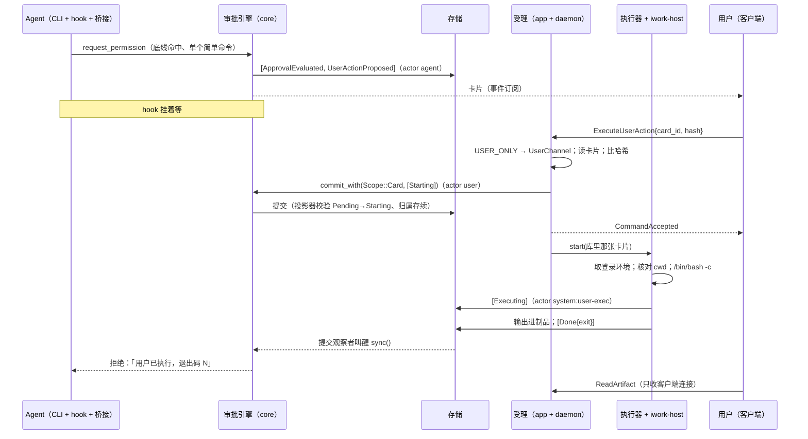

# T10e 实施方案：亲手执行与安全清单

- 状态：初稿（2026-11-12），等方案审查（任务 ID 由 supervisor 定，`-plan` 后缀）
- 任务卡：`docs/tasks/M1/T10e.md`（范围 2a、2c；验收 1、2）
- 依据：需求 7.2（安全能力的分层、能力与界面分离）、FR11、第 9 章（系统底线、已知限制）、AC36、AC41；M1 技术设计 7.0、7.2a、7.2c、7.3；`AGENTS.md`「安全不变量」亲手执行一条；T01 方案 4.3（卡片表、对话表、附录 B）；T07 方案 4.3、4.4、5.4、6.7、6.9、6.10.6 第 8–10 条、6.10.8；T04 方案 2.5、2.8、第 11 节交接；T06 方案第 8 节、3.4a、4.5、5.3；T03 方案 2.4、S2
- 前置：T10a 合入（它又等 T04 组 3、T06 S6–S9）。本方案用到 T10a 的东西都列在 1.4，标「T10a 交付」

## 0 一页总览

1. **大部分地基已经在 main 上**。协议（四个卡片命令、两个清单命令、一个查询、四种事件、三个错误码）、卡片状态机与提交时校验、`ExecutionBackend` 端口、亲手执行判定与哈希、清单校验纯函数、会话快照、崩溃恢复把执行到一半的卡片转「结果未知」，都已合入。T10e 要写的是三块：`iwork-host` 的执行后端、六条命令的受理、把它们接进 T10a 的链路；再加引擎和续接说明两处小改（2.5）。
2. **不加协议字段、不加事件种类、不加数据库迁移**。所以这张卡合入后发现问题，装回上一版就能退（T07 PD6、T04 Q4 的条件都满足）。
3. **「只有用户本人能点」做成一个类型**。`iwork-app::channel::UserChannel` 只有校验过连接的函数造得出来；启动卡片、忽略、停止、确认结束、清单增删的计划函数都要这个值当参数，忘了查通道就编译不过。哪些命令只收用户本人，登记在一张表 `USER_ONLY` 里（2.2）。
4. **执行的内容只来自落盘的卡片**。`ExecuteUserAction` 只带卡片编号和哈希；执行器拿的是库里那张卡片的命令或补丁，请求里没有可执行的内容。卡片的转换表没有回到「待执行」的边，一张卡片最多执行一次（T01 4.3）。
5. **Agent 这一侧只听得到一句固定的话**。引擎已有的 `card_settled_message` 是唯一出处（「用户已执行，退出码 N」等五句）。输出进制品区，只有客户端连接读得到；制品区对 Agent 是底线禁读。
6. **安全清单的校验照 T07 的纯函数，T10e 补两件**：范围内每一种会话形状各校验一遍（全局条目要对每个项目都成立）；路径条目把「写下的位置」和「解析后的真实位置」两种都校验（经链接指进凭据目录的可写目录要拒）。生效靠 T10a 每次起 CLI 进程前重读清单、重算快照，T10e 用端到端用例证明改动到得了审批和沙箱设置两头。
7. **要产品负责人定的 5 件、知情并登记已知限制的 5 件**，在第 10 节。都不挡开工的是 Q2、Q3、Q4；Q1、Q5 定之前，步 4 和步 1 的表各有一行先按推荐做、留好改口。

## 1 现状与约束

### 1.1 已有的（main，2026-11-12）

| 东西 | 在哪 | T10e 怎么用 |
| --- | --- | --- |
| 命令 `ExecuteUserAction{card_id, proposal_hash}`、`DismissUserAction`、`StopUserAction`、`ConfirmUserActionEnded`、`AddSecurityListEntry{list, value, scope}`、`RemoveSecurityListEntry{entry_id}`；查询 `ListSecurityLists` | `proto/iwork/v1/{commands,queries}.proto` | 原样受理，不加字段 |
| 事件 `UserActionProposed`、`UserActionStateChanged`、`SecurityListEntryAdded`、`SecurityListEntryRemoved` | `events.proto` 130、131、140、141 | 原样提交 |
| 错误码 `USER_ACTION_HASH_MISMATCH`(72)、`USER_ACTION_NOT_PENDING`(73)、`USER_ACTION_WRONG_CHANNEL`(74)、`SECURITY_LIST_ENTRY_REJECTED`(110)、`RULE_NOT_REVOCABLE`(111) | `common.proto` | 2.7 的对照表 |
| 卡片状态机 `USER_ACTION_TRANSITIONS`、`check_committed`（提交时校验整张表，T07 PD2） | `crates/iwork-domain/src/user_action.rs` | 所有卡片事件都经 `card.apply(触发)` 得到；撞车由写线程裁决 |
| `ExecutionBackend`、`ExecutionHandle`、`OutputSink`、`ExecError` | `crates/iwork-ports/src/exec.rs` | `iwork-host` 实现它 |
| `propose_user_action`、`proposal_hash` | `crates/iwork-core/src/approval/evaluate/proposal.rs` | 受理时重算哈希比对 |
| 引擎建卡片并等结果：`propose_card`；到终态经折叠的 `CardSettled` 把话带给挂着的 hook；`card_settled_message` | `crates/iwork-core/src/approval/engine/{decisions,fold,mod}.rs` | 不改结果文字；2.5 改 `propose_card` 一处 |
| `engine.commit_with(Scope::Card(对话), req)`：卡片「从待执行出发」的事件在对话令牌上排队 | `engine/external.rs` | 启动、忽略走它（T07 6.10.6 第 9 条） |
| `validate_list_entry`、拒收名单、`rules::revocable` | `crates/iwork-core/src/approval/rules/` | 清单受理调它 |
| `snapshot_for`、`rule_paths_for`、`constraints_for`；折叠记 `snapshot_inputs_seq` | `crates/iwork-core/src/approval/session.rs` | 会话启动时用（T10a 交付） |
| 约束翻成 Claude Code 沙箱设置 | T06 方案第 8 节（`settings.rs`） | 不改；端到端用例断言它的输出 |
| 崩溃恢复：`Starting` / `Executing` / `Stopping` 的卡片 → `Unknown` | `crates/iwork-core/src/recovery.rs`；T04 2.5 | 不改；启用演练 |
| `Deleting` 期间放行的收尾命令表 `DELETING_ALLOWED`、`admission::admit` | `crates/iwork-app/src/admission.rs` | 受理时调它 |
| `ShutdownDaemon` 的受理、`RunningWork`（含「执行中的卡片数」） | `crates/iwork-daemon/src/{handler/lifecycle,work}.rs` | 卡片那一半由 T10e 接 |
| 连接上下文 `ConnectionContext{client_kind, signature_checked}` | `crates/iwork-ipc/src/server/handler.rs` | 用户通道的判断只看这两样 |
| 读模型 `security_lists()`（库里三张清单的用户条目）、`artifact_is_referenced`（含卡片） | `crates/iwork-ports/src/read_model.rs` | 查询与输出读取 |

样板：受理照 `handler/lifecycle.rs` + `iwork_app::lifecycle::decide_shutdown` 的写法（判断是 `iwork-app` 里的纯函数，`iwork-daemon/src/handler/` 里的外壳只取数、调用、提交）；登记表照 `DELETING_ALLOWED`；进程组的起停照 `crates/iwork-agent-acp/src/process.rs`。

### 1.2 约束

- `AGENTS.md` 安全不变量：卡片写明精确命令或补丁加理由；不可记住；全开档也出现；不得做成 Agent 能自己批准的通道；执行后 Agent 只得知是否执行与退出码，输出只给用户；判定在编排核心，用户确认在应用服务，执行在 `iwork-host`，适配层只转发。
- 安全设计原则（需求 v1.50、v1.69）：不为堵一个缺口引入一串新机制；新增安全规则不改已有规则与求值流程；盖不住的记已知限制、交产品负责人。
- 判定结果固定五种，不新增；求值七步不动（T10e 不碰 `evaluate/`）。
- 依赖方向：`iwork-app` 不依赖 `iwork-ipc`、`iwork-host`、`iwork-store`；`iwork-host` 只依赖 `iwork-ports`、`iwork-domain`、`iwork-rootfs`（`scripts/deps-policy.toml`）。
- 崩溃后的卡片按做法 A（产品负责人 2026-11-09）：不核对进程、不停、不重跑、不自动判结束。
- M1 不支持 Windows：执行后端在非 unix 平台直接回 `SpawnFailed{"M1 不支持 Windows"}`，用到真进程的测试限定 `#[cfg(unix)]`。
- 安全清单的界面待定（需求 v1.65、v1.66）：只经命令验收。

### 1.3 两问

**再加一种要动几处？**

- 再加一条「只收用户本人」的命令：`USER_ONLY` 加一行，处理函数签名带上 `&UserChannel`。一处表、一处函数。
- 再加一张安全清单：`SecurityList` 加一个变体和它的层（domain）、`validate_list_entry` 加一个分支（core）、`constraints_for` 或 `Boundaries` 认这个层（core）。受理、查询、事件、存储都不用动。这是 T07 留下的结构，T10e 不改。
- 卡片再加一种提议内容（现在是命令、补丁两种）：`Proposal` 加变体、`proposal_hash` 加分支、`ExecutionBackend` 加一个方法、执行器的 `match` 加一支。四处，都由穷举 `match` 逼着改全。

**改这里牵动谁？**

- `USER_ONLY` 表与 `channel::verify`：`ShutdownDaemon` 现在的判断 `may_shut_down` 改成读它（行为不变）。
- `propose_card` 的复用（2.5）：引擎的性质测试 `engine_interleavings`、T09 客户端对「同一张卡片被再次等」没有感知（没有新事件）。
- `ResumeReason` 加变体（2.5）：T06 的 `resume_note` 快照测试、T10a 选续接说明的地方。
- 卡片执行器：T04 的 `RunningWork`（数卡片、退出时停卡片）、T10a 的对话删除流程（停卡片、卡片到终态后再查一次）、T10b 的助手删除流程（同样的两件事）。
- 清单受理：T10a 的会话启动（读清单的地方）；T06 的设置翻译（只读它的输出）。

### 1.4 用到 T10a 的东西（T10a 交付；名字以 T10a 为准）

T10a 只写接线说明、不走方案审查，所以这里写的是 T10e 需要它**做到什么**。步 0 拿 T10a 实际合入的代码逐条核对，对不上的回 architect 改本方案，不在代码里将就。

| # | T10a 交付 | T10e 怎么用 | 依据 |
| --- | --- | --- | --- |
| A1 | 命令与查询的分发：`DaemonHandler` 内层的真 `RequestHandler`，按命令种类分到 `handler/*.rs`；`command_id` 幂等，重发返回重放的回执；每个请求开 `command` span | 六条命令、一个查询各加一支；「只有新提交才起进程」靠回执里的重放标记（2.3） | T04 第 11 节交接；T01 3.2 |
| A2 | 装好的 `Arc<ApprovalEngine>`，和「提交观察者叫醒、独立任务跑 `sync()`」那条线 | `commit_with(Scope::Card)`；执行器直接提交的卡片事件靠这条线送到挂着的 hook | T07 6.10.8；T10a 验收 3 |
| A3 | 会话启动：**每次起 CLI 进程前**（新回合、续接都算），在一个读事务里读 `security_lists()` 和 head，调 `rule_paths_for` + `snapshot_for`，把**同一份**快照交给 T06（翻成设置）和 `SessionKeys`；构造 `EnvPaths` 的函数只有一个 | 清单「对新启动的会话生效」就是它。T10e 不改它，用端到端用例证明（7.2）；清单校验要「每种会话形状的 `EnvPaths`」，调同一个构造函数（2.6） | T07 6.9、4.3；技术设计 7.2c |
| A4 | `RunningWork` 的回合那一半 | 卡片那一半由 T10e 加：`running()` 的卡片数、`cancel_all` 停卡片、`abort_all` 封口（2.3） | T04 2.8 |
| A5 | `DeleteConversation` 的删除流程：进 `Deleting`、经 `commit_with(ConversationDeleting)` 作废待处理项、全部到终态后提交 `ConversationDeleted`；一个幂等的「再查一次这个对话能不能删完」入口 | T10e 在进 `Deleting` 时停这个对话执行中的卡片；卡片到终态后调「再查一次」 | T01 4.3 对话表；技术设计 9.0 |
| A6 | `ResumeTurn` 受理里选续接说明的地方（`Approved` / `Denied` / `Interrupted`） | 加上卡片的那一句（2.5） | T06 5.3 |
| A7 | 端到端测试夹具：真存储 + 真引擎 + 假运行时 + 经 ipc 发命令的客户端 | 第 7 节的端到端用例都建在它上面 | T10a 验收 |

**空窗提醒（给 supervisor）**：T10a 合入之后、T10e 组 1 合入之前，引擎已经会出卡片，可「执行」「忽略」还没人受理：卡片点不动，回合挂到用户取消或等待上限（约两小时）。组 1 要紧跟 T10a；中间这段产品负责人碰到卡片就取消回合。

## 2 模块与接口

### 2.1 crate 与文件

| crate | 新增 / 改 | 内容 |
| --- | --- | --- |
| `iwork-app` | 新 `channel.rs` | `UserChannel`、`USER_ONLY`、`verify`（纯函数） |
| `iwork-app` | 新 `user_action.rs` | 四个命令的计划函数、执行结果 → 事件、输出截断规则（纯函数） |
| `iwork-app` | 新 `security_lists.rs` | 增、删的计划函数，查询结果的拼装（纯函数） |
| `iwork-host` | 新 `exec.rs`、`login_env.rs` | `UserExecBackend`：起进程、停、等、打补丁；取登录 shell 的环境 |
| `iwork-daemon` | 新 `handler/user_action.rs`、`handler/security_lists.rs`、`card_runs.rs` | 外壳：取数、调计划函数、提交、把卡片交给执行器 |
| `iwork-daemon` | 改 `handler/lifecycle.rs`、`work` 的实现、`boot.rs` 装配 | `may_shut_down` 读 `USER_ONLY`；`RunningWork` 接卡片 |
| `iwork-core` | 改 `approval/engine/decisions.rs`、`turn/resume_note.rs` | 2.5 的两处 |
| `iwork-ports` | 改 `read_model.rs`、`exec.rs` | 加按编号取一张卡片的查询；加常量 `STOP_GRACE` |
| `iwork-store` | 改 `read_model.rs` | 上面那个查询的实现（读 `user_actions` 表已有的快照列，不加列） |
| `iwork-agent-acp` | 改 `process.rs` 一行 | `GRACE_PERIOD` 改成读 `iwork_ports::exec::STOP_GRACE`（值不变） |

`STOP_GRACE` 为什么挪：T01 4.3 写卡片停止「3 秒后结束进程树（与回合取消一致）」，「一致」现在靠两处各写一个 3。真值放端口，两边都读它。

### 2.2 用户通道（`iwork-app::channel`）

```rust
/// 证明这条请求来自用户本人操作的客户端连接。字段私有，只有 `verify` 造得出来。
pub struct UserChannel(());

/// 判断用的事实。`iwork-app` 不认识 ipc 的类型，由 daemon 从 `ConnectionContext` 抄过来。
#[derive(Debug, Clone, Copy)]
pub struct ChannelFacts {
    pub client_kind: pb::ClientKind,
    pub signature_checked: bool,
    /// daemon 传 `cfg!(feature = "dev")`
    pub dev_build: bool,
}

/// 只收用户本人的命令（proto `Command` oneof 字段名 → 被拒时的错误码）。加一条 = 加一行。
pub const USER_ONLY: &[(&str, pb::ErrorCode)] = &[
    ("execute_user_action", UserActionWrongChannel),
    ("dismiss_user_action", UserActionWrongChannel),
    ("stop_user_action", UserActionWrongChannel),
    ("confirm_user_action_ended", UserActionWrongChannel),
    ("add_security_list_entry", PermissionDenied),      // 见 Q5
    ("remove_security_list_entry", PermissionDenied),   // 见 Q5
    ("shutdown_daemon", /* 沿用 handler/lifecycle.rs 现在回的码 */),
];

pub fn verify(facts: ChannelFacts) -> Result<UserChannel, WrongChannel>;
```

`verify` 的规则只有一条：`client_kind == DESKTOP && signature_checked`；`dev_build` 时再放过 `DEV_TOOL` 与没查签名的连接（开发期的 `ipc-tool`、`tauri dev`）。发布构建里 `signature_checked` 恒为真（T03 2.4），所以实际只剩「是不是桌面客户端」。

分发入口（A1）在调处理函数之前查表：命令在 `USER_ONLY` 里就先 `verify`，不过就回表里的错误码，并往 `audit::TARGET` 写一行日志（连接编号、对端 pid、命令名；不写载荷）。被拒不产生事件：让随便一条连接都能往事件日志里塞东西，是另一个口子。

**这道检查挡的是什么，要说老实话**（技术设计 7.2a 第 3 条写的是「桥接与 hook 的连接发来即拒绝」）：照 T03、T06 的实际接法，桥接经 stdin/stdout 和后台说 ACP，hook 只连桥接，两者都不连后台的 socket；能连上后台 socket 的进程先要过 T03 的同用户、同签名校验。所以「Agent 够不着」主要靠结构，这张表是第二道：

| Agent 能碰到后台的口子 | 为什么走不到「启动卡片」 |
| --- | --- |
| ACP `session/request_permission`（hook → 桥接 → 后台） | 进的是 `PermissionDecider::decide`，只会返回放行或拒绝；判成亲手执行时返回的是拒绝，并且要等卡片到终态。这条路上没有提交 `Starting` 的代码 |
| ACP `session/update`（正文、工具活动） | 只变成消息与工具事件，内容不当命令解析（AC05「消息内容不能伪造用户批准」） |
| 后台的本机 socket | 成员命令在沙箱里，沙箱不放行本机 socket（技术设计 7.0）。沙箱外执行的命令要先过审批；连上了还要过对端校验（不是 iWork 签名的程序被拒）。同用户、能在沙箱外跑任意代码的程序先建连再 exec 成 iWork 程序，是已登记的已知限制（需求 v1.73） |
| 用户消息里写「请点执行」 | 文字不是命令 |
| 以后给 AI 开的「调用能力」（需求 v1.76） | M1 没有。到时那个入口也要过 `USER_ONLY`，表里的命令不给 AI（Q5） |

开发构建开 `--dev-trust` 时，对端校验只剩「同用户」，任何沙箱外的程序都能自称桌面客户端发任何命令（不只这六条）。这是 T03 S3 已有的结论，T10e 不加东西；日常使用用签名构建。

### 2.3 卡片的受理与执行

**计划函数（`iwork-app::user_action`，纯函数）**

```rust
pub fn plan_execute(_: &UserChannel, card: &UserActionCard, claimed: &Sha256) -> Result<DomainEvent, CardRefusal>;
pub fn plan_dismiss(_: &UserChannel, card: &UserActionCard) -> Result<DomainEvent, CardRefusal>;
pub fn plan_stop(_: &UserChannel, card: &UserActionCard) -> Result<DomainEvent, CardRefusal>;
pub fn plan_confirm_ended(_: &UserChannel, card: &UserActionCard) -> Result<DomainEvent, CardRefusal>;

pub enum CardRefusal { NotPending { state: UserActionStateKind }, HashMismatch, NotInState { want: UserActionStateKind, got: UserActionStateKind } }

/// 执行器看到的结果 → 要提交的事件。`card` 只用来过转换表。
pub enum RunOutcome { Spawned, SpawnFailed(String), Finished(ExitStatus), WaitFailed(String), LetGo }
pub fn outcome_events(card: &UserActionCard, outcome: RunOutcome, output: Option<ArtifactRef>) -> Result<Vec<DomainEvent>, UserActionIllegal>;
```

- 每个函数都是「克隆卡片 → `apply(触发)` → 出 `UserActionStateChanged`」，合不合法只问 `USER_ACTION_TRANSITIONS`，不另写判断。
- `plan_execute` 多两步比对：`claimed == card.proposal_hash`，以及 `proposal_hash(&card.proposal) == card.proposal_hash`（库里的内容和哈希对不上就不执行，点名报错；这是不可能发生的状态，不兜底）。
- `LetGo` 用 `ProcessLost` 触发（→ `Unknown`）：意思是「后台不再持有这个进程」，和崩溃恢复同一个去处。

**四个命令的步骤（`iwork-daemon/src/handler/user_action.rs`）**

共同的开头：① 查 `USER_ONLY` 拿到 `UserChannel`；② 读卡片（读模型新增 `user_action(id) -> Option<UserActionCard>`），没有 → `NOT_FOUND`；③ 读对话，`admission::admit(对话, 命令, Some(卡片), card_runs.holds(id))`，删除中的对话只放行停止与确认（`CONVERSATION_DELETING`）。

| 命令 | 之后的步骤 |
| --- | --- |
| `ExecuteUserAction` | `plan_execute` → `engine.commit_with(Scope::Card(对话), {command_id, actor: "user", events})` → 回 `CommandAccepted{seq}` → **回执不是重放的（`CommitReceipt.replayed == false`）才** `card_runs.start(卡片)`。被投影器拒（别人先启动、先作废了，或对话在删、助手已删）→ `USER_ACTION_NOT_PENDING` |
| `DismissUserAction` | `plan_dismiss` → `commit_with(Scope::Card)`。折叠应用后，挂着的 hook 收到「用户未在 iWork 中执行」 |
| `StopUserAction` | `plan_stop`（要求 `Executing` 且本进程持有句柄）→ 直接提交 `Stopping`（actor `user`）→ `card_runs.stop(id)`。进程先自己结束了 → 提交被拒 → `PRECONDITION_FAILED`（已经结束，不用停） |
| `ConfirmUserActionEnded` | `plan_confirm_ended`（要求 `Unknown`）→ 直接提交 `Ended`（actor `user`）→ 对话在 `Deleting` 就调 A5 的「再查一次」 |

启动、忽略走 `commit_with`、别的直接提交，是 T07 6.10.6 第 9 条定的：只有「从待执行出发」的两种要和作废计划在对话令牌上排队。

**执行器（`iwork-daemon/src/card_runs.rs`，薄外壳）**

```rust
pub struct CardRuns<B: ExecutionBackend, S, A> { /* 句柄表：UserActionId → (ConversationId, B::Handle)；封口标记 */ }
impl CardRuns {
    pub fn start(&self, card: UserActionCard);            // 起一个任务跑下面的流程
    pub fn holds(&self, id: UserActionId) -> bool;        // admission 的 handle_held
    pub async fn stop(&self, id: UserActionId);           // handle.stop()：先请求结束，STOP_GRACE 后结束整个进程组
    pub fn count(&self) -> u32;                           // RunningWork::running() 的卡片数
    pub async fn stop_where(&self, pick: impl Fn(ConversationId) -> bool, actor: &Actor);  // 对话删除、完全退出
    pub fn seal(&self);                                   // abort_all：之后不再起进程
}
```

一张命令卡片的流程：

1. 已封口 → 什么都不做（卡片留在 `Starting`，下次启动的恢复把它转成结果未知）。
2. `backend.run_as_user(req, sink)`。失败 → 提交 `Failed{error}`，结束。
3. 句柄进表 → 提交 `Executing`。
4. `handle.wait()`：
   - 结束 → 输出存成制品（`ArtifactStore::put_bytes`）→ 提交 `Done{exit}` 带输出引用。
   - 等待失败 → `handle.stop()` 尽力停 → 提交 `Unknown{error}` 带已收到的输出。
5. 句柄出表；卡片的对话在 `Deleting` → 调 A5 的「再查一次」。

补丁卡片：`backend.apply_patch_as_user(req)`，成功 → 一笔提交 `[Executing, Done{exit: Code(0)}]`；失败（内容已变、目标不是普通文件、读写出错）→ `Failed{error}`。补丁是原子替换，失败就是文件没动。

**记不下来就放手**：第 3、4 步的提交失败（存储出错，或被投影器拒）时，进程已经在跑、状态却写不进去。做法只有一种：`handle.stop()` 尽力停 → 用 `LetGo` 试一次提交 `Unknown` → 句柄出表。这一笔也失败就只记错误日志：卡片停在库里原来的状态，存储故障由 T04 的 `store_health` 让后台退出重启，恢复把它转成结果未知。不重试提交、不重跑命令。

执行器写的事件 actor 是 `system:user-exec`（它们是结果记录）；用户点出来的四种（`Starting`、`Dismissed`、`Stopping`、`Ended`）actor 是 `user`。删除对话、完全退出引起的 `Stopping` 用发起那条命令的 actor。

**输出**（规则在 `iwork-app::user_action`，一处）：stdout 和 stderr 合成一路按到达顺序收；内存里最多留 `OUTPUT_HEAD = 256 KiB` 的开头加 `OUTPUT_TAIL = 768 KiB` 的结尾，中间丢掉的地方插一行「（中间有 N 字节没有保存）」；管道一直读到底，子进程不会因为我们不读而卡住。M1 执行中不往客户端推实时输出（协议里没有这种增量事件，见 Q2），结束时一次存成制品。日志只写卡片编号、状态、退出码、字节数，不写输出。

**接 `RunningWork` 与对话删除**

- `running()`：卡片数 = `card_runs.count()`。`ShutdownDaemon` 没带确认、又有卡片在跑 → 已有的 `PRECONDITION_FAILED`（T04 2.8）。
- `cancel_all()`（用户点「完全退出」）：`stop_where(全部)`，等它们到 `Done`（停机表第 2 步的 5 秒之内）。
- `abort_all()`（信号、升级、故障）：`seal()`，**不停卡片的进程、不提交事件**；后台退出后它们成了没人管的进程，下次启动转结果未知（T04 L2，做法 A）。
- 对话进 `Deleting`（A5）：`stop_where(这个对话)`；`Unknown` 的卡片停不了，对话停在 `Deleting` 等用户点「我已核对」（T01 4.3）。
- 删除助手（T10b）同样调 `stop_where`，写进给 T10b 的交接（第 12 节）。

### 2.4 `iwork-host` 的执行后端

```rust
pub struct UserExecBackend { /* 路径解析器；STOP_GRACE */ }
impl ExecutionBackend for UserExecBackend { type Handle = UserExecHandle; … }
```

**起命令**（技术设计 7.2a 第 4 条：后台直接起进程，不经厂商 CLI、不带 hook、不进沙箱）

| 项 | 做法 | 为什么 |
| --- | --- | --- |
| 解释器 | 固定 `/bin/bash -c <卡片里的命令文字>` | 审批是按 bash 语法分析这段文字的（`iwork-shell`）；卡片只为「单个简单命令、全部词字面」生成（T07 5.4），里面没有变量、通配、命令替换，引号与重定向在 bash 下的含义就是分析时认的含义。换成用户自己的 shell（zsh 的 `=cmd`、fish 的语法）会让「看到的」和「跑的」对不上。见 Q3 |
| 工作目录 | 提议里的 `cwd`。起之前用 `PathResolver` 再解析一遍，和提议里记的规范路径不是同一个位置就不起（`SpawnFailed{"工作目录在卡片提出之后变了"}`） | 卡片提出之后有人把这个目录换成链接，`rm config` 删的就是别处的 `config` |
| 环境 | 用户登录 shell 的环境（下一段）；子进程的环境只来自它，不继承后台的 | 技术设计 7.2a 第 4 条；后台从登录项启动时 `PATH` 很短 |
| 标准输入 | `/dev/null` | 设计原文「stdin 关闭」 |
| 进程组 | 自己当会话首进程与组长（`setsid`） | 停的时候整组一起停；后台退出不连带它（做法 A） |
| 停 | `SIGTERM` 发给整组 → `STOP_GRACE`（3 秒）→ `SIGKILL` 整组；幂等 | 端口注释已定 |
| 句柄丢弃 | **不**结束进程 | 和回合的 `SupervisedProcess` 相反：卡片的进程是用户起的，只有用户（停止、删除、完全退出）能叫停。所以不复用 `SupervisedProcess`，自己写这一小段 |

**登录 shell 的环境（`login_env.rs`）**：每次执行现取，不缓存。取法：登录 shell（系统用户库里登记的那个，取不到用 `/bin/sh`）跑 `-l -c 'echo __IWORK_ENV__; exec env -0'`，stdin 关闭、自成进程组、10 秒到时结束整组；输出里标记行之后按 NUL 切成 `KEY=VALUE`。取不到（到时、退出码非零、没有标记行）→ `SpawnFailed{"取不到登录 shell 的环境：<原因>"}`，卡片转 `Failed`，用户用「复制命令」自己跑。不退回去用后台自己的环境：那样「这条命令是在什么环境下跑的」就没有一个确定的答案。各种 shell 上这条命令行不行得通，列为需实测 U1（第 8 节）。

**打补丁**（`apply_patch_as_user`）：目标路径逐级不跟随链接地打开（用 `iwork-rootfs` 现有的逐级检查，根取文件系统根；接口不合用就在 `iwork-rootfs` 里补，不在 host 里另写一套）。规则：

- `old` 为空：文件必须不存在，新建。
- `old` 非空：文件里 `old` **恰好出现一次**才替换；零次或多次 → `PatchConflict`。Edit 带 `replace_all` 时卡片上只有一组新旧文字，多处命中按冲突处理（保守）。
- 写法：同目录临时文件 → 写入、落盘 → 沿用原文件的权限位 → 改名替换。改名之前任何一步失败，原文件不变。
- 任何一级是链接、目标不是普通文件 → `Io{path, message}`。

### 2.5 引擎与续接说明的两处小改

这两处动的是 T07、T06 已合入的代码，单独一步、单独一笔提交（步 4），请审查重点看。起因是同一个场景：**hook 的等待上限（约两小时，T06 4.5）到了，卡片还没人处理**。这时回合转「已中断」，卡片不作废、仍是待执行（T07 6.7），可等它的 hook 已经没了。

**① 续接说明带上卡片的结果（`iwork-core::turn::resume_note`）**

```rust
pub enum ResumeReason<'a> { …, /// 中断时有卡片没等到结果
    CardOutcome { tool: &'a str, summary: &'a str, outcome: &'a str } }
```

文字：「[iWork] 上一轮因为等用户处理暂停了。你当时发起的那次调用（{tool}：{summary}）动的是 iWork 系统底线保护的内容，已被拒绝并转给用户亲手处理。结果：{outcome}。不要重新发起它，也不要换别的方式做同一件事。请继续剩下的工作；没有它就完不成的话，说明原因后停下。」

- `outcome` 只有六种取值：`card_settled_message` 的五句，加待执行时的「用户还没处理」。不带输出、不带错误细节以外的东西，和 hook 那条路说的是同一句话。
- `summary`：命令卡片取命令文字的第一行（截到 200 字），补丁卡片取目标路径。都是 Agent 自己发过的内容。
- 用在哪（A6）：回合从「已中断」续接时，这个回合名下状态不是「已作废」的卡片，按提出的先后各拼一句，接在 T10a 选出的那条说明后面，最多取最近 5 张。回合里更早、hook 当时已经听到结果的卡片会被再说一遍，多说无害，换来的是不用记「哪张卡片的结果送到过」。
- 不自动续接：用户处理完卡片，回合还是「已中断」，对话里的「继续 / 放弃」照旧，点「继续」才带着这句话续上。和「中断后用户拒绝审批」的处理一致（技术设计 7.3 第 5 条）。见 Q1。

**② 同一回合重发同一条调用，等原来那张卡片（`engine/decisions.rs::propose_card`）**

建卡片之前先看折叠：这个回合名下有没有一张**待执行、提议哈希相同、此刻没有等待方**的卡片。有 → 不建新的，只提交这次求值的审计事件，把等待方登记到那张卡片上；没有 → 照旧新建。

- 目的：续接之后模型把那条命令又发了一遍（同一回合里另一条审批被批准而自动续接时很容易发生），不让对话里出现两张内容一样的待执行卡片。两张都点「执行」，一条只能跑一次的命令（往 `~/.ssh/config` 追加一行）就跑了两次。
- 限定「没有等待方」：同一回合里并行发了两次相同调用、前一个还在等时，不去抢它的登记，照旧各建各的。
- 已经执行过的卡片不复用：模型不听劝又发一遍时，出的是一张新卡片，要不要再执行由用户看着定。
- 不动求值、不动折叠表、不加事件；审计事件照常写，结果仍是「亲手执行」。

### 2.6 安全清单的受理

**计划函数（`iwork-app::security_lists`，纯函数）**

```rust
pub struct AddInput<'a> {
    pub list: SecurityList, pub value: &'a str, pub scope: RuleScope,
    /// 范围内每一种会话形状各一份（A3 的同一个构造函数给出）：某个项目 → 这个项目一份；
    /// 全局 → 每个已登记项目一份，每个助手的私聊目录一份
    pub envs: &'a [EnvPaths],
    pub project_roots: &'a [CanonicalPath],
    /// 库里已有的清单用户条目
    pub user_entries: &'a [RuleEntry],
    /// 路径清单：写下的位置解析后的真实位置；和写下的是同一个位置时为 None（外壳先经 PathResolver 取好）
    pub resolved: Option<&'a CanonicalPath>,
}
pub fn plan_add(_: &UserChannel, input: &AddInput, fs: &impl PathResolver, now: Timestamp, id: RuleId) -> Result<DomainEvent, AddRefusal>;
pub fn plan_remove(_: &UserChannel, entry_id: RuleId, found: Option<&RuleEntry>, builtin: &[RuleEntry]) -> Result<DomainEvent, RemoveRefusal>;
pub fn list_view(builtin: &[RuleEntry], user_entries: Vec<RuleEntry>) -> Vec<RuleEntry>;
```

`plan_add`：

1. 范围只收全局或某个项目（`Assistant`、`Conversation` → `INVALID_ARGUMENT`）；项目要存在（外壳查，不存在 → `NOT_FOUND`）。
2. 对 `envs` 里每一份：规则集 = `builtin_rules(env)` 加范围内的 `user_entries`，调 `validate_list_entry`。任何一份拒收就拒收，理由原样带出（`SECURITY_LIST_ENTRY_REJECTED`，`message` 是给人看的理由）。
3. 路径清单且 `resolved` 有值：把真实位置当成 `value` 再走一遍第 2 步。两种位置都过才算过。
4. 出 `SecurityListEntryAdded{rule}`，`rule` 是第 2 步返回的条目（各份 `env` 给出的条目相同：三张清单的匹配器只跟主目录有关）。

为什么要第 2 步的「每一份」：`validate_list_entry` 拿到的规则集里，`.git` 内部、`.claude` 设置这些内置条目的路径是按**某一个**工作区填出来的。全局条目只拿一个工作区去校验，`~/code` 这种把别的项目整个包住的可写目录就查不出来。

为什么要第 3 步：T07 4.4 定的校验只做词法规范化、不碰磁盘。用户加一个可写目录 `~/w`，它实际是指向 `~/.ssh` 的链接：词法上和凭据目录不重叠，校验过了，`~/w` 进了沙箱的 `allowWrite`。审批这道闸不受影响（求值时按真实位置判，底线照拒），可沙箱那边「放行的路径和禁写的路径经链接指到同一处时谁赢」是厂商行为，没测过（需实测 U2）。方案不靠它：加的时候两种位置都校验（和 T07 3.5「两种视图都过底线」同一个做法）。加完之后目录才被换成链接的，校验管不到，登记已知限制（K2）。

`plan_remove`：编号在内置条目里（`builtin` 里找得到，`rules::revocable` 为假）→ `RULE_NOT_REVOCABLE`；库里没有（含会话里临时生成、不入库的路径别名与临时敏感条目，查询也不列它们）→ `NOT_FOUND`；有、但不是清单条目（是记住的规则）→ `INVALID_ARGUMENT`（「这是记住的规则，请用撤销规则」）；否则出 `SecurityListEntryRemoved`。

**外壳（`handler/security_lists.rs`）**：增删共用一把异步锁（读已有条目 → 校验 → 提交，一次只进一条），不然两条并发的新增都通过查重。事件 actor 是 `user`，这两种事件本身就是审计记录（`rule` 流）。被拒的请求写一行日志，不产生事件。

**查询 `ListSecurityLists`**：一个读事务里读 `security_lists()` 和 head；结果 = 三张清单的内置条目 + 库里全部用户条目（各种范围都给，调用方自己按范围筛）。内置条目用任意一份 `EnvPaths` 填都一样（三张清单的内置条目不含工作区路径，测试守着）。每次会话临时加的敏感条目（别的项目目录、别的助手的私聊目录）不列：它们随会话变，协议里这个查询也不带项目参数。

**生效**：T10e 不写生效的代码。A3 每次起 CLI 进程前重读清单、重算快照；M1 每一轮都起新进程（技术设计 7.1「每轮结束后会话即结束」），所以改动从任何对话的**下一轮**开始生效，正在跑的这一轮用旧快照跑完（技术设计 7.2c）。要立刻生效：取消当前回合再发消息。T07 6.9 提到的「提示用户有回合还在用旧清单」M1 不做：界面待定，协议里也没有放这句话的地方。

### 2.7 错误码对照

| 情形 | 错误码 | 可重试 |
| --- | --- | --- |
| 卡片四个命令来自非用户通道 | `USER_ACTION_WRONG_CHANNEL` | 否 |
| 清单增删来自非用户通道 | `PERMISSION_DENIED` | 否 |
| 卡片、条目、项目不存在 | `NOT_FOUND` | 否 |
| 哈希不符（请求的，或库里内容与哈希对不上） | `USER_ACTION_HASH_MISMATCH` | 否 |
| 执行、忽略时卡片不在待执行；启动被投影器拒 | `USER_ACTION_NOT_PENDING`，`details.state` 带现在的状态 | 否 |
| 停止时不在执行中或本进程没有句柄；确认时不在结果未知 | `PRECONDITION_FAILED`，`details` 带状态与 `handle_held` | 否 |
| 对话删除中（执行、忽略） | `CONVERSATION_DELETING` | 否 |
| 引擎 `Conflict`、存储忙 | `UNAVAILABLE` | 是 |
| 清单条目被拒收 | `SECURITY_LIST_ENTRY_REJECTED`，`message` 是理由 | 否 |
| 删内置条目 | `RULE_NOT_REVOCABLE` | 否 |
| 清单范围不对、删的不是清单条目 | `INVALID_ARGUMENT` | 否 |

执行本身的失败（起不来、取不到环境、补丁冲突）不是命令的错误：命令已经受理，结果走事件（`Failed{error}`）。

## 3 数据流



清单：`AddSecurityListEntry` →（`UserChannel`、锁、每种会话形状校验、两种位置校验）→ `SecurityListEntryAdded` 落盘 → 下一次起 CLI 进程时 A3 读到 → `snapshot_for` → 一头进 T06 的设置（`excludedCommands` / `allowWrite`），一头进 `SessionKeys`（审批的归一与求值）。

## 4 每条规则的「目的 + 手段」

| # | 目的（防什么） | 手段 | 由什么保证 |
| --- | --- | --- | --- |
| R1 | Agent 不能替用户点「执行」 | 启动、忽略、停止、确认的计划函数要 `UserChannel`，它只能由连接校验造出来；ACP 入口没有通到这些函数的路；`USER_ONLY` 一张表 | `user_only_table_covers_handlers`、`wrong_channel_is_refused_and_logged`、`agent_side_inputs_never_move_a_card` |
| R2 | 用户点的和跑的是同一份内容 | 请求只带编号与哈希；执行器只拿库里的卡片；受理时比两次哈希 | `execute_requires_matching_hash`、`executor_runs_stored_proposal` |
| R3 | 一张卡片最多执行一次 | 转换表没有回到待执行的边；写线程校验；重放的回执不起进程 | `card_executes_at_most_once`、`replayed_execute_does_not_spawn`；T01 的表测试；T07 的 `t_card_start_beats_stale_void` |
| R4 | 执行过不等于以后放行（不可记住） | 命令没有「记住」字段；执行不产生任何规则；底线层没有放行效果（T07） | `user_action_commands_have_no_remember_field`、`executed_action_proposes_again`；T07 的 `baseline_hit_never_allows` |
| R5 | 全开档也要用户亲手点 | 卡片判定不看档位（T07）；切档不碰卡片；没有自动执行的路 | `full_access_card_waits_for_user`、`mode_switch_never_moves_cards`；T07 的 `to_full_keeps_user_action_pending` |
| R6 | Agent 只知道「执行了没有」和退出码 | 回给 hook 与续接说明的话只出自 `card_settled_message`；输出只进制品；制品区对 Agent 底线禁读；`ReadArtifact` 只收客户端连接；日志不写输出 | `output_canary_never_reaches_agent_side`、`resume_note_card_outcome_is_fixed_text`、`artifact_path_denied_to_agent_tools` |
| R7 | 审计记为用户本人 | 用户点出来的四种事件与清单增删 actor 是 `user`；执行器写的是 `system:user-exec` | `audit_actor_is_user` |
| R8 | 结果不确定时不重跑、不自动判结束 | 崩溃恢复转结果未知（已有）；记不下来就放手；唯一出口是用户确认 | `commit_failure_lets_go_as_unknown`、`wait_failure_marks_unknown`；演练 D1–D5（7.3） |
| R9 | 卡片提出之后工作目录被换掉，不让命令落到别处 | 起之前再解析 `cwd`，位置变了不起 | `cwd_changed_since_proposal_refuses_spawn` |
| R10 | 补丁不经链接写到别处、不写坏文件 | 逐级不跟随链接；`old` 恰好一次；临时文件加改名 | `patch_refuses_symlink_components`、`patch_conflict_leaves_file_untouched`、`patch_failure_is_atomic` |
| R11 | 卡片的进程只有用户能叫停，停就停干净 | 自成进程组；句柄丢弃不结束；停 = 整组先请后杀 | `stop_terminates_whole_group`、`dropped_handle_does_not_kill`、`abort_all_leaves_card_processes` |
| R12 | 输出再多也不拖垮后台、不卡住命令 | 头尾各留一段，中间丢弃；管道读到底 | `output_is_bounded_and_drained` |
| R13 | 等待上限之后才处理的卡片，Agent 仍然知道结果、不重复出卡片 | 续接说明的卡片一句；同回合同哈希的待执行卡片复用 | `resume_after_wait_limit_reports_card`、`t_reissued_call_reuses_pending_card`、`t_reuse_skipped_when_waiter_alive` |
| R14 | 清单改动只能是用户做的 | 增删在 `USER_ONLY` 里 | `list_commands_need_user_channel` |
| R15 | 清单条目不能把底线放宽 | 校验（T07 4.4）对范围内每种会话形状都跑；路径两种位置都校验；内置条目删不掉；清单条目只能在三张清单的层里（T07 `RuleSet` 构造） | `ac41_rejects_interpreters`、`add_validates_every_session_shape`、`add_validates_written_and_resolved_path`、`ac41_builtin_not_removable` |
| R16 | 就算坏条目进了库，底线也守得住 | 求值先判底线；沙箱的禁读禁写单独成列、不受可写目录影响（T07 `constraints_for`） | `stale_writable_entry_never_widens_baseline`；T06 G4 ⑨a–⑨c |
| R17 | 审批和沙箱用同一份清单 | 一份快照同时给 T06 与 `SessionKeys`（A3）；T10e 不另读一份 | `ac41_credential_command_project_scope`（两头都断言） |
| R18 | 清单改动不影响正在跑的回合 | 快照在起进程时定死 | `running_turn_keeps_old_lists` |

## 5 出事场景

每条写三件事：会出什么事；怎么止血和回退；由什么保证。

**S1 伪造用户执行**

- 会出什么事：Agent 想办法让卡片不经用户就执行。能试的口子在 2.2 的表里：造一个叫 `ExecuteUserAction` 的工具调用、在原始输入里塞卡片编号和哈希、在正文里写「用户已同意」、从沙箱里连后台的 socket。
- 止血和回退：这些口子都走不到提交 `Starting` 的代码，不用止血。真被绕过了（同用户、沙箱外的任意代码，需求 v1.73）：审计里那笔 `Starting` 的 actor 是 `user`、但用户没点过，对端校验日志里有 pid 可查；先「完全退出 iWork」，再查那个程序是怎么到沙箱外的。已经执行的命令收不回来。
- 由什么保证：`agent_side_inputs_never_move_a_card`（属性测试：假运行时发任意 ACP 消息序列，含上面这些形状；日志里 actor 不是 `user` 的卡片事件只可能是引擎的作废和执行器的结果记录）、`wrong_channel_is_refused_and_logged`、类型约束（计划函数的签名）。

**S2 记住、重放、点两下**

- 会出什么事：执行过一次之后同样的动作被自动放行；同一条 `ExecuteUserAction` 因为重连被重发；两个窗口同时点；用户连点两下。任何一种让命令多跑一次或以后不问就跑。
- 止血和回退：重发同一个 `command_id` 返回重放的回执、不起进程；别的并发只有一笔过得了写线程，输的回 `USER_ACTION_NOT_PENDING`。同样的动作下次再来仍是一张新卡片。命令真的被多跑了一次时，库里会有两张卡片各自的 `Starting`，一查便知；收不回来。
- 由什么保证：`card_executes_at_most_once`（并发 8 个执行请求，子进程只留下一行标记）、`replayed_execute_does_not_spawn`、`executed_action_proposes_again`、`user_action_commands_have_no_remember_field`。

**S3 全开档**

- 会出什么事：全开档下卡片被当成「可直接放行的待审批」自动执行；或切到全开时被顺手放掉。
- 止血和回退：切档不碰卡片（T07 6.5 第 3 条），卡片始终等用户。出了事：切回手动（即时生效）并取消回合。
- 由什么保证：`full_access_card_waits_for_user`（全开档端到端：出卡片 → 不点就一直等 → 点了才跑）、`mode_switch_never_moves_cards`。

**S4 执行那一刻被做了手脚**

| 手脚 | 结果 | 由什么保证 |
| --- | --- | --- |
| 卡片内容被换 | 卡片落盘后不可改；执行器只读库；哈希对不上不执行 | `execute_requires_matching_hash`、`executor_runs_stored_proposal` |
| 工作目录被换成链接或挪走 | 不起进程，卡片 `Failed`，理由写明 | `cwd_changed_since_proposal_refuses_spawn` |
| 补丁目标（或它的某一级目录）被换成链接 | 不写，卡片 `Failed` | `patch_refuses_symlink_components` |
| 补丁目标的内容变了 | `PatchConflict`，文件不动 | `patch_conflict_leaves_file_untouched` |
| 命令里**别的**路径在卡片提出后被改（`cp src/config .git/config` 的 `src/config` 换了内容；相对路径那一级换成了链接） | **拦不住**。卡片保证的是「跑的就是这段文字」，不保证文字在那一刻的磁盘上是什么效果。和需求第 9 章 v1.74「审批只看命令文字与检查那一刻的磁盘」同类 | 登记已知限制 K3 |
| 用户的 `PATH` 里有工作区内的目录（或 `.`），成员在里面放了同名程序 | **拦不住**，用户在自己终端里敲这条命令也一样 | 登记已知限制 K3 |
| 登录 shell 的启动文件被成员改过（全开档下写它不询问，需求 v1.53） | 取环境时会执行它。用户下次开终端同样会执行，卡片只是把这一刻提前了 | 不新增限制；写进 K3 的说明 |
| 理由是 Agent 写的，可以写得很像系统提示；命令很长，关键部分在看不见的地方 | 后台原样给文字。界面要把理由标成「Agent 的说明」、能看到完整命令（含 here-doc 正文）、不可见字符显出来 | 交设计窗口与 T09（第 12 节） |

- 止血和回退：前四行自动拦下，用户看到卡片失败的原因，要做就「复制命令」自己核对后跑。后几行发现时命令已经跑完，照用户平时处理误操作的办法（版本控制、备份）。

**S5 输出漏给 Agent**

- 会出什么事：用户执行 `cat ~/.ssh/config` 这类命令，输出里有 Agent 不能看到的东西，结果它出现在 hook 的回话、续接说明、续接摘要、AI 审查的输入，或 Agent 读得到的文件里。
- 止血和回退：发现泄漏 → 取消回合、删除这个对话（运行时的会话记录一并删，需求 v1.78），泄漏的内容若已发给模型厂商收不回来，按凭据泄漏处理（换密钥）。
- 由什么保证：`output_canary_never_reaches_agent_side`（命令打印一串特征字符，然后依次走：正常结束、失败、结果未知、等待上限后续接、续接失败用摘要新开、同对话再触发一次 AI 审查；断言特征串不出现在后台发给假运行时的任何内容里，也不在日志里）；`artifact_path_denied_to_agent_tools`（Agent 用 Read 工具和 `cat` 读输出制品的路径 → 底线拒）；`read_artifact_only_from_client`（已有规则的回归）。
- 两条剩下的信息通道，都是需求认可的：退出码（每次用户点击漏出不到一个字节）；补丁卡片失败时的「内容已变」（Agent 借此知道自己猜的旧内容对不对，每猜一次要用户点一次）。记在 K4。

**S6 后台崩溃、升级、退出时卡片正在执行**

- 会出什么事：命令跑到一半后台没了。重启后把卡片当成没跑过再跑一遍，一条只能跑一次的命令就跑了两次；或者当成跑完了。
- 止血和回退：做法 A（已定）：三种中间状态一律转「结果未知」，不查进程、不停、不重跑；用户核对后点「我已核对」。用户点「完全退出」是明确要停：卡片经句柄停掉，记成 `Done{被信号结束}`。
- 这次要补登的两点（K1）：① 后台没了之后，那条命令再往标准输出写东西会被系统结束（输出管道的另一头没了）；不写输出的会跑完。② 崩溃那一刻还在内存里的输出没有保存，「结果未知」的卡片上看不到输出。
- 由什么保证：演练 D1–D5（7.3，T01 附录 B 的五步，T04 Q1 留给 T10 启用的那组）；`abort_all_leaves_card_processes`；`shutdown_counts_and_stops_cards`。

**S7 状态记不下来**

- 会出什么事：进程起来了，`Executing` 或 `Done` 提交失败（磁盘满、存储出错）。界面上卡片一直是「启动中」，命令实际在跑、甚至已经跑完。
- 止血和回退：执行器放手（2.3）：尽力停进程、试着记成结果未知；再失败就等 T04 的存储健康检查让后台退出重启，恢复时转结果未知。用户核对。不重跑。
- 由什么保证：`commit_failure_lets_go_as_unknown`（假存储在第二笔提交上报错：断言子进程被停、最多再试一笔、之后没有任何提交）。

**S8 等待上限之后才处理卡片**

- 会出什么事：夜里出了一张卡片，两小时后回合中断。早上用户点了「执行」，再点「继续」。没有 2.5 的两处时：模型不知道那条命令已经跑过，多半重发 → 又出一张一样的卡片 → 用户再点一次，命令跑两遍。或者同一回合里另一条审批被批准、自动续接，模型把两条调用都重发，对话里出现两张一样的待执行卡片。
- 止血和回退：续接说明告诉模型结果、叫它别重发；它还是重发了：原卡片还待执行就复用那一张，已经执行过就出一张新的、由用户判断。用户看到重复的卡片点「忽略」。
- 由什么保证：`resume_after_wait_limit_reports_card`（端到端：等待上限 → 执行 → 继续；假运行时收到的续接输入里有那一句且文字固定）、`t_reissued_call_reuses_pending_card`、`t_reuse_skipped_when_waiter_alive`、`resume_note_card_outcome_is_fixed_text`（纯函数快照）。

**S9 停不下来、不结束**

- 会出什么事：命令不理 `SIGTERM`、或起了后台子进程；命令一直不结束（等不存在的输入、`tail -f`）。卡片一直「执行中」，挡住删除对话和「完全退出」。
- 止血和回退：卡片上点「停止」：整组先请后杀，3 秒内到 `Done`。标准输入是 `/dev/null`，等输入的命令马上读到结束。要终端、要输密码的命令（`sudo`、带口令的 `ssh`）在卡片里会失败，用「复制命令」自己跑（写进 K5）。「完全退出」的硬上限 15 秒（T04 2.8）不受卡片影响：到点强退，卡片下次启动转结果未知。
- 由什么保证：`stop_terminates_whole_group`（子进程忽略 `SIGTERM` 并再起一个孙进程：停止后两者都不在）、`delete_stops_executing_card`（D5）、`shutdown_counts_and_stops_cards`。

**S10 取不到登录 shell 的环境**

- 会出什么事：用户的启动文件报错、卡住、或 shell 不认 `-l -c`。所有命令卡片都执行不了。
- 止血和回退：卡片转 `Failed`，理由写明；补丁卡片不受影响（不起进程）；用户用「复制命令」。修好启动文件后新卡片恢复正常。不退回后台自己的环境（理由见 2.4）。
- 由什么保证：`login_env_timeout_marks_failed`、`login_env_junk_before_marker_is_ignored`、`child_env_comes_only_from_login_env`；实测 U1。

**S11 清单改动放宽了底线**

| 手法 | 结果 | 由什么保证 |
| --- | --- | --- |
| 可写目录落在凭据目录、数据目录里，或把它们包住；包住自动执行配置 | 拒收（T07 4.4 ①③） | T07 的 `writable_dir_rejects_ancestor_of_baseline` 等；端到端 `ac41_dirs_apply_to_new_sessions` 的反例组 |
| 全局可写目录把某个项目整个包住 | 拒收（每种会话形状都校验） | `add_validates_every_session_shape` |
| 可写目录是指向凭据目录（或它上级）的链接 | 拒收（两种位置都校验） | `add_validates_written_and_resolved_path` |
| 加完之后目录才被换成链接 | 校验管不到。审批仍按真实位置拒；沙箱那边取决于厂商行为（U2） | K2；U2 |
| 规则集升级加了新的底线目录，旧的用户可写目录正好包住它 | 条目还在。审批先判底线；沙箱的禁写是单独一列、更具体的路径优先（T06 G4 ⑨ 已测） | `stale_writable_entry_never_widens_baseline` |
| 需凭据命令里加 `python`、`bash`、`env` | 拒收并给理由 | `ac41_rejects_interpreters`（拒收名单逐个） |
| 需凭据命令里加 `npm`、`git` 这种能带起任意脚本的整程序 | **接受**。这条命令从此在沙箱外跑，全开档还不询问。需求第 9 章已知限制第 1、3 条说的就是它 | 不新增；见下面的止血 |
| 删掉内置的敏感目录、凭据命令 | 删不掉 | `ac41_builtin_not_removable` |
| 改动不是用户发的 | 拒（`USER_ONLY`） | `list_commands_need_user_channel` |

- 止血和回退：加错了 → `RemoveSecurityListEntry`，下一轮起失效；正在跑的回合还带着旧清单，取消它。删除命令本身坏了 → 装回上一版也没用（条目在库里，T10a 照读）：发修复版；修复之前不开全开档（手动、自动档下沙箱外执行都要过审批）。M1 发布包里没有改清单的界面，条目只可能是产品负责人自己用开发构建的 `ipc-tool` 加的（K5），加之前先 `ListSecurityLists` 看一眼。

**S12 清单两头不一致**

- 会出什么事：审批以为 `terraform apply` 在清单里（按沙箱外执行问），沙箱设置里却没有它（命令实际在沙箱里跑、读不到凭据而失败）；或反过来，审批当它是沙箱内的普通命令直接放行，它却在沙箱外跑了。后一种是放宽。
- 止血和回退：只可能在「审批和设置用了两份快照」时发生。A3 的约定是一份快照给两头；T10e 不另读清单。发现不一致：取消回合，查 A3。
- 由什么保证：`ac41_credential_command_project_scope` 在同一次会话启动上同时断言 T06 生成的设置 JSON 里有 `"terraform apply *"` 和 hook 请求的求值结果是沙箱外执行；`running_turn_keeps_old_lists`（会话中途加条目：这一轮的求值和设置都还是旧的）；T07 的 `snapshot_pins_excluded_commands`。

**S13 用户被自己的清单挡住**

- 会出什么事：敏感目录加得太大，成员读什么都要问；拒收的理由看不懂；条目属于一个已经移除的项目。
- 止血和回退：敏感目录只让读变成询问，不会读不了；删掉条目即可。把项目工作区或它的上级加成敏感目录会被拒收（T07 4.4）。项目移除后它名下的条目不再对任何会话生效，查询里还看得到，可以删。
- 由什么保证：`remove_only_user_list_entries`、`list_query_returns_builtin_and_user`、T07 的清单校验测试。

**紧急路径走一遍**（假设 T10e 刚合入就发现有问题）

1. 亲手执行有问题（跑错了东西、输出漏了）：第一步不点「执行」，卡片可以忽略，命令可以复制了自己跑；正在执行的点「停止」或「完全退出 iWork」（`cancel_all` 停卡片）。这些都不依赖出问题的那段执行代码以外的东西：忽略只是一笔提交；退出的 15 秒硬上限在 T04。
2. 退版本：T10e 不加事件种类、不加迁移、不加协议字段，装回上一版（只到 T10a）即可，后台自行重启（T04 2.9）。旧版读得懂 T10e 写下的全部事件（卡片的各个状态、清单增删从 T01 起就在协议里）。退回去之后卡片又点不动了（1.4 的空窗），碰到就取消回合。
3. 清单有问题：见 S11 的止血。清单条目不随退版本消失，这一点和卡片不同。
4. 这几步有没有被本方案的规则挡住：`USER_ONLY` 要求桌面客户端连接，停止、忽略、退出、删条目都是用户从客户端发的，不受影响；对话删除中仍放行停止与确认（`DELETING_ALLOWED`）；后台关门（停机第 1 步）之后新命令回 `UNAVAILABLE`，可那时 `cancel_all` 已经在停卡片了。

## 6 性能（需求第 14 章）

- 六条命令和卡片执行都是用户点出来的，不在热路径上。
- 引擎放行路径不变。`propose_card` 多一次在折叠里找同回合卡片，只在判成亲手执行时走到，量级是这个对话没到终态的卡片数（个位数）。`decisions.rs` 是热路径所在的文件，步 4 附 `cargo bench -p iwork-bench --bench approval_engine` 改动前后各跑三轮的相对值，写明当时的负载（`AGENTS.md`「性能」）。
- 内存：每张执行中的卡片最多留 1 MiB 输出。
- 每次执行多起一次登录 shell 取环境，几十毫秒到一两秒，算在用户点击之后的等待里，不在任何阈值内。
- 清单校验对范围内每种会话形状跑一遍：项目数加助手数乘以规则条数，微秒到毫秒级。

## 7 测试

### 7.1 纯函数与单测

| 位置 | 用例 |
| --- | --- |
| `iwork-app/tests/channel.rs` | `verify` 全分支（发布：只有桌面客户端加已查签名；开发：再放过调试工具）；`user_only_table_covers_handlers`（遍历命令枚举：表里的名字都是真命令；对照值：`send_message` 不在表里） |
| `iwork-app/tests/user_action.rs` | 四个计划函数对卡片的十种状态逐一判（期望值直接写出来，不从转换表算）；`execute_requires_matching_hash`；`outcome_events` 五种结果；输出截断（刚好不超、超一个字节、超很多；标记里的字节数对） |
| `iwork-app/tests/security_lists.rs` | `add_validates_every_session_shape`、`add_validates_written_and_resolved_path`（都带对照：普通目录通过）、`scope_must_be_global_or_project`、`remove_only_user_list_entries`、`list_builtins_do_not_depend_on_workspace` |
| `iwork-core/tests/engine/` | `t_reissued_call_reuses_pending_card`、`t_reuse_skipped_when_waiter_alive`、`t_reuse_skipped_for_other_turn_or_hash`；`engine_interleavings` 的操作表加「同回合重发会出卡片的调用」 |
| `iwork-core`（`resume_note` 快照） | `resume_note_card_outcome_is_fixed_text`：六种 `outcome` 各一份快照 |
| `iwork-host/tests/exec.rs`（`#[cfg(unix)]`） | `stop_terminates_whole_group`、`dropped_handle_does_not_kill`、`cwd_changed_since_proposal_refuses_spawn`、`child_env_comes_only_from_login_env`、`login_env_timeout_marks_failed`、`login_env_junk_before_marker_is_ignored`、`output_is_bounded_and_drained`（子进程写 100 MiB）、`stdin_is_closed`、`patch_refuses_symlink_components`、`patch_conflict_leaves_file_untouched`、`patch_failure_is_atomic`、`patch_keeps_file_mode`、`patch_creates_only_when_absent` |
| `iwork-proto` | `user_action_commands_have_no_remember_field`（描述符里四个命令的字段集合恰好是现在这些） |

### 7.2 端到端（A7 的夹具：真存储、真引擎、假运行时、经 ipc 发命令）

亲手执行（任务卡验收 2）：

| 验收点 | 用例 |
| --- | --- |
| 不能记住 | `executed_action_proposes_again` |
| 全开档也出现 | `full_access_card_waits_for_user`、`mode_switch_never_moves_cards` |
| Agent 没有途径自己批准 | `agent_side_inputs_never_move_a_card`、`wrong_channel_is_refused_and_logged` |
| 以用户身份执行，审计记为用户 | `audit_actor_is_user`；`card_runs_outside_sandbox_as_user`（命令写一个沙箱里写不到的临时位置，文件属主是当前用户） |
| Agent 只拿到执行了没有和退出码 | `agent_hears_fixed_sentence_only`（五种终态各一：假运行时收到的拒绝文字逐字等于期望的那句）、`output_canary_never_reaches_agent_side` |
| 输出只给用户 | `output_readable_by_client_only`、`artifact_path_denied_to_agent_tools` |
| 忽略 | `dismiss_tells_agent_not_executed` |
| 一张卡片一次 | `card_executes_at_most_once`、`replayed_execute_does_not_spawn` |
| 撞车 | `execute_vs_cancel_turn_race`（两种落盘顺序：先启动的照常执行，先作废的回 `USER_ACTION_NOT_PENDING` 且不起进程）、`stop_vs_natural_exit_race` |
| 等待上限 | `resume_after_wait_limit_reports_card` |
| 退出与删除 | `shutdown_counts_and_stops_cards`、`abort_all_leaves_card_processes` |

安全清单（任务卡验收 1，AC41，全部经命令）：

| AC41 的话 | 用例 | 断言 |
| --- | --- | --- |
| 新增 `terraform apply`（本项目）后在沙箱外运行并按档位审批 | `ac41_credential_command_project_scope` | 加之前：手动档下这条命令是普通执行的询问，设置里没有它。加之后的下一轮：设置 JSON 的 `sandbox.excludedCommands` 有 `"terraform apply *"`；手动档出「沙箱外执行」审批；自动档先进 AI 审查；全开档放行。**别的项目**里一切照旧（对照）。`terraform plan` 不受影响（对照） |
| 新增 `python` 或 `bash` 被拒收并提示原因 | `ac41_rejects_interpreters` | 错误码、`message` 非空且点名这个程序；head seq 没变；查询结果没变。拒收名单里的每个程序都跑一遍；对照：`terraform` 整程序通过 |
| 内置条目不可删除 | `ac41_builtin_not_removable` | 三张清单各取一条内置条目：`RULE_NOT_REVOCABLE`，查询里还在 |
| 新增的敏感目录与可写目录立即对新启动的会话生效 | `ac41_dirs_apply_to_new_sessions`、`running_turn_keeps_old_lists` | 敏感目录：下一轮读它里面的文件是越界询问，这一轮（加之前起的）仍放行。可写目录：下一轮设置的 `allowWrite` 里有它，手动档写它是工作区内的询问（不带越界标记），自动档放行；这一轮不变。删掉后再下一轮恢复原样 |
| 经命令、不依赖界面 | 上面全部 | 用例只用 ipc 客户端发命令与查询 |
| （补）只收用户通道；审计 | `list_commands_need_user_channel`、`list_change_audited_with_user_actor` | — |
| （补）并发 | `concurrent_adds_do_not_duplicate` | 同一条并发加 8 次，库里一条 |
| （补）坏条目也放宽不了底线 | `stale_writable_entry_never_widens_baseline` | 绕过校验把 `~/.config` 作为可写目录直接提交进库：下一轮写 `~/.config/gcloud/x` 仍是底线拒绝；约束里的禁读禁写仍含 gcloud 目录；设置 JSON 里它仍在 `denyWrite` |

### 7.3 崩溃演练（真进程；T01 附录 B，归 T04 验收 3、由本卡启用）

| # | 步骤 | 断言 |
| --- | --- | --- |
| D1 | 卡片的命令是 `echo line >> <临时文件>; sleep 30`。注入点 `IWORK_TEST_CRASH_AFTER_SPAWN`：进程起来、文件写出一行之后、`Executing` 提交之前让后台 `abort()` | 重启后卡片是结果未知；文件只有一行；没有新的 `Starting` |
| D2 | `Executing` 落盘后 `kill -9` 后台 | 同上；等 30 秒再看仍是结果未知 |
| D3 | 结果未知时删除对话 | 对话停在删除中；`SendMessage` 回 `CONVERSATION_DELETING`；`ConfirmUserActionEnded` 受理，卡片 `Ended`，对话随即删完 |
| D4 | `Starting` 落盘后、交给执行器之前崩溃 | 结果未知；文件零行（没跑过也按未知，做法 A） |
| D5 | 没崩溃：卡片执行中删除对话 | 卡片 3 秒内到 `Done{被信号结束}`，对话删完 |

演练里的卡片由测试直接提交一条 `UserActionProposed` 预置（哈希用 `proposal_hash` 算）：引擎只给单个简单命令出卡片，写不出「写一行再睡 30 秒」；执行器不关心卡片是怎么判出来的，判定归 T07 的测试。用例经用户通道发 `ExecuteUserAction` 启动它。

用到真进程与重启的用例套 `lockf /tmp/iwork-heavy-test.lock`，命令外面再套 `timeout`。

### 7.4 真实 Claude Code 冒烟（花订阅额度，跑之前由 supervisor 问产品负责人；预计不超过 10 次 Haiku 调用）

1. 手动档让成员往一个临时凭据目录替身下写一行（单条命令）→ 出卡片 → 执行 → 文件里有这一行，模型的下一句话里看得到「退出码 0」的意思、看不到命令的输出。
2. 清单：把一个放在临时 `PATH` 目录里的探针程序 `iwork-probe apply`（往工作区外写一个标记文件）加进本项目的需凭据命令 → 新一轮让成员跑它 → 出「沙箱外执行」审批 → 批准 → 标记文件出现。加之前跑同一条命令：标记文件不出现（被沙箱挡）。

## 8 需实测

| # | 测什么 | 怎么测 | 结果怎么用 |
| --- | --- | --- | --- |
| U1 | `<登录 shell> -l -c 'echo __IWORK_ENV__; exec env -0'` 在 zsh、bash、fish 上都给出标记行加 NUL 分隔的环境；启动文件往 stdout 打字、`.zprofile` 很慢（`sleep 3`）时也认得出 | 步 2 开头写一个 `iwork-host` 的 example（照 `peer-probe` 的样子），在产品负责人的 macOS 上和 Linux CI 上各跑一遍，把三种 shell 的结果贴进实施报告。macOS 自带 `env` 认不认 `-0` 一并确认 | 有一种 shell 不行：那种 shell 的用户命令卡片都会 `Failed`（S10），写进 K5；`env -0` 在 macOS 上不行就回 architect 换取法（让登录 shell `exec` 后台自己的一个只打印环境的入口） |
| U2 | Claude Code 沙箱：`allowWrite` 里有一条路径，它是指向 `denyWrite` 目录的链接。往这个链接下写，挡不挡 | 加进 T06 的 `tools/t0/iwork-t0g.py`（G4 那一组）一格：临时主目录下建 `w -> cred/`，`allowWrite: [w]`、`denyWrite: [cred]`，`sh -c 'echo x > w/f'`；再加一格「会话启动后才把 `w` 换成链接」。要一次性环境，随 T06 的 R3 一起跑 | 挡：K2 的措辞写「审批与沙箱都仍然挡」。不挡：K2 写明这是一个沙箱缺口（审批仍挡 Agent 的直接写，命令里的脚本挡不住），交产品负责人看要不要在会话启动时丢掉这类条目 |

T10e 不引入别的厂商行为假设：需凭据命令的匹配、`excludedCommands` 的写法、`allowWrite` 与底线目录的优先级，都是 T06 已测或在测的格子（G4 ④、⑨）。

## 9 偏离或补充技术设计的地方（定稿后由 supervisor 同步进 `m1-tech-design.md`）

| 类型 | 内容 | 设计原文 |
| --- | --- | --- |
| 措辞 | 7.2a 第 3 条「桥接与 hook 的连接发来即拒绝」：两者不连后台的 socket。实际的保证是 2.2 那张表（结构上走不到）加 `USER_ONLY` 的通道检查 | 7.2a 第 3 条 |
| 补 | 命令固定用 `/bin/bash -c` 解释；环境是每次现取的登录 shell 环境（`-l`，非交互），取不到卡片失败 | 7.2a 第 4 条「环境为用户登录 shell 的环境」 |
| 补 | 起之前核对工作目录；补丁要求旧文字恰好出现一次、逐级不跟随链接 | 7.2a 第 4 条 |
| 补 | 输出留头 256 KiB、尾 768 KiB；执行中不推实时输出 | 7.2a 第 5 条「输出与退出码只进卡片」 |
| 补 | 等待上限之后才处理的卡片：不自动续接，续接说明带结果；同回合重发复用待执行的卡片 | 7.2a 第 2 条只写了「超时防护同 6.3」 |
| 补 | 存储记不下执行状态时放手转结果未知 | 7.2a 第 5 条只写了崩溃 |
| 补 | 清单增删只收用户通道 | 7.2c 没写谁能调 |
| 补 | 清单校验对范围内每种会话形状都跑；路径条目两种位置都校验 | 7.2c「校验在 `iwork-core`（纯函数）」；T07 4.4「校验不碰磁盘」——纯函数没变，解析放在调用它之前 |
| 补 | `ListSecurityLists` 不列每次会话临时加的敏感条目 | 7.2c |
| 不做 | 清单变化后提示「有回合还在用旧清单」 | T07 6.9 写的是「可据此提示」；界面待定 |

## 10 要产品负责人定的

### 要定的（带选项与推荐）

**Q1 等待上限之后用户才处理卡片：回合要不要自动续上**

- 背景：卡片出来两小时没人管，回合转「已中断」。之后用户点了「执行」或「忽略」。
- (a) **不自动续接（推荐）**：回合还是「已中断」，对话里的「继续 / 放弃」不变；用户点「继续」时把卡片的结果告诉 Agent。和「中断后用户拒绝审批」的处理一致，不用给引擎加新的续接条件。代价：用户要多点一下「继续」。
- (b) 处理完卡片就自动续接：和「中断后用户批准审批」的体验一致。代价：引擎的折叠要多记一种「要续接」的条件（现在只认一次性放行），T07 6.10 的折叠表、性质测试都要动。
- 依据：技术设计 7.3 第 5 条；T07 6.10.8 `turns_to_resume`。影响：2.5 ①、步 4。

**Q2 命令执行中要不要实时看到输出**

- (a) **M1 不做（推荐）**：结束（或停止）后一次看到全部输出。底线范围内的命令大多一瞬间就完（`cp`、`ln`、往配置里追加一行）。不动协议。
- (b) 加一种输出增量事件（协议加字段，客户端 T09 要接）。长命令能边跑边看，再决定停不停。
- 影响：选 (b) 要另开一步，并带上「T10e 不加协议字段、可直接退版本」这句话的修改。

**Q3 卡片里的命令按 bash 解释，不按用户自己的 shell**

- (a) **固定 `/bin/bash`（推荐）**：审批是按 bash 语法看这条命令的，执行也按它，看到的和跑的一致。环境仍取用户登录 shell 的。代价：只在 `.zshrc` 这类交互式启动文件里设的 `PATH` 取不到（登录 shell 非交互时不读它），这类程序在卡片里会报找不到，用户用「复制命令」。
- (b) 用用户的登录 shell 跑：环境最像用户的终端。代价：zsh、fish 对同一段文字的解释和 bash 有出入（zsh 的 `=cmd`、fish 的语法），审批分析过的含义不再是执行的含义。
- (c) 在 (a) 上把取环境改成交互式登录 shell（`-l -i`）：能取到 `.zshrc` 里的设置。代价：交互式启动更慢，有的启动文件在没有终端时会卡住或报警。
- 依据：T07 5.4；技术设计 7.2a 第 4 条。

**Q4 用户点了「忽略」之后，同一个动作再来还出不出卡片**

- (a) **照现状，再出（推荐）**：忽略不进拒绝记忆。Agent 收到「用户未在 iWork 中执行」，多数会停下说明；它再发，就再出一张。不改求值流程。
- (b) 忽略算一次拒绝：本对话内、到用户下一条消息之前，同一动作只拒绝、不出卡片（需求第 9 章「被用户拒绝过的同一动作不生成卡片」的延伸）。要改引擎的折叠（忽略事件记指纹），并且要定「用户发了新消息之后」怎么恢复——底线动作没有「强制询问一次」这一步可走。
- 依据：需求 AC05、第 9 章；T07 5.4 条件 ③、6.3。

**Q5 安全清单的增删，以后给 AI 开「调用能力」时也不给它调**

- 背景：需求 v1.76 说用户可改的设置「以后也可能由 AI 调用」。安全清单的增删等于改自己的权限（把一条命令挪到沙箱外、把一个目录变成可写）。
- (a) **列进「只收用户本人」（推荐）**：和亲手执行四个命令放在同一张表里，M1 起就这样。以后 AI 想改清单，只能提议、由用户点（做法到时再定）。
- (b) M1 先不限制，等 AI 调用能力那天再说：M1 没有 AI 入口，眼下没有差别；可表里少了这两行，到时容易漏。
- 依据：需求 7.2（v1.66、v1.76）、FR11；`AGENTS.md` 安全设计原则。

### 知情并登记（建议写进需求第 9 章「已知限制」；措辞由产品负责人定）

- **K1（做法 A 的补充）**：后台中断（崩溃、升级、关机）时正在执行的亲手执行命令，再往外写输出会被系统结束，不写输出的会跑完；中断那一刻还没保存的输出看不到了。
- **K2**：安全清单的目录条目在加入时检查；加入之后目录被换成指向受保护位置的链接，检查管不到。审批仍按真实位置拒绝 Agent 的直接读写；沙箱一侧的结论等 U2。
- **K3**：亲手执行保证「跑的就是卡片上的文字」，不保证这段文字在执行那一刻的效果：命令里提到的别的文件在卡片提出后可能被改；用户的 `PATH` 里有工作区内的目录时，同名程序可能是成员放的；取环境时会执行登录 shell 的启动文件。执行前请看清命令；拿不准就复制到自己的终端里核对后再跑。
- **K4**：Agent 除了退出码，还能从补丁卡片的失败原因里知道「旧内容和它以为的不一样」。
- **K5**：M1 没有改安全清单的界面，发布包里用不了这项能力（需求 v1.65 已定界面待定），只能用开发构建的调试工具发命令；卡片里的命令没有终端，要输密码、要交互的会失败，用「复制命令」自己跑；登录 shell 不认 `-l -c` 的（视 U1 结果列出）命令卡片执行不了。

## 11 实施计划

依赖：T10a 已合入。每步一笔能单独 revert 的提交。写、改、审代码前先加载 `good-code` skill（`~/.agents/skills/good-code`），和 `AGENTS.md` 一起用，冲突以项目为准；派 developer、reviewer 时把这句写进派活消息。

| 步 | 目标 | 文件范围 | 依赖 | 验收 |
| --- | --- | --- | --- | --- |
| 0 | 对账：拿 T10a 合入的代码核对 1.4 的 A1–A7，写一页对照（实际的名字、有没有差异）。有差异回 architect | 不改代码 | T10a | 对照表交 supervisor；A3「每次起进程前读清单、一份快照给两头」必须逐行指到代码 |
| 1 | 用户通道：`UserChannel`、`USER_ONLY`、`verify`；分发入口查表；`may_shut_down` 改读表；六条命令在分发里占位（回「未实现」） | `iwork-app/src/channel.rs`、`iwork-daemon/src/handler.rs`、`handler/lifecycle.rs` | 0 | 7.1 `channel.rs` 全过；T04 的 `shutdown_refused_from_non_desktop_client` 不改就过；`wrong_channel_is_refused_and_logged` |
| 2 | 执行后端：U1 实测 → `UserExecBackend`、登录环境、补丁；`STOP_GRACE` 挪到端口 | `iwork-host/src/{exec,login_env}.rs`、`iwork-ports/src/exec.rs`、`iwork-agent-acp/src/process.rs`（一行）、`iwork-rootfs`（需要时补接口）、`scripts/deps-policy.toml`（加外部依赖时） | 0 | 7.1 `exec.rs` 全过；U1 结果进报告；`scripts/check-deps.sh` 过；agent-acp 现有测试不改就过 |
| 3 | 卡片受理与执行器：四个计划函数、`outcome_events`、输出规则；读模型按编号取卡片；`CardRuns`；四条命令接进分发；`RunningWork` 的卡片那一半；对话删除的两处接缝 | `iwork-app/src/user_action.rs`、`iwork-ports/src/read_model.rs`、`iwork-store/src/read_model.rs`、`iwork-daemon/src/{card_runs.rs,handler/user_action.rs}`、T10a 的宿主与删除流程文件（各加几行） | 1、2 | 7.1 `user_action.rs`；7.2 亲手执行一栏除等待上限一行外全过；7.3 D1–D5 |
| 4 | 引擎复用待执行卡片；`ResumeReason::CardOutcome`；`ResumeTurn` 选说明处加卡片 | `iwork-core/src/approval/engine/{decisions,waiting}.rs`、`iwork-core/src/turn/resume_note.rs`、T10a 的 `ResumeTurn` 受理文件 | 3（Q1 定之前按 (a) 做） | 7.1 引擎三条与快照；`resume_after_wait_limit_reports_card`；`PROPTEST_CASES=5000` 的 `engine_interleavings`、`engine_fold` 全过；`approval_engine` 基准前后对比 |
| 5 | 安全清单：三个纯函数、外壳、查询；`ipc-tool` 发得了这三样（发不了就补） | `iwork-app/src/security_lists.rs`、`iwork-daemon/src/handler/security_lists.rs`、`iwork-ipc/examples/ipc-tool`（需要时） | 1 | 7.1 `security_lists.rs`；7.2 安全清单一栏全过 |
| 6 | 真实 Claude Code 冒烟（7.4）；U2 的两格交给 T06 脚本的 developer | 不改产品代码；`tools/t0/` 的格子由 T06 那边加 | 3、4、5 | 冒烟记录附报告；U2 排进 T06 R3 |
| 7 | 文档同步（supervisor 与产品负责人）：第 9 节进技术设计；K1–K5 进需求第 9 章；`AGENTS.md` 命令一节有新增的 example 时补一行 | 文档 | 定稿后 | — |

- **可以并行的**：步 2 和步 1 文件不重叠；步 5 和步 2、3、4 文件不重叠（步 1 已把分发里的位置占好，各填各的 `handler/*.rs`）。步 3、4 都要动 T10a 的宿主文件，串行，交给同一个 developer。
- **合入分组**（每组单独审、单独合入、单独可退）：组 1 = 步 1–4（亲手执行）；组 2 = 步 5（安全清单，只依赖步 1，等组 1 合入后从 main 拉）；步 6 在两组都合入后做。
- **阻塞项**：没有挡开工的。Q1、Q5 定之前按推荐做；定成另一项时，Q1 要回 architect 补引擎折叠的方案（不在本方案里），Q5 是删表里两行。Q2 选 (b)、Q3 不选 (a)、Q4 选 (b) 都要回 architect 补方案后另开步骤。

## 12 交接给别的卡

- **T10a**：1.4 的 A1–A7；1.4 末尾的空窗。
- **T10b（删除助手）**：删除流程里调 `card_runs.stop_where(这个助手的对话)`，卡片到终态后再查一次能不能删完；`Unknown` 的卡片同样要等用户确认。
- **T09 与设计窗口**（安全类界面的语义，按 `AGENTS.md` 由 supervisor 转）：卡片上的理由标明是「Agent 的说明」；命令要能看到全文（长命令、here-doc 正文），不可见字符显出来；「启动中」「结果未知」「执行失败（原因）」三种状态的文案；`ShutdownDaemon` 确认框里卡片数的说法。后台只给原文，不做这些判断。
- **T06**：U2 的两格进 `iwork-t0g.py`，随 R3 跑。
- **T04**：验收 3 的端到端部分（D1–D5）由本卡启用，通过后请 supervisor 在 T04 的完成记录里标全过（T04 Q1）。
- **T10c（移除项目）**：项目移除后它名下的清单条目不再生效但还在库里；要不要随项目一起删由 T10c 定，T10e 两种都能处理。
- **T11**：故障矩阵加一格「卡片执行中 `kill -9`」（D2）。

## 13 ADR（由 developer 随实现写入 `docs/adr/`，编号合入时定）

### ADR-T10e-a 「只有用户本人能做」是一个类型加一张表

- 背景：亲手执行的四个命令、安全清单的增删、完全退出，都要求请求来自用户本人操作的客户端。原来只有 `ShutdownDaemon` 自己写了一个判断。再加几条各写各的，迟早有一条忘了查。
- 决定：`iwork-app::channel` 里一个只有连接校验造得出来的 `UserChannel`，和一张登记表 `USER_ONLY`。分发入口查表；处理这些命令的计划函数把 `&UserChannel` 写进签名。以后给 AI 或别的界面开调用入口，也过这张表。
- 备选：每个处理函数开头自己查连接种类（漏一处就是口子，也没有一处能回答「哪些命令只收用户」）；在存储的提交时校验里按 actor 拦（actor 是调用方自己填的字符串，拦不住填错的）。
- 影响：加一条只收用户的命令 = 表加一行、签名加一个参数。发布构建里这道检查是对端校验之后的第二道；开 `--dev-trust` 的开发构建里它只认连接自报的种类。

### ADR-T10e-b 卡片的命令固定按 bash 解释，环境每次现取

- 背景：技术设计只写了「环境为用户登录 shell 的环境」。卡片上的文字是审批按 bash 语法分析过的。
- 决定：`/bin/bash -c <文字>`；环境每次执行前用登录 shell 现取，子进程的环境只来自它；取不到就让卡片失败，不退回后台的环境。进程自成一组，句柄丢弃不结束它。
- 备选：用用户的 shell 跑（解释有出入）；启动时取一次环境缓存起来（用户改了启动文件之后不生效，还要定失效规则）；复用回合的 `SupervisedProcess`（它丢弃即结束整棵树，和「只有用户能叫停」相反）。
- 影响：每次执行多一次登录 shell 的启动；只在交互式启动文件里设置的变量取不到（Q3）。
