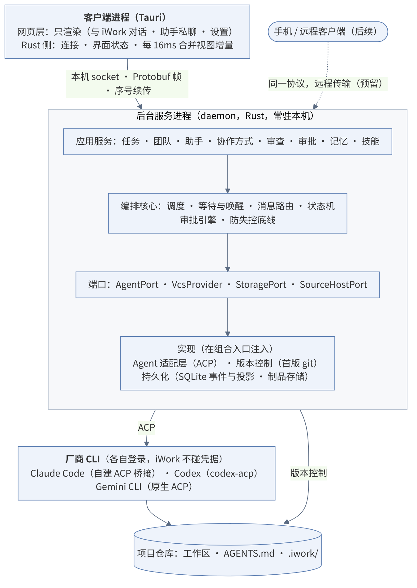

# iWork 需求与系统架构设计

> 多厂商 Agent 协作开发环境（ADE：Agent Development Environment）

_版本 1.74 · 基线稿 · 2026 年 11 月 10 日_

本文是 iWork 的需求与架构基线。第一部分为产品需求，第二部分为技术设计，附录收录决策记录、待决事项与参考资料。v0.4 至 v0.25 的逐条修订保留在 v0.25 文档中，本版只呈现结论；v1.0 之后的变更见附录 D。

用语约定：“已确认”指已由产品负责人拍板的需求；“建议实现”指技术方案的推荐做法，可在实现中调整，但不得违反已确认需求与安全不变量。

# 第一部分 产品需求

## 1 产品概述

### 1.1 定位与命名

iWork 是一款 ADE（Agent Development Environment），如同 IDE 之于集成开发环境：用户以项目为单位，用自己定义的角色组建由不同厂商 Agent 构成的团队，通过与主管对话完成开发需求。iWork 负责协作编排与交付治理，不替代完整 IDE、模型服务或厂商 Agent 内核。

命名约定：iWork 为产品名称；ADE 指产品形态。文中“系统”“iWork”均指本产品。iWork 为非商用的个人工具。

### 1.2 目标用户

首要目标用户是重度个人开发者：在本机使用，使用本人的厂商账户或 API Key，追求产出速度与最强模型组合。小团队与企业场景作为后续扩展，不作为首版设计约束。

### 1.3 核心价值

- 交叉审查：审查者可选用与实现者不同的厂商，以减少同源模型的盲点；是否异厂商由用户在团队中配置，平台不强制。
- 按角色各取所长：为架构、开发、审查等角色选择最合适的模型。
- 避免厂商锁定：角色、项目记忆与技能可在厂商之间迁移。
- 额度分摊：组合使用用户本人在多家厂商的账户额度。须遵守各厂商条款：使用用户本人账户，iWork 不转售、不代付，也不收集、保存或中转厂商登录凭据。首版只显示各账户用量，由用户手动换人。

### 1.4 产品原则

平台只提供通用机制与安全底线，不内置特定的协作行为约束。返工次数、审查严格度、无进展处理、委派方式等具体行为，由用户通过角色提示词、团队协作方式与配置定制。

工程原则：以极致性能与最优架构为目标，实现难度与工作量不作为降低设计标准的理由。“最优”以可度量的结果为准：性能以第 14 章阈值与自动化基准衡量，架构以分层边界清晰、可替换、可测试、无已知正确性缺口衡量。

平台强制的只有两类：

- 安全不变量：合入主干由用户决定；用户拒绝的操作不可被绕过（不能换工具、换成员或换运行时规避）；委派、换角色、增减成员均不扩大权限；iWork 管理的凭据不进入任何提示词或上下文。
- 防失控底线：等待环检测；递归委派系统上限为 5 层（主管 → 成员为第 1 层），触发时暂停并通知用户。

审批的硬保证范围（产品负责人 2026-11-12 定 V2，`docs/plans/vendor-capability-policy.md`）：系统底线 + 有副作用的动作（写、执行命令、删除、推送、发布、沙箱外执行、MCP 非只读调用）+ 越界读（读敏感目录清单内的路径），由审批与沙箱两道闸执行；用户拒绝的动作不可绕过（AC05）照旧。工作目录内的读与厂商内部的编排（子代理怎么拆、技能怎么选、计划怎么排）由厂商决定，审计尽力记录。接入新厂商时按这张保证面验收。

厂商能力的去留规则（产品负责人 2026-11-12 定 V1）：厂商能力默认开放，只有满足下面任一条才关：① 动作离开本机或离开 iWork 的视野（云端执行、推送到设备、发给别的会话）；② 能突破底线或沙箱，又没有经过审批的出口；③ 与 iWork 正在提供的同一职能冲突、两者同时运行会打架（团队、工作区、定时），这一类标「暂缓」并写明由哪个里程碑承载后开放。「别家没有」不构成关闭理由；厂商特有的能力经 ACP 的 config options、`available_commands_update`、`_meta` 与能力矩阵（8.4）展示，不为界面一致而砍。产品负责人已接受的例外（技能内联命令 PD-5、技能文件头 hook、技能 `allowed-tools` P17、环境变量带进定制 P14）列在第 9 章已知限制，不按第 ② 条关闭；新出现的能力一律按本规则判断，实测证明某项已接受的例外能突破沙箱时回产品负责人重定。

### 1.5 首版成功标准

作者本人长期以 iWork 替代现有工具。首版不设外部用户量指标。

## 2 交互形态与核心场景

### 2.1 交互形态

沟通界面以对话为中心，参考 Claude Desktop 与 Codex Desktop 的形态：用户在一条对话中与主管交流，团队的计划、进展、成员问答、审批与变更结果在对话中呈现。用户可通过 @ 或进入成员对话直接指挥某位成员。具体信息架构与界面细节在产品设计中确定。

打开项目即可对话：系统内置默认的主管角色，自动加入每个项目，项目的入口对话对象即为主管，用户无需先创建角色或团队。主管可修改、可重置，不可删除；用户可见名称为 iWork，“主管”仅为内部术语（文档、编排核心与日志使用）：界面不出现“主管”字样，其发言以 iWork 身份呈现，角色库中以 iWork 名义列出供查看与编辑；项目不能换用其他角色担任主管。

首次使用引导：选择一个项目 → 确认主管使用的运行时（iWork 自动检测本机已安装并登录的 Claude Code、Codex 与 Antigravity CLI（agy））→ 开始对话。首次引导后，项目设置中单独提供“运行时”入口，复用引导页的检测、安装与登录流程。角色模板不在首次引导中出现，用户需要组建团队时再导入。

若本机未检测到已安装并登录的 CLI，iWork 引导安装已验证版本（受管理模式），并打开厂商自己的登录流程；iWork 不接触登录凭据。

首版随附四个团队模板（一组角色加一套协作方式，导入后可改）：开发 + 审查；架构 + 开发 + 审查；前端全流程（UI 设计 → 开发 → Code reviewer 与 UI reviewer 并行审查）；并行开发（多名开发并行，汇合后统一审查）。各模板的返工上限默认 3 轮，到限后暂停并交用户决定。

其余角色由用户创建，或从可一键导入的模板开始（架构、开发、测试、UI 设计、Code reviewer、UI reviewer、安全审查），导入后生成用户自有副本，可任意修改。

### 2.2 核心场景

| 场景 | 描述 |
| --- | --- |
| A 团队交付 | 用户向主管描述需求。主管在团队协作方式的框架内拆分任务并派给成员；开发提交变更，审查者（可选用不同厂商）针对固定版本提出可定位问题，开发返工后复审；步骤通过后自动合入团队集成分支；用户最后决定合入 main 或开 PR。 |
| B 成员协作 | 开发向架构提问后结束本轮；架构的回答作为新消息送回，开发继续工作，无需主管逐条转发。提问 10 分钟无回答则上报主管。 |
| C 单人工作 | 用户只用一名成员（主管兼执行）完成需求；成员可使用厂商自带的子 Agent。 |
| D 单人与团队互转 | 单人即一人团队。为团队增加成员即转为团队执行，任务身份、历史、产物与上下文保持不变；移除成员至仅剩主管即回到单人。 |
| E 自定义团队 | 用户导入或新建角色，填写通用与项目提示词，配置工具、MCP 与技能，用可视化流程编辑器定义协作方式，组成团队。 |

## 3 核心概念

| 概念 | 含义 |
| --- | --- |
| 项目 | 一个代码仓库及其 iWork 配置、记忆与任务历史。 |
| 角色 | 长期存在的 Agent 身份与配置，存于全局角色库，可加入或退出项目，而不是在项目内创建。即“长期助手”；界面统一称“助手”，“角色”仅为内部术语。助手除职能外可设名字与头像，在对话、看板与通知中统一显示“头像 + 名字”，悬停显示职能。助手与项目同为侧栏一级入口（iWork 作为默认助手列在首位）；每个助手有主页：身份与运行时、正在做什么、加入的项目（每项可开单人对话）、近期工作、审查表现（仅取审查台账数据并标注样本量，不做排名与评分）、跨项目记忆与待确认条目，配置、记忆、版本分标签页。侧栏助手区以聊天列表形式显示每个助手的最近一句；助手与项目均显示未读数：只统计发给用户的新消息与需用户处理的卡片，不统计工具调用等过程输出，打开对应对话即清零；首页默认仍对 iWork 对话。 |
| 项目角色配置 | 角色在某个项目中的项目特定提示词与能力配置。 |
| 成员 | 角色在某个对话中的实例，绑定一个运行时（Claude Code、Codex 或 Antigravity CLI（agy））。一名成员只担任一个角色。同一角色在不同项目、同一项目的不同对话中均为相互隔离的实例：只共享角色定义与跨项目记忆，上下文、厂商会话、工作区、审批与用量各自独立。界面上呈现为同一身份（名称与头像）。 |
| 团队 | 项目中的一组成员，以主管为入口。项目有默认团队与协作方式；每个对话从默认团队开始，可为本对话增减成员。只有主管一名成员时即单人模式。 |
| 主管 | 系统内置的默认角色，自动加入每个项目，是项目对话的入口；负责在协作方式框架内拆分任务、派工、处理事件和汇总，可兼任执行。可修改、可重置，不可删除，不能由其他角色替代。运行时取项目默认值，每个对话可切换。 |
| 协作方式 | 团队级配置：流程编排、沟通关系、调度策略、人工介入点。可存为模板。 |
| 任务 / 运行 / 会话 / 轮次 | 任务是目标；运行是一次执行尝试；会话是厂商 Agent 的会话；轮次是一次模型交互。 |
| 制品 | 不可变的变更版本（提交、Diff、测试结果），审查结论绑定到具体制品版本。 |

## 4 功能需求

| 编号 | 能力 | 需求 |
| --- | --- | --- |
| FR01 | 项目与工作区 | 选择仓库，记录基线提交；每个并行写入任务使用独立工作区（git worktree）与分支；每个任务设团队集成分支。 |
| FR02 | 多厂商接入 | 首版接入 Claude Code、Codex 与 Antigravity CLI（agy）；显示实际版本、认证方式与能力；未验证版本明确标示。 |
| FR03 | 对话式交互 | 以对话为中心；打开项目即进入与主管的对话，无需先创建角色或团队；主管对用户的名称为 iWork，界面不出现“主管”字样；成员列表与团队面板不列出它，仅角色库以 iWork 名义列出；可通过 @ 或成员对话直接指挥成员；计划、问答、审批、变更以对话内卡片呈现。输入框显示当前运行时与模型（如“Claude Code · Opus”），可在本对话内临时改选模型与思考强度，只在本对话有效，新对话回到默认：同一运行时内随时可换，下一轮生效，进行中的一轮不受影响，对话中插入一行切换记录；对话中不能更换运行时，要换须开新对话（厂商会话无法跨厂商迁移）；所选模型不可用（无权限、已下线、服务过载）时该轮失败并提示改选，不自动换用其他模型。用户也可直接与某个助手对话：每个助手与用户之间是一条连续的长对话（类似与同事私聊），点开助手默认进入该对话，右侧为助手资料（动态、记忆、配置）。对话不走团队流程，该助手为唯一执行者；每一时刻只作用于标题栏选定的一个项目，切换项目时在对话中插入分隔；该助手被派入团队任务时，对话中插入任务卡片并可跳转到对应团队对话；需要协作时可一键转交 iWork 接手。项目选择器列出该助手已加入的项目与“私聊”（M1 没有团队，列出全部项目与“私聊”；M2 起只列已加入的项目）：选“私聊”（不关联任何项目）时（新建助手尚未加入任何项目时的默认状态），助手在 iWork 为其准备的私有工作目录中运行（默认 ~/iWork/assistants/<助手名>，Windows 为 %USERPROFILE%\iWork\assistants，与项目目录同属用户可见的 iWork 根目录，不放在 iWork 数据目录内；目录在新建助手时按当时的名字创建，之后改名不移动目录），不接触任何仓库、不走团队流程，适合问答、查资料、写文档与处理附件；能力按助手设置与全局审批规则执行；只可写入跨项目记忆（仍需用户确认）。支持图片与文件附件：可拖入对话区、粘贴或经输入框附件按钮选择，发送前以卡片显示并可移除；图片以 ACP image 内容块送达，仓库内文件传路径引用，仓库外文件复制到附件区后以 resource_link 送达（附件区为数据目录中的只读区，Agent 可读、不可写，见 9 章）；主管派工时可把附件转交成员，在成员对话中添加的附件只给该成员；运行时声明不支持图片时提示但不阻止发送；单个附件上限 20MB（见第 14 章），附件随对话记录保留；用户附加凭据目录内的文件时先提示“文件内容将发送给模型厂商”，确认后可附加（内容直接嵌入消息发给模型，存档副本放在只读区之外，Agent 读不到），私钥文件（如 id_rsa、*.pem）一律拒绝附加。在主管对话中 @ 成员时，消息与成员回复均在主管对话中可见；在成员对话中直接发出的指令以摘要抄送主管；仅当指令改变任务范围（新增需求、修改方案或验收标准）时，由成员经协作工具上报并唤醒主管调整计划。 |
| FR04 | 团队组建 | 主管为系统内置角色，自动加入每个项目，可修改、可重置、不可删除，不可由其他角色替代；主管的运行时、模型与思考强度取项目默认值，每个对话可切换；运行时在对话开始后固定，模型与思考强度可在对话中途切换（见 FR03）。项目从全局角色库选择角色组成默认团队并设默认协作方式；每个对话从默认团队开始，用户可随时为本对话增减成员，主管可提议、用户确认后生效（是否允许主管自行增减可在主管角色中配置）；对话内的增减不改变项目默认团队。 |
| FR05 | 自定义角色 | 新建或从模板导入角色（主管为内置，不在模板中）；填写角色通用提示词与项目特定提示词；选择运行时、模型与思考强度作为默认值（模型列表优先取自运行时 CLI，取不到时提供常用别名并可手填模型 ID；思考强度仅在运行时支持时显示；因配置隔离，用户在厂商 CLI 中自设的默认模型不会带入，iWork 每次都显式指定模型）；配置工具、MCP 与技能（内置工具按 4 个分组开关：读文件与搜索、编辑文件、执行命令、网页抓取与搜索；子代理、技能、待办与计划类工具始终开启，能把工作带出 iWork 的工具始终关闭；工具开关只决定助手能用哪些工具，不是安全边界，边界由系统底线、沙箱与审批保证）；不设能力档位：助手之间的差异通过工具配置（启用哪些工具、MCP 与技能；被禁用的工具在启动时即不提供，审批层兜底拒绝，也不能在审批卡片上临时启用，要用须到助手配置中启用）与记在助手上的永久批准表达；角色保存时生成版本号，可查看历史版本；编辑页提供生效预览，按 AGENTS.md → 角色通用提示词 → 本项目补充 → 团队感知 → 任务与交接物的顺序展示最终送给运行时的指令；角色可复制、删除（iWork 不可删除；不提供停用）：删除不可撤销，删除助手配置、与它的私聊记录、记在它身上的永久批准，先取消其正在运行的回合、待审批转为已作废；它在项目对话中的发言保留并标“（已删除）”；私聊工作目录中的文件不删除，确认框写明路径由用户自行处理；M2 起删除前提示使用中的团队。不设项目私有角色，所有角色均在全局角色库中；角色库可按“用于哪些项目”筛选与分组。 |
| FR06 | 自定义协作方式 | 可视化流程编辑器，支持顺序执行、并行分支与汇合、条件分支、循环返工；配置沟通关系（谁可直接问谁、是否经主管中转）、调度策略（串行或并行、主管派工或成员认领、并发上限）与人工介入点。 |
| FR07 | 计划与调度 | 主管把需求拆成落在流程各阶段的任务；调度器校验计划符合流程、依赖无环、权限与资源在范围内；是否需要用户批准计划由协作方式决定。 |
| FR08 | 成员协作 | 成员可提问、回答、上报阻塞、提交交付；提问采用异步送回；问答抄送规则由沟通关系决定。 |
| FR09 | 审查与返工 | 审查针对固定制品版本；finding 为结构化记录（严重度、出处、把握程度、出错场景、证据、影响、同类位置），只报有证据的问题；本次引入的阻断级与重要级问题进入返工循环，改动前就有的问题交用户决定；审查者只读，须声明未能验证的项；复审只看新改动与仍开放的问题，不重复已关闭的问题；返工达到上限时先做方案复盘再交用户。审查角色、阻断级别、轮次上限与审查深度均为可配置项，默认值见 9.8。 |
| FR10 | 集成与合入 | 步骤通过后自动合入团队集成分支并运行测试；冲突由主管安排返工；合入 main 或开 PR 由用户决定。可在协作方式中改为每步人工合入。 |
| FR11 | 审批与权限 | 边界：所有成员统一，只能写分配给自己的工作区（以及系统临时目录、可写缓存区与项目追加的可写目录）；工作区外的读不算越界，读敏感目录清单内的路径算越界（自己的工作区即使位于清单目录之内也照常可读）；联网不受控，不询问、不设域名清单。边界由两道闸执行（见 9 章）：沙箱（底线部分三档相同；只写白名单在手动、自动档生效，全开档放开；管命令及其子进程）与审批（管文件工具与命令文字，是唯一会询问用户的一层）。审批提供手动、自动、全开三档，档位只决定默认问不问，不改变沙箱：手动档下写入与执行逐个询问，读文件与搜索不询问，越界询问；自动档下边界内自动执行，越界请求先交 AI 审查，通过则放行、不通过才询问；全开档表示用户自担风险、交由 AI 接管：边界内外都不询问，不经 AI 审查。越出沙箱只有一个出口“沙箱外执行”（例外：用户在 iWork 专用配置目录里自己写的沙箱排除命令与额外可读写路径，视同用户的决定，见 8.4 与附录 B）：需凭据命令清单中的命令（如需要远程认证的 git 命令、docker、云服务 CLI、gh）直接在沙箱外运行，清单外的命令被沙箱挡住后可请求在沙箱外重跑；手动档询问，自动档先交 AI 审查、不通过再询问（清单内的可记住到本项目，匹配范围同下文“记住的范围”，即程序名加子命令；清单外的不能记住）；全开档下清单内的命令放行，不提供清单外的沙箱外重跑（全开档的沙箱已放开写白名单，只守底线）。安全清单：需凭据的命令、敏感目录、可写目录三张清单，各由内置条目与用户新增的条目组成，用户条目可设为全局或只对某个项目，内置条目不可删除；需凭据的命令只能写成“程序名 + 子命令”，解释器、shell 与通用启动器（如 bash、sh、python、node、ruby、perl、env、xargs、make）拒收并提示原因，拒收名单本身也是规则条目；M1 提供安全清单的完整能力（经应用服务的命令增删查，任何客户端都可调用）；桌面客户端的界面形式待定，因为以后可能接入不同的界面。“必问”动作每次询问、不能记住、不经 AI 审查：git push 三档都询问，全开档也不例外；发布类命令（如 npm publish、docker push）、写入会被自动执行的配置（见 9 章）、删除与丢弃未提交改动的 git 命令（如 git reset --hard、git checkout -- .、git clean、git restore）在手动、自动档询问，全开档不询问（删除不进回收站）。全开只在当前对话生效，新对话回到项目默认；不能设为项目默认；每次切到全开都弹出确认；处于全开时档位按钮常驻醒目标识。项目设默认档（默认手动，只能是手动或自动）；对话中可随时切换，即时生效；切到更宽松的档位时，已弹出且在新档位下可直接放行的待审批自动放行，其余保留；在 iWork（主管）对话中切换对全体成员生效（切到全开时确认框列出受影响的成员，用于夜间无人值守等场景），在成员对话中切换仅对该成员生效；成员单独设置优先于主管对话的切换，该成员显示“单独设置”标记，可一键恢复跟随主管。助手私聊不跟随 iWork 对话，使用所选项目的默认档位；切换项目时全开失效，回到该项目的默认档位；未选项目时默认手动。AI 审查的理由记入审计，它用于减少打扰，不是安全边界；可在项目设置中关闭；由哪个运行时与模型承担 AI 审查可在项目设置中配置，默认与 iWork 相同。批准可记住：一次、本对话、本项目、永久（记在助手上）；记住的范围按动作确定：执行命令按程序名加子命令（如 npm test，带任何参数都算），写文件与读敏感目录按所在目录，MCP 与未归类的工具按工具名；卡片上直接写明将记住的范围；记住的规则可在设置中查看与撤销；记住生成的规则在各档下都生效，档位只改变没有规则命中时的默认结果；系统底线、“必问”动作与清单外的沙箱外重跑不能记住。工具归类：厂商内置工具逐个归入动作类型；能把工作带出 iWork 管控的工具（如创建云端定时任务或远程会话的工具、会话内定时工具）启动时不提供，审批兜底拒绝，三档相同；MCP 工具声明只读的按读处理（三档放行），其余手动、自动档询问（可按工具名记住），全开档放行；未归类的工具手动、自动档询问（可按工具名记住），全开档放行。系统回合（iWork 自己发起的回合，如 AI 审查、AGENTS.md 草稿）按用途限定工具集：AI 审查不开任何工具，只依据输入的动作、任务目标与上下文摘要作判断；其他系统回合只开所需工具；系统回合中的工具调用不经 AI 审查、不询问用户，超出其工具集的动作一律拒绝。求值时拒绝优先于询问、询问优先于放行：用户设的拒绝规则先于“必问”检查。用户拒绝的同一动作（动作类型 + 目标）按 AC05 自动拒绝，换一种写法达到同一效果为已知限制。待审批时发送系统通知，不设超时。iWork 的判定优先于厂商 CLI 自身的权限模式与放行规则。 |
| FR12 | 执行与控制 | 查看流式输出与工具活动；可取消（单个任务或本对话全部任务）；首版不提供用户手动暂停与恢复，系统自动暂停（递归上限、受保护分支异常、人工介入点）保留，由用户处理通知后继续；关闭窗口或退出界面后团队继续运行。 |
| FR13 | 记忆 | 项目说明（AGENTS.md）、项目共享记忆、角色的项目记忆、角色跨项目记忆四层，厂商自带自动记忆重定向到项目记忆（见第 10 章）。 |
| FR14 | 技能 | 复用厂商已有的技能格式；iWork 分发技能并按项目与角色控制启用。 |
| FR15 | 用量显示 | 显示各账户与各任务的用量和额度状态；首版不做提醒、限额或自动停机。 |
| FR16 | UI 预览环境 | 为 UI 设计与 UI 审查角色启动应用、分配端口、用浏览器截图，并把审查结论绑定到界面版本与环境。 |
| FR17 | 运行时版本 | 记录每次运行的适配器与 CLI 版本，以及每一轮所用的模型与思考强度；已知不兼容的组合阻止运行；升级不替换运行中会话的运行时。 |
| FR18 | 历史与数据 | 对话与任务记录在本机长期保留，由用户手动清理：项目对话可删除（M1；侧栏对话右键“删除”，确认后删除该对话的记录，其待审批转为已作废，不改动任何代码文件）；助手私聊是一条连续长对话，M1 不提供删除；大文件可配置自动清理天数；未合入的代码永不自动删除；用户可导出记录。 |
| FR19 | 项目管理 | 首次引导后可随时添加项目：侧栏“添加项目”或把文件夹拖入窗口；方式有三种：打开本机文件夹；从 Git 地址克隆（使用本机 git 与已有凭据，iWork 不接触凭据，深度托管集成见 D04）；新建项目（填写项目名，由 iWork 创建目录并初始化版本控制、做首次提交）。新建与克隆默认放在 iWork 项目目录 ~/iWork/projects/<项目名或仓库名>（Windows 为 %USERPROFILE%\iWork\projects），默认目录可在设置中修改，每次添加时也可更换位置。项目须处于受支持的版本控制之下（经 VcsProvider 抽象，不限定 git；首版只支持 git）；没有版本控制的文件夹不能添加，提示并可一键初始化（首版为 git init 与首次提交）。添加后识别 AGENTS.md、REVIEW.md 与 .iwork/；缺少 AGENTS.md 时可由 iWork 读代码生成草稿，经用户确认后写入。新项目默认团队仅含主管，运行时取全局默认，添加完成后进入该项目的新对话。移除项目只从 iWork 列表移除，不删除仓库与 .iwork/ 文件，历史记录保留，重新添加同一仓库时恢复。一个仓库根目录对应一个项目，首版不支持把子目录单独添加为项目（子目录差异由 AGENTS.md 分区说明）；按仓库根目录去重，重复添加或添加同仓库的其他工作区时跳转到已有项目；仓库被移动或改名后项目标为“找不到路径”，用户可重新定位，按 .iwork/ 中的项目 ID 重新关联，历史不丢失；侧栏项目按最近活跃排序，可置顶，首版不做分组。 |
| FR20 | 本机配置导入 | 每家运行时首次接入 iWork 时，发现用户本机为该 CLI 配置的 MCP 服务器、技能与插件，列出并提示一次，用户勾选后导入；之后不再提示，设置 › 运行时 提供“从本机导入”入口（不弹窗、不显示红点）。导入的 MCP 与技能在 M3 之前对全部助手与项目生效，M3 起按助手与项目控制启用；插件只导入其中的技能与 MCP；用户自己的 hook 与权限模式不导入。MCP 所需的密钥由用户在 iWork 中重新填写，存入系统钥匙串，iWork 只存引用。 |
| FR21 | 密钥库与注入 | （M3）用户在 iWork 中按名称保存密钥，存入系统钥匙串，与 MCP 密钥管理合为一处；Agent 在命令中只写引用名（如 $SECRET_github），由 iWork 执行时注入为环境变量，Agent 看不到原值，命令输出中的原值被遮盖；每个密钥配一份允许使用的命令前缀，首次使用需审批，可记住；只在整条命令为单个简单命令时注入，含 ;、&&、\|、$( ) 等的组合命令不注入；前缀设为解释器或通用网络工具（如 bash、python、node、curl）时界面警告。注入由 iWork 的包装程序完成，它在厂商沙箱内运行，沙箱配置须放行它与后台服务的本地连接；不能改写命令的运行时不提供注入，改用亲手执行卡片。定位：防意外泄露、收窄使用范围，不防存心外发（拿到密钥的程序仍可能外发）。程序自带的凭据（ssh-agent、gh 登录等）照常可用，不必进密钥库。M3 规划时按安全设计原则重审，优先采用厂商自带的凭据遮盖能力（如 Claude Code 沙箱的 credentials mask）。 |
| FR22 | 轻松元素 | （M1）界面在等待与完成时刻带轻松元素：助手头像表情与互动（空闲、工作中、等你、完成，悬停、戳一下、侧栏眼睛跟随鼠标）、口语化文案、“搞定”印章。印章在一轮回复正常结束且产生改动时盖在改动摘要卡片上，由编排核心判断，界面只负责显示。审批、越界、拒绝、亲手执行等安全相关界面不出现轻松元素；设置中可关闭轻松元素；系统开启“减少动态效果”时动画停用。经验条、成就卡、小队小结暂不做，核心功能完成后再考虑。 |

## 5 首版范围与里程碑

### 5.1 首版范围

- 平台：macOS、Windows、Linux 同时支持。
- 厂商：Claude Code、Codex、Antigravity CLI（agy）。Gemini CLI 已于 2026-06-18 停止账号登录，由 Antigravity CLI 取代。
- 包含：团队与自定义角色、可视化协作方式编辑器、审查返工、团队集成分支、四层记忆、技能、UI 预览环境、用量显示。
- 只支持本机客户端；后台服务接口按可远程访问设计，手机与远程电脑调度后续提供。
- 不包含：预算控制、插件市场、外部长期助手接入。
- 代码托管平台对接（开 PR、读 Issue、同步 CI）待定，架构预留扩展点。

### 5.2 里程碑

按主线逐层叠加，每个里程碑都能独立使用：

| 里程碑 | 范围 |
| --- | --- |
| M1 | 单成员 + 一家厂商（Claude Code）：对话界面、本地常驻后台服务、审批（手动 / 自动 / 全开三档、AI 审查、沙箱外执行与需凭据命令清单）、固定沙箱、工作区与 Diff；系统底线与亲手执行卡片；模型与思考强度选择；轻松元素（头像表情与互动、“搞定”印章，FR22）；助手私聊与最小助手管理、附件（含凭据附件规则）、添加与新建项目、本机额度、配置隔离与本机导入（M1 只列出本机的 MCP、技能与插件，导入在产品负责人接受 T10f 方案 PD-1 / PD-9 的不变量例外后开放，见附录 B）。已知缺口（如受保护分支不监控）见 M1 技术设计。 |
| M2 | 三家厂商接入、团队与主管、计划卡片、成员问答、审查返工、团队集成分支、受保护分支监控；和多成员并行一起设计并开放厂商的后台任务（Claude Code 的后台子代理、后台命令、Monitor，M1 先关，见附录 B D5）；回合中消息直接交给运行时（M1 只排队，若 T10a 合入后没先做）。 |
| M3 | 可视化协作方式编辑器、项目与角色记忆、技能与 MCP 按助手和项目配置、角色模板、审查页（finding 台账与指标、调优时间线）、密钥库与注入（FR21）。 |
| M4 | UI 设计与 UI 审查所需的预览环境。 |

里程碑表示依赖顺序，不构成工期承诺。

## 6 验收标准

| 编号 | 验收项 |
| --- | --- |
| AC01 | 用户向主管提出需求，由至少两家厂商的成员完成开发与审查；界面可见成员角色、运行时版本、步骤状态与工作区。 |
| AC02 | 审查基于固定制品版本返回可定位问题；返工生成新版本并关联原问题复审；旧版本的通过结论不用于新版本。 |
| AC03 | 成员提问后结束本轮，回答以新消息送回并继续工作；覆盖先回答后等待、重复、迟到、目标离线与重启，不误唤醒已取消任务。 |
| AC04 | 提问 10 分钟无回答上报主管；主管无响应时直接通知用户；待审批时发送系统通知且不超时。 |
| AC05 | 用户拒绝的操作不执行；更换工具、成员、角色或运行时均不能绕过；消息内容不能伪造用户批准。拒绝按“动作类型 + 目标”识别，与所用工具无关；在本对话内、直到用户发出下一条消息之前，任何回合（含中断后续接）、任何成员与运行时再次请求同一动作都自动拒绝；用户发出新消息后，该动作下一次被请求时强制询问一次（三档都适用，不受记住的放行规则影响）；用户允许则执行，之后按正常规则求值；用户再次拒绝则重新进入自动拒绝；换一种写法（如改用脚本）达到同一效果为已知限制（9 章）。 |
| AC06 | 委派、换角色与增减成员不扩大权限；新增成员只获得其角色配置允许的能力。 |
| AC07 | 递归委派达到系统上限时暂停并通知用户；检测到等待环时进入可解释的阻塞状态。 |
| AC08 | 并行步骤在独立工作区执行；通过后自动合入集成分支并跑测试；冲突不被静默覆盖；合入 main 只在用户操作后发生。 |
| AC09 | 取消一个任务不影响其他任务；已产生的代码修改仍可审查；未合入的代码不因任务结束而删除。 |
| AC10 | 关闭窗口与退出客户端后团队继续运行；重新打开后状态完整；重启后台服务不重复执行有副作用的操作。 |
| AC11 | 增加成员保持任务身份、对话、历史、制品、未提交变更与已用量；移除成员时其进行中任务有序收束或交还主管。 |
| AC12 | 无需修改源码即可新增角色；同一角色在两个项目使用不同项目提示词，生效预览可见每段来源；项目层只能收紧工具，不能扩大。 |
| AC13 | 修改角色、项目配置或协作方式只对新启动的运行生效，界面区分已保存与当前生效版本；撤销权限在下一次调用即生效。 |
| AC14 | 可视化流程编辑器可配置四种流程结构；主管的计划超出流程框架时被调度器拒绝并说明原因。 |
| AC15 | 项目记忆写入仓库 .iwork/memory/ 并对三家厂商成员可见；角色项目记忆默认只加载给对应角色；角色跨项目记忆不含任何项目内容。 |
| AC16 | 项目 A 与 B 使用相似关键词时，A 的记忆、技能配置与上下文不进入 B。例外：附件区中所有对话的附件可被任何对话的 Agent 读到，为已知限制（9 章）。 |
| AC17 | 技能按项目与角色启用；未启用的技能不分发给成员。 |
| AC18 | 未验证的 CLI 版本明确标示；已知不兼容的组合不能运行；升级不替换运行中会话的运行时。 |
| AC19 | 日常同时运行 4 个成员流畅；压力测试 16 个成员时界面与后台服务不崩溃、事件不丢失；指标分别列出客户端、后台服务与 Agent 进程。 |
| AC20 | UI 审查结论绑定界面版本与运行环境，并附截图证据。 |
| AC21 | 新建项目后无需创建任何角色或团队即可与主管对话；主管可修改与重置，不能删除或被其他角色替代。 |
| AC22 | 在对话中增减成员只影响本对话，项目默认团队不变；切换主管运行时只影响新开始的对话。 |
| AC23 | 成员提前工作、越权通信、提交未达标交接物、计划越出流程框架时均被系统拒绝；本地受保护分支出现非系统流程的变更时暂停相关成员并通知用户。 |
| AC24 | 成员启动时可见团队名册与自己可联系的对象，默认看不到队友使用的厂商；成员无法读取队友的工作过程；成员变动后受影响成员在下一轮得到通知。 |
| AC25 | 在主管对话中 @ 成员时，消息与回复在主管对话中可见；成员对话中的指令以摘要抄送主管；改变任务范围的指令触发主管修订计划，其余不唤醒主管。 |
| AC26 | 审查员在自己的临时工作区内运行与修改，审查结束后工作区被删除且改动不进入制品；审查员改动开发者工作区时该审查步骤判为失败；审查结果无法解析时停止自动推进并交用户。 |
| AC27 | 改动前就有的阻断级或重要级问题不阻挡本次通过，并单独列给用户决定；存在未验证项时不判定审过。 |
| AC28 | 复审不重复报告已关闭的问题；达到轮次上限后产出方案复盘并交用户；每条阻断级与重要级 finding 都有结局并计入审查指标。 |
| AC29 | 多步任务合入前对集成分支整体审查；合入 main 时在最新 main 上复检，冲突或失败退回主管；冲突解决的提交经过重审。 |
| AC30 | 中、高风险任务启用安全审查，未关闭的安全阻断级问题阻挡合入；审查深度随风险档位自动选择。 |
| AC31 | 被驳回的问题附理由并对用户可见，用户改判后重新进入返工；超阈值的改动按单元拆分审查后再整体审查。 |
| AC32 | 修 bug 任务可生成待确认漏报；开启考题集后，修改审查配置前可回放并显示得分变化。 |
| AC33 | 拖入、粘贴或选择的图片与文件随消息送达运行时，接收方能读取内容或路径；运行时不支持图片时界面给出提示；超出大小上限的附件在发送前被拒绝并说明原因。 |
| AC34 | 可从本机文件夹或 Git 地址添加项目；不在受支持版本控制下的目录被提示且可一键初始化；移除项目不改动仓库文件，重新添加后历史记录恢复。 |
| AC35 | iWork 中的成员会话不运行用户自己的 hook、不沿用用户的权限模式，不加载未导入的 MCP、技能与插件；每家运行时首次接入时提示一次本机导入，之后不再提示，可从设置中再次导入。 |
| AC36 | Agent 要改动系统底线范围内的内容（如 ~/.ssh/config）时被拒绝并生成亲手执行卡片，写明精确命令或补丁与理由；用户点“执行”后由 iWork 以用户身份执行、审计记为用户本人，或复制命令自行执行；执行后 Agent 只得知是否执行与退出码；点“忽略”后 Agent 收到“用户未在 iWork 中执行”；卡片不可记住，全开档同样出现。用户附加 ~/.npmrc 先提示后可附加，附加 id_rsa 被拒绝。 |
| AC37 | 助手配置可选运行时、模型与思考强度；对话中改选模型后下一轮按新模型运行，正在进行的一轮不受影响，对话中有切换记录，新对话回到默认；对话中不能更换运行时；所选模型不可用时该轮失败并提示改选，不自动换用其他模型；运行记录中每一轮都有模型与思考强度。 |
| AC38 | 沙箱底线部分三档相同：手动档下脚本写工作区外、读凭据目录或 iWork 数据目录均被挡；全开档下 npm i -g 等写工作区外的命令直接成功，但脚本读 ~/.ssh、写 iWork 数据库仍被挡，且不出现沙箱外重跑；需凭据命令清单中的 git pull 经一次批准后在沙箱外执行成功，自动档可按命令记住到本项目，全开档不询问；清单外命令被挡后可请求沙箱外重跑，自动档下不能记住；git push 在全开档也询问，npm publish 与写 .claude/settings.json 在手动、自动档询问、全开档不询问；git reset --hard 在手动、自动档询问；亲手执行卡片只为单个简单命令生成；私聊切换项目后全开失效。 |
| AC39 | Agent 调用创建云端定时任务的工具（如 /schedule 背后的工具）或会话内定时工具时，三档都被拒绝且启动参数中不提供；NotebookEdit 按写文件、WebSearch 按联网处理；声明只读的 MCP 工具三档放行，其余 MCP 工具在手动、自动档询问、可按工具名记住；未归类的工具在手动、自动档询问，全开档放行。 |
| AC40 | 删除助手后：侧栏不再出现，私聊记录与永久批准被删除，项目对话中它的发言仍在并标“（已删除）”，私聊工作目录中的文件仍在；iWork 的右键菜单不含删除。在本项目记住 npm test 后，npm test --watch 不再询问，npm publish 仍询问；记住写 src/a.ts 后写 src/b.ts 不再询问；在设置中撤销该规则后恢复询问。 |
| AC41 | 安全清单（经应用服务命令验收，不依赖界面）：在需凭据的命令中新增 terraform apply（本项目）后，该命令在沙箱外运行并按档位审批；新增 python 或 bash 被拒收并提示原因；内置条目不可删除；新增的敏感目录与可写目录立即对新启动的会话生效。 |

# 第二部分 技术设计

## 7 总体架构

iWork 由运行在用户本机的常驻后台服务与 Tauri 桌面客户端组成。后台服务是唯一的业务核心，退出客户端不影响团队运行；客户端通过受认证的本机 IPC 连接。手机与远程电脑后续通过远程接入连接同一后台服务，代码与厂商登录状态始终留在用户机器上。

*图 1 iWork 总体架构*

### 7.1 技术栈（已确认）

- 后台服务：Rust，常驻进程，单文件分发；ACP 使用官方 Rust SDK。
- 客户端：Tauri（Web 技术）；界面层可复用于未来的远程或 Web 客户端。
- 客户端与后台服务通信：本机 Unix domain socket / Windows 命名管道；建连时由操作系统校验对端为同一用户且为同一签名的 iWork 客户端；协议用 Protobuf 定义并生成 Rust 与 TypeScript 类型，线上为带长度前缀的二进制帧（另有 JSON 调试模式）；命令、查询、事件三类消息，事件按序号订阅、断线续传、有界背压；客户端 Rust 侧维护状态并每 16ms 合并一次视图增量，经 Tauri Channel 以二进制推给网页层；传输层可替换，远程接入沿用同一协议。后台服务由客户端按需拉起，可选登录自启。细节见《iWork M1 技术设计》。
- 持久化：SQLite 存元数据与事件；大日志、Diff、截图等制品独立存储，数据库只保留引用与校验值。
- 渲染性能须用最重视图实测验证：长列表虚拟化、流式输出有界缓冲与批量更新、Markdown 与高亮增量计算、进程与 Git 等 I/O 离开界面线程。

### 7.2 分层与依赖

| 层 | 模块 | 职责 |
| --- | --- | --- |
| 客户端 | 对话界面、设置、流程编辑器 | 展示与输入；不持有凭据，不决定业务终态；只调用窄接口（发消息、处理审批、取消、合入等）。 |
| 应用服务 | 任务、团队、角色配置、协作方式、审查、审批、记忆、技能 | 受理命令，校验主体与范围，组装有效配置快照。 |
| 编排核心 | 调度器、等待登记、消息路由、状态机、能力策略 | 依赖与并发、等待与唤醒、投递与消费证据、超时检测、授权与防失控底线。 |
| 端口 | AgentPort、VcsProvider、StoragePort、SourceHostPort、ExecutionBackend、SecretStore | 与框架和厂商无关的接口、事件与能力描述。 |
| 适配层 | 三家 Agent 适配器 | 协议转换、能力协商、会话映射；只上报信号，不做业务判断，不绕过权限。 |
| 基础设施 | 进程管理、版本控制实现（首版 git）、运行时管理、预览环境、以用户身份执行、系统钥匙串 | 进程树、PTY、隔离工作区与集成线（git 实现为 worktree 与集成分支）、版本安装与回退、应用启动与截图。 |

依赖规则：客户端依赖应用接口；应用层依赖领域与端口；基础设施实现端口并在组合入口注入。厂商事件先标准化为领域事件再进入界面；原始事件仅用于诊断，脱敏、限量保存。

安全相关能力的分层：系统底线、凭据与私钥识别、密钥注入授权等判定都在编排核心，为纯函数；需要用户本人确认的操作（亲手执行、凭据附件确认）由应用服务受理，只接受来自客户端的用户操作，审计主体记为用户；执行与密钥存取在基础设施，经 ExecutionBackend 与 SecretStore 端口注入；适配层只转发与改写（如把密钥引用改写为包装程序调用），不做判断；客户端只展示与发出命令，自己不执行。

能力与界面分离：所有用户能力（包括安全清单、记住的规则、本机导入、助手与对话管理等）都以应用服务的命令与查询提供，桌面客户端只是其中一种界面；以后接入其他界面（如远程、手机、命令行）时复用同一组命令，业务规则与校验不放在界面层。界面待定的能力照常实现与验收，只是暂不做界面。

## 8 Agent 接入

### 8.1 AgentPort 与 ACP

AgentPort 统一以 ACP 驱动各厂商 Agent，编排层不依赖具体接入形式。按 ACP v2 语义设计（v2 仍标 draft，需版本协商），v1 作为降级：

- 会话恢复使用 session/resume（v2）或 session/load（v1）。
- 忙时输入依赖 v2 的排队语义：Agent 不得因忙拒绝 prompt，须按序插入或排队。
- 消费证据：v2 在消息插入后返回 messageId，并推送 running / idle / requires_action 状态；v1 适配器的消费状态记为未知。
- 审批：request_permission 绑定具体操作；未知结果不得视为批准。
- MCP：iWork 协作工具（提问、回答、提交、上报阻塞、读取任务状态、写入记忆）作为 MCP 服务按成员注入。
- 能力检测由适配层完成，降级由编排层决定；不支持的能力明确显示。

### 8.2 三家接入方式

| 厂商 | 接入方式 | 认证 | 说明 |
| --- | --- | --- | --- |
| Claude Code | iWork 自写适配器：以 -p 配合 stream-json 驱动用户本机 CLI，审批经 --settings 注入的 PreToolUse hook | 用户经 Anthropic 官方流程以本人订阅或 API Key 登录 | 已实测确定（M1 采用）：hook 不可被用户的 auto 模式与放行规则绕过；hook 超时会放行，由适配器在到时前中断回合防护；可经 updatedInput 改写命令；配置隔离用启动参数屏蔽用户级配置并沿用原登录。claude-agent-acp（基于 Claude Agent SDK 的社区 ACP 适配器）实测沿用用户 auto 模式、不发权限请求，仅作可选接法。 |
| Codex | iWork 自写适配器，驱动用户本机 Codex 的官方 app-server 接口（JSON-RPC，可由本机 CLI 生成协议定义） | ChatGPT 登录或 API Key | app-server 支持每个动作的审批回调（approvalPolicy untrusted）、沙箱策略（含交给外部沙箱）、额度读取；该接口标为 experimental，按版本生成协议并做兼容测试。第三方 codex-acp 仅作可选（旧包内置旧内核已实测不可用）。 |
| Antigravity CLI（agy） | 原生 ACP（agy acp） | 厂商自身流程（agy 交互登录或 agy acp --login） | 已实测：每个动作都发权限请求，拒绝生效；边界经 agy acp --sandbox。 |

接入选择规则：厂商提供原生 ACP 的，优先使用原生 ACP；没有原生 ACP 的，由 iWork 自写适配器驱动用户本机已安装 CLI 的原生无界面接口；第三方翻译适配器（如 claude-agent-acp、codex-acp）不作为默认，仅作为可选接法。原因：审批必须不可绕过、沙箱必须能包住 Agent 执行的动作、所用 CLI 须与用户本机版本一致，并满足单个适配进程的内存预算。各家最终接法以补测结论为准（M1 技术设计 Q7–Q10）。

### 8.3 认证与合规约束

- iWork 不修改厂商程序、不禁用其登录方式，也不收集、保存或中转厂商登录凭据或会话 token。
- 不代用户付费、不转售用量；产品名称与标识不使用“Claude Code”等厂商商标。
- 合规依据（已确认）：Claude Code 官方法律与合规政策允许终端用户以本人订阅登录未经修改的 Claude Code，包括由平台托管 Claude Code 的情形；此外，官方帮助文档（2026-10-07 更新）说明 Claude Agent SDK、claude -p 与第三方应用的用量照常从用户本人订阅额度扣除；政策禁止的是第三方开发者在自己的应用中提供 Claude.ai 登录或代用户转发订阅请求。iWork 为非商用个人工具，不提供登录、不接触凭据，经 claude-agent-acp 或自建桥接器使用本人订阅均属允许范围。实施条件：不修改程序、不禁用其登录方式；登录经 Anthropic 自己的流程完成；不收集、保存或中转凭据与 token；不代付、不转售用量。Codex 与 Antigravity CLI（agy）按同一原则处理：用户经厂商自己的流程登录本人账户，iWork 不接触凭据。

### 8.4 隔离与能力验证

成员会话与用户自己的厂商 CLI 全局配置隔离：不运行用户的 hook、不沿用用户的权限模式，不加载用户的全局技能、插件、MCP 与全局指令，防止它们放宽 iWork 的审批或跨项目泄漏；需要的 MCP 与技能经本机导入（FR20）后由 iWork 按会话显式提供。隔离方式经实测二选一：优先以启动参数屏蔽用户级配置并沿用用户已有的登录（Claude Code 2.1.319 已实测满足，M1 采用此方式；Codex、agy 在 M2 接入时实测）。厂商 CLI 自带的内置技能与插件照常加载。仓库内的项目级设置（如 .claude/settings.json、.claude/settings.local.json 及其中的 hook、权限与沙箱配置）一律不加载，只使用 iWork 传入的设置，防止不可信仓库在会话启动时执行代码、放宽沙箱或关闭 iWork 的 hook；仓库内的 CLAUDE.md、技能、子代理定义与命令照常加载（产品负责人 2026-11-12 定 P16，维持 v1.63）；因为加载项目设置的启动参数会把仓库的 .claude/settings.json 一起带进来，iWork 要另想办法只送这几样进会话（做法待 T06 方案定）；仓库技能里的内联命令照 PD-5 不关，会不经审批直接执行，记为已知例外（第 9 章），只打开信得过的仓库；仓库里有意提交的 hook（如自动格式化）在 iWork 中不生效。若启动参数无法完全排除项目级设置，交产品负责人另定处理方式。若屏蔽不全，或无法按会话加载 iWork 提供的技能与插件，则改为每家厂商一个 iWork 专用配置目录（如 CLAUDE_CONFIG_DIR、CODEX_HOME），所有成员共用，用户在其中经厂商流程登录一次。成员内关闭厂商原生的团队功能，避免与 iWork 团队嵌套。用户自己的厂商定制（插件、技能、MCP、全局说明）进成员会话的方向（产品负责人 2026-11-12 定 V3 选 b）：每家一个 iWork 专用配置目录（如 `CLAUDE_CONFIG_DIR`），用户在里面用厂商自己的方式登录、安装定制，由 CLI 自己加载，iWork 不读其内容；用户亲手写进专用目录的设置（权限、沙箱排除与可写路径、hook、env 等）本就是用户的决定，iWork 不拦、不另提醒，和用户往安全清单里加条目同理（产品负责人 2026-11-12 定）；专用目录在数据目录里，成员写不了。iWork 仍要管住的是：成员写不进专用目录、插件与 MCP 自带的东西按已登记的例外处理、管理员托管设置按已知限制处理；具体做法与实测待 T06 方案定。方案定稿并实施之前，维持现有隔离。

能力矩阵逐家验证：v2 排队、审批回传、工具限制、MCP 注入、子 Agent 可观测性、配置目录隔离、自动记忆目录重定向、resume、用量上报。不支持的路径明确标示，不靠提示词宣称受控。

## 9 团队协作机制

### 9.1 协作方式与计划

协作方式建模为团队级 CollaborationPolicy，可存为模板：stages（阶段、顺序、交接物、通过条件，支持顺序、并行汇合、条件分支、循环返工）；channels（成员间允许的提问与交付关系、是否经主管中转）；scheduling（串行或并行、主管派工或成员认领、并发上限）；checkpoints（需用户确认的环节）。

流程是框架：主管通过 propose_plan / revise_plan 提出计划（任务、依赖、角色、验收标准），调度器校验其符合流程与依赖无环后执行；消息路由按 channels 拒绝越权通信。协作方式与角色配置均不能放宽安全不变量。

规划范式（已确认）：采用“流程框架 + 主管规划 + 成员自主”的混合方式。宏观上，主管按规划—执行（plan-and-execute）与编排者—工作者（orchestrator-workers）方式在用户定义的流程框架内拆分任务；微观上，每名成员在自己的任务内以自主循环（ReAct）完成工作。不采用单 Agent 自主循环（无分工与交叉审查）、完全固定流程（无法适应不同需求）或成员自组织（不可控，与 9.2 的执行保障冲突）。

- 先了解再规划：主管先读取相关代码与项目记忆，再提出计划。
- 计划只拆到任务一级：任务内部的步骤由成员自行决定，避免计划过细而迅速过时。
- 计划随事件更新：收到交付、阻塞、超时或用户消息时，主管可通过 revise_plan 修订，修订后的计划同样经调度器校验。

### 9.2 协作方式的执行保障

流程由编排核心执行，而不是依赖 Agent 自觉遵守。编排核心通过三件事约束成员：何时启动成员、成员能调用哪些协作工具与联系谁、成员交出的结果是否算数。提示词只告知成员在流程中的位置、输入与应交付的内容，用于步骤内的工作质量，不作为流程保障。

| 协作方式 | 保障机制 | 违反时的结果 |
| --- | --- | --- |
| 流程编排 | 编排核心持有流程状态，只在流程到达某阶段时向该阶段成员下发任务；未到阶段的成员不被唤起。 | 成员无法提前或越过阶段工作。 |
| 交接物与通过条件 | 阶段结束须经 submit_artifact 提交规定交接物，由系统校验通过条件（测试退出码、审查结论枚举等）；条件分支依据结构化结果而非自然语言。 | “已完成”的声明不推进流程；未达标不进入下一阶段。 |
| 沟通关系 | 成员间提问与交付只能经 iWork 协作工具，消息路由按 channels 逐条校验。 | 越权通信被拒绝并返回原因。 |
| 调度策略 | 主管计划经调度器校验：任务须落在流程阶段内、依赖无环、并发不超上限。 | 不符合的计划被拒绝并说明原因，由主管修订。 |
| 人工介入点 | 流程到达介入点时编排核心暂停并通知用户。 | 无法被成员绕过。 |
| 合入 | 合入团队集成分支由系统执行，成员无合并权限。 | 成员不能跳过审查自行合入。 |

安全设计原则：

- 首版尽量设计出完善的安全机制方案，同时保证设计合理。
- iWork 不能保证管控所有风险，只覆盖常见场景；覆盖不到的风险明确记为已知限制，由用户知情承担。
- 避免递归式地解决问题，不为解决问题而解决问题：不为堵一个缺口引入新机制，再为新机制的缺口引入更多机制。遇到安全缺口先找现有机制能否覆盖，但也不能硬套现有机制，要合理且正确地利用；覆盖不了就记为已知限制，交产品负责人决定。
- 扩展性：后续迭代新增安全规则时，架构上支持直接新增，不需要改动已有的规则与流程。

权限模型分四个概念，各管一件事：

| 概念 | 回答的问题 | 谁设置 | 靠什么执行 |
| --- | --- | --- | --- |
| ① 系统底线 | 什么永远不允许（读写凭据目录、读写 iWork 数据目录、写入 .git 内部、删除关键路径、非流程产生的受保护分支变更） | iWork 写死，不可配置、不可提权；三档相同 | 审批与沙箱两道闸同时执行（.git 内部只靠审批；受保护分支由编排核心事后发现） |
| ② 能力边界 | 最多能碰到什么：只写分配给自己的工作区，工作区外可读但敏感目录除外（联网不受控）；加上助手工具配置 | 统一边界由系统给定；沙箱底线部分三档相同，只写白名单全开档放开；工具配置在助手上 | 操作系统沙箱（命令及其子进程）与审批引擎（文件工具与命令文字） |
| ③ 动作审批 | 边界之内哪些要先问用户，越界如何提权（越出沙箱只经“沙箱外执行”） | 项目默认档与规则，对话内可切换手动 / 自动 / 全开 | 审批引擎（经 ACP 或 hook），自动档下越界先经 AI 审查 |
| ④ 流程确认点 | 流程走到这里由用户决定：合入 main、批准计划、人工介入点、记忆写入、AGENTS.md 草稿 | 协作方式与系统规则 | 编排核心 |

优先级为 ① > ② > ③：外层不允许的，内层规则不能放开。④ 与 ①–③ 无关，是流程层的人工决定；“审批”一词只指 ③，④ 统称“确认点”。厂商 CLI 自身的权限模式与放行规则不参与判定。

系统底线由两道闸同时执行：审批拦 Agent 的直接访问（工具读写，命令或重定向的目标路径落在底线范围内），沙箱拦命令及其子进程的实际访问；三档相同，命中即拒绝，不询问、不可提权。凭据目录与 iWork 数据目录读写都禁（数据目录中的附件区 attachments/ 与导入区 imports/ 除外：两者为只读区，Agent 可读、不可写，用于读取仓库外附件与导入技能的参考文件和脚本；制品存储 artifacts/ 中的长日志、大 Diff、截图等不在只读区）：写入比读取更危险（可植入登录公钥、改写 ssh 配置执行任意命令、劫持包源、篡改审批规则与审计），读取会泄露凭据与其他项目的对话记录。写入 .git 内部只能由审批拦截（git 自身提交时要写 .git，沙箱无法区分），脚本直接写 .git 内部为已知限制。需要凭据的程序（如 git 经 ssh 推送、npm publish、云服务 CLI）在沙箱内读不到凭据，按“沙箱外执行”处理（FR11），Agent 仍拿不到凭据内容。凭据目录：~/.ssh、~/.gnupg、~/.aws、~/.azure、~/.kube、~/.config/gcloud、~/.docker/config.json、~/.netrc、~/.git-credentials、~/.npmrc、~/.pypirc、系统钥匙串目录，以及各厂商 CLI 的凭据文件（Windows 为对应位置）。

底线拦的是 Agent，不是用户。确需改动底线范围内的内容时（如给 ~/.ssh/config 加主机别名、在 .git/hooks 下放提交钩子），Agent 不直接操作，而是生成“亲手执行”卡片，写明精确的命令或文件补丁与理由；只有整条命令为单个简单命令（或单个文件补丁）时才生成卡片，组合命令直接拒绝；被用户拒绝过的同一动作不生成卡片；用户可点“执行”，由 iWork 以用户身份执行（不经 Agent、不进沙箱，审计记为用户本人），或点“复制命令”自行执行。执行后 Agent 只得知是否执行与退出码，输出只给用户；用户也可点“忽略”，Agent 收到“用户未在 iWork 中执行”。卡片不可记住，全开档也照样出现。用户主动附加的文件不属于 Agent 直接访问，按 FR03 处理（凭据文件提示后可附加，私钥一律拒绝）。M1 实现。

“删除关键路径”：删除目标是下列路径之一或它们的上级目录时一律拒绝：文件系统根目录、用户主目录本身、工作区根目录本身、仓库的 .git 目录本身、系统目录（如 /System、/usr、/bin、/sbin、/etc、/Library、C:\Windows、C:\Program Files）、iWork 数据目录、iWork 根目录（~/iWork）及其 projects、assistants 目录本身。删除工作区内的普通文件不受此限，按“必问”询问。“写入 .git 内部”只拦 Agent 直接写文件（工具写入、重定向、rm / mv / cp 等命令的目标落在 .git/ 内）；git 命令本身（commit、checkout 等）照常可执行，由其动作类型与受保护分支规则约束。

会被自动执行的配置：写入后会在之后的会话中于沙箱外、审批外自动运行的文件，包括 .claude/ 下的设置、.mcp.json、~/.gitconfig、shell 启动文件（如 ~/.zshrc、~/.bashrc）与 macOS LaunchAgents。写入为“必问”，手动、自动档询问、不能记住，卡片显示改动内容；全开档不询问；命令写入由沙箱写保护挡住，需经沙箱外执行。

敏感目录清单（默认，以规则条目维护、可追加）：个人文件夹（~/Documents、~/Desktop、~/Downloads、~/Pictures、~/Movies、~/Music、iCloud 云盘 ~/Library/Mobile Documents）、邮件与信息（~/Library/Mail、~/Library/Messages）、浏览器资料目录（Chrome、Safari、Firefox、Edge）、iWork 中登记的其他项目目录与其他助手的私聊目录；Windows 与 Linux 用对应的用户目录。敏感目录只由审批判定，不进沙箱。

边界的硬执行：沙箱的底线部分（禁读禁写凭据目录与 iWork 数据目录）三档相同；只写白名单在手动、自动档生效，全开档放开为可写任何位置，并关闭“被挡后请求沙箱外重跑”，使全开档不询问也守住底线。首版使用厂商 CLI 自带的沙箱，只包住 Agent 执行的命令及其子进程，不限制 CLI 自身的配置目录、登录与厂商 API 访问；文件工具不在沙箱内，由审批按同一份规则判定。沙箱固定配置：禁读禁写凭据目录与 iWork 数据目录；写入只放行本人工作区、系统临时目录、可写缓存区与项目追加的可写目录（可写缓存区是常见工具链缓存目录的清单，如 ~/.npm、~/.cargo/registry、~/go/pkg/mod、~/.cache/pip、~/.gradle、Xcode DerivedData，只放行具体子目录，其中的凭据文件仍按底线拒绝）；保留厂商自带的写保护路径（如 .git/hooks、.gitconfig、shell 启动文件、.claude/settings*.json、.mcp.json）；需凭据命令清单中的命令在沙箱外运行；联网放开；本机 socket 默认不放行，需要时经沙箱外执行；仓库的项目级设置不加载（8.4）。读用黑名单、写用白名单。沙箱实现策略：M1 用 Claude Code 自带沙箱；M2 起接入其他厂商时，逐家检查其沙箱能否表达上述核心约束（禁读凭据与数据目录、只写白名单、例外命令），能则沿用厂商沙箱，不能则对该厂商使用 iWork 执行器（基于开源 sandbox-runtime，经命令改写套用），或在界面上标为该成员的已知限制。工作区内的 git 命令仍可执行。远端 push 受审批规则约束；本地受保护分支（main 与集成分支）由编排核心监控，发现非系统流程产生的引用变更时暂停相关成员并通知用户（事后发现，非事前阻止）。

安全规则的组织（扩展性）：系统底线、必问清单、各档默认值、需凭据命令清单、敏感目录清单、可写缓存区与用户记住的规则都是同一种规则条目（编号、层级、匹配条件、结果、来源、范围），内置规则集带版本号；新增安全规则只加条目或动作分类器，不改求值流程。判定结果固定为五种：放行、询问、拒绝、亲手执行、沙箱外执行，新增结果种类须经产品负责人决定。编排核心只产出抽象约束，各厂商适配器翻译为自身沙箱配置并声明能执行哪些，执行不了的约束改为询问或标为已知限制。审计记录命中的规则编号与规则集版本。

已知限制（覆盖不到，由用户知情承担；新增安全规则时同时登记其覆盖不到的风险）：

- 沙箱外执行时，整条命令连同它带起的脚本、git hook、npm 脚本都不受沙箱约束；审批只看得到命令本身；全开档下清单内命令不询问，同样如此。
- 全开档里，清单外又需要凭据的命令会直接失败（可加入需凭据命令清单）。
- 沙箱外执行的命令被记住后按程序名加子命令匹配，带任何参数都算，参数可能让它在沙箱外执行任意代码。
- 程序在内部读取敏感目录与清单之外的文件，拦不住。
- 只读区中所有对话的附件，任何对话的 Agent 都读得到（不按对话隔离）。
- 脚本直接写 .git 内部，拦不住。
- 被拒绝的动作换一种写法达到同一效果，拦不住。
- iWork 读写仓库内文件时先逐级检查路径不穿过符号链接、再打开文件；两步之间若有程序并发把某一级换成符号链接，仍可能读穿到仓库外（TOCTOU）。仓库里事先放好的链接挡得住，专门抢跑的并发替换挡不住（v1.70）。
- 后台计算改动与状态时不执行仓库配置的外部过滤程序（防止借 .git/config 逃出沙箱）：子模块内部未提交的改动不显示，只显示子模块指向的提交变化；需要外部过滤的文件不做内容比较，时间戳或大小变化即标为「可能有改动」（v1.71）。
- 某个连接订阅范围内的持久事件写入很快、读历史又慢（持续写入的字节速率 × 取快照耗时超过 7MB 缓冲）时，断线重连可能一直转圈；界面提示「后台负载过高」，关掉高流量的对话，或停掉正在跑的成员后重新打开 iWork 即可恢复（v1.72）。
- 本机通信的对端校验证明的是「建连那一刻的进程跑的是哪个程序」，不能证明之后在这条连接上收发数据的仍是它：同用户、能在沙箱外运行任意代码的程序可以先建连、fork 留住连接，再 exec 成 iWork 正版程序，借此冒充客户端或后台服务（Linux、macOS 均实测成立）。成员命令在沙箱内，沙箱默认不放行本机 socket，碰不到这条通道；能利用它的程序本来就能直接改动 iWork 数据，对端校验只是多一道防线。不为此另加机制（v1.73）。
- 审批对命令文字的静态分析覆盖常见写法与已知的绕过手法；刻意构造的 shell 写法仍可能被判为普通询问而不是底线拒绝，`.git` 内部写入只由审批拦截，用户批准「解析不了」的命令前要看清命令内容。审批只看命令文字与检查那一刻的磁盘：同一条命令里前面的步骤先改磁盘（建目录、建链接、改权限）、后面的步骤再经它到达受保护位置，检查时看不出来（v1.74）。
- 为守住底线，审批对命令文字的判断宁严勿松，带来以下误拒或多问（v1.74，细节见 `docs/plans/T07.md` 第 13 节「收口」）：换掉、删掉或挪走一个本身指向受保护位置的链接会被拒（单条命令可走亲手执行）；带未登记谓词的 `find`（含 `-exec`）每次都问、不能记住；当前目录是工作区根时 `find … -delete` 按删除工作区根拒绝；命令文字超过 256 KiB、词法都切不出（引号没闭合等）、或路径查不清（无权限、链接成环）的命令三档都拒、不出卡片，修正后重发；经链接读写算两个动作，只能允许一次；`cp -r` 等递归复制只检查目的目录与「目的/源目录名」两层。
- 联网不受控，读到的内容可被发出。沙箱里实测（Claude Code 2.1.322，2026-11-12 R2 补测）：HTTP(S) 通；本机端口通，所以成员连得上本机上不设口令的服务（本机的 Redis、数据库、调试端口、监听 TCP 的 Docker）；别的外连要程序会走代理才通（如 `git` 经 ssh 走隧道），`nc`、`psql`、`mysql`、`redis-cli` 这类不认代理的程序连不了远端：需要时用户把它加进需凭据命令清单走沙箱外执行（全开档下不提供清单外的沙箱外重跑），或由成员在沙箱里自己搭转发。
- 用户在 iWork 专用配置目录里写的设置全部生效，包括把命令排除出沙箱、额外的可读写路径（可把凭据目录读开）；仓库技能的 hook 与内联命令若在沙箱外执行，也能往这个目录写入这类设置，之后所有项目的会话都带着（产品负责人 2026-11-12 接受）。
- 机器上有管理员下发的 Claude Code 托管设置时，它高于 iWork 给的设置；其中放宽沙箱的条目（排除在沙箱外的命令、额外可写路径）会生效，iWork 察觉不到（产品负责人 2026-11-12 接受，未实测）。
- 仓库里的技能照常加载，技能文件头里自带的 hook 在技能被调用时照常执行，可以自己跑命令，不经 iWork 审批（产品负责人 2026-11-12 接受）；iWork 对工具调用的拒绝仍然优先。
- 取消或停止成员时清理它起的进程，进程身份按「进程号 + 出生时间」认；Linux 上出生时间的刻度通常是 10 毫秒，若 10 毫秒内同一个进程号被放掉又分给别的程序，可能误杀那个程序（产品负责人 2026-11-12 接受，D2）。
- 技能正文里的内联命令（`!命令`）在技能加载时直接执行，不经 iWork 的审批 hook：审批、用户的拒绝与审计都看不到它；它在不在沙箱里没有实测（产品负责人 2026-11-12 接受，PD-5）。仓库里的技能照常加载（P16），所以打开一个不可信的仓库，它的技能可以借此不经审批执行命令：只打开信得过的仓库。
- iWork 的审批 hook 没给出决定时，技能声明的 `allowed-tools` 会让 CLI 照放行名单执行，范围超出「CLI 自己不问的动作」；hook 明确拒绝时仍然拒绝（产品负责人 2026-11-12 接受，P17）。
- 本机导入列表照原样显示本机 MCP 的名字、环境变量与请求头的键名、技能目录名与插件键（不读任何值）；用户把凭据写进这些名字里时，它们会显示在界面上并经过后台与客户端（产品负责人 2026-11-12 接受，T10f PD-A1）。
- 命令输出中可能带出凭据内容。
- M1 不监控受保护分支（M2 起事后发现）。
- AI 审查只用于减少打扰，不是安全边界。
- MCP 服务进程不在沙箱内。
- Claude Code 内置技能未隔离（8.4）；技能只是说明，它的动作仍经工具审批，能把工作带出 iWork 的工具已在启动时禁用。
- MCP 工具的“只读”声明由服务自报，声明不实拦不住。
- Claude Code 的 PreToolUse hook 没给出决定时（实际只剩 CLI 自己跳过 hook 这一种），CLI 自己不问的动作照 CLI 规则执行：工作目录内的读（Read、Grep、Glob 与 `cat` 这类只读命令）与起子代理。那一刻用户给读设的拒绝规则、AC05 对读的拒绝记忆、这些读的审计、手动档对只读命令的询问都失效；只读命令仍受沙箱约束。其他命令、写文件、MCP、工作目录外的读仍被拒（T06 S0 实测与补测，2.1.322；2026-11-12 定）。
- 项目目录本身包住凭据目录或 iWork 数据目录时（如把家目录加成项目），上一条的情形下文件工具读得到其中的文件（2026-11-12 定）。
- 没进已验证表的 Claude Code 版本，已有工具的权限行为若有变化，本机验证查不出，照样放行；新增的内置工具由启动时的白名单挡住（2026-11-12 定）。
- 成员会话的环境变量原样继承后台的环境：从终端或 Claude Code 里直接运行 iWork、或把带定制的变量设成全局时，用户的插件、技能目录等定制会经环境带进会话；是插件时会话开始后被核对发现、停会话并停用这个运行时，插件的会话开始类 hook 已经跑过一次；不是插件时没有信号（2026-11-12 定）。

### 9.3 成员间的相互感知

成员分层感知队友（已确认），既能找对人，又不共享彼此的工作过程：

| 感知内容 | 获得方式 | 规则 |
| --- | --- | --- |
| 团队名册 | 成员启动时注入团队简介 | 列出成员的角色与职责；默认不标注队友使用的厂商，可在协作方式中开启。 |
| 可联系范围 | 团队简介按沟通关系标注 | 只列出允许直接提问或交付的对象。 |
| 队友状态 | 按需调用协作工具 get_team | 忙碌、等待、空闲等状态不主动推送，避免上下文膨胀。 |
| 队友工作过程 | 不共享 | 只能看到对方的交付物、发来的消息与项目共享记忆；角色的项目记忆默认互不加载。 |
| 成员变动 | 在受影响成员的下一轮通知 | 避免联系已离开的成员。 |

### 9.4 成员问答：异步送回

ask 在同一事务中登记问题、等待条件与待发消息后立即返回回执，工具说明要求提问方结束本轮；回答经 ACP 以新 prompt 送回提问方。登记等待与事件游标同时提交，唤醒以 wait_id 与 event_id 去重；无关、重复与旧轮次的回答不唤醒新请求；迟到回答不重启已取消或完成的任务。简短问题可允许有时限的阻塞等待。

### 9.5 超时处理分工

| 层 | 职责 |
| --- | --- |
| 厂商运行时 | 只处理自身一轮内的重试与工具超时。 |
| 适配层 | 上报成员状态、工具调用、文件变更、测试结果、进程存活等信号，不做判断。 |
| 编排核心 | 持有全局计时与等待登记，按规则产生超时事件：提问 10 分钟无回答上报主管（可配置）；审批不超时，仅发系统通知。 |
| 主管 | 收到事件后决定改问、改派或转交用户；主管自身无响应时，编排核心直接通知用户。 |

平台不内置“无进展”检测，用户可通过角色与团队提示词实现类似效果。

### 9.6 主管的唤醒

计划状态存于后台服务而非主管上下文；主管只在交付、阻塞、超时与用户消息等事件时被唤醒，其他事件合并为摘要，通过 get_task_state 读取，避免上下文与用量膨胀。

用户直接指挥成员时（主管对话中 @ 成员，或在成员对话中发言），主管可见该消息或其摘要，但默认不被唤醒；成员判断指令改变了任务范围时须经协作工具上报，编排核心据此唤醒主管修订计划。

### 9.7 审查、返工与集成

开发提交不可变制品 → 审查者针对该版本返回问题与证据 → 需修改时创建返工任务 → 作者提交新版本并逐条回应 → 新审查轮次复审 → 通过后自动合入团队集成分支并运行测试，后续步骤基于集成分支 → 冲突由主管安排返工 → 用户决定合入 main 或开 PR。ReviewRound 记录审查者、范围、基线、制品版本、环境、问题、严重度与处置状态。

### 9.8 审查方案

以作者在 agent-scaffold 中的审查工作流为主体，借鉴 Anthropic《Solving code review at Anthropic》的做法。平台提供下列机制；阈值与角色组合是团队模板的默认值，用户可改。

#### 流程

- 分诊：主管判断风险（低 / 中 / 高）、写出验收标准、选择审查角色，并判断是否需要先出方案。高风险或需用户决定的任务，方案须经用户批准后才实施。
- 方案审查（跨模块、会成为后续范例、影响发布与运维的任务）：方案写明每条规则的“目的 + 手段”与出事场景（会出什么事、怎么止血回退、由什么保证），审查者推演场景、专门走一遍回退路径。
- 实施与自证：开发提交结构化报告（摘要、改动文件、验证证据、风险、未解决项、预览方式），须附测试或截图等证据，不能只声明完成；项目定义的检查命令（lint、类型、测试）先由系统运行，失败即退回。
- 并行审查：代码审查、功能审查（只按验收标准检查行为、数据与边界）、UI 审查（经预览环境看真实界面）按需并行；审查者对照任务意图与验收标准阅读改动，判断是否解决问题、是否契合系统、是否破坏别处，修 bug 时查根因。
- 复核：主管（或指定的复核角色）逐条打开引用的代码复核阻断级与重要级 finding，去重，判为成立、可能成立或不成立；“深度”档位可改为多名查找者并行、多名复核者投票，过半同意才保留。驳回须附理由与证据，被驳回的问题在审查记录中对用户可见，用户可改判并重新打开。
- 返工与复审：只把成立或可能成立、且本次引入的问题交给开发，要求一并修复同类位置；复审只看新改动与仍开放的问题，已关闭的 ID 随提示下发，不得重复报告。
- 收敛：达到轮次上限仍有开放问题时，由架构（无架构时由主管）复盘方案为何不收敛，给出根因与替代方案，再交用户决定。多步任务按步骤分别计轮次。
- 整体审查：所有步骤完成后，对集成分支相对基线的全部改动整体审查一次，重点看步骤之间的相互影响，并逐条核对全部验收标准；单步任务可省略。
- 合入前复检：用户合入 main 时，系统在临时工作区把集成分支合到最新 main 上运行项目检查；有冲突或检查失败即退回主管，通过才合入。冲突解决产生的提交作为新制品版本，只审与冲突相关的改动。
- 安全审查：安全审查员（只读角色模板）默认对中、高风险任务启用，自动加入并行审查分支，关注注入、鉴权、密钥、依赖与数据泄露；未关闭的安全阻断级问题阻挡合入，后续提交修复后自动关闭。
- 大改动拆分：改动超过阈值（默认 800 行，或超过审查者上下文的一半）时按模块或目录切成多个审查单元并行审查，主管合并去重后再跨单元整体审查。

#### 审查深度

| 档位 | 默认用于 | 做法 |
| --- | --- | --- |
| 快速 | 低风险 | 1 名审查者，主管复核。 |
| 标准 | 中风险 | 任务选定的各类审查并行，主管复核。 |
| 深度 | 高风险 | 每类审查 2–3 名查找者（可用不同模型），复核者投票过半才保留。 |

档位随分诊的风险等级自动选择，可在协作方式中修改；界面显示每档的预计用量。

#### finding 规范

| 字段 | 规则 |
| --- | --- |
| 严重度 | blocking（错误行为、安全、数据损坏或验收不通过）/ important（必须修，除非用户接受风险；含违反明文规则且能说出后果的质量问题）/ nit（建议项，不进返工，不需要结局）。 |
| 出处 | introduced_by_change 必填，与严重度相互独立：改动前就有的问题照实标严重度，不挡本次通过，单独列给用户决定本次修、另开任务或不改。 |
| 把握程度 | confirmed（能说出触发条件与错误结果并引用代码行或截图）/ plausible（机制成立、触发条件不确定，写明如何确认）。有证据但拿不准的照样报。 |
| 内容 | 出错场景、证据（文件:行或复现步骤）、按最坏处写的影响、最小修复建议、问题类别与同类位置。说不出出错场景的不按 bug 报；质量类问题须写明违反哪条规则与后果，否则按 nit。 |
| 未验证项 | 每名审查者必须列出没能验证的项及原因（没有预览、跑不起来等）；存在未验证项时不能判定审过，交用户决定。 |

#### 平台保障

- 审查员的验证环境：系统为每名审查员在被审版本上创建独立的临时 git worktree，审查员可在其中自由运行命令、修改文件、编写复现测试，审查结束即删除；其改动不进入制品，只能以“建议补丁”附在 finding 中作为证据。开发者的工作区对审查员只读，审查步骤前后由编排核心比对其工作区指纹，有改动即判该步骤失败。UI 审查在审查员的工作区中经预览环境启动应用；共享依赖缓存须防并发写坏。
- 结构化与失败即停：审查、复核与开发报告须为合法的结构化结果；无法解析或字段不全时停止自动推进并交用户，不宣称通过。
- 审查标准文件：仓库根目录 REVIEW.md，与 AGENTS.md 同级，由用户维护；按审查角色的补充（本项目里出错是什么样、可跳过的路径、必须遵守的规则）写成其中的分节；每次审查加载。
- 审查账本：每轮审查与每条 finding 记入项目审查账本；阻断级与重要级 finding 须有结局：fixed、refuted、intentional、not_worth、pre_existing。
- 指标：精确率（fixed 对比 refuted）、噪音（refuted 与 not_worth）、漏报（用户确认后记录）、一轮通过率、平均轮次；审查配置变更时记录配置指纹，用于对比调优前后的效果。
- 反复出现的同类问题，提示用户把规则沉淀到 AGENTS.md、REVIEW.md 或技能中，从源头消除。
- 漏报来源：用户新建修复 bug 的任务时，主管定位引入该问题的提交，关联原任务与审查轮次，生成待确认的漏报放入“待你处理”；用户确认后计入漏报。
- 考题集：用户确认的漏报与合入后回退的问题，经用户确认后存为考题（含当时的改动与应报出的问题）；修改审查配置（提示词、模型、深度）前可一键回放考题集对比得分，分数下降时提示。默认关闭，按项目开启。
- 定期审查存量代码：按项目开启，默认每周夜间审查指定目录；发现的问题全部标为改动前就有，进入待用户决定的列表；每次用量单独显示。默认关闭。
- 审查独立性：审查者与产出者使用同一运行时的同一模型时界面提示（按模型比较，不只比较厂商），不阻止。

#### 审查记录与指标的呈现

不做独立的 dashboard，审查记录与指标并入 iWork：待用户决定的事项（漏报待确认、改动前就有的问题、调优待判定、超时未关闭）进入“待你处理”收件箱；项目设置中的“审查”页提供 finding 台账（列表 + 详情与操作）以及指标与调优时间线（精确率、噪音、漏报、一轮通过率、平均轮次、考题得分，按配置指纹标出每次调优）。

- 指标只在后台服务中计算，界面只负责展示，保证各处数字一致。
- 只有用户能在界面上写入结局与改判，Agent 不能以用户身份写入。
- 样本不足时以文字标注，不画趋势箭头；漏报与噪音率并列展示。

### 9.9 成员变更

单人即一人团队，不设独立的模式切换状态机。增加成员：对写入租约做一次静默（quiescing），生成交接快照（结构化进度加原成员撰写的交接说明），目标成员按自身角色配置重新解析能力，不继承原成员权限。移除成员：其进行中任务有序收束或交还主管，工作区与制品保留。同一执行只能有一个控制归属，以任务版本乐观并发与带 fencing token 的写入租约保证。

## 10 角色、配置与记忆

### 10.1 角色与配置

- 对象：RoleDefinition（全局角色库中的角色）、ProjectRoleConfig（角色在项目中的提示词与能力配置）、Membership（成员）、EffectiveRoleSnapshot（每次运行固定的有效配置）。
- 提示词按“系统安全约束 → 角色通用 → 项目特定 → 本次任务”顺序拼接，不覆盖；项目层留空即沿用通用层。
- 工具、MCP 与技能取通用与项目配置的交集，项目层只能收紧或显式禁用。实际调用还须同时满足项目审批规则与运行时能力。
- 修改只对新启动的运行生效；撤销权限在下一次调用即生效。写入携带 expected_version 防止并发覆盖。
- MCP 工具发现只提供元数据，新工具或 schema 变化需重新评估，不能沿用旧名单自动放行；凭据只存引用，不进入角色模板或提示词。

角色与实例：同一角色加入多个项目时，各项目、各对话中的成员是相互隔离的实例。共享：角色定义（名称、职责、通用提示词、基础能力）与跨项目记忆；隔离：项目特定提示词与能力配置、项目共享记忆与该角色的项目记忆、上下文、厂商会话、工作区、审批记录与用量。

记忆写入由本地后台服务串行执行（成员经协作工具提交，不直接改写文件），避免同一角色的多个实例并发写入同一记忆文件时相互覆盖。

### 10.2 记忆

| 层 | 位置 | 内容与写入 |
| --- | --- | --- |
| 项目说明 | 仓库 AGENTS.md | 构建命令、规范、约定；单一来源（Codex 直接读取，Claude Code 直接读取或由 CLAUDE.md 引用）；用户手写，iWork 不自动修改。 |
| 项目共享记忆 | 仓库 .iwork/memory/ | 任务中形成的事实与决定；MEMORY.md 索引加主题文件；随 git 共享；默认由成员自动写入（可配置）；所有成员加载。 |
| 角色的项目记忆 | 仓库 .iwork/memory/roles/<角色>/ | 仅对该角色在本项目有用的经验；由该角色自动写入；默认只加载给该角色（非访问控制）。 |
| 角色跨项目记忆 | 全局角色库 | 经验与偏好，不含任何项目内容；写入需用户确认。 |
| 厂商自动记忆 | 重定向 | 可指定目录的（如 Claude Code 的 autoMemoryDirectory）指向 .iwork/memory/；不能指定的关闭；无自动记忆的厂商经协作工具写入。 |

自动写入的内容依靠 git 审查与回滚兜底。检索与注入以 project_id 为边界，缓存键包含项目与授权范围；不因关键词相似混入其他项目。

### 10.3 技能

复用厂商已有的技能格式，不自创格式；技能安装与项目启用分离，同一份技能可在不同项目使用不同版本与参数；角色允许使用某技能不自动授予其依赖的工具或 MCP 权限。

## 11 权限、审批与数据

- 审批绑定具体运行、工具调用与参数摘要，参数或目标改变时重新授权；权限请求丢失或无法回传时阻止关键操作。
- 沙箱只包住 Agent 执行的命令，不包住厂商 CLI 本身；读写文件等内置工具不经 shell，由审批按结构化路径判定。沙箱不可用的平台（如原生 Windows 上的部分 CLI）界面须向用户说明边界降级。
- 跨厂商数据共享默认不限制，团队内各厂商成员可获取仓库内容与任务日志。
- Agent 输出、仓库内容、MCP 返回与预览网页均视为不可信数据，不提升为用户指令，不获得客户端同等的本地执行权限。
- 本机 IPC 与未来的远程接口须端点鉴权，不把 localhost 视为可信。
- 诊断日志默认排除密钥、凭据、完整环境变量与敏感请求内容。

## 12 任务生命周期与一致性

| 对象 | 状态 |
| --- | --- |
| Task | draft → queued → active → validating → review_ready → completed；可进入 blocked、failed、cancelling、cancelled。成员声明完成不直接改变终态。 |
| Attempt | preparing → running ↔ waiting_peer / waiting_approval → exited → validated；失败后创建新尝试并保留历史。 |
| Session | starting → ready → busy → idle → closed；断线 disconnected，恢复失败 unavailable。 |
| Approval | pending → approved / denied / voided（不超时）。所属回合或任务被取消、所属回合失败（如运行时进程意外退出）、对话被删除、回合中断后用户选择不再继续时转为 voided（已作废）：界面置灰并移出“待你处理”；运行时等待上限引起的中断不作废，审批继续等待用户。 |
| Question | pending → answered / timed_out（上报主管）/ cancelled。 |
| ReviewRound | requested → in_review → changes_requested / approved / blocked。 |

- 投递与消费分开记录：delivery_state（accepted → queued → dispatched → accepted_by_runtime，另有 failed / expired / cancelled）与 consumption_state（unknown / evidenced_consumed）。
- 持久化 outbox 与收件去重，至少一次传输，不声称端到端恰好一次；有副作用的命令用幂等键，结果不确定时先对账再决定。
- 状态转换与待发事件同事务写入；界面按事件序号增量订阅；历史回放只重建视图，不重复执行命令、审批或 Git 操作。
- 取消先进入 cancelling，停止新调度并终止等待，再取消运行时与子进程树；已写入的文件不自动撤销。
- 重启后核对进程与会话，可恢复的经 resume 恢复，不能恢复的生成明确的继续任务，不静默重放。

## 13 运行时版本与兼容

默认受管理模式，允许用户显式选择本机 CLI。RuntimeBundle 记录适配器、SDK、CLI、ACP 版本、平台与校验值，固定最终解析结果。升级流程：下载到新目录 → 校验 → 兼容测试 → 只对新会话激活 → 保留上一个可用组合；运行中会话不热替换；回退前检查会话数据格式。

## 14 性能目标

- 并发：日常同时运行 4 个成员，压力测试 16 个；参考机型为 16GB 内存笔记本。
- 重视图基准：多路并发流式输出、活动终端、十万条历史消息滚动、大型 Diff；记录 P50 / P95 / P99 帧时与输入延迟。
- 资源：客户端、后台服务、适配器与 Agent 进程分别统计空闲、峰值与长时增长。
- 可靠性：有界队列、无静默丢失、背压时可跳过中间展示帧，但不丢关键业务事件。
- 阈值只统计 iWork 自身进程（客户端、后台服务、ACP 桥接）；厂商 CLI 进程单独统计、只做展示，不计入预算。以下为初值，M1 实测后如需调整须在修订记录中说明原因。

| 指标 | 日常（4 成员） | 压力（16 成员） |
| --- | --- | --- |
| 界面帧时（最重视图） | P95 ≤ 16.7ms，P99 ≤ 33ms，单帧不超过 100ms | P95 ≤ 33ms |
| 输入延迟（按键到显示） | P95 ≤ 50ms | P95 ≤ 100ms |
| 流式输出延迟（daemon 收到到可见） | P95 ≤ 100ms | P95 ≤ 250ms |
| 切换对话（含十万条历史） | P95 ≤ 200ms | P95 ≤ 200ms |
| 唤醒延迟（回答送达到成员恢复，不含厂商耗时） | ≤ 1s | ≤ 2s |
| 启动 | daemon 已运行时客户端 ≤ 2s 可用；daemon 冷启动 ≤ 1s；客户端重开 ≤ 1s 恢复现场 | — |
| daemon 内存 | 空闲 ≤ 80MB，运行中 ≤ 200MB | ≤ 400MB |
| 客户端内存 | 空闲 ≤ 250MB，最重视图 ≤ 600MB | ≤ 800MB |
| 单个 ACP 桥接进程 | ≤ 60MB | ≤ 60MB |
| 长时运行 | 8 小时内存增长 ≤ 10% | 不崩溃、不丢事件 |
| 空闲 CPU（无成员运行） | daemon 平均 < 1%，客户端 < 2% | — |
| 单个附件 | ≤ 20MB | — |

上述指标写成自动化基准并进入 CI：M1 覆盖 daemon 相关指标，M2 加入界面指标。超出阈值记为回归，不阻止合入，但在审查页中标出。

## 15 扩展性

首版只做内部模块化，在组合入口显式注册实现；外部工具经 MCP、新 Agent 经 ACP 接入；后续版本提供插件市场。新增模块不得绕开核心的状态、授权、审计与防失控规则。

| 扩展点 | 职责 |
| --- | --- |
| AgentProvider | ACP、原生接口或 SDK 的统一接入。 |
| ToolProvider | MCP 或本地工具的发现与调用；可见与授权分别校验。 |
| ExecutionBackend | 本机运行（含以用户身份执行亲手执行卡片：不经 Agent、不进沙箱）；为远程与容器预留。 |
| 安全规则 | 动作分类器、规则条目与抽象约束：新增安全规则只加条目或分类器，不改求值流程；各厂商适配器把抽象约束翻译为自身沙箱配置并声明能执行哪些。 |
| SecretStore | 密钥按名称存取，只有后台服务进程可取值；首版为系统钥匙串（M1 存 MCP 密钥，M3 起用于命令注入）。 |
| WorkflowPolicy | 流程、调度、验证与审查策略；模型提议须通过核心规则校验。 |
| ArtifactRenderer | Diff、报告、截图等展示；不可信内容不能执行本地命令。 |
| VcsProvider | 版本控制抽象，平台不限定 git：识别仓库与基线版本、为成员与审查员创建隔离工作区、提交或快照、生成 diff、合入集成线并检测冲突、监控受保护线的变更。编排核心、审查与集成只依赖该接口，git worktree、分支等为 git 实现的细节；首版只实现 git；Perforce、SVN、Jujutsu 等后续按接口补充。 |
| SourceHostProvider | 代码托管平台（GitHub、GitLab 等）：开 PR、读 Issue、回写审查意见、同步 CI；首版是否实现待定。 |

# 附录

## 附录 A 待决事项

| 编号 | 事项 | 下一步 |
| --- | --- | --- |
| D04 | 代码托管平台对接 | 决定首版是否实现 SourceHostProvider 及支持哪些平台。 |
| T01 | git 表述改写（技术设计待办） | 技术设计阶段统一改写仍直接写 git worktree、分支的段落：FR01 项目与工作区、9.8 审查员验证环境、第 10 章项目记忆、第 6 章基础设施等，改为“VcsProvider 的 git 实现”，含义不变。 |
| D05 | 远程与手机调度 | 设计远程接入的认证、传输与审批回传；确定所在版本。 |
| D09 | 插件市场 | 确定插件的形态、沙箱、签名与发布方式（后续版本）。 |

## 附录 B 决策记录

“原 Dxx”指 v0.x 文档中的待决编号；“v1 Dxx”指本版附录 A 的待决编号。

| 主题 | 决定 | 原编号 |
| --- | --- | --- |
| hook 不表态时（Claude Code） | PreToolUse hook 没给出决定时（实际只剩 CLI 自己跳过 hook 这一种），CLI 不问的动作照 CLI 规则执行：工作目录内的读（Read、Grep、Glob、只读命令）与起子代理，记为已知限制；其他命令、写文件、MCP、工作目录外的读仍被拒。配套写死：hook 失败一律拦、权限模式 dontAsk、hook 只有写出完整决定才以 0 退出。只读命令一项另行确认接受，最坏情况按沙箱算 | 2026-11-12（T06 方案 D1 选 A） |
| 项目目录包住凭据或数据目录 | 不在添加项目时拒绝；hook 不表态的那几次读，文件工具读得到其中的文件，记为已知限制 | 2026-11-12（T06 方案 P12） |
| 未验证的 Claude Code 版本 | 启动时用内置工具白名单，只给已验证版本见过的工具；已有工具的权限行为变化，过了本机验证照样放行，记为已知限制，补法是版本进已验证表 | 2026-11-12（T06 方案 P11 选 d + a） |
| 成员会话禁用的内置工具（新增） | DesignSync、PushNotification、SendMessage、Workflow、EnterWorktree、ExitWorktree：启动时不提供，hook 兜底拒绝，三档相同 | 2026-11-12（T06 方案 P13） |
| 成员会话的环境变量 | 不筛选，CLI 原样继承后台的环境，只额外关掉 Claude Code 的自动记忆；从终端或 Claude Code 里直接运行 iWork、或把带定制的变量设成全局时，这些变量会进成员会话，记为已知限制（正式包由登录项、Finder 启动，环境干净）；会话里出现非内置、非 iWork 给的插件时停会话 | 2026-11-12（T06 方案 P14） |
| 亲手执行的补丁卡片 | 拆出 T10e，另开 T10h 在 M1 内做；T10e 只做命令卡片。T10h 完成前，Edit 命中系统底线时只拒绝、提示改用命令卡片（和整文件 Write 一样）；AC36 不改 | 2026-11-12（T10e 方案第 3 轮后） |
| 亲手执行卡片的任务或卡片宿主崩溃 | 一律整个后台退出，交给崩溃恢复：在途卡片记成结果未知，正在跑的回合变成已中断、可继续；接受卡片一侧的缺陷连带打断正在跑的对话（M1 单人使用） | 2026-11-12（T10e 方案第 3 轮后） |
| 沙箱联网的实测口径 | 保留本机端口（`allowLocalBinding`，开发服务器与监听端口的测试要用）；「联网不受控」按实测写清：HTTP(S) 通、本机端口通、别的外连要程序会走代理才通；不认代理的程序由用户自己加进需凭据命令清单，或成员在沙箱里搭转发，不做成内置默认（9 章已知限制） | 2026-11-12（T06 方案 P3，R2 补测） |
| 本机导入在 M1 的范围 | T10f 切开：M1 先交付「只读名字的发现、导入列表与『还没启用』的原因、协议加法、两个开关（默认关）」；MCP 导入、技能导入等 PD-1、PD-9（及 PD-5 与 K3 实测）有答复时再定方案与实施。M1 成员会话里没有用户自己的 MCP 与用户级技能 | 2026-11-12（T10f 方案第 3 轮后） |
| 移除已导入的 MCP 或技能怎么生效 | 重启即撤回：移除只对新开的会话生效；要立刻停，完全退出 iWork 再打开（后台退出时结束所有 CLI 进程树，启动时清掉旧快照与退场的密钥）。已知限制：移除后、退出重开前，已经起来的 MCP 还在跑，旧技能文件仍读得到 | 2026-11-12（T10f 方案第 3 轮后） |
| 取消回合时怎么停 Claude Code（D2） | interrupt → 到点没结束发 SIGTERM → 再到点才硬杀；硬杀之前顺着父进程号把 CLI 的后代找全一起结束（T05 进程监管加按后代查找）。管不住的记已知限制：命令自己另立会话脱离出去的后代、已结束命令留下的 `cmd &`、CLI 先死后台才来清 | 2026-11-12（T06 方案 D2，R2 补测 k1–k4） |
| 会话中途受保护路径被改成链接（T10e Q7） | 接受，记已知限制 K2：会话跑到一半有人把受保护的文件（如 `~/.zshrc`）改成指进可写目录的链接时，这个会话里审批用启动时的快照，认不出真实位置受保护，Agent 直接写它会当普通写入（自动档放行、手动档普通询问）；下一个会话快照重算后恢复。Agent 自己做不出这种链接（改受保护文件本身被底线拦） | 2026-11-12（T10e 方案 Q7） |
| 回合的定义 | 一个回合从用户的一条消息开始，到运行时静下来为止（Claude Code：最近一个 `result` 之后没有排着的输入，发出去的每条用户消息都已被某个 `result` 收下）；回合进行中用户发的消息算这个回合里的又一条用户消息，不是新回合（这是交给运行时之后的说法；M1 不交，见下一行）。M1 回合中能不能直接把消息交给运行时，另定（评估见 T06 architect 报告「不按严格一问一答」） | 2026-11-12 |
| 回合进行中用户再发消息（M1） | 0 档：照常受理，排成下一个回合，当前回合结束后再交给运行时；排着的可以撤回。不做「停止并发送」按钮。「发出就直接交给运行时（插不插进当前回合由运行时自己定，各家不强求一致）」放在 T10a 合入后或 M2 开头，先跑 1 格实测再定；后台子代理与后台命令放 M2，和多成员并行一起设计 | 2026-11-12 |
| Claude Code 的后台任务（D5） | 方向：尽量保留厂商原本的做法（后台子代理、后台命令、Monitor），M2 和多成员并行一起设计后开放。M1 先关：启动时设 `CLAUDE_CODE_DISABLE_BACKGROUND_TASKS=1`（P14「只额外关自动记忆」之外再加这一项），Monitor 进永久禁用名单。M1 的代价：子代理在前台跑、主代理等它做完；模型带后台参数调 Bash 会先吃一次参数错误再改前台 | 2026-11-12（T06 方案 D5，R2 补测 b1/b2/n1） |
| 本机导入列表上的名字（T10f PD-A1） | 不过滤：MCP 名字、环境变量与请求头的键名、技能目录名、插件键照原样显示（值一律不读）。名字里要是写了凭据，是用户自己的行为，记为安全不变量第 1 条的已知例外（第 9 章） | 2026-11-12（T10f 方案 PD-A1） |
| 仓库内的说明、技能、子代理、命令（P16） | 照常加载（维持 v1.63），但不经加载项目设置的启动参数（那会带进仓库的 .claude/settings.json），由 iWork 只把这几样送进会话，做法待 T06 方案定。仓库技能里的内联命令不经审批直接执行、`allowed-tools` 在 hook 没给结论时放宽范围，产品负责人接受风险（只打开信得过的仓库） | 2026-11-12（T06 方案 P16，R2 补测 L1/L2；同日先定不加载，随后改回） |
| 技能文件头里自带的 hook | 不算「仓库的 hook」，照常跑：仓库技能原样送进会话，技能被调用时它注册的 hook 会执行（可以自己跑命令），记为已知例外；iWork 自己的拒绝仍然优先（插件 hook 答允许、iWork 答拒绝时结果是拒绝，R2X H1） | 2026-11-12（T06 方案 3.1c） |
| 技能正文里的内联命令（T10f PD-5） | 不关（不设 `disableSkillShellExecution`）：技能加载时执行正文里的 `!命令`，绕过 iWork 的审批 hook，审批、拒绝记忆与审计都看不到它，记为安全不变量「审批不能被放宽」的已知例外（第 9 章）。M1 里没有导入的技能、仓库技能不加载，只有厂商内置技能 | 2026-11-12（T10f 方案 PD-5，R2 补测 K3b/K3c） |
| 技能声明的放行名单（P17） | 接受为已知限制：iWork 的 hook 没给出决定时，技能的 `allowed-tools` 会让 CLI 照放行名单执行，范围超出 D1 接受的那几项；hook 明确拒绝时仍然拒绝。M1 只涉及 Claude Code 内置技能（程序里看到的名单含读类工具、`Bash(date *)`、几个域名的 WebFetch、`Edit(~/.claude/settings.json)`，未实测） | 2026-11-12（T06 方案 P17，R2 补测 K2c/H1） |
| 清理进程树时的进程身份（D2） | 进程身份 = 进程号 + 系统原生的出生时间（macOS 精度 1 微秒，Linux 通常 10 毫秒）；同一个进程号在同一个刻度里被放掉又分给别的进程时会认错，最坏误杀一个无关进程。Linux 上要在 10 毫秒内把进程号转一整圈，产品负责人接受为已知限制 | 2026-11-12（T06 方案 5.4a，D2 审查 3/F-2） |
| 厂商能力的去留规则（V1） | 默认开放；只在动作离开本机或 iWork 视野、能突破底线或沙箱又不经审批、与 iWork 职能冲突（暂缓）三种情况下关；已接受的例外（PD-5、技能文件头 hook、P17、P14）保留，实测证明能突破沙箱时再定 | 2026-11-12（`docs/plans/vendor-capability-policy.md`） |
| 审批的硬保证范围（V2） | 系统底线 + 有副作用的动作 + 越界读（敏感目录清单）；工作目录内的读与厂商内部编排由厂商决定 | 2026-11-12（同上；supervisor 补「越界读」，产品负责人同意） |
| 用户定制进成员会话（V3） | 选 b：每家一个 iWork 专用配置目录，CLI 自己加载，iWork 不读内容；设置不得放宽 iWork 的审批与沙箱，做法与实测待 T06 方案；定稿实施前维持现有隔离 | 2026-11-12（同上） |
| 专用目录里用户写的设置 | 本就是用户的决定：用户亲手写进 iWork 专用配置目录的设置（含放宽沙箱或权限的条目、hook、env）iWork 不拦、不另提醒；iWork 只保证成员写不进这个目录 | 2026-11-12（V3 方案审查后） |
| 专用目录设置的两处后果（产品负责人确认接受） | ① 能写专用目录的不只是用户：仓库技能文件头 hook、技能内联命令可能在沙箱外执行，恶意仓库可借此往专用目录写入放宽沙箱的设置，之后所有项目、所有会话都带着（持久、跨项目）；② 专用目录里的沙箱排除命令、可写路径、可读路径放行，构成「越出沙箱只有沙箱外执行一个出口」「系统底线写死、不可配置」两条的例外（可读路径能把凭据目录读开）。仍全部放行 | 2026-11-12 |
| 管理员托管设置 | 记为已知限制，不测：机器上有管理员下发的 Claude Code 托管设置（MDM、系统目录的 managed-settings.json、控制台下发）时，它的优先级高于 iWork 给的设置；其中把命令排除在沙箱外或多给可写路径的，命令会在沙箱外执行，iWork 的审批按沙箱内判、开会话的核对查不出来（照文档推，未实测） | 2026-11-12（T06 方案 3.1d 审查 1/F-1） |
| 目标用户 | 重度个人开发者 | — |
| 核心价值 | 交叉审查（异厂商可选，不强制）、各取所长、避免锁定、额度分摊四项 | v1.3 调整 |
| 团队模板 | 开发 + 审查；架构 + 开发 + 审查；前端全流程；并行开发 | v1 D03 |
| 递归上限 | 5 层，触发时暂停并通知 | v1 D07 |
| 首次使用 | 选项目 → 确认主管运行时 → 对话；无 CLI 时引导安装并跳转厂商登录 | v1.2–1.3 |
| 单人与团队 | 单人即一人团队，增减成员即互转 | 原 D13 |
| 产品原则 | 平台只提供通用机制与安全底线 | — |
| 接入方式 | 统一 ACP；原生 ACP 优先，无原生的自写适配器驱动本机 CLI，第三方适配器仅作可选 | 原 D03、v1.27、v1.30 |
| 平台与技术栈 | 三平台同时支持；Rust 后台服务 + Tauri | 原 D01、D02 |
| 运行形态 | 本地常驻服务，退出后继续运行；首版只支持本机客户端 | 原 D06 |
| 交互形态 | 以对话为中心，参考 Claude Desktop 与 Codex Desktop | — |
| 默认主管 | 系统内置，自动加入每个项目，打开项目即与其对话；可改、可重置、不可删、不可替代 | v1.1 |
| 角色 | 主管以外的角色由用户创建；模板一键导入；全局角色库 + 项目补充；一人一角色；角色即长期助手 | 原 D05、D08、D09、D18、D21 |
| 团队范围 | 项目有默认团队与协作方式，对话可增减成员 | v1.1 |
| 主管运行时 | 项目默认，每个对话可切换，对话开始后固定 | v1.1 |
| 审查方案 | agent-scaffold 审查工作流为主体 + 多查找者投票（深度档）+ 对照任务意图；模板返工上限 3 轮；同模型审查提示不阻止 | v1 D01 |
| 审查补充 | 整体审查、合入前复检、冲突重审、驳回可见可改判、安全审查、深度随风险、漏报来源、大改动拆分、考题集与定期审查（默认关闭）；标准文件 REVIEW.md；审查记录并入 iWork 不做独立 dashboard | v1.11 |
| 审查员环境 | 每名审查员一个临时 worktree，可自由运行与修改，审完删除；改动只作建议补丁；开发者工作区只读 | v1 D10 |
| 认证合规 | 依据 Claude Code 官方政策，以本人订阅驱动未修改的原版 CLI；不碰凭据、不转售 | v1 D02 |
| 商用与命名 | 非商用个人工具，暂不处理商标问题 | v1 D08 |
| 直连成员 | 主管可见，范围变化时才唤醒 | v1.9 |
| 项目私有角色 | 不设；角色库按项目筛选与分组 | v1.8 |
| 成员感知 | 分层感知；默认不告知队友厂商，可配置 | v1.6 |
| 规划范式 | 流程框架 + 主管规划 + 成员自主 | v1.5 |
| 协作方式 | 可视化流程编辑器，四种流程结构；流程是框架，主管在框架内拆任务 | 原 D22 |
| 提示词合成 | 顺序拼接叠加，工具只能收紧 | 原 D19 |
| 配置生效 | 只对新运行生效，撤权立即生效 | 原 D20 |
| 成员问答 | 异步送回 | 原 D14 |
| 超时 | 编排核心检测、主管处理；提问 10 分钟上报；审批不超时 | 原 D14 |
| 审批 | 项目级审批规则 | — |
| 集成 | 团队集成分支自动合并，用户决定合入 main | — |
| 子 Agent | 只用厂商自带 | 原 D17 |
| 数据 | 跨厂商共享不限制；历史长期保留 | 原 D07 |
| 用量 | 只显示，不控制 | 原 D16 |
| 沙箱 | 启用厂商自带沙箱，只包住 Agent 执行的命令；目标为 iWork 统一沙箱 | v1.27 |
| 能力档位 | 不设档位，改为工具配置 + 统一边界 | v1.27 |
| 审批作废 | 审批增加已作废状态：回合 / 任务取消、所属回合失败、对话删除、中断后不再继续时作废 | v1.41、v1.70 |
| 模式与规则叠加 | 记住的规则两种模式都生效，模式只改默认；必问只能允许一次；工作区外读算越界（v1.46 起为手动 / 自动 / 全开三档，记住的规则三档都生效；v1.51 起工作区外的读不算越界，只有读敏感目录算越界） | v1.40 |
| 拒绝的作用范围 | 按动作类型 + 目标识别；本对话内直到用户下一条消息前自动拒绝，之后恢复询问 | v1.39 |
| 联网 | 联网不受控：不询问、不设域名清单，沙箱放开网络 | v1.38 |
| 配置隔离与本机导入 | 成员会话与用户全局配置隔离，方式经实测二选一；每家运行时首次接入时提示一次本机导入，设置里保留入口 | v1.37 |
| 关键路径与 .git | 列出删除关键路径清单；“写 .git 内部”只拦直接写文件，git 命令照常 | v1.36 |
| 凭据目录 | 系统底线：凭据目录读写都禁，只针对 Agent 直接访问，程序内部使用凭据不算 | v1.35 |
| 私聊目录 | 私聊工作目录放 ~/iWork/assistants/<助手名>，不放数据目录 | v1.34 |
| 项目位置 | 支持在 iWork 内新建项目；新建与克隆默认放 ~/iWork/projects，可设置 | v1.33 |
| 禁用工具 | 被助手工具配置禁用的工具不能经审批卡片临时启用 | v1.32 |
| 审批模式 | 手动 / 自动，项目默认手动，对话内可切换；成员单独设置优先于主管切换 | v1.27、v1.28 |
| 审批三档 | 手动 / 自动 / 全开；全开只在当前对话生效、不可设为默认，删除不问、git push 仍问；沙箱禁读凭据三档都开，写限制只在自动档开（沙箱随档位的部分已由 v1.52 改为三档相同） | v1.46 |
| 底线出口 | 底线只拦 Agent；需要时生成亲手执行卡片，用户执行或复制，不可记住、全开也出现（M1） | v1.47 |
| 凭据附件 | 用户附加凭据文件提示“内容发给模型厂商”后可附加，私钥一律拒绝（M1） | v1.47 |
| 密钥注入 | 钥匙串按名存放、命令按名引用注入、输出遮盖、按命令前缀授权、只注入单个简单命令、通用程序前缀警告；防意外泄露、收窄范围，不防存心外发（M3） | v1.47 |
| 沙箱与档位 | 沙箱三档相同（禁读禁写凭据与数据目录、只写白名单）；档位只决定问不问（推翻 v1.46 手动档、全开档不开写限制） | v1.52 |
| 沙箱外执行 | 越出沙箱的唯一出口；需凭据命令清单直接在沙箱外运行，清单外被挡可请求重跑；自动档先经 AI 审查、不通过再询问，清单内可记住、清单外不能；全开放行（取代“不带写限制重试”与“程序内部用凭据不算”） | v1.52 |
| 必问扩展 | 发布类命令与写入会被自动执行的配置在手动、自动档必问，全开档不问（全开只有 git push 询问）；丢弃未提交改动的 git 命令按删除处理 | v1.54 |
| 敏感目录 | 只由审批判定，不进沙箱（修改 v1.51）；默认清单见 9 章 | v1.52 |
| 底线调整 | iWork 数据目录读写都禁；亲手执行卡片只限单个简单命令；拒绝记忆不属底线、不生成卡片 | v1.52 |
| 私聊档位 | 不跟随 iWork 对话；切换项目时全开失效；未选项目默认手动 | v1.52 |
| 沙箱实现策略 | M1 用 Claude Code 自带沙箱；M2 起逐家检查，表达不了核心约束的用 iWork 执行器（基于开源 sandbox-runtime）或标为已知限制 | v1.52 |
| 安全规则组织 | 规则即数据；结果固定五种；抽象约束由适配器翻译；集中维护已知限制清单 | v1.52 |
| 能力与界面分离 | 所有用户能力以应用服务命令与查询提供，界面只是入口之一；界面待定的能力（如安全清单）照常实现并经命令验收 | v1.66 |
| 全开档沙箱 | 方案 C：底线部分三档相同；全开档放开只写白名单、关闭沙箱外重跑；清单内命令照常在沙箱外运行 | v1.65 |
| 安全清单 | 需凭据的命令、敏感目录、可写目录支持用户新增（全局或按项目），内置条目不可删；需凭据命令拒收解释器与 shell；M1 做，界面待定 | v1.65 |
| 数据目录只读区 | 附件区 attachments/ 与导入区 imports/ 为只读区（Agent 可读不可写；v1.68 由整个制品存储收窄为附件区），其余数据目录读写都禁；凭据附件内容嵌入消息、副本放在只读区之外；删除“本回合只读许可”规则 | v1.64 |
| 项目级设置 | 仓库内的 .claude/settings.json 与 settings.local.json 一律不加载（推翻 v1.44 照常加载）；CLAUDE.md、技能、子代理定义照常加载 | v1.63 |
| 删除助手 | 以删除取代停用：删除配置、私聊记录与永久批准，项目对话发言保留并标注，私聊工作目录文件不删；不可撤销；iWork 不可删除 | v1.61 |
| 记住的范围 | 命令按程序名 + 子命令，写文件与读敏感目录按目录，MCP 与未归类工具按工具名；卡片写明范围；设置中可查看与撤销 | v1.61 |
| 求值顺序与拒绝记忆 | 拒绝规则先于必问检查（拒绝 > 询问 > 放行）；被拒动作在用户下一条消息后强制询问一次（三档都适用，不受记住的放行规则影响），之后恢复正常 | v1.58 |
| 会话工具集 | 启动时按会话类型限定工具：助手会话 = 内置工具 − 永久禁用 − 助手关掉的分组；AGENTS.md 草稿只开读文件与搜索；AI 审查不开工具。系统回合不经 AI 审查、不询问，超出工具集一律拒绝。工具开关为 4 个分组，不是安全边界 | v1.57 |
| 轻松元素 | M1 做头像表情与互动、口语化文案、“搞定”印章（编排核心判断：一轮正常结束且有改动），可在设置中关闭；经验条、成就卡、小队小结暂不做，核心功能完成后再考虑 | v1.56 |
| 工具归类 | 内置工具逐个归类；创建云端定时任务、远程会话与会话内定时的工具启动时禁用、审批兜底拒绝；MCP 按只读声明处理；未归类工具手动、自动档询问，全开档放行 | v1.55 |
| 越界定义（读） | 工作区外的读不算越界；读敏感目录清单算越界；读凭据目录由底线拒绝；hook 与沙箱用同一张清单 | v1.51 |
| 安全设计原则 | 首版尽量完善且合理；只覆盖常见场景，覆盖不到的记为已知限制；避免递归式解决问题；先找现有机制覆盖缺口，但不硬套；架构支持后续新增安全规则 | v1.50、v1.69 |
| 模型选择 | 运行时 → 模型 → 思考强度三级；助手配置设默认，对话内可临时改选模型与思考强度（下一轮生效），不能换运行时；模型不可用时失败并提示，不设备用模型；思考强度 M1 做 | v1.49 |
| 安全能力分层 | 判定在编排核心；用户确认在应用服务；执行与密钥存取在基础设施（ExecutionBackend、SecretStore）；适配层只转发与改写 | v1.48 |
| 亲手执行结果 | Agent 只得知是否执行与退出码，输出只给用户；卡片可忽略 | v1.48 |
| 权限模型 | 四概念：系统底线 / 能力边界 / 动作审批 / 流程确认点 | v1.29 |
| AI 审查 | 自动模式下越界请求先经 AI 审查，不通过才问用户；必问动作不经 AI 审查 | v1.28 |
| 记忆 | AGENTS.md + 仓库项目记忆 + 角色项目记忆 + 角色跨项目记忆；厂商记忆重定向 | 原 D10、D12 |
| 技能与插件 | 复用厂商技能格式；插件市场后续 | 原 D11 |
| 首版范围 | 三家厂商；含记忆、技能、完整协作方式、UI 预览环境；M1–M4 逐层叠加 | 原 D04 等 |
| 成功标准 | 作者本人长期替代现有工具 | — |

## 附录 C 参考资料

- [ACP v2 迁移说明](https://agentclientprotocol.com/protocol/v2/migration)
- [ACP v1 概览](https://agentclientprotocol.com/protocol/v1/overview)
- [claude-agent-acp](https://github.com/agentclientprotocol/claude-agent-acp)
- [codex-acp](https://github.com/agentclientprotocol/codex-acp)
- [Antigravity CLI ACP](https://antigravity.google/docs/cli/acp)
- [Antigravity CLI 无界面模式](https://antigravity.google/docs/cli/headless)
- [Claude Code 法律与合规](https://code.claude.com/docs/en/legal-and-compliance)
- [Claude Agent SDK 概览](https://code.claude.com/docs/en/agent-sdk/overview)
- [Claude Code 记忆](https://code.claude.com/docs/en/memory)
- [Claude Code agent teams](https://code.claude.com/docs/en/agent-teams)
- [MCP 工具规范](https://modelcontextprotocol.io/specification/2025-11-25/server/tools)
- [Git worktree](https://git-scm.com/docs/git-worktree)
- [Tauri 安全模型](https://v2.tauri.app/security/)

技术依据截至 2026 年 11 月 7 日。协议与厂商条款变化较快，实施时应固定版本并重新核验。

## 附录 D 修订记录

| 版本 | 变更 |
| --- | --- |
| 1.0 | 由 v0.25 整理为基线稿：拆分产品需求与技术设计，合并 FR、AC 与待决编号。 |
| 1.71 | 已知限制补：后台读取改动不执行外部过滤程序，子模块内部未提交改动不显示（9 章）；升级规则见 M1 技术设计第 4 节。 |
| 1.72 | 已知限制补：持续高写入且取快照慢时断线重连可能不收敛（9 章）；事件推送背压改为关闭连接、客户端重连续传（M1 技术设计 3.5）。 |
| 1.73 | 已知限制补：本机通信对端校验挡不住 fork+exec 冒充（9 章；实测见 T0 实测 6.5）。 |
| 1.74 | 已知限制补：审批命令文字静态分析的边界与宁严勿松带来的误拒、多问（9 章；T07 方案定稿，产品负责人 2026-11-10 接受）。 |
| 1.70 | 审批作废条件补「所属回合失败」（第 12 章）；已知限制补仓库内文件读写的 TOCTOU（9 章）。 |
| 1.69 | 安全设计原则补充：先找现有机制覆盖安全缺口，但不能硬套，要合理且正确地利用；覆盖不了记为已知限制交产品负责人决定（9 章）。 |
| 1.68 | 只读区由整个制品存储收窄为单独的附件区 attachments/，长日志、大 Diff 等制品不再对 Agent 可读；AC16 注明附件区例外（FR03、9 章、AC16）。 |
| 1.67 | 统一沙箱外执行的记住范围写法（程序名加子命令），并登记为已知限制（FR11、9 章）。 |
| 1.66 | 明确能力与界面分离：安全清单等能力经应用服务命令提供并验收，桌面界面待定不影响能力实现（7.2、FR11、AC41）。 |
| 1.65 | 全开档改为只守底线的宽松沙箱并关闭沙箱外重跑，堵住全开档下 Agent 自行跳过沙箱的问题；新增安全清单（三张清单可由用户新增，界面待定）；新增 AC41（FR11、9 章、AC38）。 |
| 1.64 | 修正 v1.52 遗漏：数据目录中的制品存储与导入区改为只读区，仓库外附件与导入技能可读；凭据附件内容嵌入消息；删除“本回合只读许可”；已知限制补一条（FR03、FR11、9 章）。 |
| 1.63 | 仓库内项目级设置改为一律不加载，防止仓库自带 hook 不经审批执行、放宽沙箱或关闭 iWork 的 hook（8.4、9 章；推翻 v1.44 的项目级设置部分）。 |
| 1.62 | 文字一致性修正：8.3 厂商名、附录 B“模式与规则叠加”注明已被三档与越界定义取代。 |
| 1.61 | 以删除助手取代停用（FR05）；定义记住的范围与设置中的查看、撤销（FR11）；新增 AC40。 |
| 1.60 | 新增删除项目对话（M1，FR18）。 |
| 1.59 | 统一私聊项目选择器范围：M1 列出全部项目，M2 起只列助手已加入的项目（FR03）。 |
| 1.58 | 修正求值顺序：用户的拒绝规则先于必问检查；细化 AC05：被拒动作在用户下一条消息后强制询问一次，之后恢复正常（FR11、AC05）。 |
| 1.57 | 新增会话工具集与系统回合规则：AI 审查不开工具，系统回合不经 AI 审查、超出工具集一律拒绝；工具开关定为 4 个分组并写明不是安全边界（FR05、FR11）。 |
| 1.56 | 新增 FR22 轻松元素：M1 范围为头像表情与互动、口语化文案、“搞定”印章，可关闭；经验条、成就卡、小队小结暂不做；更新 M1 范围。 |
| 1.55 | 补工具归类：内置工具逐个归类，能把工作带出 iWork 的工具（云端定时任务、远程会话、会话内定时）启动时禁用；MCP 工具按只读声明处理；未归类工具兜底规则；更正内置技能的已知限制说法；新增 AC39（FR11、9 章）。 |
| 1.54 | 更正：发布类命令在全开档不询问，全开档只有 git push 询问（FR11、AC38）。 |
| 1.53 | 产品负责人裁定：写入会被自动执行的配置在全开档不询问；自动档下沙箱外执行先经 AI 审查；发布类命令三档必问、丢弃未提交改动按删除处理、清单外重跑不能记住、敏感目录默认清单均确认（FR11、9 章、AC38）。 |
| 1.52 | 安全设计重写：沙箱与档位脱钩、三档相同；“沙箱外执行”为越出沙箱的唯一出口，新增需凭据命令清单；必问扩展到发布类命令与会被自动执行的配置，丢弃未提交改动按删除处理；敏感目录只由审批判定并给出默认清单；iWork 数据目录读写都禁；亲手执行限单个简单命令；私聊档位规则；沙箱实现策略；安全规则组织与已知限制清单；新增 AC38（FR11、9 章、15 章、AC05）。 |
| 1.51 | 越界定义调整：工作区外的读不再算越界，改为只有读敏感目录清单（私人文件与其他项目）算越界；沙箱禁读扩展到敏感目录清单，与 hook 一致（FR11、9 章）。 |
| 1.50 | 增加安全设计原则：首版尽量完善且合理，只覆盖常见场景、覆盖不到的记为已知限制，避免递归式解决问题，架构支持后续新增安全规则（9 章）。 |
| 1.49 | 新增模型与思考强度选择：FR03 对话内改选、FR04 主管默认、FR05 助手配置、FR17 每轮记录、FR11 AI 审查运行时与模型可配、审查独立性按模型比较；新增 AC37；更新 M1 范围。 |
| 1.48 | 7.2 增加安全相关能力的分层与 ExecutionBackend、SecretStore 端口，15 章增加 SecretStore；亲手执行卡片补充结果回传与忽略，底线示例改为 ~/.ssh/config 与 .git/hooks（~/.gitconfig 不在底线内，经 git 命令越界审批即可）；FR21 补充只注入单个简单命令、通用程序前缀警告与跨厂商限制。 |
| 1.47 | 系统底线增加亲手执行卡片（M1，9 章、AC36）；FR03 增加凭据附件规则；新增 FR21 密钥库与注入（M3）；更新 M1、M3 范围。 |
| 1.46 | 审批改为手动 / 自动 / 全开三档；沙箱分禁读凭据与写限制两层并随档位开启，定义可写缓存区与读黑名单缺口；自动档被写限制误挡的命令可经审批不带写限制执行（FR11、9 章）。 |
| 1.45 | 8.2 Claude Code 接入方式改为定论（自写适配器，已实测）；M1 不做 iWork 统一沙箱执行器，边界先靠 Claude Code 自带沙箱与审批（9 章）。 |
| 1.44 | 明确厂商内置技能与仓库内项目级设置不在隔离范围内，照常加载（8.4；项目级设置部分已由 v1.63 推翻）。 |
| 1.43 | Claude Code 配置隔离经实测采用启动参数屏蔽，沿用用户已有登录（8.4）。 |
| 1.42 | 里程碑表与已确认的决定对齐：M1 补充助手私聊与最小助手管理、附件、添加与新建项目、本机额度、配置隔离与本机导入；计划卡片与受保护分支监控列入 M2；技能与 MCP 按助手和项目配置列入 M3（5.2）。 |
| 1.41 | 审批状态增加 voided（已作废）及其触发条件（12 章）；越界动作可被用户记住的放行规则放行（FR11 补充说明）。 |
| 1.40 | 明确模式与记住的规则如何叠加、必问不可记住、工作区外读算越界（FR11、9 章）。 |
| 1.39 | 明确“拒绝不可绕过”的识别方式与作用范围（AC05）。 |
| 1.38 | 联网改为不受控：取消项目域名清单，联网不询问，沙箱放开网络（FR11、9 章）。 |
| 1.37 | 配置隔离改为与用户全局配置隔离，所有成员共用、方式经实测二选一（8.4）；新增本机配置导入（FR20、AC35）。 |
| 1.36 | 明确系统底线的“删除关键路径”清单，以及“写入 .git 内部”只拦直接写文件、git 命令照常执行（9 章）。 |
| 1.35 | 系统底线“读凭据目录”改为“读写凭据目录”，限定为 Agent 直接访问，程序内部使用凭据不算，并列出凭据目录清单（9 章）。 |
| 1.34 | 私聊工作目录改为 ~/iWork/assistants/<助手名>，移出 iWork 数据目录，避免与系统底线“写 iWork 数据目录一律拒绝”冲突（FR03）。 |
| 1.33 | 新增“新建项目”添加方式；新建与克隆的默认位置为 ~/iWork/projects，可在设置中修改（FR19）。 |
| 1.32 | 确认：被助手工具配置禁用的工具不能在审批卡片上临时启用，要用须到助手配置中启用（FR05）。 |
| 1.31 | 首版厂商由 Gemini CLI 改为 Antigravity CLI（agy，原生 agy acp）；按接入选择规则，Codex 拟用 iWork 自写适配器驱动本机 codex app-server（FR02、8.2）。 |
| 1.30 | 确立接入选择规则：原生 ACP 优先，无原生 ACP 的由 iWork 自写适配器驱动用户本机 CLI，第三方翻译适配器仅作可选（8.2）；Claude Code 首版接法随之待补测确认。 |
| 1.29 | 确认权限四概念模型：系统底线、能力边界、动作审批、流程确认点，优先级 ① > ② > ③，④ 单列；“审批”只指动作审批，流程层的人工决定统称确认点（9 章）。 |
| 1.28 | 引入 AI 审查：自动模式下越界请求先经 AI 审查，不通过才询问用户，必问动作不经 AI 审查，不作为安全边界；成员单独设置的审批模式优先于主管对话的切换（FR11）。 |
| 1.27 | 审批与权限重整：取消能力三档，改为工具配置加统一边界；审批分手动 / 自动两种模式及切换规则（FR05、FR11）；边界由沙箱硬执行，首版启用厂商沙箱、只包住 Agent 执行的命令（9 章）；Claude Code 首版改经 claude-agent-acp 接入，自建桥接器为备选，并更正合规说明：个人以本人订阅经 Agent SDK 或第三方工具使用属允许范围（8.2、8.3）。 |
| 1.26 | 重画图 1：区分客户端与后台服务进程，补端口层与 VcsProvider，界面改为与 iWork 对话与助手私聊；7.2 端口改为 VcsProvider，基础设施改为版本控制实现（首版 git）。 |
| 1.25 | 确认客户端与后台服务通信方案（本机 socket、对端签名校验、Protobuf 二进制帧、序号续传、16ms 视图增量）与后台服务启动方式（7.1）；新增独立的《iWork M1 技术设计》。 |
| 1.24 | 新增工程原则：以极致性能与最优架构为目标，难度不作为降低标准的理由，以可度量结果衡量（1.4）。 |
| 1.23 | D06 关闭：第 14 章写入性能阈值初值（帧时、输入与流式延迟、切换对话、唤醒、启动、内存、CPU、附件上限），只统计 iWork 自身进程，指标进入 CI 自动化基准。 |
| 1.22 | 新增未读数：助手与项目显示未读数，只计发给用户的消息与待处理卡片，打开即清零（术语表“角色/助手”）。 |
| 1.21 | 助手提升为一等公民：私聊（不关联项目）时在私有工作目录运行；与助手为一条连续长对话、按选定项目执行；侧栏一级入口、助手主页、iWork 列为默认助手、表现数据不排名；界面“角色”统一改称“助手”；助手可设名字与头像；可与助手在项目中开单人对话，可一键转交 iWork（术语表、FR03）。 |
| 1.20 | 项目管理补充：一仓库一项目、按根目录去重、路径失效后重新定位、侧栏排序与置顶（FR19）。 |
| 1.19 | 附录 A 新增 T01：技术设计阶段把直接写 git 的段落改写为 VcsProvider 的 git 实现。版本控制不限定 git：新增扩展点 VcsProvider，核心只依赖抽象接口（第 7 章扩展点、FR19、AC34）；首版只实现 git，无版本控制的文件夹须先初始化（原 D10，已关闭）。 |
| 1.18 | 新增项目管理：添加（本机文件夹 / Git 克隆 / 拖入）、git 要求、初始化 AGENTS.md 草稿、移除与恢复（FR19）；新增 AC34。 |
| 1.17 | 新增图片与文件附件：拖入、粘贴、附件按钮三种入口，按类型经 ACP 送达，可转交成员（FR03）；新增 AC33。 |
| 1.16 | 首版不做用户手动暂停与恢复，只保留取消与系统自动暂停（FR12）。 |
| 1.15 | 确认界面设计中的补充设定：角色能力三档且只能收紧、提示词拼接顺序与生效预览、角色版本号（FR05）；安全审查自动加入并行审查分支（9.8）；设置中的运行时入口（2.1）；角色模板增加测试与安全审查（2.1）。 |
| 1.14 | 确认主管对用户隐身：界面不出现“主管”字样，发言以 iWork 身份呈现，成员列表与团队面板不列出主管，仅角色库以 iWork 名义列出；用户可见名称为 iWork，“主管”仅为内部术语（2.1、FR03）。 |
| 1.13 | D02 关闭：依据 Claude Code 官方政策确认合规并写明实施条件（8.3）；D08 关闭：iWork 为非商用个人工具，暂不处理命名（1.1）。 |
| 1.12 | 确认审查员验证环境：每名审查员一个临时 worktree，可自由运行与修改，审完删除，改动只作建议补丁，开发者工作区只读（9.8、AC26）；D10 关闭。 |
| 1.11 | 9.8 审查方案补充：整体审查、合入前复检、冲突重审、驳回监督、安全审查、审查深度随风险、大改动拆分、漏报来源、考题集与定期审查；审查标准文件定为 REVIEW.md；新增“审查记录与指标的呈现”（并入 iWork，不做独立 dashboard），M3 加入审查页；新增 AC29–AC32；审查员验证环境与只读规则转为待决 D10。 |
| 1.10 | 新增 9.8 审查方案（以 agent-scaffold 审查工作流为主体，借鉴 Anthropic 代码审查实践），重写 FR09；团队模板返工上限默认 3 轮；新增 AC26–AC28；D01 关闭。 |
| 1.9 | 确认用户直接指挥成员时主管可见，仅在任务范围改变时唤醒主管（FR03、9.6）；新增 AC25。 |
| 1.8 | 确认不设项目私有角色，角色库支持按项目筛选与分组（FR05）。 |
| 1.7 | 明确同一角色在不同项目与对话中为隔离实例，只共享角色定义与跨项目记忆（第 3 章“成员”、10.1）；记忆写入由后台服务串行执行（10.1）。 |
| 1.6 | 新增 9.3 成员间的相互感知（分层感知，默认不告知队友厂商）；新增 AC24；第 9 章后续小节顺延。 |
| 1.5 | 9.1 补充规划范式：流程框架 + 主管规划（plan-and-execute / orchestrator-workers）+ 成员自主（ReAct），及三条设计约束。 |
| 1.4 | 新增 9.2 协作方式的执行保障（流程由编排核心执行，提示词不作为保障），含受保护分支监控；新增 AC23；第 9 章后续小节顺延编号。 |
| 1.3 | 异厂商审查改为可选、不强制（1.3、场景 A、首版范围、M2）；首版随附四个团队模板（原 D03）；递归委派上限定为 5 层（原 D07）；无可用 CLI 时引导安装并跳转厂商登录。 |
| 1.2 | 首次使用引导改为：选项目 → 确认主管运行时（自动检测已登录的 CLI）→ 开始对话；角色模板改为组建团队时再导入（2.1）。 |
| 1.1 | 主管改为系统内置默认角色，打开项目即可对话，可修改、可重置、不可删除、不可替代（2.1、第 3 章、FR03、FR04、FR05）；项目设默认团队与协作方式，对话可增减成员（FR04）；主管运行时取项目默认、每个对话可切换（FR04）；新增 AC21、AC22；决策记录相应更新。 |
